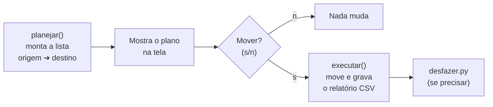

# 05 — Projeto do módulo: organizador de pastas com relatório

> **Curso:** Automação com Python  
> **Módulo:** 01 — Arquivos e pastas  
> **Tempo estimado:** 2 h  

---

## 🎯 Objetivos

Ao final desta aula, você terá:

- Um **organizador de pastas** que separa os arquivos por tipo (Documentos, Imagens, Áudios e vídeos...).
- Um **plano** mostrado antes de mexer em qualquer coisa, com confirmação.
- Um **relatório CSV** de tudo o que foi movido, que abre no Excel.
- Um script **desfazer**, que devolve tudo ao lugar a partir do relatório.

## Pré-requisitos

- Aulas [01](01_o_que_vale_automatizar.md) a [04](04_renomear_fotos_pela_data.md) deste módulo.
- A pasta `treino` original (apague e rode o `criar_treino.py` de novo, se precisar).

---

## Como o organizador funciona



Repare na separação: **planejar** não mexe em nada; **executar** só faz o que foi planejado. É a mesma ideia do `SIMULAR`, agora com uma pergunta no terminal.

## O organizador

```python title="organizar.py"
"""Organizador de pastas: separa os arquivos por tipo e grava um relatório do que mudou."""
import csv
import shutil
from datetime import datetime
from pathlib import Path

PASTA = Path("treino") / "Downloads"
CATEGORIAS = {
    "Documentos": {".pdf", ".docx", ".doc", ".odt", ".txt", ".pptx", ".xlsx", ".csv"},
    "Imagens": {".jpg", ".jpeg", ".png", ".gif", ".webp", ".heic"},
    "Audios e videos": {".mp3", ".wav", ".mp4", ".mov", ".mkv"},
    "Compactados": {".zip", ".rar", ".7z"},
    "Instaladores": {".exe", ".msi"},
}
OUTROS = "Outros"


def categoria(arquivo: Path) -> str:
    extensao = arquivo.suffix.lower()
    for nome, extensoes in CATEGORIAS.items():
        if extensao in extensoes:
            return nome
    return OUTROS


def destino_livre(caminho: Path, ocupados: set[Path]) -> Path:
    candidato, n = caminho, 2
    while candidato.exists() or candidato in ocupados:
        candidato = caminho.with_name(f"{caminho.stem} ({n}){caminho.suffix}")
        n += 1
    return candidato


def planejar(pasta: Path) -> list[tuple[Path, Path]]:
    """Lista de (origem, destino) sem mexer em nada."""
    plano, ocupados = [], set()
    for arquivo in sorted(pasta.iterdir()):
        if not arquivo.is_file() or arquivo.name.startswith("relatorio_"):
            continue
        destino = destino_livre(pasta / categoria(arquivo) / arquivo.name, ocupados)
        ocupados.add(destino)
        plano.append((arquivo, destino))
    return plano


def executar(plano: list[tuple[Path, Path]], pasta: Path) -> Path:
    relatorio = pasta / f"relatorio_{datetime.now():%Y-%m-%d_%H%M%S}.csv"
    with open(relatorio, "w", newline="", encoding="utf-8-sig") as arq:
        escritor = csv.writer(arq, delimiter=";")
        escritor.writerow(["origem", "destino"])
        for origem, destino in plano:
            destino.parent.mkdir(exist_ok=True)
            shutil.move(origem, destino)
            escritor.writerow([origem.resolve(), destino.resolve()])
    return relatorio


def main() -> None:
    plano = planejar(PASTA)
    if not plano:
        print("Nada para organizar.")
        return
    for origem, destino in plano:
        print(f"{origem.name:32} -> {destino.parent.name}/{destino.name}")
    resposta = input(f"\nMover {len(plano)} arquivos? (s/n) ").strip().lower()
    if resposta != "s":
        print("Nada foi movido.")
        return
    relatorio = executar(plano, PASTA)
    print(f"Pronto! O relatório está em: {relatorio}")


if __name__ == "__main__":
    main()
```

```text
> python organizar.py
anotacoes.txt                    -> Documentos/anotacoes.txt
apresentacao_ciencias.pptx       -> Documentos/apresentacao_ciencias.pptx
boletim_2026_1bim.pdf            -> Documentos/boletim_2026_1bim.pdf
...
sem_extensao                     -> Outros/sem_extensao
video_formatura.mp4              -> Audios e videos/video_formatura.mp4

Mover 16 arquivos? (s/n) s
Pronto! O relatório está em: treino\Downloads\relatorio_2026-11-08_135834.csv
```

Rodando de novo: `Nada para organizar.` (os arquivos já estão nas subpastas, e o `iterdir()` só olha os arquivos soltos).

### Decisões do projeto

| Decisão | Por quê |
|---|---|
| **Dicionário `CATEGORIAS`** com conjuntos de extensões | Para mudar as regras, você mexe só no dicionário, não no resto do código. |
| **`OUTROS`** para o que não se encaixa | Nenhum arquivo fica sem destino, nem os sem extensão. |
| **Pular os `relatorio_*`** | O organizador não "organiza" os próprios relatórios. |
| **`ocupados` no `destino_livre()`** | Dois arquivos com o mesmo nome no plano não disputam o mesmo destino (a lição da [aula 04](04_renomear_fotos_pela_data.md#a-primeira-versao-e-o-que-o-teste-mostrou)). |
| **`input()` para confirmar** | Só move depois de você ler o plano e digitar `s`. |
| **Relatório com `;` e `utf-8-sig`** | O Excel em português abre o CSV direto, separando as colunas pelo `;` e mostrando os acentos certos (o `-sig` grava a marca que o Excel procura). |
| **Caminhos completos (`resolve()`) no relatório** | O `desfazer.py` funciona de qualquer pasta. |

!!! tip "Testado com nome repetido"
    Antes de rodar, uma `Documentos/anotacoes.txt` "antiga" foi colocada na pasta de treino. O organizador planejou `Documentos/anotacoes (2).txt` para o arquivo novo, e o antigo ficou intacto. Faça esse teste também.

## O desfazer

```python title="desfazer.py"
"""Desfaz uma organização, usando o relatório gravado pelo organizar.py."""
import csv
import shutil
import sys
from pathlib import Path


def desfazer(relatorio: Path) -> None:
    with open(relatorio, newline="", encoding="utf-8-sig") as arq:
        linhas = list(csv.DictReader(arq, delimiter=";"))
    voltaram = 0
    for linha in reversed(linhas):
        origem, destino = Path(linha["origem"]), Path(linha["destino"])
        if not destino.exists():
            print(f"não encontrado (pulei): {destino}")
            continue
        if origem.exists():
            print(f"já existe outro arquivo no lugar (pulei): {origem}")
            continue
        shutil.move(destino, origem)
        voltaram += 1
    # Apaga as pastas de categoria que ficaram vazias
    for pasta in {Path(l["destino"]).parent for l in linhas}:
        if pasta.exists() and not any(pasta.iterdir()):
            pasta.rmdir()
    print(f"{voltaram} arquivos voltaram para o lugar.")


if __name__ == "__main__":
    if len(sys.argv) != 2:
        print("Uso: python desfazer.py caminho/do/relatorio.csv")
    else:
        desfazer(Path(sys.argv[1]))
```

```text
> python desfazer.py treino\Downloads\relatorio_2026-11-08_135834.csv
16 arquivos voltaram para o lugar.
```

- **`sys.argv`** é a lista do que foi digitado no terminal: `sys.argv[0]` é o nome do script e `sys.argv[1]`, o caminho do relatório. Dica: no terminal do VS Code, você pode **arrastar** o arquivo CSV para dentro do terminal para colar o caminho.
- **`reversed(linhas)`**: desfaz na ordem contrária à que foi feita.
- O desfazer **não sobrescreve** nada: se aparecer outro arquivo no lugar original, ele pula e avisa.
- **`rmdir()`** só apaga pasta **vazia** (se tiver qualquer arquivo, dá erro). Por isso a conferência `not any(pasta.iterdir())` vem antes. É a única "remoção" do módulo, e só de pastas vazias criadas pelo próprio organizador.

---

## Usando na sua pasta de verdade

Depois de testar bastante na `treino`:

1. Faça uma **cópia** da sua pasta Downloads (ou de outra pasta bagunçada) e mude a constante `PASTA` para a cópia: `PASTA = Path(r"C:\Users\SeuUsuario\Downloads - copia")`.
2. Rode, leia o plano com calma e só então digite `s`.
3. Confira o resultado. Se não gostou, use o `desfazer.py`.
4. Só quando estiver confiante, aponte para a pasta original.

!!! info "O `r` antes das aspas"
    `r"C:\Users\..."` é um texto **cru** (*raw*): as barras invertidas valem como barras, e não como códigos especiais. Use sempre que for colar um caminho do Windows.

---

## ⚠️ Erros comuns

- **Mudar `PASTA` direto para a Downloads de verdade** no primeiro teste.
- **Digitar `s` sem ler o plano.**
- **Apagar o relatório** e depois querer desfazer: guarde os relatórios até ter certeza.
- **Abrir o relatório no Excel e salvar por cima** em outro formato: o `desfazer.py` precisa do CSV original. Se quiser mexer, salve uma cópia.
- **`KeyError: 'origem'`** no desfazer: o arquivo informado não é um relatório do organizador.

---

## Exercícios

### Básico (fixação)

Crie uma categoria **"Planilhas"** (com `.xlsx`, `.xls`, `.ods` e `.csv`) separada de Documentos. Atenção: o mesmo tipo não pode estar em duas categorias.

<!-- gabarito -->
??? success "Gabarito — Básico"
    ```python
    CATEGORIAS = {
        "Documentos": {".pdf", ".docx", ".doc", ".odt", ".txt", ".pptx"},
        "Planilhas": {".xlsx", ".xls", ".ods", ".csv"},
        "Imagens": {".jpg", ".jpeg", ".png", ".gif", ".webp", ".heic"},
        "Audios e videos": {".mp3", ".wav", ".mp4", ".mov", ".mkv"},
        "Compactados": {".zip", ".rar", ".7z"},
        "Instaladores": {".exe", ".msi"},
    }
    ```

    `.xlsx` e `.csv` **saíram** de Documentos. Se ficassem nas duas, valeria a primeira categoria encontrada no `for` da função `categoria()`, e Planilhas nunca seria usada. Na pasta de treino, `planilha_gastos.xlsx` vai para `Planilhas/`.

### Intermediário (aplicação)

Escreva um script `resumo_relatorio.py` que leia um relatório do organizador e mostre **quantos arquivos foram para cada categoria**. Para testar, ele pode receber o caminho do relatório pelo `sys.argv` ou procurar o relatório mais recente na `treino/Downloads`.

<!-- gabarito -->
??? success "Gabarito — Intermediário"
    ```python
    import csv
    from collections import Counter
    from pathlib import Path

    relatorios = sorted(Path("treino", "Downloads").glob("relatorio_*.csv"))
    if not relatorios:
        print("Nenhum relatório encontrado.")
    else:
        mais_recente = relatorios[-1]
        with open(mais_recente, newline="", encoding="utf-8-sig") as arq:
            linhas = list(csv.DictReader(arq, delimiter=";"))
        categorias = Counter(Path(l["destino"]).parent.name for l in linhas)
        print(f"Relatório: {mais_recente.name}")
        for nome, quantidade in categorias.most_common():
            print(f"  {nome:16} {quantidade}")
    ```

    Como o nome do relatório começa com a data no formato `AAAA-MM-DD_HHMMSS`, o `sorted()` deixa o mais recente por último (`[-1]`). Na pasta de treino: Documentos 8, Imagens 3, Audios e videos 2, e um em cada uma das outras.

### Avançado (desafio)

Acrescente ao organizador a opção de **ignorar arquivos modificados nos últimos 7 dias** (que provavelmente ainda estão em uso). Eles devem aparecer no plano como `(recente, fica)` e não ser movidos.

<!-- gabarito -->
??? success "Gabarito — Avançado"
    Basta mudar o `planejar()` (e acrescentar o import de `timedelta`): os arquivos recentes não entram no plano, e a função devolve também a lista deles para o `main()` mostrar.

    ```python
    import shutil
    from datetime import datetime, timedelta
    from pathlib import Path

    PASTA = Path("treino") / "Downloads"
    DIAS_RECENTES = 7


    def recente(arquivo: Path) -> bool:
        modificado = datetime.fromtimestamp(arquivo.stat().st_mtime)
        return datetime.now() - modificado < timedelta(days=DIAS_RECENTES)


    def planejar(pasta: Path) -> tuple[list[tuple[Path, Path]], list[Path]]:
        plano, recentes = [], []
        for arquivo in sorted(pasta.iterdir()):
            if not arquivo.is_file() or arquivo.name.startswith("relatorio_"):
                continue
            if recente(arquivo):
                recentes.append(arquivo)
                continue
            plano.append((arquivo, pasta / "Organizados" / arquivo.name))
        return plano, recentes


    plano, recentes = planejar(PASTA)
    for arquivo in recentes:
        print(f"{arquivo.name:32} (recente, fica)")
    print(f"{len(plano)} arquivos seriam organizados; {len(recentes)} ficam.")
    ```

    Esta versão é uma demonstração reduzida (o destino é uma pasta só, para focar na regra nova); no organizador completo, troque só o `planejar()` e ajuste o `main()` para receber as duas listas. Na pasta de treino, os arquivos de `Downloads` acabaram de ser criados, então **todos** são recentes: crie a pasta de treino e espere, ou mude a data de alguns com `os.utime` (como no `criar_treino.py`) para testar.

---

## 💡 Resumo

- **Planejar** (sem mexer) ➔ **mostrar** ➔ **confirmar** ➔ **executar** ➔ **relatório**: o roteiro de toda automação segura.
- Regras num **dicionário** fácil de mudar; **`OUTROS`** para o que sobrar.
- Relatório **CSV com `;` e `utf-8-sig`** abre no Excel e permite **desfazer**.
- Primeiro na `treino`, depois numa **cópia** da pasta real, por último na original.

## ➡️ Próximo passo

**Módulo 02 — Planilhas** *(em produção)*: ler e escrever Excel com `openpyxl` e transformar a planilha de notas da turma em boletim.
