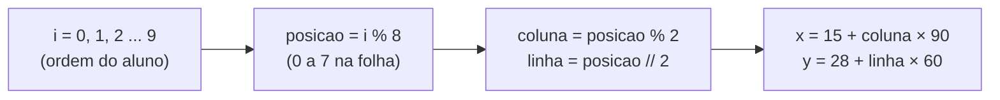

# 04 — Certificados e crachás em lote

> **Curso:** Automação com Python  
> **Módulo:** 03 — Documentos e PDFs  
> **Tempo estimado:** 1 h 30 min  

---

## 🎯 Objetivos

Ao final desta aula, você será capaz de:

- Gerar **um PDF por pessoa** e, ao mesmo tempo, **um PDF com todos** (para imprimir de uma vez).
- Criar **nomes de arquivo seguros** a partir de nomes com acento e espaço.
- Montar uma **folha de crachás** (8 por página A4) com linhas de corte.
- Entender por que **importar** um arquivo pode executar coisas que você não queria.

## Pré-requisitos

- [Aula 02](02_pdf_com_fpdf2.md): o `certificado.py` com a função `desenhar_certificado()`.

---

## Certificados para a turma toda

```python title="certificados_em_lote.py"
import unicodedata
from datetime import date
from pathlib import Path

from fpdf import FPDF
from openpyxl import load_workbook

from certificado import desenhar_certificado

PASTA = Path("treino_docs")
SAIDA = PASTA / "saida" / "certificados"


def nome_de_arquivo(texto: str) -> str:
    """'João Pedro Melo' -> 'joao_pedro_melo' (sem acentos, espaços nem símbolos)."""
    sem_acento = unicodedata.normalize("NFKD", texto).encode("ascii", "ignore").decode()
    return "".join(c if c.isalnum() else "_" for c in sem_acento.lower()).strip("_")


def main() -> None:
    livro = load_workbook(PASTA / "participantes.xlsx")
    curso = {chave: valor for chave, valor in livro["Curso"].iter_rows(values_only=True)}
    participantes = list(livro["Participantes"].iter_rows(min_row=2, values_only=True))
    SAIDA.mkdir(parents=True, exist_ok=True)

    todos = FPDF(orientation="landscape", format="A4")  # um PDF com todos, para imprimir de uma vez
    todos.set_auto_page_break(False)
    for nome, matricula, frequencia in participantes:
        um = FPDF(orientation="landscape", format="A4")  # um PDF por pessoa, para enviar
        um.set_auto_page_break(False)
        for pdf in (um, todos):
            desenhar_certificado(pdf, nome, curso["Curso"], curso["Carga horária"], date.today())
        destino = SAIDA / f"certificado_{nome_de_arquivo(nome)}.pdf"
        um.output(destino)
        print(f"{nome:18} -> {destino.name}")
    todos.output(SAIDA / "todos_os_certificados.pdf")
    print(f"\n{len(participantes)} certificados + todos_os_certificados.pdf ({todos.pages_count} páginas)")


if __name__ == "__main__":
    main()
```

```text
Ana Souza          -> certificado_ana_souza.pdf
Bruno Lima         -> certificado_bruno_lima.pdf
...
João Pedro Melo    -> certificado_joao_pedro_melo.pdf

10 certificados + todos_os_certificados.pdf (10 páginas)
```

- **Dois PDFs ao mesmo tempo:** `um` (só daquela pessoa, para enviar) e `todos` (uma página por pessoa, para imprimir). O `for pdf in (um, todos):` desenha a mesma página nos dois.
- **`desenhar_certificado()` vem do `certificado.py`** (aula 02) por `import`. Uma mudança no desenho vale para os dois scripts.
- **`pages_count`** conta as páginas do PDF.

!!! note "Este script ainda não confere a frequência"
    Ele gera certificado para **todos** da planilha, inclusive quem tem 40% de frequência. Está certo para treinar o "em lote"; o projeto do módulo ([aula 05](05_projeto_emissao.md)) aplica a regra dos 75%.

## Nomes de arquivo seguros

`João Pedro Melo` vira `joao_pedro_melo`. Por quê?

- **Acentos** em nomes de arquivo funcionam no Windows, mas podem virar caracteres estranhos ao passar por e-mail, `.zip` ou outros sistemas.
- **Espaços** atrapalham no terminal (é preciso pôr aspas).
- **Símbolos** como `/`, `:` e `?` são **proibidos** em nomes de arquivo (`Maria D'Ávila` tem um apóstrofo; `Turma 1/A` tem uma barra).

A função `nome_de_arquivo()` resolve em três passos: `unicodedata.normalize("NFKD", ...)` separa as letras dos acentos (`ã` vira `a` + `~`), o `.encode("ascii", "ignore")` joga fora tudo o que não é letra simples, e o `for` troca o que não é letra ou número por `_`.

## A folha de crachás

```python title="crachas.py"
from pathlib import Path

from fpdf import FPDF
from openpyxl import load_workbook

PASTA = Path("treino_docs")
LARGURA, ALTURA = 90, 60          # tamanho de cada crachá, em milímetros
COLUNAS, LINHAS = 2, 4            # 8 crachás por folha A4
MARGEM_X, MARGEM_Y = 15, 28       # sobra da folha, dividida entre os lados
ROXO = (79, 53, 181)

livro = load_workbook(PASTA / "participantes.xlsx")
curso = livro["Curso"]["B1"].value
nomes = [nome for nome, *_ in livro["Participantes"].iter_rows(min_row=2, values_only=True)]

pdf = FPDF(format="A4")
pdf.set_auto_page_break(False)
for i, nome in enumerate(nomes):
    posicao = i % (COLUNAS * LINHAS)
    if posicao == 0:
        pdf.add_page()
    x = MARGEM_X + (posicao % COLUNAS) * LARGURA
    y = MARGEM_Y + (posicao // COLUNAS) * ALTURA
    # Linha de corte tracejada
    pdf.set_draw_color(170, 170, 170)
    pdf.set_dash_pattern(dash=2, gap=2)
    pdf.rect(x, y, LARGURA, ALTURA)
    pdf.set_dash_pattern()
    # Faixa colorida no alto
    pdf.set_fill_color(*ROXO)
    pdf.rect(x + 4, y + 4, LARGURA - 8, 10, style="F")
    pdf.set_xy(x + 4, y + 4)
    pdf.set_font("Helvetica", "B", 10)
    pdf.set_text_color(255, 255, 255)
    pdf.cell(LARGURA - 8, 10, "PARTICIPANTE", align="C")
    # Nome (letra menor se o nome for comprido)
    pdf.set_text_color(20, 20, 20)
    tamanho = 20 if len(nome) <= 16 else 16
    pdf.set_font("Helvetica", "B", tamanho)
    pdf.set_xy(x + 4, y + 24)
    pdf.cell(LARGURA - 8, 12, nome, align="C")
    pdf.set_font("Helvetica", "", 8)
    pdf.set_xy(x + 4, y + ALTURA - 14)
    pdf.cell(LARGURA - 8, 6, curso, align="C")

destino = PASTA / "saida" / "crachas.pdf"
destino.parent.mkdir(exist_ok=True)
pdf.output(destino)
print(f"{len(nomes)} crachás em {pdf.pages_count} folha(s): {destino}")
```

```text
10 crachás em 2 folha(s): treino_docs\saida\crachas.pdf
```

A conta da posição de cada crachá:



- **`%`** (resto da divisão) faz a posição voltar a 0 a cada 8 crachás: é aí que entra uma **página nova**.
- **`//`** (divisão inteira) dá a linha: posições 0 e 1 na linha 0, 2 e 3 na linha 1...
- **Margens:** 2 × 90 = 180 mm de crachás numa folha de 210 mm sobram 30 mm, divididos em 15 de cada lado. 4 × 60 = 240 mm numa altura de 297 sobram 57 mm, por isso o `MARGEM_Y = 28`.
- **Tracejado:** `set_dash_pattern(dash=2, gap=2)` desenha a linha de corte; `set_dash_pattern()` sem nada volta à linha contínua.
- **Nome comprido** ganha letra menor (16 em vez de 20), para caber na largura do crachá.

!!! tip "Imprima em 100%"
    Na hora de imprimir o PDF, escolha **Tamanho real** / **100%** (e não "Ajustar à página"): assim o crachá sai com 9 × 6 cm de verdade e cabe no porta-crachá.

## Importar executa o arquivo (o bug que o teste achou)

Na primeira versão deste módulo, o `certificados_em_lote.py` tinha o código **solto** no arquivo, sem `main()`. No projeto (aula 05), ao fazer `from certificados_em_lote import nome_de_arquivo` só para usar a função, o Python **executou o arquivo inteiro** e gerou, sem ninguém pedir, os 10 certificados desta aula de novo, numa pasta que o projeto nem usa.

É assim que o `import` funciona: na primeira vez, ele **roda** o arquivo de cima a baixo. Definições de funções só "guardam" a função; mas código solto (ler a planilha, gerar PDFs) é **executado**. Por isso todos os scripts deste módulo usam:

```python
def main() -> None:
    ...  # o trabalho do script


if __name__ == "__main__":
    main()
```

`__name__` vale `"__main__"` quando você roda o arquivo direto (`python certificados_em_lote.py`), e vale `"certificados_em_lote"` quando ele é importado. O `main()` só roda no primeiro caso.

---

## ⚠️ Erros comuns

- **Código solto em arquivos que outros importam**: efeitos colaterais inesperados (veja acima).
- **`OSError: [Errno 22] Invalid argument`** ao salvar: há caractere proibido no nome do arquivo. Use `nome_de_arquivo()`.
- **Dois alunos com o mesmo nome** geram o **mesmo arquivo**, e o segundo substitui o primeiro. No projeto, o nome do arquivo poderia incluir a matrícula para evitar isso (veja o desafio da aula 05).
- **Crachá cortado na impressão**: imprimir com "Ajustar à página".
- **Nome que não cabe no crachá**: diminua a fonte para nomes longos ou use `multi_cell` com duas linhas.

---

## Exercícios

### Básico (fixação)

Teste a `nome_de_arquivo()` com estes nomes e anote o resultado: `"Maria D'Ávila"`, `"José da Conceição"`, `"  Ana  Souza  "`, `"Turma 1/A"`.

<!-- gabarito -->
??? success "Gabarito — Básico"
    ```python
    from certificados_em_lote import nome_de_arquivo

    resultados = {nome: nome_de_arquivo(nome) for nome in
                  ["Maria D'Ávila", "José da Conceição", "  Ana  Souza  ", "Turma 1/A"]}
    for nome, arquivo in resultados.items():
        print(f"{nome!r:22} -> {arquivo}")
    ```

    Resultados: `maria_d_avila`, `jose_da_conceicao`, `ana__souza` e `turma_1_a`. Repare no `ana__souza` com **dois** `_` (eram dois espaços): funciona, mas não fica bonito. Para juntar sublinhados repetidos, dá para usar `re.sub(r"_+", "_", texto)`.

### Intermediário (aplicação)

Faça uma versão dos crachás com a palavra **VISITANTE** na faixa (em vez de PARTICIPANTE) e a faixa na cor **teal** `(0, 121, 107)`, para 3 nomes inventados digitados numa lista no próprio script.

<!-- gabarito -->
??? success "Gabarito — Intermediário"
    ```python
    from pathlib import Path

    from fpdf import FPDF

    NOMES = ["Rosa Andrade", "Paulo Vieira", "Lúcia Tavares"]
    LARGURA, ALTURA, COLUNAS = 90, 60, 2
    TEAL = (0, 121, 107)

    pdf = FPDF(format="A4")
    pdf.set_auto_page_break(False)
    pdf.add_page()
    for i, nome in enumerate(NOMES):
        x = 15 + (i % COLUNAS) * LARGURA
        y = 28 + (i // COLUNAS) * ALTURA
        pdf.set_draw_color(170, 170, 170)
        pdf.rect(x, y, LARGURA, ALTURA)
        pdf.set_fill_color(*TEAL)
        pdf.rect(x + 4, y + 4, LARGURA - 8, 10, style="F")
        pdf.set_xy(x + 4, y + 4)
        pdf.set_font("Helvetica", "B", 10)
        pdf.set_text_color(255, 255, 255)
        pdf.cell(LARGURA - 8, 10, "VISITANTE", align="C")
        pdf.set_text_color(20, 20, 20)
        pdf.set_font("Helvetica", "B", 20)
        pdf.set_xy(x + 4, y + 24)
        pdf.cell(LARGURA - 8, 12, nome, align="C")

    destino = Path("treino_docs") / "saida" / "crachas_visitantes.pdf"
    destino.parent.mkdir(exist_ok=True)
    pdf.output(destino)
    ```

    Com só 3 nomes, uma página basta (por isso o `add_page()` fica fora do `for`). Para listas maiores, volte ao `if posicao == 0: pdf.add_page()` do script da aula.

### Avançado (desafio)

Altere o `certificados_em_lote.py` (numa cópia) para gerar certificado **só** para quem tem frequência de **75% ou mais** e mostrar, no fim, quem ficou de fora.

<!-- gabarito -->
??? success "Gabarito — Avançado"
    ```python
    from datetime import date
    from pathlib import Path

    from fpdf import FPDF
    from openpyxl import load_workbook

    from certificado import desenhar_certificado
    from certificados_em_lote import nome_de_arquivo

    PASTA = Path("treino_docs")
    SAIDA = PASTA / "saida" / "certificados_75"

    livro = load_workbook(PASTA / "participantes.xlsx")
    curso = {chave: valor for chave, valor in livro["Curso"].iter_rows(values_only=True)}
    SAIDA.mkdir(parents=True, exist_ok=True)

    emitidos, de_fora = [], []
    for nome, matricula, frequencia in livro["Participantes"].iter_rows(min_row=2, values_only=True):
        if frequencia < 75:
            de_fora.append(f"{nome} ({frequencia}%)")
            continue
        pdf = FPDF(orientation="landscape", format="A4")
        pdf.set_auto_page_break(False)
        desenhar_certificado(pdf, nome, curso["Curso"], curso["Carga horária"], date.today())
        pdf.output(SAIDA / f"certificado_{nome_de_arquivo(nome)}.pdf")
        emitidos.append(nome)

    print(f"{len(emitidos)} certificados emitidos.")
    print("Ficaram de fora:", ", ".join(de_fora))
    ```

    Saem **7** certificados. Ficam de fora Diego (60%), Gabriela (40%) e João Pedro (70%). O **Felipe**, com exatamente **75%**, recebe: a regra é "75% ou mais", por isso o teste é `< 75` para ficar de fora.

---

## 💡 Resumo

- Desenhe a mesma página em **dois PDFs** (um por pessoa e um com todos) com `for pdf in (um, todos)`.
- **`nome_de_arquivo()`**: sem acentos, espaços nem símbolos, com `unicodedata.normalize("NFKD")`.
- Crachás em grade: **`%`** para a posição na folha e a página nova, **`//`** para a linha.
- `import` **executa** o arquivo: deixe o trabalho dentro de `main()` com `if __name__ == "__main__":`.

## ➡️ Próximo passo

**[05 — Projeto do módulo: emissão de certificados e declarações](05_projeto_emissao.md)**.
