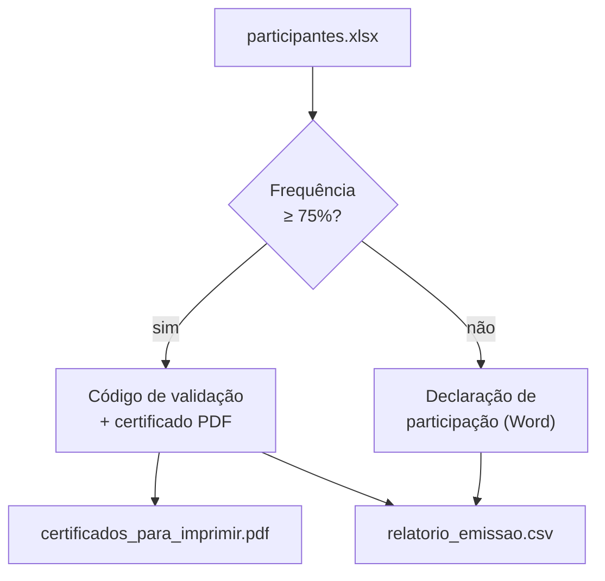

# 05 — Projeto do módulo: emissão de certificados e declarações

> **Curso:** Automação com Python  
> **Módulo:** 03 — Documentos e PDFs  
> **Tempo estimado:** 2 h  

---

## 🎯 Objetivos

Ao final desta aula, você terá um script que, a partir da planilha de participantes:

- Emite **certificado em PDF** para quem tem frequência de **75% ou mais**, com um **código de validação**.
- Emite **declaração de participação** em Word (para a secretaria conferir e assinar) para quem ficou abaixo.
- Gera um **PDF único** com os certificados, para imprimir.
- Grava um **relatório** CSV com o que foi emitido para cada pessoa e os códigos.

## Pré-requisitos

- Aulas [01](01_documentos_word.md) a [04](04_certificados_e_crachas.md) deste módulo, com os arquivos `certificado.py`, `certificados_em_lote.py` e `preencher_declaracoes.py` **na mesma pasta**.

---

## O que o script faz



## O código de validação

Um certificado impresso pode ser falsificado. Um jeito simples de permitir a conferência é imprimir um **código** que a escola guarda no relatório: quem recebe o certificado (uma empresa, outra escola) pode perguntar "o código F0907-66A16 é da Ana Souza?".

O código sai de um **resumo criptográfico** (*hash*) SHA-256 da matrícula, do curso e da data de término:

```python
import hashlib

resumo = hashlib.sha256("2026001|Oficina de Canva para Pequenos Negócios|30/09/2026".encode()).hexdigest().upper()
print(f"{resumo[:5]}-{resumo[5:10]}")   # F0907-66A16
```

- O **mesmo** aluno no **mesmo** curso gera **sempre o mesmo** código: emitir de novo não "inventa" outro.
- Mudar uma única letra da entrada muda o código inteiro, e não dá para descobrir a matrícula a partir do código.
- Dez caracteres hexadecimais dão mais de um trilhão de combinações: para uma escola, colisão (dois alunos com o mesmo código) é praticamente impossível. Mesmo assim, o desafio desta aula confere.

!!! info "Validação de verdade"
    Sistemas oficiais usam assinatura digital (por exemplo, o assinador do gov.br). O código daqui é uma conferência simples, adequada a cursos livres e oficinas. Não use para documentos que exigem validade jurídica.

## O script

```python title="emitir_certificados.py"
"""Emite os documentos de um curso: certificado (frequência >= 75%) ou declaração de participação."""
import csv
import hashlib
from datetime import date
from pathlib import Path

from docx import Document
from fpdf import FPDF
from openpyxl import load_workbook

from certificado import desenhar_certificado
from certificados_em_lote import nome_de_arquivo
from preencher_declaracoes import data_por_extenso, substituir

PASTA = Path("treino_docs")
SAIDA = PASTA / "saida" / "emissao"
FREQUENCIA_MINIMA = 75  # %


def codigo_de_validacao(matricula: int, curso: str, fim: str) -> str:
    """Código curto e sempre igual para a mesma pessoa e o mesmo curso, ex.: 'A1B2C-3D4E5'."""
    resumo = hashlib.sha256(f"{matricula}|{curso}|{fim}".encode()).hexdigest().upper()
    return f"{resumo[:5]}-{resumo[5:10]}"


def emitir_certificado(pasta: Path, nome: str, codigo: str, curso: dict, todos: FPDF) -> Path:
    um = FPDF(orientation="landscape", format="A4")
    um.set_auto_page_break(False)
    for pdf in (um, todos):
        desenhar_certificado(pdf, nome, curso["Curso"], curso["Carga horária"], date.today())
        pdf.set_xy(14, 186)
        pdf.set_font("Helvetica", "", 9)
        pdf.set_text_color(110, 110, 110)
        pdf.cell(269, 6, f"Código de validação: {codigo}", align="C")
    destino = pasta / f"certificado_{nome_de_arquivo(nome)}.pdf"
    um.output(destino)
    return destino


def emitir_declaracao(pasta: Path, nome: str, matricula: int, frequencia: int, curso: dict) -> Path:
    doc = Document(PASTA / "modelo_declaracao.docx")
    substituir(doc, {
        "nome": nome, "matricula": matricula, "frequencia": frequencia,
        "curso": curso["Curso"], "inicio": curso["Início"], "fim": curso["Fim"],
        "carga": curso["Carga horária"], "responsavel": curso["Responsável"],
        "data": data_por_extenso(date.today()),
    })
    destino = pasta / f"declaracao_{nome_de_arquivo(nome)}.docx"
    doc.save(destino)
    return destino


def main() -> None:
    livro = load_workbook(PASTA / "participantes.xlsx")
    curso = {chave: valor for chave, valor in livro["Curso"].iter_rows(values_only=True)}
    participantes = list(livro["Participantes"].iter_rows(min_row=2, values_only=True))
    SAIDA.mkdir(parents=True, exist_ok=True)

    todos = FPDF(orientation="landscape", format="A4")
    todos.set_auto_page_break(False)
    relatorio = []
    for nome, matricula, frequencia in participantes:
        if frequencia >= FREQUENCIA_MINIMA:
            codigo = codigo_de_validacao(matricula, curso["Curso"], curso["Fim"])
            arquivo = emitir_certificado(SAIDA, nome, codigo, curso, todos)
            relatorio.append([nome, matricula, frequencia, "Certificado", codigo, arquivo.name])
        else:
            arquivo = emitir_declaracao(SAIDA, nome, matricula, frequencia, curso)
            relatorio.append([nome, matricula, frequencia, "Declaração", "", arquivo.name])
        print(f"{nome:18} {frequencia:3}%  {relatorio[-1][3]:12} {arquivo.name}")

    todos.output(SAIDA / "certificados_para_imprimir.pdf")
    with open(SAIDA / "relatorio_emissao.csv", "w", newline="", encoding="utf-8-sig") as arq:
        escritor = csv.writer(arq, delimiter=";")
        escritor.writerow(["Nome", "Matrícula", "Frequência (%)", "Documento", "Código", "Arquivo"])
        escritor.writerows(relatorio)

    certificados = sum(1 for linha in relatorio if linha[3] == "Certificado")
    print(f"\n{certificados} certificados e {len(relatorio) - certificados} declarações em {SAIDA}")


if __name__ == "__main__":
    main()
```

## Rodando

```text
> python emitir_certificados.py
Ana Souza          100%  Certificado  certificado_ana_souza.pdf
Bruno Lima          85%  Certificado  certificado_bruno_lima.pdf
Carla Mendes        95%  Certificado  certificado_carla_mendes.pdf
Diego Rocha         60%  Declaração   declaracao_diego_rocha.docx
Elisa Prado         90%  Certificado  certificado_elisa_prado.pdf
Felipe Torres       75%  Certificado  certificado_felipe_torres.pdf
Gabriela Nunes      40%  Declaração   declaracao_gabriela_nunes.docx
Heitor Alves       100%  Certificado  certificado_heitor_alves.pdf
Isabela Costa       80%  Certificado  certificado_isabela_costa.pdf
João Pedro Melo     70%  Declaração   declaracao_joao_pedro_melo.docx

7 certificados e 3 declarações em treino_docs\saida\emissao
```

E o começo do relatório (abre no Excel):

```text
Nome;Matrícula;Frequência (%);Documento;Código;Arquivo
Ana Souza;2026001;100;Certificado;F0907-66A16;certificado_ana_souza.pdf
Bruno Lima;2026002;85;Certificado;CC19B-3340B;certificado_bruno_lima.pdf
Carla Mendes;2026003;95;Certificado;3065D-669AE;certificado_carla_mendes.pdf
```

O certificado sai igual ao da aula 02, com a linha **"Código de validação: F0907-66A16"** discreta, em cinza, no pé da página.

### Reaproveitando o que já existia

O projeto quase não tem código novo: ele **importa** o desenho do certificado (aula 02), o nome de arquivo seguro (aula 04) e o preenchimento do modelo do Word (aula 01). Isso só funciona porque cada um desses arquivos tem o trabalho dentro de `main()` ([aula 04](04_certificados_e_crachas.md#importar-executa-o-arquivo-o-bug-que-o-teste-achou)).

| Função | Vem de |
|---|---|
| `desenhar_certificado()` | `certificado.py` (aula 02) |
| `nome_de_arquivo()` | `certificados_em_lote.py` (aula 04) |
| `substituir()`, `data_por_extenso()` | `preencher_declaracoes.py` (aula 01) |
| `codigo_de_validacao()`, `emitir_certificado()`, `emitir_declaracao()` | Novas, neste arquivo |

---

## ⚠️ Erros comuns

- **`ModuleNotFoundError: No module named 'certificado'`**: os arquivos das aulas anteriores não estão na mesma pasta do `emitir_certificados.py`.
- **Certificados a mais numa pasta estranha**: um dos arquivos importados está sem `main()`.
- **Mudar a data de término do curso depois de emitir**: os códigos mudam. Emita com os dados finais.
- **Mandar a declaração em Word para o aluno** sem a secretaria conferir e assinar: ela foi feita em Word justamente para ser revisada.
- **Esquecer de guardar o relatório**: sem ele, não há como conferir os códigos depois.

---

## Exercícios

### Básico (fixação)

A coordenação mudou a frequência mínima para **80%**. Mude o script e diga quem deixa de receber certificado.

<!-- gabarito -->
??? success "Gabarito — Básico"
    Basta mudar a constante:

    ```python
    FREQUENCIA_MINIMA = 80  # %
    ```

    Deixa de receber o **Felipe Torres** (75%), que passa a receber a declaração. A **Isabela** (80%) continua recebendo, porque a regra é "80% ou mais" (`>=`). Ficam 6 certificados e 4 declarações.

### Intermediário (aplicação)

Escreva o `validar_codigo.py`: o usuário digita um código e o script procura no `relatorio_emissao.csv`, respondendo `Código válido: Ana Souza, Oficina...` ou `Código não encontrado`. Aceite o código com letras minúsculas e espaços sobrando.

<!-- gabarito -->
??? success "Gabarito — Intermediário"
    ```python
    import csv
    from pathlib import Path

    RELATORIO = Path("treino_docs") / "saida" / "emissao" / "relatorio_emissao.csv"

    with open(RELATORIO, newline="", encoding="utf-8-sig") as arq:
        por_codigo = {linha["Código"]: linha for linha in csv.DictReader(arq, delimiter=";") if linha["Código"]}

    codigo = input("Código de validação: ").strip().upper()
    encontrado = por_codigo.get(codigo)
    if encontrado:
        print(f"Código válido: {encontrado['Nome']}, frequência {encontrado['Frequência (%)']}%")
    else:
        print("Código não encontrado")
    ```

    O dicionário `por_codigo` deixa a busca instantânea, mesmo com milhares de certificados. As declarações têm o código vazio, por isso o `if linha["Código"]` as deixa de fora. Digitando `  f0907-66a16 `, a resposta é *Código válido: Ana Souza, frequência 100%*.

### Avançado (desafio)

Escreva um teste que confira duas garantias do código de validação: (1) **não há dois participantes com o mesmo código**; (2) **rodar de novo dá os mesmos códigos**. Use a função `codigo_de_validacao()` com `import`.

<!-- gabarito -->
??? success "Gabarito — Avançado"
    ```python
    from pathlib import Path

    from openpyxl import load_workbook

    from emitir_certificados import codigo_de_validacao

    livro = load_workbook(Path("treino_docs") / "participantes.xlsx")
    curso = {chave: valor for chave, valor in livro["Curso"].iter_rows(values_only=True)}
    matriculas = [m for _, m, _ in livro["Participantes"].iter_rows(min_row=2, values_only=True)]

    primeira = [codigo_de_validacao(m, curso["Curso"], curso["Fim"]) for m in matriculas]
    segunda = [codigo_de_validacao(m, curso["Curso"], curso["Fim"]) for m in matriculas]

    assert len(set(primeira)) == len(primeira), "há códigos repetidos!"
    assert primeira == segunda, "os códigos mudaram entre uma execução e outra!"
    print(f"{len(primeira)} códigos únicos e estáveis")
    ```

    O `assert` para o programa com a mensagem se a condição for falsa. `len(set(...))` conta os códigos **diferentes**: se for menor que o total, algum se repetiu. Saída: `10 códigos únicos e estáveis`.

---

## 💡 Resumo

- Regra de emissão numa **constante**; certificado em **PDF** (pronto) e declaração em **Word** (para revisar).
- **Código de validação** com `hashlib.sha256`: igual para a mesma pessoa e curso, impossível de "adivinhar".
- **Relatório** CSV com tudo o que foi emitido: é ele que permite conferir os códigos depois.
- O projeto **importa** as funções das aulas anteriores, graças ao `main()` em cada arquivo.

## ➡️ Próximo passo

**[Módulo 04 — E-mail, agendamento e boas práticas](../modulo_04_email_e_agendamento/index.md)**: preparar e-mails com segurança, guardar senhas no `.env`, agendar scripts e registrar o que aconteceu em logs.
