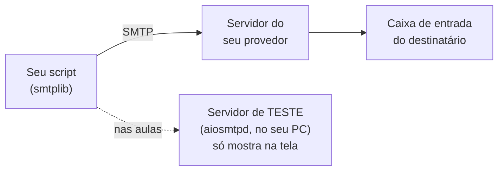

# 02 — Enviando para um servidor de teste

> **Curso:** Automação com Python  
> **Módulo:** 04 — E-mail, agendamento e boas práticas  
> **Tempo estimado:** 1 h  

---

## 🎯 Objetivos

Ao final desta aula, você será capaz de:

- Entender o que é um **servidor SMTP** e o caminho de um e-mail.
- Rodar um **servidor de e-mail de teste** no próprio computador, que mostra as mensagens em vez de entregá-las.
- Enviar e-mails com `smtplib` e tratar o erro de **servidor desligado**.
- Saber o que muda para enviar por um provedor de verdade (Gmail).

## Pré-requisitos

- [Aula 01](01_montar_emails.md): `aiosmtpd` instalado e e-mails montados com `EmailMessage`.

---

## O caminho de um e-mail

Para enviar, o seu programa entrega a mensagem a um **servidor SMTP** (o "correio" do seu provedor), que a leva até a caixa do destinatário.



Nas aulas, trocamos o servidor do provedor por um **servidor de teste** que roda no seu computador: ele recebe o e-mail e **mostra** o conteúdo no terminal, sem entregar a ninguém. O script é o mesmo; só muda o endereço do servidor.

## Ligando o servidor de teste

Abra um **segundo terminal** no VS Code (o ícone **+** do painel do terminal), ative o ambiente virtual e rode:

```powershell
python -m aiosmtpd -n -l localhost:8025
```

O terminal fica "parado", esperando e-mails. Deixe-o aberto. (Para desligar: **Ctrl+C**.)

- `-l localhost:8025` = escutar no **próprio computador** (`localhost`), na **porta 8025**.
- `-n` evita uma configuração de permissões que só existe no Linux.

## Enviando

No **primeiro** terminal:

```python title="enviar_teste.py"
import smtplib
from email.message import EmailMessage

msg = EmailMessage()
msg["From"] = "professor@example.com"
msg["To"] = "ana.souza@example.com"
msg["Subject"] = "Teste do servidor de e-mail falso"
msg.set_content("Se você está lendo isto no outro terminal, o envio funcionou.")

with smtplib.SMTP("localhost", 8025) as servidor:
    servidor.send_message(msg)
print("Mensagem entregue ao servidor de teste.")
```

```text
Mensagem entregue ao servidor de teste.
```

E no terminal do servidor aparece o e-mail inteiro:

```text
---------- MESSAGE FOLLOWS ----------
From: professor@example.com
To: ana.souza@example.com
Subject: Teste do servidor de e-mail falso
Content-Type: text/plain; charset="utf-8"
Content-Transfer-Encoding: 8bit
MIME-Version: 1.0
X-Peer: ('::1', 57281, 0, 0)

Se você está lendo isto no outro terminal, o envio funcionou.
------------ END MESSAGE ------------
```

- `smtplib.SMTP(servidor, porta)` abre a conexão; o `with` fecha no fim, mesmo se der erro.
- `send_message(msg)` envia o `EmailMessage` da aula 01, com anexos e tudo.

## Quando o servidor está desligado

Esqueceu de ligar o servidor (ou a internet caiu, ou o endereço está errado)?

```text
ConnectionRefusedError: [WinError 10061] Nenhuma conexão pôde ser feita porque a máquina de destino as recusou ativamente
```

Um script automático não pode simplesmente quebrar: ele precisa **avisar** o que aconteceu. O projeto ([aula 05](05_projeto_lembrete.md)) trata esse erro e registra uma mensagem clara no log.

```python
import smtplib

try:
    with smtplib.SMTP("localhost", 8025, timeout=30) as servidor:
        servidor.send_message(msg)
except (OSError, smtplib.SMTPException) as erro:
    print(f"Não consegui enviar: {erro}")
```

`OSError` cobre os problemas de **conexão** (servidor desligado, sem internet); `smtplib.SMTPException` cobre as **recusas do servidor** (senha errada, destinatário recusado). O `timeout=30` desiste depois de 30 segundos, em vez de esperar para sempre.

## E para enviar de verdade?

Quando chegar a hora (com autorização, e depois de testar tudo no servidor de teste), o script usa o servidor do seu provedor. No **Gmail**:

| Configuração | Valor |
|---|---|
| Servidor | `smtp.gmail.com` |
| Porta e segurança | `587` com **STARTTLS** (ou `465` com SSL) |
| Usuário | o seu endereço do Gmail |
| Senha | uma **senha de app**, e não a senha da conta |

A **senha de app** é um código de 16 letras, criado na conta Google (endereço `myaccount.google.com/apppasswords`, ou procure **"Senhas de app"** na busca da conta), que só existe para contas com **verificação em duas etapas** ligada (veja o [curso de Segurança digital](../../seguranca_digital/modulo_01_senhas_e_contas/04_verificacao_em_duas_etapas.md)). Ela dá acesso só ao envio pelo programa e pode ser **revogada** a qualquer momento, sem trocar a senha da conta. Sem ela, o Gmail recusa com o erro *534-5.7.9 Application-specific password required*.

```python
with smtplib.SMTP("smtp.gmail.com", 587, timeout=30) as servidor:
    servidor.starttls()                       # liga a criptografia
    servidor.login(usuario, senha_de_app)     # vem do .env (aula 03), nunca escrita no código
    servidor.send_message(msg)
```

!!! warning "Conta da escola ou do trabalho"
    Contas institucionais (Google Workspace, Microsoft 365) costumam ter regras próprias: o administrador pode bloquear senhas de app ou envio por programas. Pergunte ao responsável de TI antes, e nunca use a conta de outra pessoa.

!!! info "Provedores mudam as regras"
    Os dados do Gmail desta tabela foram conferidos em 08/11/2026. Provedores mudam as exigências de segurança de tempos em tempos: em caso de erro de login, consulte a ajuda oficial do provedor.

---

## ⚠️ Erros comuns

- **`ConnectionRefusedError`**: o servidor de teste não está ligado (ou a porta está diferente).
- **O e-mail não aparece no terminal do servidor**: o script está enviando para outra porta, ou o servidor foi iniciado num terminal sem o ambiente virtual (erro `No module named aiosmtpd` logo no começo).
- **`SMTPAuthenticationError` / `534-5.7.9`** (Gmail): está usando a senha da conta, e não a senha de app.
- **Script "travado" para sempre**: faltou `timeout=` no `SMTP(...)`.
- **Testar no Gmail de verdade** antes de testar no servidor local.

---

## Exercícios

### Básico (fixação)

Com o servidor de teste ligado, envie **dois** e-mails diferentes (para `ana.souza@example.com` e `bruno.lima@example.com`) **na mesma conexão**.

<!-- gabarito -->
??? success "Gabarito — Básico"
    ```python
    import smtplib
    from email.message import EmailMessage

    enviados = 0
    with smtplib.SMTP("localhost", 8025, timeout=30) as servidor:
        for nome, email in [("Ana", "ana.souza@example.com"), ("Bruno", "bruno.lima@example.com")]:
            msg = EmailMessage()
            msg["From"] = "professor@example.com"
            msg["To"] = email
            msg["Subject"] = f"Olá, {nome}"
            msg.set_content(f"Teste para {nome}.")
            servidor.send_message(msg)
            enviados += 1
    print(f"{enviados} e-mails enviados")
    ```

    Abrir **uma** conexão e mandar vários é mais rápido do que conectar de novo a cada e-mail. No terminal do servidor aparecem dois blocos `MESSAGE FOLLOWS`.

### Intermediário (aplicação)

Escreva a função `enviar(msg, servidor="localhost", porta=8025) -> bool`, que devolve `True` se conseguiu enviar e `False` (com uma mensagem amigável) se o servidor estiver desligado. Teste com o servidor desligado.

<!-- gabarito -->
??? success "Gabarito — Intermediário"
    ```python
    import smtplib
    from email.message import EmailMessage


    def enviar(msg: EmailMessage, servidor: str = "localhost", porta: int = 8025) -> bool:
        try:
            with smtplib.SMTP(servidor, porta, timeout=30) as conexao:
                conexao.send_message(msg)
            return True
        except (OSError, smtplib.SMTPException) as erro:
            print(f"Não consegui enviar para {msg['To']}: o servidor {servidor}:{porta} está ligado? ({erro})")
            return False


    msg = EmailMessage()
    msg["From"] = "professor@example.com"
    msg["To"] = "ana.souza@example.com"
    msg["Subject"] = "Teste"
    msg.set_content("Teste.")
    resultado = enviar(msg, porta=8099)  # ninguém escutando na 8099
    print(resultado)
    ```

    Com a porta 8099 (sem servidor), a função avisa e devolve `False`, sem quebrar o programa. Quem chama decide: tentar de novo mais tarde, registrar no log, avisar alguém.

### Avançado (desafio)

A Ana quer avisar a turma toda de uma mudança de sala e escreveu um script que põe os 30 e-mails no mesmo `msg["To"]`, separados por vírgula. Explique o problema e reescreva para enviar **um e-mail por aluno**, na mesma conexão, com uma pausa de 1 segundo entre eles.

<!-- gabarito -->
??? success "Gabarito — Avançado"
    Com todos no "Para", **cada aluno vê o e-mail de todos os outros**: é um vazamento de dados pessoais, e respostas "para todos" viram uma bagunça. A versão certa:

    ```python
    import smtplib
    import time
    from email.message import EmailMessage

    turma = ["ana.souza@example.com", "bruno.lima@example.com", "carla.mendes@example.com"]

    with smtplib.SMTP("localhost", 8025, timeout=30) as servidor:
        for i, email in enumerate(turma):
            msg = EmailMessage()
            msg["From"] = "professor@example.com"
            msg["To"] = email
            msg["Subject"] = "Mudança de sala: aula de quinta no laboratório 2"
            msg.set_content("A aula de quinta será no laboratório 2.\n\nProfessor")
            servidor.send_message(msg)
            if i < len(turma) - 1:
                time.sleep(1)  # devagar: provedores bloqueiam disparos rápidos
    print(f"{len(turma)} avisos enviados, um para cada aluno")
    ```

    O `if i < len(turma) - 1` evita esperar à toa depois do último e-mail.

---

## 💡 Resumo

- O script entrega o e-mail a um **servidor SMTP**; nas aulas, ao **servidor de teste** (`python -m aiosmtpd -n -l localhost:8025`), que só mostra.
- `smtplib.SMTP(servidor, porta, timeout=30)` + `send_message(msg)`; trate `OSError` e `SMTPException`.
- Gmail de verdade: `smtp.gmail.com`, `587` + `starttls()`, login com **senha de app** (exige verificação em duas etapas).
- Um e-mail por pessoa, devagar.

## ➡️ Próximo passo

**[03 — Senhas no `.env` e configuração](03_env_e_configuracao.md)**: como trocar de servidor de teste para servidor real sem mexer no código e sem expor a senha.
