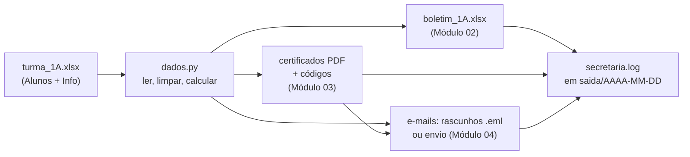

# 01 — Planejando a Secretaria automática

> **Curso:** Automação com Python  
> **Módulo:** 05 — Projeto final  
> **Tempo estimado:** 1 h 30 min  

---

## 🎯 Objetivos

Ao final desta aula, você terá:

- Entendido o que a **Secretaria automática** faz e o que ela **não** faz.
- Definido a **entrada** (a planilha da turma) e as **saídas** (boletim, certificados, e-mails, log).
- Organizado o projeto como um **pacote** Python, com um arquivo para cada responsabilidade.
- Criado a **planilha de treino** do projeto.

## Pré-requisitos

- Os [Módulos 01 a 04](../docs/index.md) deste curso.

---

## O que é a Secretaria automática

Uma ferramenta de linha de comando que, a partir da **planilha da turma**, faz o trabalho de fim de ano da secretaria:

```text
python -m secretaria tudo treino_secretaria/turma_1A.xlsx
```



| Faz | Não faz |
|---|---|
| Calcula média (arredondada como a escola), frequência e situação | Decidir casos especiais (recuperação, conselho de classe): isso é com a escola |
| Gera o boletim em Excel com as abas Boletim, Resumo e Problemas | Corrigir a planilha: ela **lista** os problemas para uma pessoa resolver |
| Emite certificado em PDF, com código de validação, para quem foi **aprovado** | Assinar documentos oficiais |
| Prepara um e-mail para cada aluno com o resultado (e o certificado no anexo) | Enviar sem você pedir: o padrão é **rascunho**; envio só com `--enviar` |
| Grava tudo numa pasta com a data e registra o que fez num log | Apagar ou sobrescrever a planilha original |

!!! info "Tudo o que você já sabe, junto"
    | Parte do projeto | Onde você aprendeu |
    |---|---|
    | Pasta de saída por data, nunca mexer no original | [Módulo 01](../modulo_01_arquivos_e_pastas/index.md) |
    | Ler a planilha, limpar notas, arredondar com `Decimal`, boletim formatado | [Módulo 02](../modulo_02_planilhas/index.md) |
    | Certificado em PDF, nome de arquivo seguro, código de validação | [Módulo 03](../modulo_03_documentos_e_pdfs/index.md) |
    | E-mail com anexo, rascunho `.eml`, `.env`, servidor de teste, log | [Módulo 04](../modulo_04_email_e_agendamento/index.md) |

## A entrada: a planilha da turma

A planilha tem duas abas. A **Alunos**, com uma linha por aluno: `Matrícula`, `Nome`, `E-mail`, as quatro notas e as `Faltas`. E a **Info**, com os dados da turma: `Turma`, `Curso`, `Ano`, `Aulas dadas` e `Responsável`.

```python title="criar_treino_secretaria.py"
"""Cria a planilha de treino da Secretaria automática (dados inventados)."""
from pathlib import Path

from openpyxl import Workbook

TREINO = Path("treino_secretaria")

ALUNOS = [  # matrícula, nome, e-mail, 4 bimestres, faltas
    [2026001, "Ana Souza", "ana.souza@example.com", 8.5, 7.0, 9.0, 8.0, 4],
    [2026002, "Bruno Lima", "bruno.lima@example.com", 5.0, 6.5, 4.5, 6.0, 10],
    [2026003, "Carla Mendes", "carla.mendes@example.com", 9.5, 9.0, 10.0, 9.5, 0],
    [2026004, "Diego Rocha", "", 4.0, 3.5, 5.0, 4.5, 12],                           # sem e-mail
    [2026005, "Elisa Prado", "elisa.prado@example.com", 7.0, "7,5", 6.5, 8.0, 2],   # nota como texto
    [2026006, "Felipe Torres", "felipe.torres@example.com", 6.0, 5.5, 6.0, None, 6],  # nota não lançada
    [2026007, "Gabriela Nunes", "gabriela.nunes@example.com", 3.0, 4.0, 2.5, 3.5, 25],
    [2026008, "Heitor Alves", "heitor.alves@example", 8.0, 8.5, 7.5, 9.0, 1],       # e-mail errado
]

INFO = [("Turma", "1A"), ("Curso", "Técnico em Informática"), ("Ano", 2026),
        ("Aulas dadas", 80), ("Responsável", "Prof. Pedro Paulo")]


def main() -> None:
    if TREINO.exists():
        print(f"A pasta '{TREINO}' já existe. Apague-a se quiser começar do zero.")
        return
    TREINO.mkdir()
    livro = Workbook()
    aba = livro.active
    aba.title = "Alunos"
    aba.append(["Matrícula", "Nome", "E-mail", "1º bim", "2º bim", "3º bim", "4º bim", "Faltas"])
    for linha in ALUNOS:
        aba.append(linha)
    info = livro.create_sheet("Info")
    for chave, valor in INFO:
        info.append([chave, valor])
    livro.save(TREINO / "turma_1A.xlsx")
    print(f"Planilha de treino criada em: {(TREINO / 'turma_1A.xlsx').resolve()}")


if __name__ == "__main__":
    main()
```

De propósito, a turma de treino tem os problemas que aparecem na vida real: **nota digitada como texto** (Elisa), **nota não lançada** (Felipe), **e-mail vazio** (Diego) e **e-mail digitado errado** (Heitor).

## A estrutura do projeto

Até aqui, cada projeto era **um arquivo**. A Secretaria é maior: fica organizada num **pacote**, uma pasta com vários arquivos `.py`, cada um com uma responsabilidade.

```text
C:\Automacao\
├── .env                         ← configuração do e-mail (Módulo 04), fora do Git
├── criar_treino_secretaria.py
├── treino_secretaria\
│   └── turma_1A.xlsx
├── secretaria\                  ← o pacote
│   ├── __init__.py              ← marca a pasta como pacote
│   ├── __main__.py              ← permite rodar com "python -m secretaria"
│   ├── dados.py                 ← ler a planilha e aplicar as regras (aula 02)
│   ├── documentos.py            ← boletim e certificados (aula 03)
│   ├── emails.py                ← montar, salvar ou enviar e-mails (aula 03)
│   └── cli.py                   ← a linha de comando que junta tudo (aula 04)
├── testes\
│   └── test_secretaria.py       ← testes automáticos (aula 04)
└── saida\
    └── 2026-11-08\              ← uma pasta por dia em que a Secretaria rodou
```

!!! tip "Por que separar em arquivos?"
    - **Ler e calcular** (`dados.py`) não grava nada: é fácil de testar e de reaproveitar.
    - **Gerar arquivos** (`documentos.py`) e **e-mails** (`emails.py`) ficam isolados: dá para mudar o visual do certificado sem mexer nas regras de aprovação.
    - A **linha de comando** (`cli.py`) só decide **o que** rodar e **em que ordem**.

    Quando algo dá errado, você sabe em qual arquivo procurar.

---

## ⚠️ Erros comuns

- **Começar pelo código** sem saber o que entra e o que sai. Planeje antes (esta aula).
- **Um arquivo gigante** com tudo dentro: difícil de testar e de entender.
- **Planilha diferente do combinado** (abas com outro nome, colunas em outra ordem): a leitura quebra. Combine o formato com quem preenche e confira com o [cabeçalho](../modulo_02_planilhas/04_juntar_e_limpar.md).
- **Esquecer quem fica de fora**: aluno sem e-mail não recebe nada. O log precisa avisar.

---

## Exercícios

### Básico (fixação)

Crie a pasta do projeto com a estrutura da aula (pastas `secretaria` e `testes`, por enquanto com arquivos vazios) e rode o `criar_treino_secretaria.py`. Abra a planilha e localize os quatro problemas de propósito.

<!-- gabarito -->
??? success "Gabarito — Básico"
    ```python
    from pathlib import Path

    for arquivo in ["secretaria/__init__.py", "secretaria/__main__.py", "secretaria/dados.py",
                    "secretaria/documentos.py", "secretaria/emails.py", "secretaria/cli.py",
                    "testes/test_secretaria.py"]:
        caminho = Path(arquivo)
        caminho.parent.mkdir(exist_ok=True)
        caminho.touch(exist_ok=True)   # cria vazio, sem apagar se já existir
    print(sorted(str(p) for p in Path("secretaria").iterdir()))
    ```

    Os problemas: Elisa (`"7,5"` como texto no 2º bimestre), Felipe (4º bimestre vazio), Diego (e-mail vazio) e Heitor (`heitor.alves@example`, sem o `.com`). O `touch(exist_ok=True)` cria o arquivo vazio e não faz nada se ele já existir: seguro para rodar de novo.

### Intermediário (aplicação)

Escreva uma conferência que abre a `turma_1A.xlsx` e confirma que ela tem as abas **Alunos** e **Info** e que o cabeçalho da aba Alunos é exatamente o combinado. Mostre `Planilha no formato certo` ou o que está diferente.

<!-- gabarito -->
??? success "Gabarito — Intermediário"
    ```python
    from pathlib import Path

    from openpyxl import load_workbook

    ESPERADO = ("Matrícula", "Nome", "E-mail", "1º bim", "2º bim", "3º bim", "4º bim", "Faltas")

    livro = load_workbook(Path("treino_secretaria") / "turma_1A.xlsx", read_only=True)
    erros = []
    for aba in ("Alunos", "Info"):
        if aba not in livro.sheetnames:
            erros.append(f"falta a aba {aba}")
    if "Alunos" in livro.sheetnames:
        cabecalho = next(livro["Alunos"].iter_rows(max_row=1, values_only=True))
        if cabecalho != ESPERADO:
            erros.append(f"cabeçalho diferente: {cabecalho}")
    print("Planilha no formato certo" if not erros else "\n".join(erros))
    ```

    Essa conferência pode virar a primeira coisa que a Secretaria faz: se a planilha não estiver no formato, ela para com uma mensagem clara, em vez de calcular coisas erradas.

### Avançado (desafio)

A coordenação pediu que a Secretaria também mande o **boletim** para os **responsáveis**. Sem programar, responda: o que muda na **planilha**, em **qual arquivo** do pacote, e que cuidado de **privacidade** é preciso?

<!-- gabarito -->
??? success "Gabarito — Avançado"
    - **Planilha:** uma coluna nova, por exemplo `E-mail do responsável` (e, idealmente, a autorização da família para receber por e-mail).
    - **Pacote:** `dados.py` passa a ler a coluna nova (e validar o e-mail); `emails.py` ganha uma função para montar o e-mail do responsável; `cli.py` decide quando enviá-lo. `documentos.py` não muda.
    - **Privacidade:** cada responsável recebe **só** o resultado do **seu** filho (um e-mail por família, nunca a turma toda em cópia), e notas são dados pessoais de menores de idade, que pedem cuidado especial pela LGPD ([Segurança digital](../../seguranca_digital/modulo_04_cidadania_e_direitos/03_lgpd_no_dia_a_dia.md)).

    Este exercício mostra a vantagem da organização em pacote: dá para saber **onde** mexer antes de escrever qualquer linha.

---

## 💡 Resumo

- A Secretaria lê a **planilha da turma** e gera **boletim**, **certificados** e **e-mails**, com **log**, numa pasta com a data.
- Ela **lista** problemas e **não** decide casos especiais nem envia sem `--enviar`.
- O projeto é um **pacote**: `dados.py` (regras), `documentos.py`, `emails.py` e `cli.py`.

## ➡️ Próximo passo

**[02 — O pacote e as regras da escola](02_pacote_e_dados.md)**.
