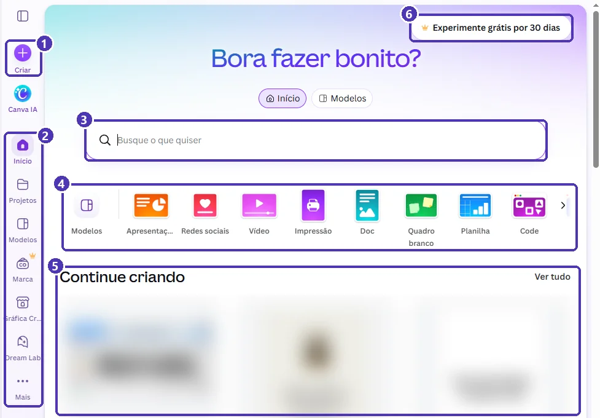
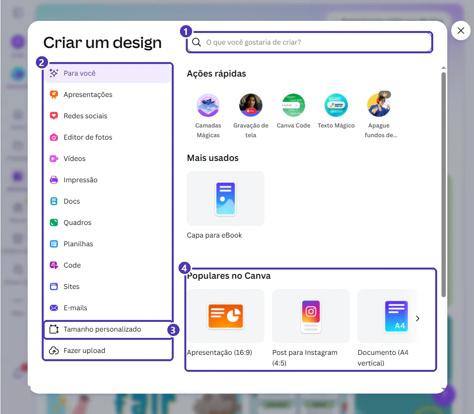
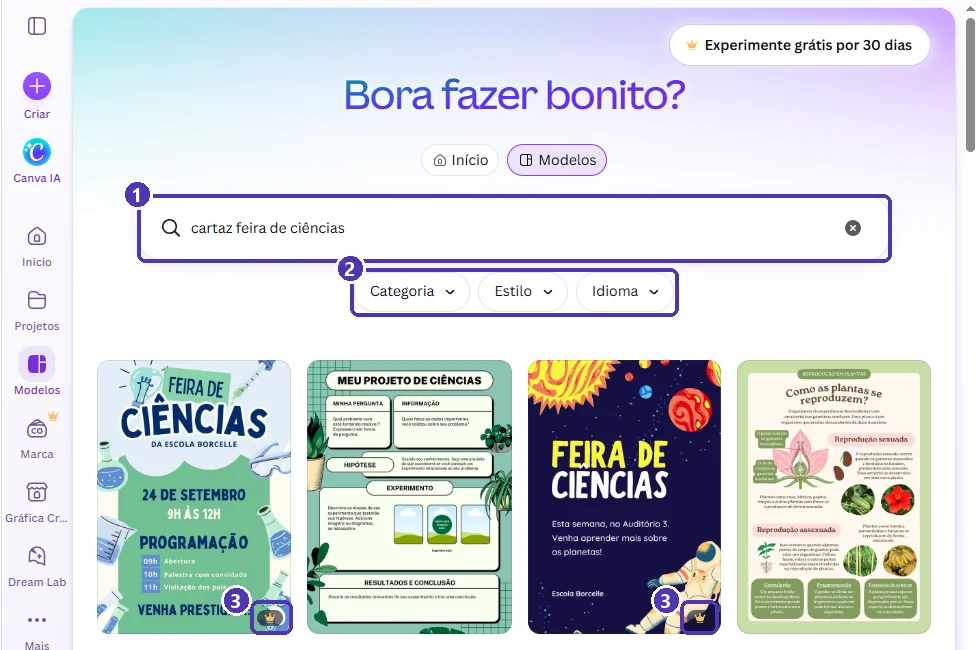

# 01 — Conhecendo o Canva: conta e tela inicial

> **Curso:** Canva  
> **Módulo:** 01 — Primeiros passos  
> **Tempo estimado:** 1 h  

---

## Objetivos

Ao final desta aula, você será capaz de:

- Explicar o que é o Canva e para que ele serve.
- Criar uma conta gratuita e deixar a interface em **português**.
- Diferenciar o plano **gratuito** do **Pro** e reconhecer a **coroa** 👑.
- Reconhecer as áreas da **tela inicial**: barra lateral, busca, atalhos e designs recentes.
- Abrir a janela **Criar um design** e buscar **modelos** com filtros.

## Pré-requisitos

- Saber usar mouse, teclado e navegador.
- Ter um e-mail (pessoal ou da escola).

---

## O que é o Canva

O **Canva** é uma ferramenta de design que funciona no navegador, sem instalar nada. Com ele você faz cartazes, apresentações, posts para redes sociais, vídeos curtos, currículos, convites e muito mais.

A grande vantagem são os **modelos**: designs prontos, feitos por designers, que você adapta trocando textos, cores e imagens. Em vez de começar de uma página em branco, você começa de algo que já está bonito e **ajusta ao seu conteúdo**.

!!! tip "Modelo é ponto de partida, não produto final"
    Um modelo bonito com o texto errado continua errado. Antes de escolher, pense: **qual é a mensagem** e **quem vai ler**? Depois procure o modelo que ajuda a passar essa mensagem.

---

## Criar a conta

1. Acesse [canva.com](https://www.canva.com) e clique em **Cadastre-se**.
2. Escolha como entrar: **Continuar com o Google**, com a **Microsoft**, com o **e-mail** ou outra opção da lista.
3. O Canva pergunta para que você vai usá-lo (pessoal, escola, empresa...). A resposta só personaliza as sugestões da tela inicial.
4. Se aparecer uma oferta do **Canva Pro**, procure **Agora não** ou **Pular**. Não é preciso informar cartão para usar o plano gratuito.

!!! warning "Teste grátis pede cartão"
    O botão **Experimente grátis por 30 dias** abre o teste do Pro, que pede um cartão e passa a cobrar quando o período termina, se você não cancelar. Este curso usa **só o plano gratuito**: não é preciso fazer o teste.

!!! info "Canva para Educação"
    Escolas de ensino básico podem pedir o **Canva para Educação**, gratuito para professores e alunos e com os recursos do Pro. Nesse caso, o professor convida a turma e você entra com o e-mail da escola. Se a sua escola não usa, tudo neste curso funciona no plano gratuito comum.

### Deixar o Canva em português

Se a tela aparecer em inglês ou outro idioma: clique na sua **foto de perfil** (canto inferior esquerdo) ➔ **Configurações** ➔ **Seu perfil** ➔ **Idioma** ➔ **Português (Brasil)**.

---

## Gratuito ou Pro?

O plano gratuito já tem muita coisa: milhares de modelos, fotos, ícones e fontes, além de 5 GB de armazenamento na nuvem. O **Pro** é pago e libera mais modelos e elementos e algumas ferramentas, como o redimensionamento automático de designs.

No Canva, **tudo que é do Pro tem uma coroa** 👑: em modelos, elementos, fotos e botões. Se você usar um item com coroa, o Canva deixa editar, mas **cobra ou bloqueia na hora de baixar**.

!!! danger "Fuja da coroa"
    Antes de escolher um modelo, uma foto ou um elemento, procure a coroa 👑 no canto. Sem coroa = pode usar de graça. Assim você não descobre o problema só na hora de entregar o trabalho.

---

## A tela inicial

Depois de entrar, você chega à **tela inicial** (*Início*). É dela que tudo parte:

<figure markdown="span">
  { loading=lazy }
  <figcaption>(1) <strong>Criar</strong>, para começar um design novo · (2) barra lateral · (3) busca · (4) atalhos por tipo de design · (5) <em>Continue criando</em>, com seus designs recentes · (6) o teste do Pro, que você pode ignorar.</figcaption>
</figure>

| Área | Para que serve |
|---|---|
| **Criar** (1) | Abre a janela *Criar um design*, com todos os tipos e tamanhos. |
| **Barra lateral** (2) | *Início* (esta tela), **Projetos** (seus designs e pastas), **Modelos** (a biblioteca de modelos) e outros atalhos. Os itens com 👑, como **Marca**, são do Pro. |
| **Busca** (3) | Procura modelos e também os seus designs. Escreva o que quer fazer: “cartaz feira de ciências”, “currículo”, “post aniversário”. |
| **Atalhos** (4) | Começam um design de um tipo comum: *Apresentação*, *Redes sociais*, *Vídeo*, *Impressão*, *Doc*, *Quadro branco*... |
| **Continue criando** (5) | Seus designs mais recentes. *Ver tudo* leva para *Projetos*. |

!!! tip "Barra lateral escondida"
    O ícone no alto da barra lateral (um retângulo com uma linha) abre e fecha o painel com mais opções. Em telas pequenas, a barra mostra só os ícones.

---

## A janela Criar um design

Clique em **Criar** (o **+** roxo da barra lateral). Abre a janela **Criar um design**:

<figure markdown="span">
  { loading=lazy }
  <figcaption>(1) Busca por tipo de design · (2) categorias · (3) <strong>Tamanho personalizado</strong>, para escolher largura e altura · (4) os tipos mais usados, cada um com o tamanho já certo.</figcaption>
</figure>

- Cada **tipo** de design já vem com o tamanho certo: *Apresentação (16:9)* tem o formato da tela do projetor, *Post para Instagram (4:5)* o do feed e *Documento (A4 vertical)* o de uma folha.
- **Tamanho personalizado** serve quando você sabe as medidas exatas (por exemplo, um banner de 90 × 30 cm).
- **Fazer upload** traz arquivos do seu computador (fotos, PDFs, apresentações do PowerPoint) para editar no Canva.

Na próxima aula você vai criar designs por aqui com calma. Por enquanto, só explore e feche no **X**.

---

## Buscar modelos

Na tela inicial, clique em **Modelos** (no alto, ao lado de *Início*, ou na barra lateral) e escreva na busca. Exemplo: `cartaz feira de ciências`.

<figure markdown="span">
  { loading=lazy }
  <figcaption>(1) O que você buscou · (2) filtros: <em>Categoria</em>, <em>Estilo</em> e <em>Idioma</em> · (3) a coroa 👑 marca os modelos do Pro. Os outros dois são gratuitos.</figcaption>
</figure>

- **Categoria** separa por tipo de design: só *Cartaz*, só *Apresentação*...
- **Estilo** filtra pela aparência (minimalista, colorido, divertido...).
- **Idioma** mostra modelos já escritos em português, o que poupa trabalho de tradução.
- Clique em um modelo para ver a prévia e, se gostar, em **Personalizar este modelo**. O Canva abre uma **cópia** no editor; o modelo original não muda.

!!! tip "Busque pelo assunto e pelo tipo"
    “feira de ciências” traz de tudo: cartazes, apresentações, certificados. Com “**cartaz** feira de ciências”, ou com o filtro *Categoria*, os resultados ficam bem mais certeiros.

---

## ⚠️ Erros comuns

!!! warning "“Meu design pede para pagar na hora de baixar”"
    Algum item do design tem coroa 👑. No editor, procure os elementos marcados com coroa e troque-os por opções gratuitas ([aula 03](03_conhecendo_o_editor.md)).

!!! warning "“A tela está em inglês”"
    *Foto de perfil ➔ Configurações ➔ Seu perfil ➔ Idioma ➔ Português (Brasil)*.

!!! warning "“Não acho o design que fiz ontem”"
    Ele não sumiu: o Canva salva tudo sozinho. Veja em **Continue criando**, na tela inicial, ou em **Projetos**, na barra lateral. Também dá para buscar pelo nome na caixa de busca.

---

## Exercícios

### Básico (fixação)

1. Entre no Canva e confira se a interface está em português.
2. Na tela inicial, encontre e anote o nome dos itens da **barra lateral**.
3. Abra a janela **Criar um design** e anote o tamanho indicado entre parênteses em três tipos de design diferentes.

<!-- gabarito -->
??? success "Gabarito — Básico"
    1. Se não estiver: *foto de perfil ➔ Configurações ➔ Seu perfil ➔ Idioma ➔ Português (Brasil)*.
    2. Os principais são **Criar**, **Canva IA**, **Início**, **Projetos**, **Modelos**, **Marca** (👑), **Gráfica**, **Dream Lab** e **Mais**. A lista pode mudar um pouco com as atualizações do Canva.
    3. Exemplos: *Apresentação (16:9)*, *Post para Instagram (4:5)*, *Documento (A4 vertical)*.

### Intermediário (aplicação)

Sua turma vai organizar uma **feira de ciências** e precisa de um cartaz. Busque modelos e escolha **três** que:

- sejam **gratuitos** (sem coroa 👑);
- sejam do tipo **cartaz**;
- já estejam em **português**.

Anote, para cada um, por que ele combina (ou não) com uma feira de ciências da sua escola.

<!-- gabarito -->
??? success "Gabarito — Intermediário"
    1. *Modelos* ➔ busque `cartaz feira de ciências`.
    2. Filtro **Categoria ➔ Cartaz** e **Idioma ➔ Português**.
    3. Passe o olho no canto inferior direito de cada miniatura e descarte as que têm coroa.

    **Bons motivos para escolher:** título grande e legível de longe; espaço para data, horário e local; cores que combinam com o tema. **Maus motivos:** “é o mais bonito”, se o texto fica pequeno demais para ler no corredor.

### Avançado (desafio)

Abra um modelo **gratuito** de cartaz com **Personalizar este modelo**. Sem editar nada:

1. Descubra o **nome** que o Canva deu ao design (no alto do editor).
2. Volte para a tela inicial e encontre esse design em **Continue criando** e em **Projetos**.
3. Responda: o modelo original, na busca, mudou? Por quê?

<!-- gabarito -->
??? success "Gabarito — Avançado"
    1. O nome aparece no alto do editor, normalmente o nome do modelo ou “Design sem nome”. Clique nele para renomear.
    2. O Canva salvou a cópia sozinho: ela aparece em *Continue criando* e em *Projetos*.
    3. **Não mudou.** *Personalizar este modelo* cria uma **cópia** só sua; o modelo continua igual para todo mundo.

---

## 💡 Resumo

- O Canva é um editor de design no navegador, baseado em **modelos** que você adapta.
- O plano **gratuito** basta para este curso; a **coroa** 👑 marca o que é do Pro.
- **Criar** começa um design; **Projetos** guarda os seus; **Modelos** é a biblioteca.
- Busque pelo **tipo + assunto** e use os filtros *Categoria*, *Estilo* e *Idioma*.
- O Canva **salva sozinho**: seus designs aparecem em *Continue criando* e em *Projetos*.

## ➡️ Próximo passo

**[02 — Criar um design: tamanhos e modelos](02_criar_um_design.md)**: você vai criar designs pelo tamanho certo e adaptar um modelo ao seu conteúdo.
