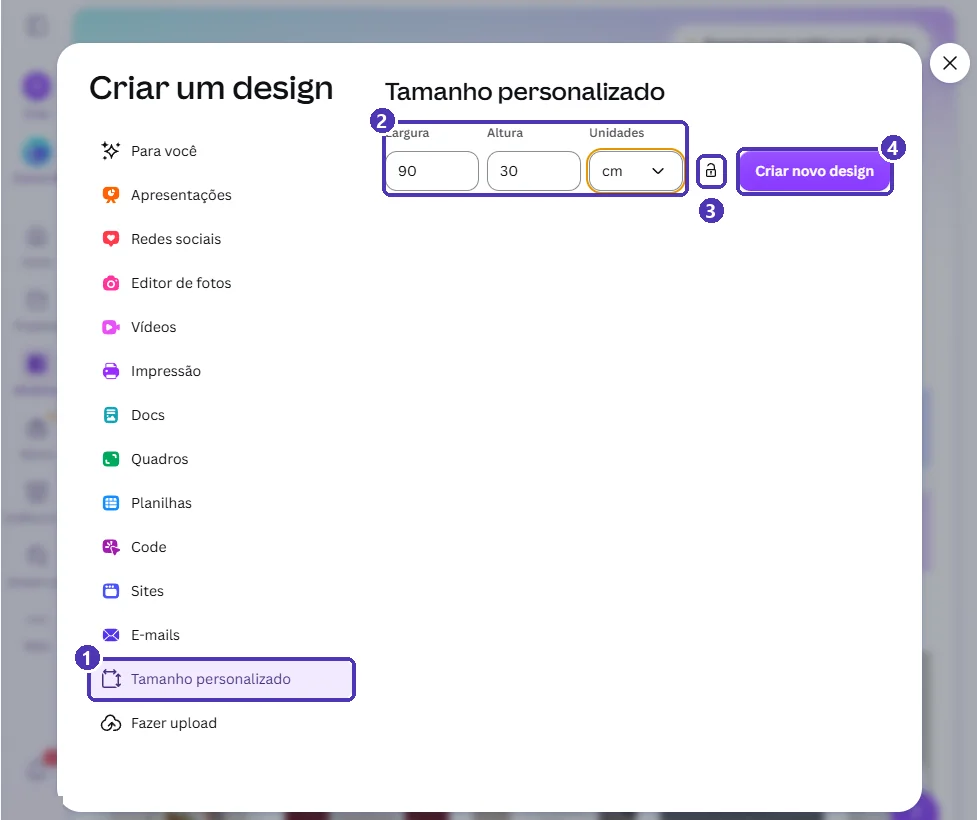
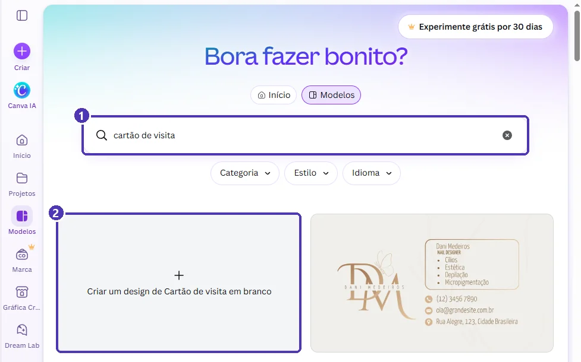
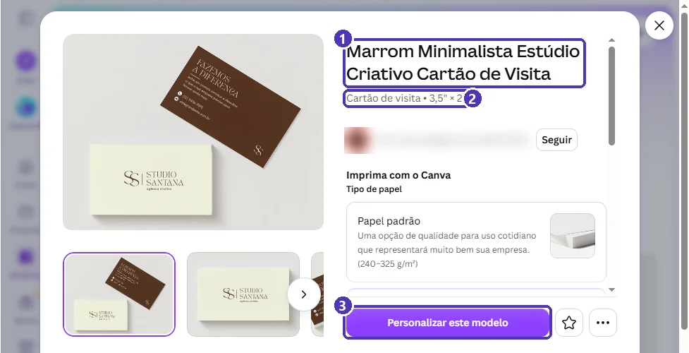
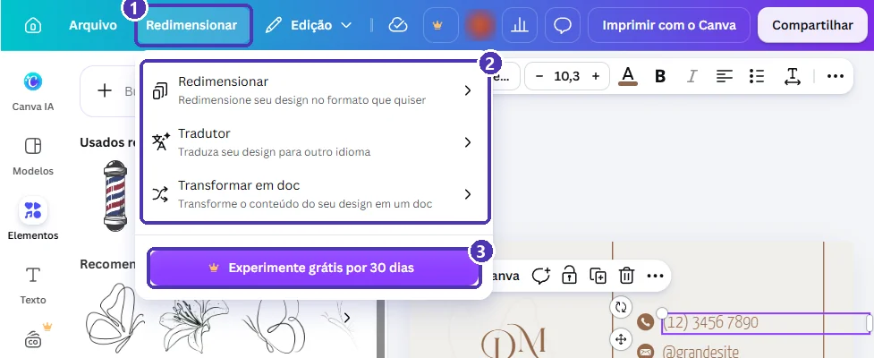

# 02 — Criar um design: tamanhos e modelos

> **Curso:** Canva  
> **Módulo:** 01 — Primeiros passos  
> **Tempo estimado:** 1 h  

---

## Objetivos

Ao final desta aula, você será capaz de:

- Explicar por que o **tamanho** vem antes de tudo num design.
- Criar um design com **tamanho personalizado**, em centímetros ou pixels.
- Começar um design **em branco** ou a partir de um **modelo**.
- Ler a **prévia** de um modelo antes de usar: nome, tipo e medidas.
- Contornar o **Redimensionar**, que é do Pro, sem pagar nada.

## Pré-requisitos

- [Aula 01](01_conhecendo_o_canva.md): tela inicial, janela *Criar um design* e busca de modelos.

---

## Primeiro o tamanho, depois o resto

Todo design no Canva nasce com um **tamanho fixo**: a largura e a altura da página. É a primeira decisão, porque o resto (letra, imagem, margem) é pensado para aquele espaço.

| Para onde vai | Tamanho comum | Unidade que faz sentido |
|---|---|---|
| Projetor ou TV | 16:9 (1920 × 1080 px) | px |
| Feed do Instagram | 4:5 (1080 × 1350 px) | px |
| Folha impressa | A4 (21 × 29,7 cm) | cm ou mm |
| Cartão de visita no Brasil | 9 × 5 cm | cm ou mm |

!!! tip "Tela = pixels; papel = centímetros"
    Se o design vai ser **visto numa tela**, pense em **pixels (px)**. Se vai ser **impresso**, pense em **centímetros (cm)** ou **milímetros (mm)**. Assim você nunca cria um cartaz do tamanho de um selo.

---

## Tamanho personalizado

Quando nenhum tipo pronto serve (um banner, uma etiqueta, um marcador de página), use o **Tamanho personalizado**:

1. Clique em **Criar** (o **+** roxo da barra lateral).
2. Na lista da esquerda, clique em **Tamanho personalizado**.
3. Digite a **Largura** e a **Altura** e escolha a **Unidade**: `px`, `pol.` (polegadas), `mm` ou `cm`.
4. Clique em **Criar novo design**.

<figure markdown="span">
  { loading=lazy }
  <figcaption>(1) <strong>Tamanho personalizado</strong> · (2) largura, altura e unidade: aqui, um banner de 90 × 30 cm · (3) o cadeado mantém a proporção quando você muda uma das medidas · (4) <strong>Criar novo design</strong>.</figcaption>
</figure>

!!! warning "Unidade errada, design errado"
    O Canva começa em **px**. Se você digitar `90` e `30` sem trocar para **cm**, o design terá 90 × 30 **pixels**: menor que um ícone. Abaixo de 40 px o Canva avisa que a medida é pequena demais.

!!! tip "Para que serve o cadeado"
    Com o **cadeado** fechado, mudar a largura muda a altura na mesma proporção. Útil para fazer uma versão maior ou menor de um tamanho que você já conhece.

---

## Em branco ou a partir de um modelo?

Na busca de **Modelos**, escreva o tipo de design: `cartão de visita`. O primeiro quadro é sempre **Criar um design de *(tipo)* em branco**. Os outros são modelos prontos daquele tipo.

<figure markdown="span">
  { loading=lazy }
  <figcaption>(1) Busque pelo tipo de design · (2) <strong>em branco</strong>: página vazia, já no tamanho certo. Os quadros ao lado são modelos.</figcaption>
</figure>

| Começar... | Quando escolher |
|---|---|
| **Em branco** | Você já sabe o que quer, ou o professor deu um layout para seguir. |
| **De um modelo** | Você quer um ponto de partida bonito e vai **trocar textos, cores e imagens**. |

---

## A prévia do modelo

Clique em um modelo para abrir a **prévia**. Antes de usar, leia:

<figure markdown="span">
  { loading=lazy }
  <figcaption>(1) O nome do modelo · (2) o <strong>tipo e as medidas</strong>: 3,5" × 2" é o cartão de visita americano · (3) <strong>Personalizar este modelo</strong> abre uma cópia sua no editor.</figcaption>
</figure>

- As **medidas** dizem se o modelo serve. Os cartões de visita do Canva vêm em polegadas (3,5" × 2", cerca de 8,9 × 5,1 cm), quase o tamanho brasileiro de 9 × 5 cm.
- Embaixo aparece **Mais conteúdo semelhante**: outros modelos parecidos, para comparar.
- **Personalizar este modelo** cria uma **cópia** na sua conta. O original continua igual para todo mundo.

!!! warning "Modelo com coroa"
    Se a miniatura ou algum elemento do modelo tiver a coroa 👑, ele é do Pro. Você consegue editar, mas na hora de baixar o Canva pede a assinatura. Prefira modelos sem coroa.

---

## E se o tamanho estiver errado? (Redimensionar)

No editor, o botão **Redimensionar** muda o tamanho de um design pronto. Mas, no plano gratuito, ele só oferece o teste do Pro:

<figure markdown="span">
  { loading=lazy }
  <figcaption>(1) <strong>Redimensionar</strong>, na barra de cima do editor · (2) as opções do menu · (3) o botão do teste do Pro: no plano gratuito, essas opções são pagas.</figcaption>
</figure>

**O caminho gratuito:**

1. Crie um **design novo** no tamanho certo (por exemplo, com *Tamanho personalizado*).
2. Volte ao design antigo, selecione tudo com `Ctrl + A` e copie com `Ctrl + C`.
3. No design novo, cole com `Ctrl + V` e reorganize os elementos para o novo espaço.

!!! tip "Copiar e colar entre designs funciona"
    Textos, formas, fotos e ícones colados de um design para outro mantêm cor, fonte e tamanho. Depois é só ajustar a posição.

---

## ⚠️ Erros comuns

!!! warning "“Meu cartaz saiu minúsculo na impressão”"
    O design foi criado em **px** com medidas pequenas. Para impressão, crie em **cm** ou **mm** com o tamanho real do papel.

!!! warning "“Escolhi um modelo de Instagram para fazer um cartaz”"
    O modelo traz o tamanho junto. Um post de 1080 × 1350 px vira um cartaz borrado no papel. Busque pelo **tipo certo** (`cartaz`) ou crie com *Tamanho personalizado*.

!!! warning "“Cliquei em Redimensionar e pediu cartão”"
    O Redimensionar é do Pro. Use o caminho gratuito: design novo + copiar e colar.

---

## Exercícios

### Básico (fixação)

Crie três designs com **Tamanho personalizado** e confira as medidas de cada um no menu *Arquivo* do editor:

1. Um **marcador de página** de 5 × 18 cm.
2. Uma **capa de vídeo** de 1280 × 720 px.
3. Uma **etiqueta** de 10 × 4 cm.

<!-- gabarito -->
??? success "Gabarito — Básico"
    Para cada um: *Criar ➔ Tamanho personalizado* ➔ largura, altura e **unidade** ➔ *Criar novo design*.

    1. Largura **5**, Altura **18**, Unidade **cm**.
    2. Largura **1280**, Altura **720**, Unidade **px**.
    3. Largura **10**, Altura **4**, Unidade **cm**.

    No editor, clique em **Arquivo**: logo abaixo do nome aparecem o tipo e as medidas do design.

### Intermediário (aplicação)

Você precisa de um **cartaz A3** para a feira de ciências. Encontre **dois caminhos** para começar esse design no tamanho certo e diga qual é mais rápido.

<!-- gabarito -->
??? success "Gabarito — Intermediário"
    - **Caminho 1:** *Criar ➔ Tamanho personalizado* ➔ **29,7 × 42 cm** (A3 em pé) ➔ *Criar novo design*.
    - **Caminho 2:** busque `cartaz` ou `pôster` e use **Criar um design de Cartaz em branco**, ou escolha um modelo de cartaz. Confira na prévia se as medidas são de A3.

    O caminho 2 é mais rápido quando o tipo pronto já tem a medida certa. O caminho 1 é garantido quando você sabe a medida exata.

### Avançado (desafio)

Você fez um **post para Instagram (4:5)** e agora precisa da mesma arte em formato **Story (9:16, 1080 × 1920 px)**, sem pagar o Pro. Faça a versão Story e liste o que precisou ajustar.

<!-- gabarito -->
??? success "Gabarito — Avançado"
    1. *Criar ➔ Tamanho personalizado* ➔ **1080 × 1920 px** (ou busque `story`).
    2. No post: `Ctrl + A` ➔ `Ctrl + C`. No story: `Ctrl + V`.
    3. Ajustes típicos: o story é **mais alto e mais estreito**. Aumente o fundo para cobrir a página toda, empilhe os blocos na vertical e deixe uma **margem livre em cima e embaixo**, onde o Instagram mostra o nome do perfil e a caixa de resposta.

---

## 💡 Resumo

- O **tamanho** é a primeira decisão: **px** para telas, **cm/mm** para papel.
- **Tamanho personalizado** cria qualquer medida; confira a **unidade** antes de criar.
- Comece **em branco** quando já sabe o que quer, ou de um **modelo** para adaptar.
- Na **prévia**, confira o tipo e as medidas antes de clicar em **Personalizar este modelo**.
- **Redimensionar** é do Pro: o caminho gratuito é criar um design novo e **copiar e colar**.

## ➡️ Próximo passo

**[03 — Conhecendo o editor](03_conhecendo_o_editor.md)**: as áreas do editor, como editar textos e onde encontrar elementos.
