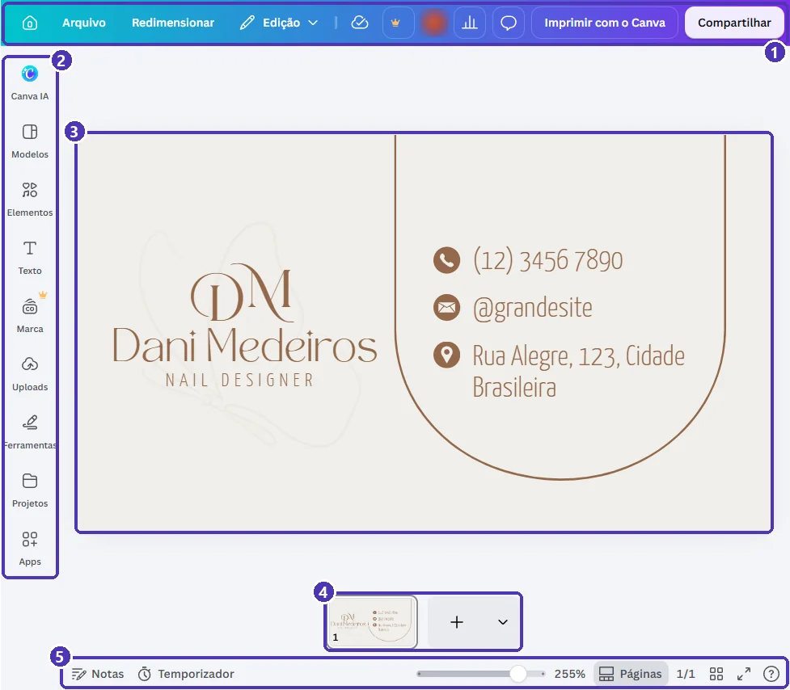
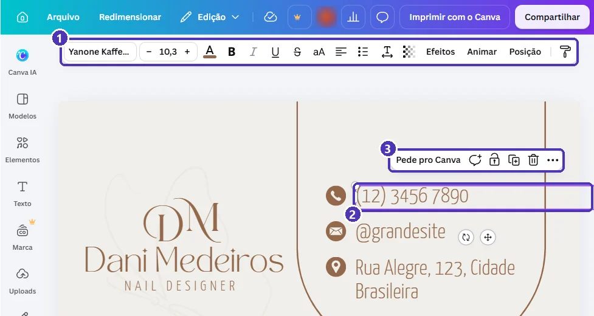
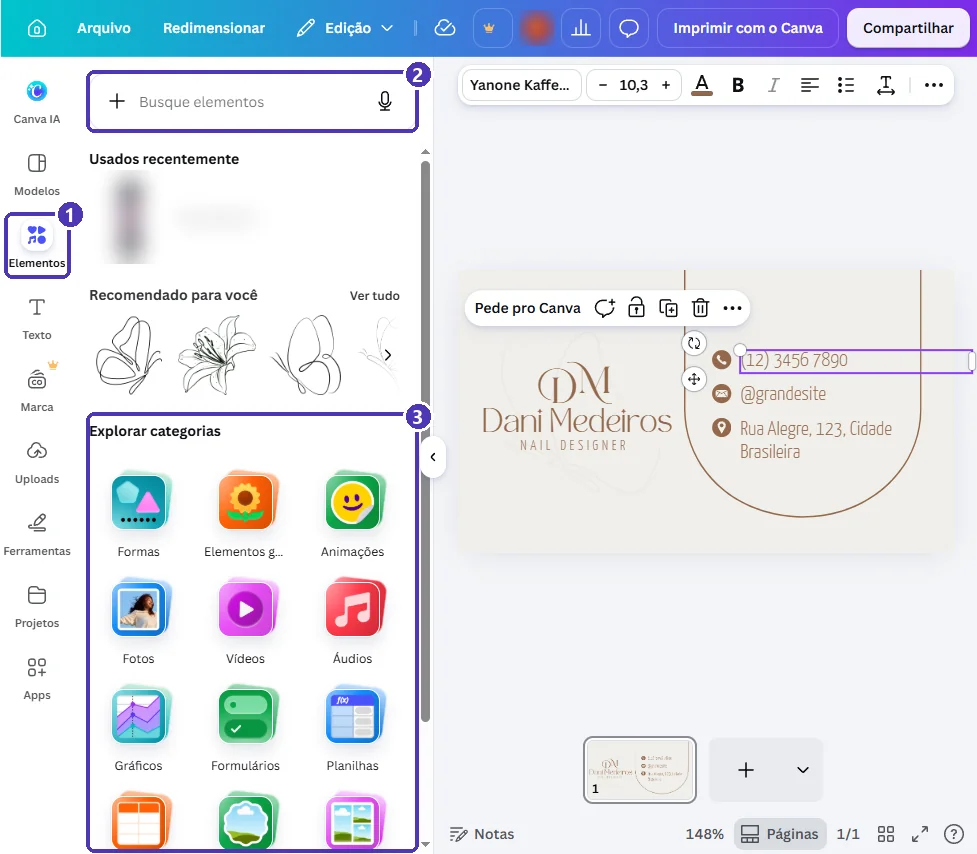

# 03 — Conhecendo o editor

> **Curso:** Canva  
> **Módulo:** 01 — Primeiros passos  
> **Tempo estimado:** 1 h 30 min  

---

## Objetivos

Ao final desta aula, você será capaz de:

- Reconhecer as cinco áreas do **editor** do Canva.
- **Selecionar** um elemento e usar a **barra de ferramentas** que aparece para ele.
- **Editar textos** sem perder a formatação, usando **Copiar estilo** quando precisar.
- Encontrar formas, ícones e fotos no painel **Elementos**.
- Usar **desfazer**, **zoom** e as **páginas** do design.

## Pré-requisitos

- [Aula 02](02_criar_um_design.md): criar um design em branco ou a partir de um modelo.

---

## As áreas do editor

Ao abrir um design (por exemplo, com **Personalizar este modelo**), você chega ao editor:

<figure markdown="span">
  { loading=lazy }
  <figcaption>(1) Barra superior · (2) painel lateral · (3) a página, onde você edita · (4) faixa de páginas · (5) barra inferior: notas, zoom e modos de exibição.</figcaption>
</figure>

| Área | O que tem |
|---|---|
| **Barra superior** (1) | Casinha (volta para a tela inicial), **Arquivo**, **Redimensionar** (👑), **Edição**, desfazer e refazer, o ícone de nuvem (salvamento), **Imprimir com o Canva** e **Compartilhar**. |
| **Painel lateral** (2) | **Modelos**, **Elementos**, **Texto**, **Marca** (👑), **Uploads** (suas imagens), **Ferramentas**, **Projetos** e **Apps**. Clique em um item para abrir o painel; clique de novo para fechar. |
| **Página** (3) | O design em si. Clique em um elemento para selecioná-lo. |
| **Faixa de páginas** (4) | As miniaturas das páginas. O **+** adiciona uma página nova. |
| **Barra inferior** (5) | **Notas** (anotações que só você vê), zoom (a barrinha e a porcentagem), **Páginas**, visualização em grade e tela cheia. |

!!! tip "Zoom rápido"
    Segure `Ctrl` e gire a rodinha do mouse para aproximar e afastar. Para enquadrar a página inteira de novo, clique na porcentagem do zoom e escolha **Ajustar**.

---

## Selecionar e editar um elemento

**Um clique** em um elemento o **seleciona**: aparece uma moldura roxa com alças nos cantos e a barra de ferramentas muda para mostrar só o que serve para aquele elemento.

<figure markdown="span">
  { loading=lazy }
  <figcaption>(1) Barra de ferramentas do texto: fonte, tamanho, cor, negrito, itálico, alinhamento, <em>Efeitos</em>, <em>Animar</em>, <em>Posição</em> e, no fim, o rolinho <strong>Copiar estilo</strong> · (2) o texto selecionado · (3) ações rápidas: comentar, bloquear, duplicar, excluir e mais opções.</figcaption>
</figure>

- **Mover:** arraste o elemento. Linhas cor-de-rosa aparecem quando ele fica alinhado com o centro ou com outro elemento.
- **Redimensionar:** arraste as **alças dos cantos**. Pelas laterais, uma caixa de texto muda de largura e as palavras se reorganizam.
- **Girar:** use a seta circular embaixo do elemento.
- **Excluir:** `Delete` ou a lixeira das ações rápidas.

### Editar um texto

1. **Dois cliques** no texto para entrar na edição (aparece o cursor piscando).
2. Selecione o que quer trocar. `Ctrl + A` seleciona **todo o texto daquela caixa**.
3. Digite o texto novo.
4. `Esc` sai da edição.

!!! warning "Texto novo com outra aparência"
    Às vezes, ao apagar tudo e digitar de novo, o texto muda de peso (fica mais grosso) ou de tamanho. Para igualar ao resto: selecione uma caixa que está **certa** ➔ clique em **Copiar estilo** (o rolinho no fim da barra) ➔ clique na caixa que ficou diferente. Pronto: mesma fonte, tamanho, cor e peso.

---

## O painel Elementos

**Elementos**, no painel lateral, é onde ficam formas, linhas, ícones, fotos, vídeos, áudios, gráficos e tabelas:

<figure markdown="span">
  { loading=lazy }
  <figcaption>(1) <strong>Elementos</strong>, no painel lateral · (2) busca: escreva o que procura, como “seta”, “estrela” ou “livro” · (3) as categorias.</figcaption>
</figure>

- Clique em um item para colocá-lo **no meio da página**, ou arraste-o para o lugar certo.
- Na busca, depois dos resultados, use as abas (*Gráficos*, *Fotos*, *Formas*...) para filtrar.
- **Fotos e elementos com coroa 👑 são do Pro.** Passe o mouse sobre a miniatura antes de usar.

!!! tip "Texto novo: painel Texto"
    Para acrescentar um título ou parágrafo, use **Texto** no painel lateral ➔ **Adicionar uma caixa de texto**, ou pressione a tecla `T` com nada selecionado.

---

## Desfazer, salvar e páginas

- **Desfazer:** `Ctrl + Z` (ou a seta curva na barra superior). **Refazer:** `Ctrl + Y`.
- **Salvar:** o Canva salva **sozinho** a cada mudança. O ícone de **nuvem** na barra superior mostra quando está salvando. Em *Arquivo* aparece “Todas as alterações foram salvas”.
- **Páginas:** o **+** na faixa de páginas adiciona uma página em branco. A setinha ao lado do **+** dá a opção de **duplicar** a página atual, útil para fazer frente e verso de um cartão.

---

## ⚠️ Erros comuns

!!! warning "“Cliquei e selecionou o fundo inteiro”"
    Você clicou numa área sem elemento, ou o elemento está **atrás** de outro. Clique bem em cima do texto ou objeto. Se não der, selecione qualquer elemento ➔ **Posição** ➔ aba **Camadas**: a lista mostra todos os elementos da página, e um clique na lista seleciona o que estava escondido.

!!! warning "“Não consigo mover um elemento”"
    Ele pode estar **bloqueado** (cadeado nas ações rápidas). Clique no cadeado para desbloquear.

!!! warning "“O painel lateral sumiu”"
    Ele recolhe quando você clica no mesmo item de novo. Clique em qualquer item do painel (*Elementos*, *Texto*...) para abri-lo outra vez.

---

## Exercícios

### Básico (fixação)

Abra um modelo **gratuito** de cartão de visita e:

1. Troque o **nome** do modelo pelo seu nome.
2. Mude a **cor** de um dos textos.
3. Desfaça a mudança de cor com o teclado.

<!-- gabarito -->
??? success "Gabarito — Básico"
    1. Dois cliques no nome ➔ `Ctrl + A` ➔ digite o seu nome ➔ `Esc`.
    2. Selecione o texto (um clique) ➔ na barra, o **A** sublinhado de cor ➔ escolha a cor.
    3. `Ctrl + Z`.

### Intermediário (aplicação)

No mesmo cartão:

1. Coloque um **ícone** de lápis ou de livro, combinando com a cor dos textos.
2. Deixe o ícone **alinhado** com o texto ao lado.
3. Se algum texto ficou com aparência diferente depois da troca, iguale com **Copiar estilo**.

<!-- gabarito -->
??? success "Gabarito — Intermediário"
    1. *Elementos* ➔ busque `lápis` ➔ escolha um **sem coroa**. Com o ícone selecionado, clique no quadrado de cor da barra e use a mesma cor dos textos (aparece em *Cores do documento*).
    2. Arraste até aparecer a linha cor-de-rosa de alinhamento com o texto.
    3. Selecione o texto certo ➔ **Copiar estilo** (o rolinho) ➔ clique no texto diferente.

### Avançado (desafio)

Faça o **verso** do cartão: uma segunda página com só o seu nome e um ícone, no centro, com o mesmo fundo da frente.

<!-- gabarito -->
??? success "Gabarito — Avançado"
    1. Na faixa de páginas, a setinha ao lado do **+** ➔ **Duplicar página**. Assim o verso nasce com o mesmo fundo e as mesmas cores.
    2. Na página 2, apague o que não vai ficar (selecione e `Delete`).
    3. Centralize o nome e o ícone: arraste até aparecerem as linhas de centro, ou selecione o elemento ➔ **Posição** ➔ *Alinhar* ➔ **Centro** e **Meio**.

---

## 💡 Resumo

- Editor = **barra superior**, **painel lateral**, **página**, **faixa de páginas** e **barra inferior**.
- **Um clique** seleciona; **dois cliques** editam o texto; `Esc` sai.
- A barra de ferramentas muda conforme o elemento selecionado.
- **Copiar estilo** iguala a formatação de dois textos.
- O Canva **salva sozinho**; `Ctrl + Z` desfaz.

## ➡️ Próximo passo

**[04 — Projetos, pastas e salvamento](04_projetos_e_pastas.md)**: dar nome aos designs, criar pastas e encontrar tudo depois.
