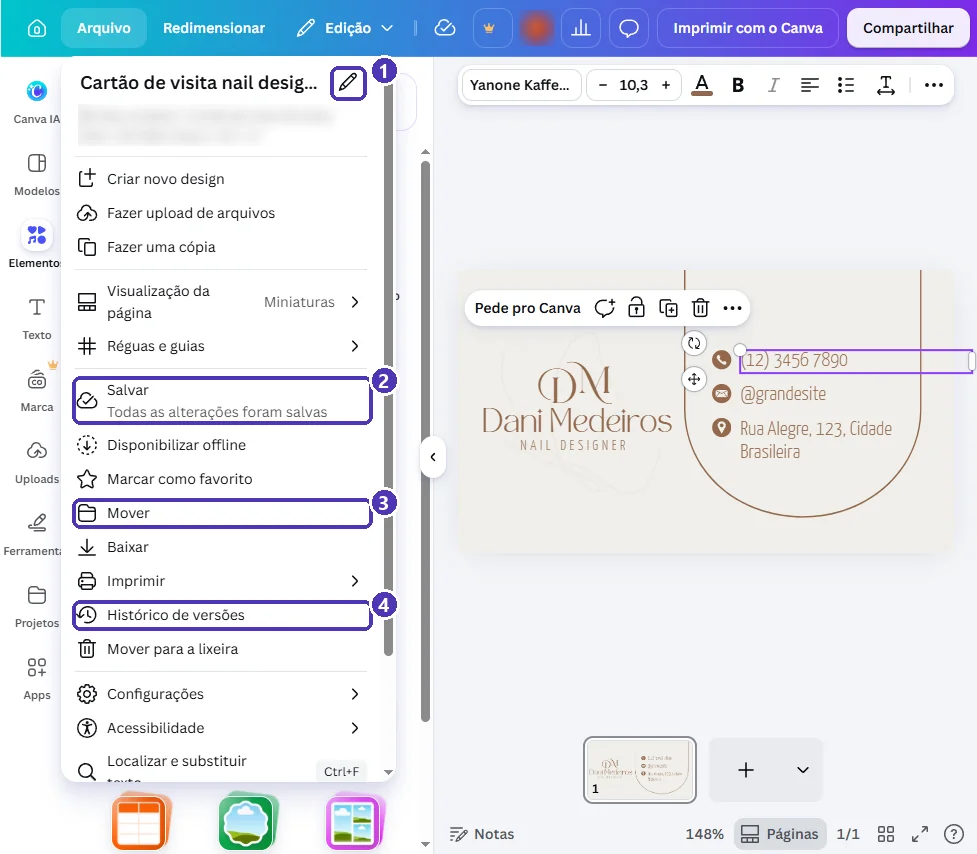
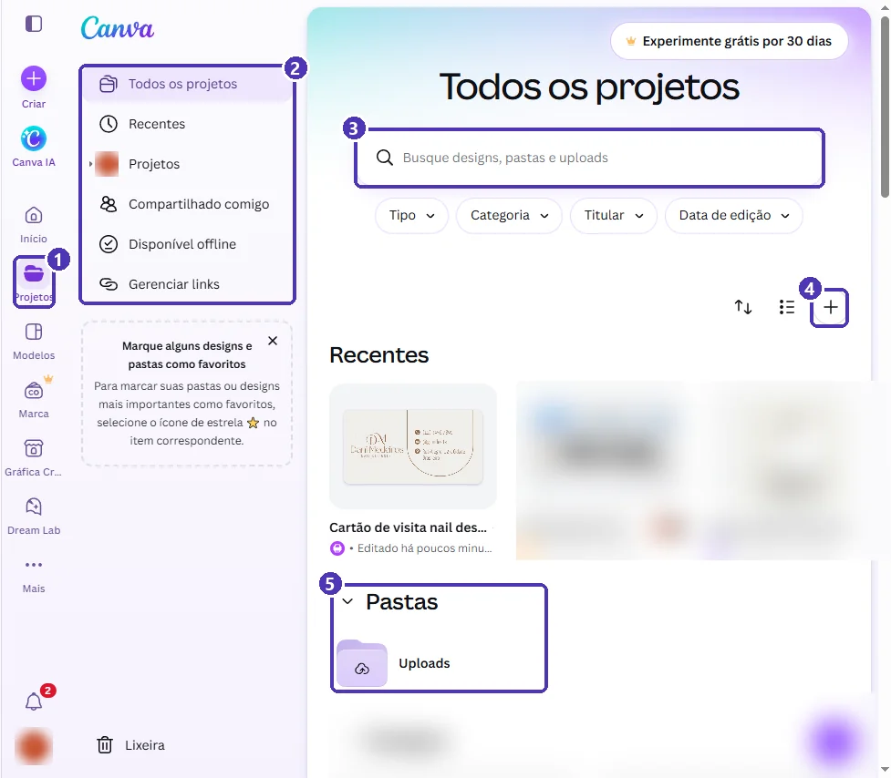
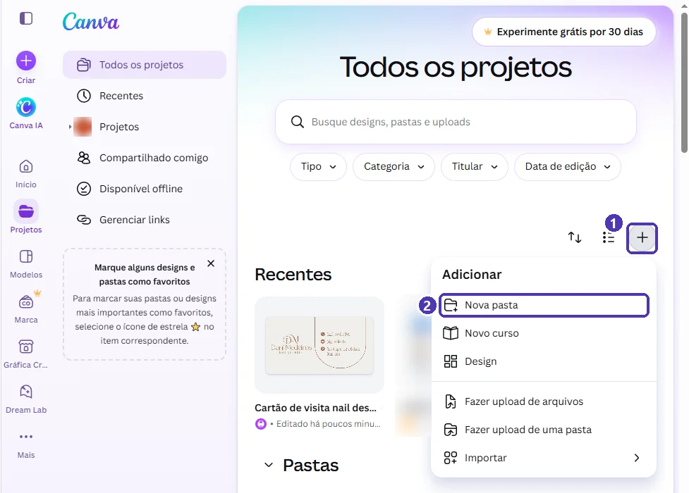
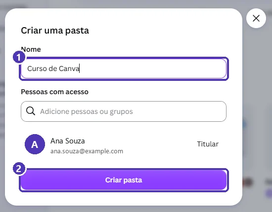
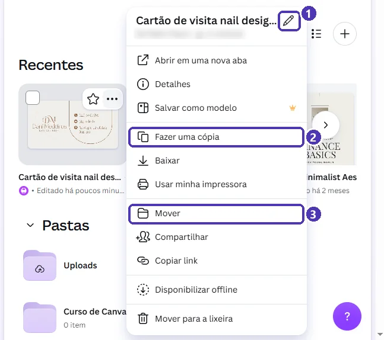
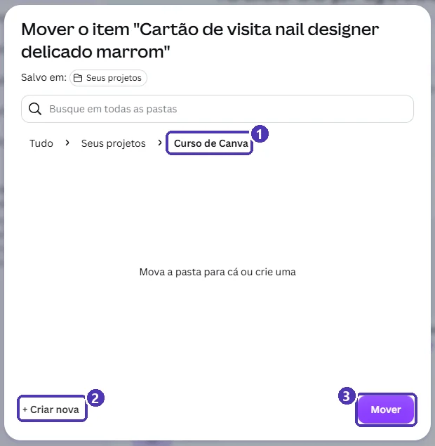
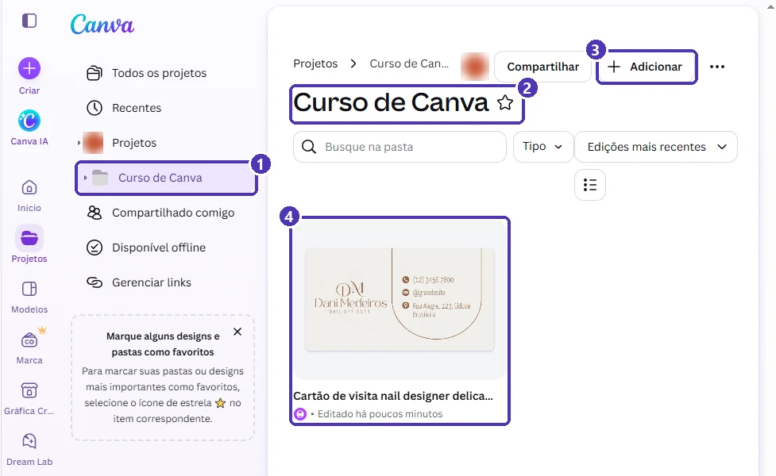

# 04 — Projetos, pastas e salvamento

> **Curso:** Canva  
> **Módulo:** 01 — Primeiros passos  
> **Tempo estimado:** 1 h  

---

## Objetivos

Ao final desta aula, você será capaz de:

- Entender como o Canva **salva** seus designs.
- **Renomear** um design com um nome que você vai achar depois.
- Criar **pastas** e **mover** designs para elas.
- Encontrar qualquer design pela página **Projetos** e pela **busca**.
- Fazer uma **cópia** antes de mudar algo importante e recuperar o que foi para a **lixeira**.

## Pré-requisitos

- [Aula 03](03_conhecendo_o_editor.md): o editor e a edição de textos.

---

## O Canva salva sozinho

Não existe “esqueci de salvar” no Canva: **cada mudança é salva na nuvem** na hora. No editor, o menu **Arquivo** mostra isso:

<figure markdown="span">
  { loading=lazy }
  <figcaption>(1) O lápis ao lado do nome: <strong>renomear</strong> · (2) <em>Todas as alterações foram salvas</em> · (3) <strong>Mover</strong> para uma pasta · (4) <strong>Histórico de versões</strong>.</figcaption>
</figure>

- Logo abaixo do nome, o menu também mostra **onde** o design está salvo, o **tipo** e as **medidas**.
- **Fazer uma cópia** duplica o design inteiro. Faça uma cópia antes de uma mudança grande: se não gostar, o original continua lá.
- **Histórico de versões** mostra como o design estava antes. Se aparecer a coroa 👑 ao abrir, é recurso do Pro; use a **cópia** como alternativa gratuita.

!!! danger "Sem internet, sem salvar"
    O salvamento depende da internet. Se a conexão cair, o Canva avisa que não está salvando. **Não feche a aba** até a nuvem da barra superior voltar ao normal.

---

## Dê nomes que você vai achar depois

Todo design começa com o nome do modelo (“Cartão de visita nail designer delicado marrom”) ou com “Design sem nome”. Daqui a um mês, você não vai lembrar o que é.

**Renomear:** no editor, *Arquivo* ➔ lápis ao lado do nome ➔ digite ➔ `Enter`. Ou clique direto no nome, quando ele aparecer na barra superior.

!!! tip "Um padrão de nome"
    `tipo – assunto – data`. Exemplos: `cartaz – feira de ciências – 2026-11`, `post – aniversário da escola`, `cartão – Ana Souza`. Com o tipo no começo, a lista em ordem alfabética já agrupa os parecidos.

---

## A página Projetos

**Projetos**, na barra lateral da tela inicial, guarda tudo o que é seu:

<figure markdown="span">
  { loading=lazy }
  <figcaption>(1) <strong>Projetos</strong> · (2) atalhos: <em>Todos os projetos</em>, <em>Recentes</em>, <em>Compartilhado comigo</em>... · (3) busca de designs, pastas e uploads · (4) o <strong>+</strong> cria pastas e designs · (5) suas pastas.</figcaption>
</figure>

- **Recentes:** os últimos designs que você abriu ou editou.
- **Compartilhado comigo:** designs que outras pessoas compartilharam com você, como um trabalho em grupo.
- **Busca:** procura pelo **nome** do design. Por isso o nome importa.
- **Filtros** (*Tipo*, *Categoria*, *Titular*, *Data de edição*) ajudam quando a lista fica grande.
- **Lixeira** (no pé da lista): designs excluídos ficam lá por um tempo antes de sumir de vez.

---

## Criar uma pasta

1. Em **Projetos**, clique no **+**.
2. Escolha **Nova pasta**.

<figure markdown="span">
  { loading=lazy }
  <figcaption>(1) O <strong>+</strong> · (2) <strong>Nova pasta</strong>.</figcaption>
</figure>

3. Dê um nome à pasta e clique em **Criar pasta**.

<figure markdown="span">
  { loading=lazy }
  <figcaption>(1) O nome da pasta · (2) <strong>Criar pasta</strong>. Em <em>Pessoas com acesso</em> você pode convidar colegas; para uma pasta só sua, deixe como está.</figcaption>
</figure>

---

## Mover um design para a pasta

Passe o mouse sobre o design em **Projetos** e clique nos **três pontinhos** (⋯):

<figure markdown="span">
  { loading=lazy }
  <figcaption>(1) Lápis: <strong>renomear</strong> sem abrir o design · (2) <strong>Fazer uma cópia</strong> · (3) <strong>Mover</strong>.</figcaption>
</figure>

Em **Mover**, clique na pasta de destino e confirme:

<figure markdown="span">
  { loading=lazy }
  <figcaption>(1) A pasta escolhida aparece no caminho · (2) <strong>+ Criar nova</strong> faz uma pasta ali mesmo · (3) <strong>Mover</strong> confirma.</figcaption>
</figure>

Pronto: o design agora aparece dentro da pasta.

<figure markdown="span">
  { loading=lazy }
  <figcaption>(1) A pasta também aparece na lista da esquerda · (2) o nome da pasta · (3) <strong>Adicionar</strong> cria um design já dentro dela · (4) o design movido.</figcaption>
</figure>

!!! tip "Arrastar também funciona"
    Em **Projetos**, você pode arrastar a miniatura de um design e soltar em cima de uma pasta.

---

## ⚠️ Erros comuns

!!! warning "“Apaguei um design sem querer”"
    Vá em **Projetos ➔ Lixeira** (no pé da lista da esquerda), clique nos três pontinhos do design e escolha **Restaurar**.

!!! warning "“Mudei tudo e queria a versão de antes”"
    `Ctrl + Z` desfaz várias vezes enquanto o design está aberto. Para não depender disso, faça **Fazer uma cópia** antes de grandes mudanças.

!!! warning "“A busca não encontra meu design”"
    A busca procura pelo **nome**. Se o design ainda se chama “Design sem nome”, procure em **Recentes** ou ordene por *Data de edição*. Depois, renomeie.

---

## Exercícios

### Básico (fixação)

1. Crie a pasta **Curso de Canva**.
2. Renomeie o cartão de visita das aulas anteriores para `cartão – seu nome`.
3. Mova o cartão para a pasta.

<!-- gabarito -->
??? success "Gabarito — Básico"
    1. *Projetos* ➔ **+** ➔ *Nova pasta* ➔ `Curso de Canva` ➔ *Criar pasta*.
    2. Três pontinhos do design ➔ lápis ➔ `cartão – Ana Souza` ➔ `Enter`.
    3. Três pontinhos ➔ **Mover** ➔ *Curso de Canva* ➔ **Mover**.

### Intermediário (aplicação)

Organize a pasta do curso com **uma subpasta por módulo**: `Módulo 01`, `Módulo 02`... E coloque o cartão em `Módulo 01`.

<!-- gabarito -->
??? success "Gabarito — Intermediário"
    1. Abra a pasta *Curso de Canva* ➔ **Adicionar** ➔ *Nova pasta* (ou, na janela **Mover**, use **+ Criar nova** dentro de *Curso de Canva*).
    2. Crie `Módulo 01` e as outras.
    3. Mova o cartão: três pontinhos ➔ **Mover** ➔ *Curso de Canva* ➔ *Módulo 01* ➔ **Mover**.

### Avançado (desafio)

Você vai testar uma **cor nova** no cartão, mas quer manter a versão atual. Faça isso sem depender do *Histórico de versões* e deixe as duas versões na pasta do módulo com nomes que mostrem a diferença.

<!-- gabarito -->
??? success "Gabarito — Avançado"
    1. Três pontinhos do cartão ➔ **Fazer uma cópia**. A cópia nasce na mesma pasta, com “Cópia de” no nome.
    2. Renomeie: `cartão – Ana Souza – marrom` (original) e `cartão – Ana Souza – azul` (cópia).
    3. Abra a cópia e troque a cor. O original continua intacto.

---

## 💡 Resumo

- O Canva **salva sozinho** na nuvem; confira em *Arquivo* ou no ícone de nuvem.
- **Renomeie** com um padrão (`tipo – assunto – data`) para a busca funcionar.
- **Projetos** guarda tudo; o **+** cria pastas; os **três pontinhos** renomeiam, copiam e movem.
- **Fazer uma cópia** antes de mudanças grandes é a forma gratuita de guardar versões.
- Excluiu sem querer? **Lixeira ➔ Restaurar**.

## ➡️ Próximo passo

**[05 — Projeto do módulo: cartão de visita](05_projeto_cartao_de_visita.md)**: juntar tudo num cartão seu, pronto para imprimir ou mandar pelo celular.
