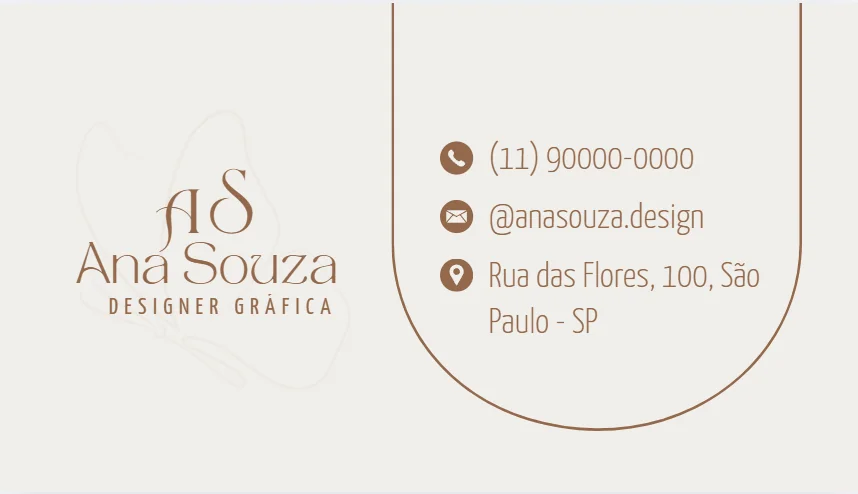
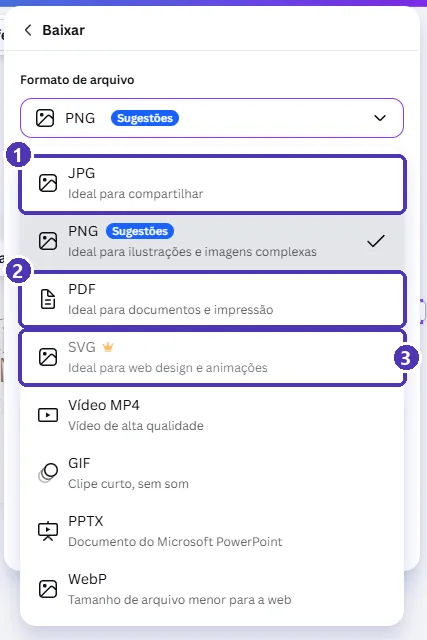
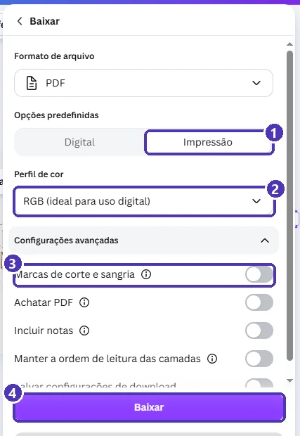
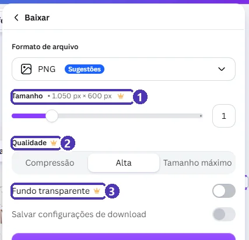

# 05 — Projeto do módulo: cartão de visita

> **Curso:** Canva  
> **Módulo:** 01 — Primeiros passos  
> **Tempo estimado:** 1 h 30 min  

---

## Objetivos

Ao final deste projeto, você terá:

- Um **cartão de visita** seu, feito a partir de um modelo gratuito.
- Os textos trocados **sem perder a formatação** do modelo.
- O design **organizado** na pasta do curso, com um nome claro.
- Uma cópia em **PDF para impressão** e uma em **PNG** para mandar pelo celular.

## Pré-requisitos

- Aulas [01](01_conhecendo_o_canva.md) a [04](04_projetos_e_pastas.md) deste módulo.

---

## O resultado

Este é o cartão de exemplo, com dados **inventados** (Ana Souza não existe):

<figure markdown="span">
  { loading=lazy }
  <figcaption>O cartão pronto: nome e profissão de um lado; contatos do outro, cada um com um ícone.</figcaption>
</figure>

!!! danger "Dados pessoais: pense antes de pôr"
    O cartão é para entregar a pessoas que você **ainda não conhece**. Coloque só o que serve para o contato profissional: um e-mail ou telefone de trabalho, um perfil profissional. **Endereço de casa, não.** Para o projeto da turma, você pode usar dados inventados, como no exemplo.

---

## Passo 1 — Escolher o modelo

1. Em **Modelos**, busque `cartão de visita`.
2. Use os filtros **Estilo** e **Idioma** para encontrar um modelo que combine com a sua área (sério, colorido, minimalista...).
3. Descarte os modelos com **coroa** 👑.
4. Abra a prévia e confira: o tipo é **Cartão de visita** e as medidas são **3,5" × 2"** (cerca de 8,9 × 5,1 cm, o tamanho padrão do Canva).
5. Clique em **Personalizar este modelo**.

!!! info "E o tamanho brasileiro?"
    No Brasil, o cartão mais comum tem **9 × 5 cm**, só um pouquinho diferente do formato do Canva. Para imprimir em casa ou mostrar no celular, o modelo serve como está. Se for mandar para uma **gráfica**, pergunte o tamanho que ela usa e, se precisar, crie um design de **9 × 5 cm** (*Tamanho personalizado*) e cole o conteúdo nele (aula 02).

---

## Passo 2 — Trocar os textos

Para cada texto do modelo:

1. **Dois cliques** no texto ➔ `Ctrl + A` ➔ digite o seu ➔ `Esc`.
2. Confira se a aparência continuou igual. Se o texto ficou **mais grosso** ou de outro tamanho, selecione um texto que está certo ➔ **Copiar estilo** ➔ clique no texto diferente (aula 03).

Troque também **monogramas** (as iniciais grandes do modelo) e **profissões**. Não deixe nenhum texto do modelo original sobrando: “Rua Alegre, 123” no seu cartão denuncia que ninguém revisou.

!!! tip "Texto que não cabe"
    Se o endereço ou o nome for maior que o do modelo, a caixa cresce e pode empurrar outros elementos. Prefira **diminuir o tamanho da fonte** um pouco a deixar o texto encostado na borda. Deixe pelo menos meio centímetro de margem em volta.

---

## Passo 3 — Revisar como um designer

Antes de baixar, confira:

- [ ] Todos os textos são **seus** (nenhum resto do modelo).
- [ ] Os textos parecidos têm a **mesma** fonte, cor e peso.
- [ ] Os elementos estão **alinhados** (as linhas cor-de-rosa ajudam).
- [ ] Há **margem** livre perto das bordas do cartão.
- [ ] Nenhum elemento tem **coroa** 👑.
- [ ] O nome do design segue o padrão (`cartão – seu nome`) e ele está na pasta **Curso de Canva**.

---

## Passo 4 — Baixar

Clique em **Compartilhar**, no canto superior direito do editor:

<figure markdown="span">
  { loading=lazy }
  <figcaption>(1) <strong>Compartilhar</strong> · (2) quem pode abrir: por enquanto, só você · (3) <strong>Copiar link</strong> · (4) <strong>Baixar</strong> · (5) <strong>Apresentar</strong> mostra o design em tela cheia.</figcaption>
</figure>

Em **Baixar**, escolha o **formato de arquivo**:

<figure markdown="span">
  { loading=lazy }
  <figcaption>(1) <strong>JPG</strong>: leve, bom para mandar por mensagem · (2) <strong>PDF</strong>: para documentos e impressão · (3) <strong>SVG</strong> tem coroa: é do Pro. PNG, MP4, GIF, PPTX e WebP são gratuitos.</figcaption>
</figure>

| Para... | Formato |
|---|---|
| Mandar pelo WhatsApp ou pôr num site | **PNG** ou **JPG** |
| Imprimir (em casa ou na gráfica) | **PDF** com a opção **Impressão** |
| Apresentar ou abrir no PowerPoint | **PPTX** |
| Design com animação | **MP4** ou **GIF** |

### PDF para impressão

1. Formato **PDF** ➔ em *Opções predefinidas*, clique em **Impressão**.
2. Abra **Configurações avançadas**.
3. Para a gráfica, ligue **Marcas de corte e sangria**: o PDF ganha uma margem extra e as marquinhas que mostram onde cortar.
4. Clique em **Baixar**.

<figure markdown="span">
  { loading=lazy }
  <figcaption>(1) <strong>Impressão</strong> · (2) perfil de cor · (3) <strong>Marcas de corte e sangria</strong>, para a gráfica · (4) <strong>Baixar</strong>.</figcaption>
</figure>

!!! tip "Sangria, em uma frase"
    A guilhotina da gráfica nunca corta exatamente na linha. A **sangria** é uma faixa extra do fundo, para fora do cartão, que garante que não sobre borda branca se o corte desviar um pouquinho.

### PNG para o celular

Formato **PNG** ➔ **Baixar**. Repare que algumas opções do PNG têm coroa:

<figure markdown="span">
  { loading=lazy }
  <figcaption>No plano gratuito, (1) <strong>Tamanho</strong>, (2) <strong>Qualidade</strong> e (3) <strong>Fundo transparente</strong> são do Pro. O PNG no tamanho padrão é gratuito e serve muito bem para mandar pelo celular.</figcaption>
</figure>

---

## Entrega

Entregue ao professor:

1. O **PDF** para impressão (`cartao_seunome.pdf`).
2. O **PNG** (`cartao_seunome.png`).
3. Uma frase dizendo **qual modelo** você usou e **o que mudou** além dos textos (cor, ícone, posição...).

### Critérios de avaliação

| Critério | O que se espera |
|---|---|
| Conteúdo | Todos os textos trocados; só dados de contato profissional (ou inventados). |
| Consistência | Textos parecidos com a mesma fonte, cor e peso. |
| Organização visual | Elementos alinhados e margem livre nas bordas. |
| Plano gratuito | Nenhum elemento com coroa 👑. |
| Arquivos | PDF de impressão e PNG, com nomes claros; design na pasta do curso. |

---

## Exercícios extras

### Básico (fixação)

Baixe o cartão em **JPG** e em **PNG** e compare o tamanho dos dois arquivos. Qual é mais leve?

<!-- gabarito -->
??? success "Gabarito — Básico"
    *Compartilhar ➔ Baixar* ➔ **JPG** ➔ *Baixar*; depois o mesmo com **PNG**. Na pasta de downloads, o **JPG** costuma ser bem mais leve: ele comprime a imagem. O **PNG** guarda cada detalhe, por isso é melhor para textos pequenos e ícones nítidos.

### Intermediário (aplicação)

Faça o **verso** do cartão (só o nome ou um ícone, no centro) e baixe frente e verso num **único PDF** de impressão.

<!-- gabarito -->
??? success "Gabarito — Intermediário"
    1. Faixa de páginas ➔ setinha ao lado do **+** ➔ **Duplicar página**; limpe a página 2 e deixe só o nome ou ícone, centralizado.
    2. *Compartilhar ➔ Baixar* ➔ **PDF** ➔ **Impressão**. Na opção de páginas, deixe **todas as páginas** selecionadas.
    3. O PDF sai com duas páginas: frente e verso.

### Avançado (desafio)

Uma gráfica pediu o cartão em **9 × 5 cm**, PDF com **marcas de corte e sangria**. Prepare o arquivo sem usar o Redimensionar.

<!-- gabarito -->
??? success "Gabarito — Avançado"
    1. *Criar ➔ Tamanho personalizado* ➔ **9 × 5 cm** ➔ *Criar novo design*.
    2. No cartão original: `Ctrl + A` ➔ `Ctrl + C`. No design novo: `Ctrl + V`. Ajuste o **fundo** para cobrir a página inteira, até a borda, e afaste os textos uns milímetros das bordas.
    3. *Compartilhar ➔ Baixar* ➔ **PDF** ➔ **Impressão** ➔ *Configurações avançadas* ➔ ligue **Marcas de corte e sangria** ➔ *Baixar*.
    4. Renomeie o design (`cartão – seu nome – 9x5 gráfica`) e guarde na pasta do curso.

---

## 💡 Resumo

- Modelo **sem coroa**, textos **todos trocados**, aparência **igualada** com Copiar estilo.
- Revise: alinhamento, margem, consistência e nome do design.
- **PNG/JPG** para tela; **PDF + Impressão** para papel; **marcas de corte e sangria** para gráfica.
- Dados pessoais: no cartão, só o contato **profissional**.

## ➡️ Próximo passo

Você terminou o **Módulo 01**. Volte ao [índice do módulo](index.md) e confira o checklist. O **Módulo 02 — Design na prática** *(em breve)* aprofunda texto, cores, imagens e alinhamento.
