# 01 — Projeto: catálogo de produtos para enviar aos clientes

> **Curso:** Canva  
> **Módulo:** 02 — Projetos para o seu negócio  
> **Tempo estimado:** 2 h  

---

## O pedido

> *“Quero fazer um catálogo dos meus produtos para mandar no WhatsApp dos clientes. Com foto, nome e preço de cada peça, e um jeito fácil de a pessoa me chamar para comprar.”*

Neste projeto você monta exatamente isso: um **catálogo em PDF**, com várias páginas de produtos e um **WhatsApp clicável**. O cliente abre no celular, escolhe, toca no número e já cai na conversa com você.

O exemplo usa um negócio **inventado**, o *Ateliê Ana Souza*, de semijoias:

<figure markdown="span">
  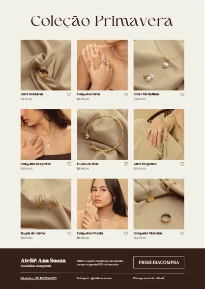{ loading=lazy }
  <figcaption>O resultado: título da coleção, produtos em grade e, no rodapé, a loja e os contatos, com o WhatsApp clicável.</figcaption>
</figure>

## O que você vai aprender no caminho

- Escolher um modelo de catálogo **gratuito** e no **formato certo** para o celular.
- Trocar nome, preço e **foto** de cada produto, com o botão **Substituir**.
- **Duplicar páginas** para caber todos os produtos.
- Pôr um **link de WhatsApp** num texto.
- Baixar em **PDF digital** e entender quando mandar o **PDF** e quando mandar o **link**.

## Antes de começar

- [Módulo 01](../modulo_01_primeiros_passos/index.md) completo: editor, textos, pastas e download.
- Uma lista dos seus produtos com **nome**, **preço** e, se tiver, **fotos** no computador ou no celular. Para praticar, use os produtos do próprio modelo.

---

## Passo 1 — Escolher o modelo

1. Em **Modelos**, busque `catálogo de produtos`.
2. O Canva separa os resultados por tipo: **Documentos**, stories, apresentações... Para mandar em PDF, prefira **Documentos** (folha A4) ou **Apresentação**.
3. Descarte os modelos com a **coroa** 👑.

<figure markdown="span">
  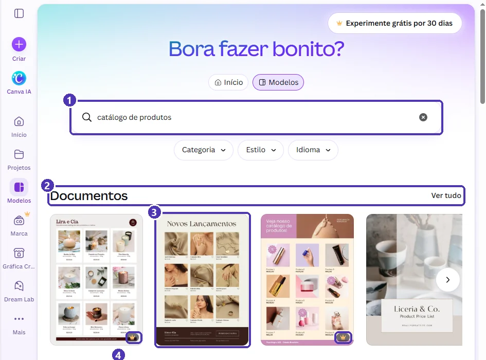{ loading=lazy }
  <figcaption>(1) A busca · (2) os resultados agrupados por tipo: <em>Ver tudo</em> mostra todos os documentos · (3) um modelo gratuito · (4) a coroa marca os modelos do Pro.</figcaption>
</figure>

4. Abra a prévia e confira o **tipo** e as **medidas**. Depois, **Personalizar este modelo**.

<figure markdown="span">
  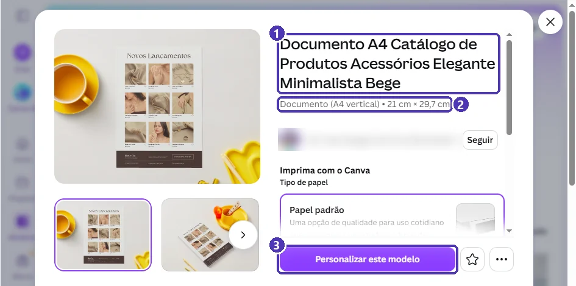{ loading=lazy }
  <figcaption>(1) O nome do modelo · (2) <strong>A4 vertical</strong>: abre bem no celular, rolando de cima para baixo · (3) <strong>Personalizar este modelo</strong>.</figcaption>
</figure>

!!! tip "A4 em pé ou apresentação deitada?"
    No celular, **A4 em pé** se lê rolando a tela, como um cardápio. Um catálogo de **apresentação (16:9, deitado)** fica pequeno no celular em pé, mas fica ótimo no computador e na TV. Para WhatsApp, prefira **em pé**.

---

## Passo 2 — Conhecer as partes do catálogo

<figure markdown="span">
  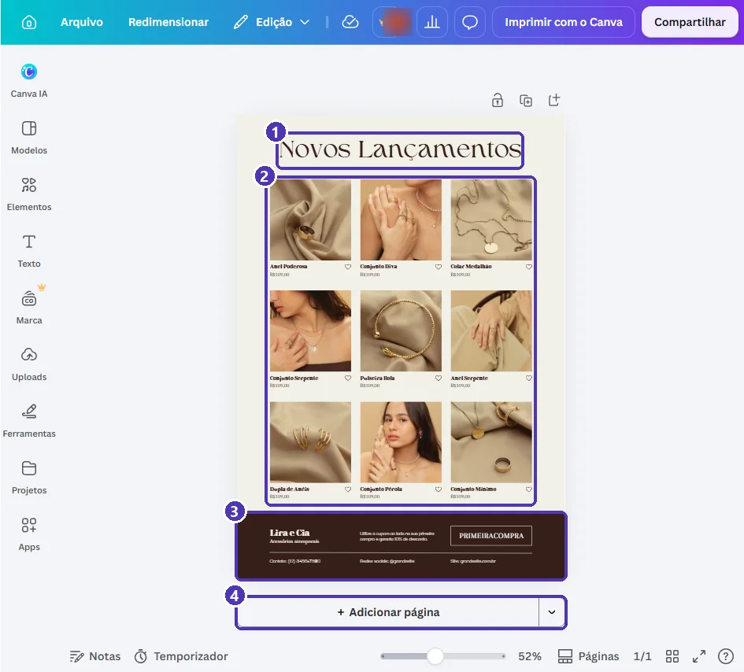{ loading=lazy }
  <figcaption>(1) Título da coleção · (2) a grade de produtos: foto, nome e preço · (3) o rodapé com a loja e os contatos · (4) <strong>Adicionar página</strong>.</figcaption>
</figure>

Antes de mexer, decida:

- **Título:** o nome da coleção ou da campanha (“Coleção Primavera”, “Kits de Páscoa”, “Pronta-entrega”).
- **Quantos produtos por página:** este modelo tem 9. Se você tem 20 produtos, serão 3 páginas.
- **O que vai no rodapé:** nome da loja, WhatsApp, Instagram e uma informação que ajude a vender (entrega, forma de pagamento, cupom).

---

## Passo 3 — Trocar os dados da loja

Troque o **título** e cada texto do **rodapé** como na [aula 03 do Módulo 01](../modulo_01_primeiros_passos/03_conhecendo_o_editor.md): dois cliques ➔ `Ctrl + A` ➔ digite ➔ `Esc`.

!!! warning "Texto pequeno: aproxime antes"
    No catálogo inteiro na tela, os textos de rodapé e preço ficam minúsculos e é fácil clicar no lugar errado. Aproxime com `Ctrl` + rodinha do mouse antes de editar.

---

## Passo 4 — Produtos: nome, preço e foto

**Nome e preço:** os mesmos dois cliques em cada texto. Escreva o preço sempre igual em todo o catálogo: `R$ 89,90`, com espaço depois do `R$` e vírgula nos centavos.

**Foto:** clique na foto do produto e, na barra de cima, em **Substituir**.

<figure markdown="span">
  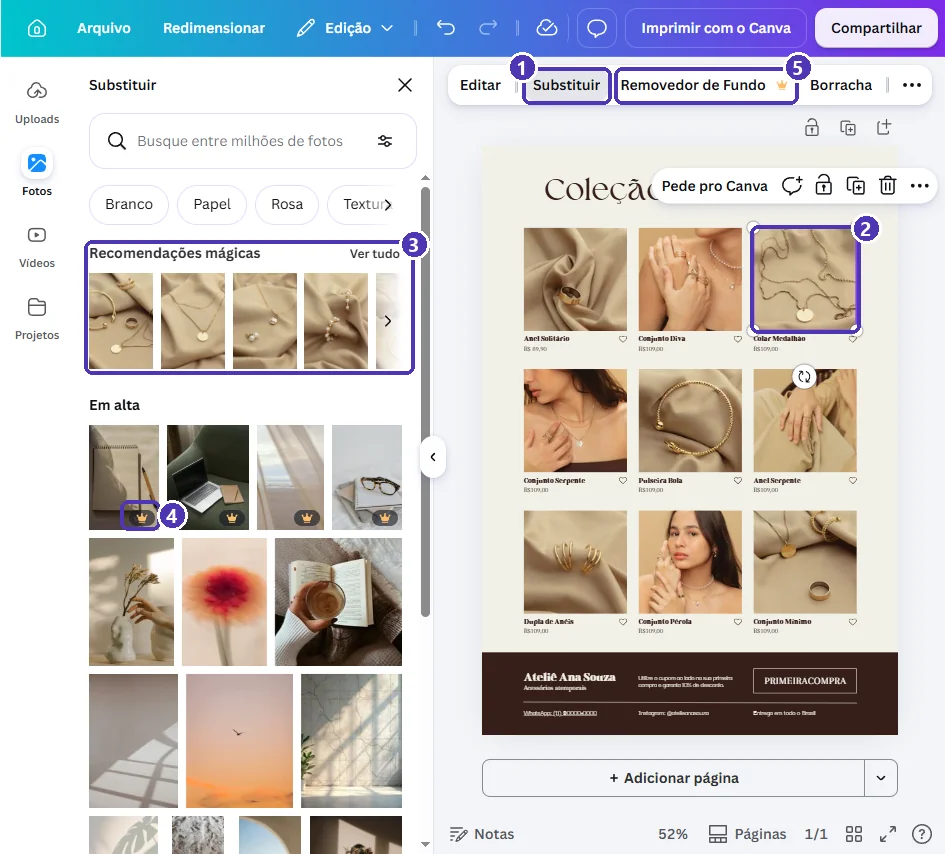{ loading=lazy }
  <figcaption>(1) <strong>Substituir</strong> · (2) a foto selecionada · (3) <em>Recomendações mágicas</em>: fotos parecidas com a atual · (4) fotos com coroa são do Pro · (5) o <em>Removedor de Fundo</em> também.</figcaption>
</figure>

No painel **Substituir**:

- **Uploads:** as **suas** fotos. Clique em *Uploads* ➔ **Fazer upload de arquivos** e escolha as fotos dos seus produtos.
- **Fotos:** o banco do Canva. Para treinar, as *Recomendações mágicas* trazem fotos parecidas com a do modelo.
- Clique na foto escolhida: ela entra **no mesmo lugar e no mesmo tamanho** da antiga.

!!! tip "Foto de produto boa, de celular"
    Fundo liso (uma folha branca ou um tecido), luz de janela, sem flash, e o produto ocupando boa parte da foto. Tire todas com o **mesmo fundo**: o catálogo fica com cara de loja.

!!! warning "Foto da internet não é sua"
    Use fotos **dos seus produtos** ou do banco do Canva. Foto de outra loja, do Google ou do Instagram de outra pessoa pode render reclamação, e o cliente recebe uma peça diferente da foto.

---

## Passo 5 — Mais páginas

Quando a primeira página estiver pronta, **duplique** para aproveitar o layout. O ícone fica na barra **em cima de cada página**:

<figure markdown="span">
  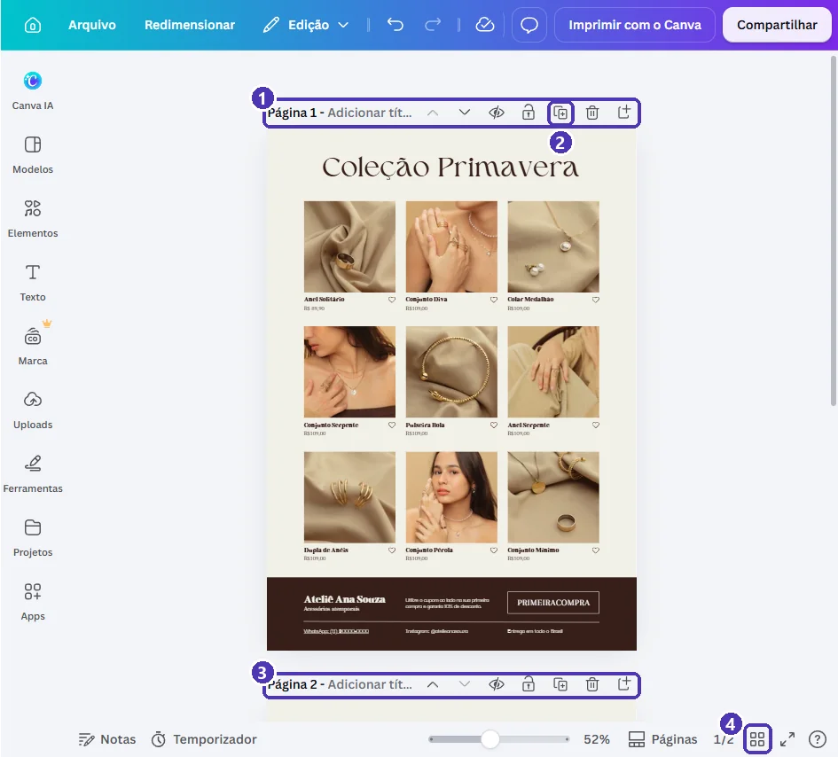{ loading=lazy }
  <figcaption>(1) A barra da página · (2) <strong>Duplicar página</strong> · (3) a página 2, criada igual à primeira · (4) visualização em grade, para ver todas as páginas.</figcaption>
</figure>

Depois, na página nova, troque só os produtos. Na **visualização em grade** você vê o catálogo inteiro e pode arrastar as páginas para mudar a ordem:

<figure markdown="span">
  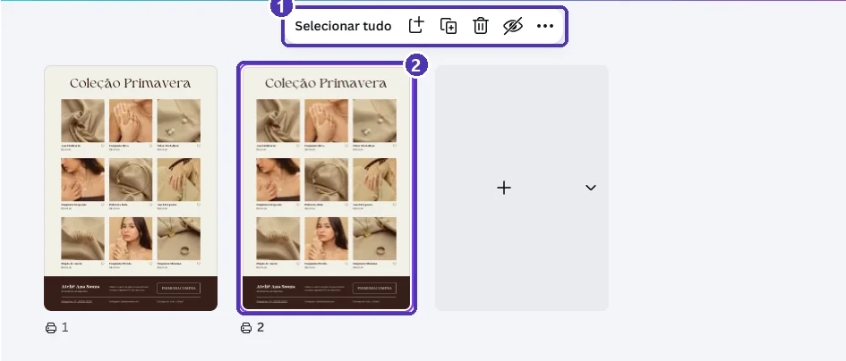{ loading=lazy }
  <figcaption>(1) Ações para as páginas selecionadas · (2) a página duplicada.</figcaption>
</figure>

!!! info "E a setinha ao lado de Adicionar página?"
    Ela acrescenta uma página de **outro tipo** (apresentação, vídeo, doc...) ao mesmo projeto. Para um catálogo, use o **+ Adicionar página** (página em branco do mesmo tamanho) ou o **Duplicar**.

    <figure markdown="span">
      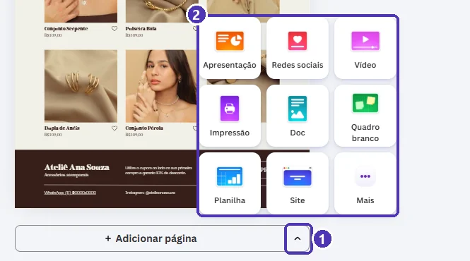{ loading=lazy }
      <figcaption>(1) A setinha · (2) os tipos de página que ela acrescenta.</figcaption>
    </figure>

---

## Passo 6 — WhatsApp clicável

Este é o detalhe que faz o catálogo **vender**: o cliente toca no número e a conversa abre.

1. Selecione o texto do WhatsApp (**um** clique).
2. Nas ações rápidas, clique nos **três pontinhos** (⋯) e em **Adicionar link**. Atalho: `Ctrl + K`.

<figure markdown="span">
  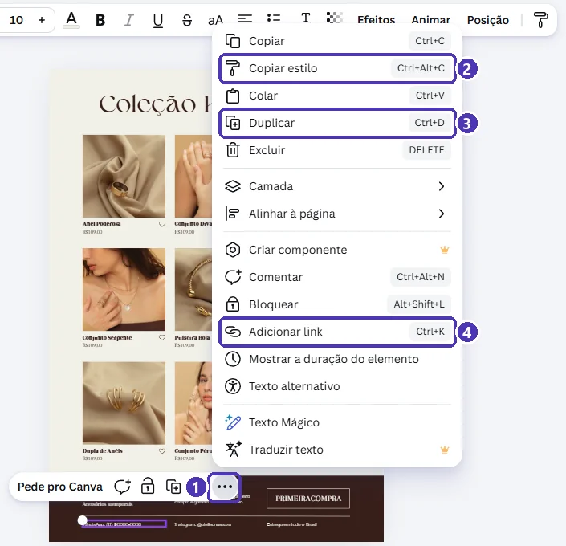{ loading=lazy }
  <figcaption>(1) Os três pontinhos · (2) <em>Copiar estilo</em> e (3) <em>Duplicar</em> também moram aqui, com seus atalhos · (4) <strong>Adicionar link</strong>.</figcaption>
</figure>

3. Digite o link no formato `https://wa.me/55` + **DDD** + **número**, só números, sem espaços nem traços. Exemplo (fictício): `https://wa.me/5511900000000`.
4. Clique em **Pronto**. O texto fica sublinhado.

<figure markdown="span">
  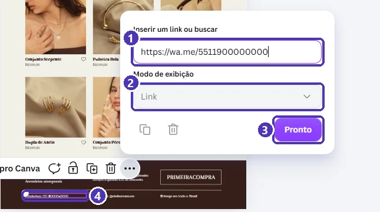{ loading=lazy }
  <figcaption>(1) O link do WhatsApp · (2) <em>Modo de exibição</em>: deixe <strong>Link</strong> · (3) <strong>Pronto</strong> · (4) o texto que recebeu o link.</figcaption>
</figure>

!!! tip "Mensagem pronta"
    Acrescente `?text=` e uma frase no fim do link, trocando os espaços por `%20`: `https://wa.me/5511900000000?text=Oi!%20Vi%20o%20catálogo`. A conversa já abre com essa mensagem escrita.

Faça o mesmo com o **Instagram** (`https://instagram.com/seuperfil`) ou com o site, se tiver.

---

## Passo 7 — Revisar

- [ ] Nenhum texto do modelo original sobrou (nomes, preços, “Lira e Cia”, “grandesite”...).
- [ ] Todos os preços no mesmo formato (`R$ 89,90`).
- [ ] Cada foto mostra **o produto daquele nome**.
- [ ] O WhatsApp está **sublinhado** e o número está certo.
- [ ] Nenhum elemento, foto ou modelo tem **coroa** 👑.
- [ ] O design tem um nome claro (`catálogo – coleção primavera – 2026`) e está numa pasta.

---

## Passo 8 — Enviar: PDF ou link?

### PDF (o mais comum)

**Compartilhar** ➔ **Baixar** ➔ formato **PDF** ➔ opção **Digital**:

<figure markdown="span">
  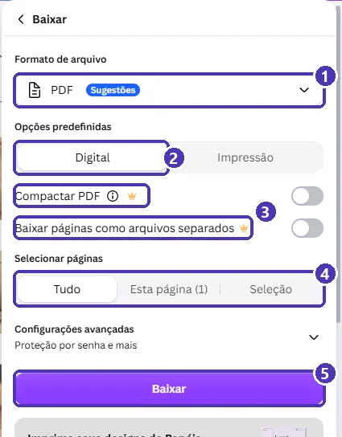{ loading=lazy }
  <figcaption>(1) Formato <strong>PDF</strong> · (2) <strong>Digital</strong>: para ver na tela, e os links continuam clicáveis · (3) duas opções do Pro · (4) <strong>Tudo</strong>: todas as páginas num PDF só · (5) <strong>Baixar</strong>.</figcaption>
</figure>

Mande o PDF no WhatsApp como **Documento** (no clipe ➔ *Documento*), não como foto: assim ele chega inteiro e os links funcionam.

!!! warning "PDF de impressão não é para WhatsApp"
    A opção **Impressão** gera um arquivo mais pesado, preparado para a gráfica. Para o cliente ver no celular, use **Digital**.

### Link do Canva

Em **Compartilhar**, o **Nível de acesso** define quem abre o link:

<figure markdown="span">
  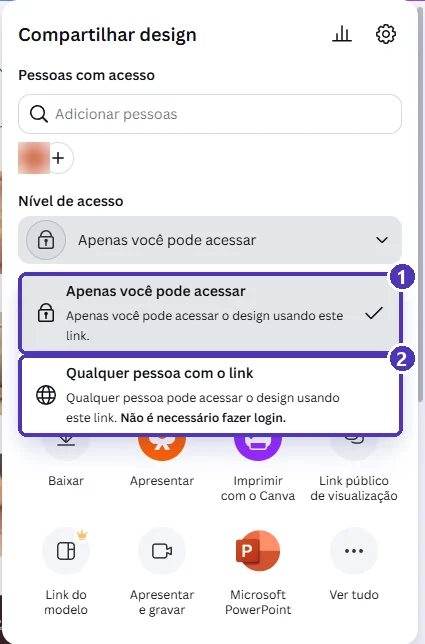{ loading=lazy }
  <figcaption>(1) <strong>Apenas você</strong>: o padrão · (2) <strong>Qualquer pessoa com o link</strong>: abre sem login.</figcaption>
</figure>

| | PDF | Link do Canva |
|---|---|---|
| Abre sem internet depois de baixado | ✅ | ❌ |
| Você muda um preço e o cliente vê na hora | ❌ (precisa mandar de novo) | ✅ |
| O cliente consegue guardar e repassar | ✅ | ✅ |

!!! danger "Link de edição, nunca"
    Ao escolher **Qualquer pessoa com o link**, confira se a permissão ao lado é **só para ver**. Para clientes, o mais seguro é o botão **Link público de visualização**, no mesmo painel: ele gera um link que só mostra o catálogo, sem acesso ao editor.

---

## Para outros negócios

O mesmo roteiro serve para qualquer loja. Busque o modelo pelo seu ramo:

| Negócio | Busque | Dica |
|---|---|---|
| Doces e bolos | `catálogo doces` | Foto de cima, mostrando o recheio; peso ou fatias junto do preço. |
| Roupas | `catálogo roupas` | Tamanhos disponíveis embaixo de cada peça. |
| Artesanato | `catálogo artesanato` | Prazo de produção no rodapé (“sob encomenda: 7 dias”). |
| Serviços (manicure, aulas...) | `tabela de preços` | Em vez de foto do produto, um ícone por serviço. |

---

## Exercícios

### Básico (fixação)

Monte **uma página** de catálogo com **6 produtos** seus (ou inventados): nome, preço e foto do banco do Canva, e o rodapé com os dados da loja.

<!-- gabarito -->
??? success "Gabarito — Básico"
    1. *Modelos* ➔ `catálogo de produtos` ➔ um modelo de **Documentos** sem coroa ➔ *Personalizar este modelo*.
    2. Se o modelo tem 9 produtos, apague 3: clique na foto, segure `Shift` e clique no nome e no preço ➔ `Delete`. Reorganize os 6 em duas linhas de 3.
    3. Para cada produto: dois cliques no nome e no preço; foto ➔ **Substituir** ➔ *Fotos* ➔ busque o produto ➔ escolha uma sem coroa.
    4. Rodapé: troque nome da loja e contatos.

### Intermediário (aplicação)

Transforme o catálogo do básico em **duas páginas** e deixe **WhatsApp e Instagram clicáveis** nas duas. Baixe o **PDF digital** e teste os links no celular.

<!-- gabarito -->
??? success "Gabarito — Intermediário"
    1. Barra em cima da página ➔ **Duplicar página**. Na página 2, troque os produtos.
    2. Em cada página: selecione o texto do WhatsApp ➔ `Ctrl + K` ➔ `https://wa.me/55DDDNUMERO` ➔ *Pronto*. O mesmo para o Instagram.
    3. *Compartilhar ➔ Baixar* ➔ **PDF** ➔ **Digital** ➔ *Selecionar páginas*: **Tudo** ➔ *Baixar*.
    4. Mande o PDF para você mesmo no WhatsApp (*clipe ➔ Documento*), abra e toque nos links.

    **Dica:** se o rodapé é igual nas duas páginas, deixe o link pronto **antes** de duplicar: a cópia já nasce com ele.

### Avançado (desafio)

Faça uma **capa** para o catálogo (primeira página) com o nome da loja, a coleção e uma foto grande, e uma **última página** com “Como comprar”: forma de pagamento, prazo de entrega e o WhatsApp com **mensagem pronta**.

<!-- gabarito -->
??? success "Gabarito — Avançado"
    1. **Capa:** na grade, + para uma página nova e arraste-a para o começo. *Elementos ➔ Fotos* ➔ uma foto sem coroa ➔ arraste até cobrir a página. Por cima, o nome da loja e da coleção, em letras grandes, numa faixa de cor para dar contraste.
    2. **Como comprar:** página nova no fim, com 3 blocos curtos: *Pagamento*, *Entrega*, *Pedido*. Use ícones de *Elementos* (`cartão`, `caminhão`, `whatsapp`).
    3. **Mensagem pronta:** `https://wa.me/55DDDNUMERO?text=Oi!%20Quero%20fazer%20um%20pedido` no texto “Peça pelo WhatsApp”.
    4. Na grade, confira a ordem: capa ➔ produtos ➔ como comprar.

---

## 💡 Resumo

- Para WhatsApp: modelo de **Documento A4 em pé**, sem coroa.
- Foto de produto: **Substituir** ➔ *Uploads* (suas fotos) ou *Fotos* (banco do Canva).
- **Duplicar página** aproveita o layout; a **grade** mostra e reordena tudo.
- **Adicionar link** (`Ctrl + K`) + `https://wa.me/55DDDNUMERO` = WhatsApp clicável.
- Cliente no celular: **PDF Digital** enviado como documento, ou **Link público de visualização**.

## ➡️ Próximo passo

**[02 — Cardápio com QR code para pedidos](02_cardapio.md)**: listas de opções e preços, cores e um QR code que abre o WhatsApp.
