# 02 — Projeto: cardápio com QR code para pedidos

> **Curso:** Canva  
> **Módulo:** 02 — Projetos para o seu negócio  
> **Tempo estimado:** 2 h  

---

## O pedido

> *“Faço bolos por encomenda e todo cliente pergunta a mesma coisa: tamanhos, sabores e preço. Quero um cardápio para mandar no WhatsApp e colar na geladeira da loja, com um QR code para o cliente me chamar.”*

Neste projeto você monta um **cardápio de uma página**, com listas de opções e preços, a **forma de pagamento** e um **QR code** que abre o WhatsApp. Ele serve para mandar por mensagem e também para **imprimir**.

O exemplo usa uma confeitaria **inventada**, a *Doces da Bia*:

<figure markdown="span">
  { loading=lazy }
  <figcaption>O resultado: opções em listas, preços alinhados, regras do pedido num quadro e um QR code para pedir pelo WhatsApp.</figcaption>
</figure>

## O que você vai aprender no caminho

- Escolher entre **cardápio**, **cartaz** e **story**, conforme onde ele vai aparecer.
- Editar **listas com marcadores** (acrescentar e tirar itens).
- Resolver **texto que estoura** a caixa e **lista que invade** o título de baixo.
- Trocar uma **cor** do design.
- Criar um **QR code** gratuito e colocar uma **legenda** nele.
- Baixar em **JPG** para o WhatsApp e em **PDF** para imprimir.

## Antes de começar

- [Projeto 01 — Catálogo de produtos](01_catalogo_de_produtos.md): trocar textos, links de WhatsApp e downloads.
- Sua lista de opções e preços. Para praticar, use a do exemplo.

---

## Passo 1 — Cardápio, cartaz ou story?

Busque `cardápio` em **Modelos**. O Canva agrupa os resultados pelo **tipo de design**, e cada tipo serve para um lugar:

<figure markdown="span">
  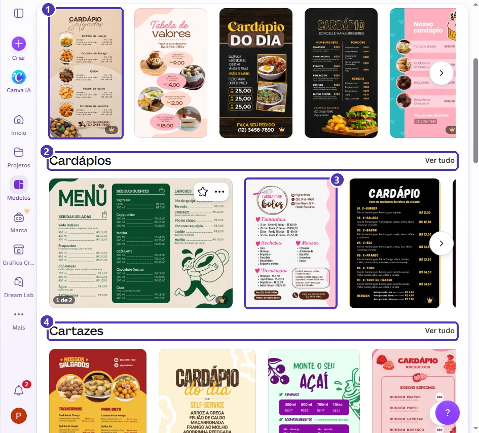{ loading=lazy }
  <figcaption>(1) <strong>Stories</strong>: em pé e estreitos, para o status do WhatsApp e o Instagram · (2) <strong>Cardápios</strong>: folha A4, para imprimir e mandar em PDF · (3) o modelo do exemplo · (4) <strong>Cartazes</strong>: para a parede ou a vitrine.</figcaption>
</figure>

| Onde vai aparecer | Tipo | Por quê |
|---|---|---|
| Na mesa, no balcão, na geladeira, em PDF | **Cardápio** (A4) | Cabe bastante informação e imprime em qualquer impressora. |
| Na parede ou na vitrine | **Cartaz** | Letra grande, para ler de longe; pouca informação. |
| No status do WhatsApp ou nos stories | **Story** (9:16) | Preenche a tela do celular em pé. |

Abra a prévia, confira o tipo (**Menu • 21 cm × 29,7 cm** é A4) e clique em **Personalizar este modelo**.

<figure markdown="span">
  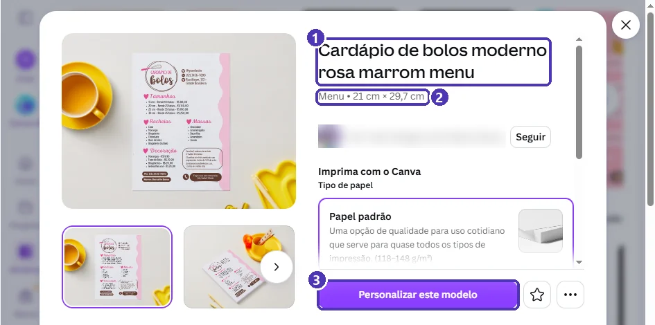{ loading=lazy }
  <figcaption>(1) O nome do modelo · (2) tipo e medidas: A4 · (3) <strong>Personalizar este modelo</strong>.</figcaption>
</figure>

!!! tip "Escolha pela estrutura, não pela cor"
    A cor você troca em 1 minuto (Passo 5). O que dá trabalho mudar é a **estrutura**: quantos blocos, onde ficam os preços, se tem foto. Procure um modelo cuja estrutura se pareça com o seu cardápio. Um modelo de bolo serve para salgados, e um de hambúrguer serve para açaí.

---

## Passo 2 — As partes do cardápio

<figure markdown="span">
  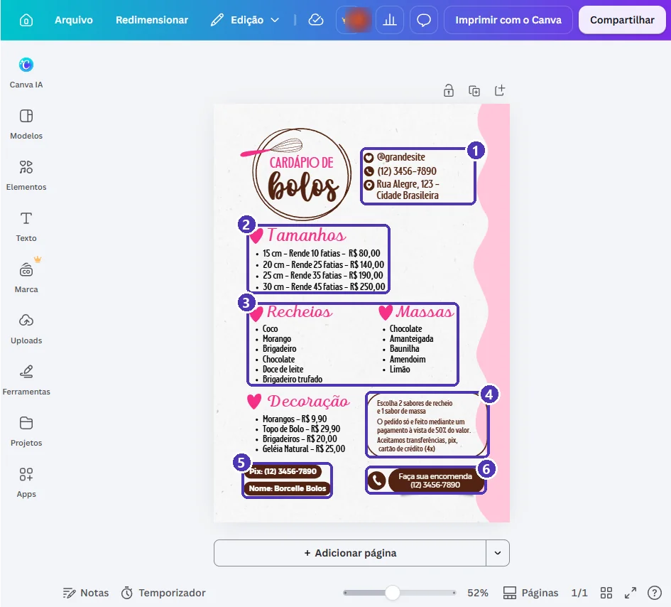{ loading=lazy }
  <figcaption>(1) Contatos · (2) opções <strong>com preço</strong> · (3) opções <strong>sem preço</strong> (sabores) · (4) as regras do pedido · (5) pagamento · (6) a chamada para pedir.</figcaption>
</figure>

Um bom cardápio responde às perguntas que o cliente faria:

1. **O que tem?** As listas de opções.
2. **Quanto custa?** O preço junto de cada opção, sempre no mesmo formato.
3. **Como peço e pago?** As regras do pedido e a forma de pagamento.
4. **Como falo com você?** Telefone, Instagram e o QR code.

---

## Passo 3 — Trocar os dados

Troque contatos, preços e regras com os **dois cliques** ➔ `Ctrl + A` ➔ digite ➔ `Esc` de sempre.

### Quando o texto estoura

Os “botões” do modelo (as pílulas marrons do Pix e do nome) têm largura fixa. Se o texto novo for maior que o antigo, ele **quebra a linha** e sai da pílula:

<figure markdown="span">
  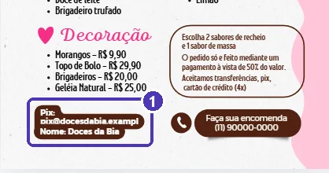{ loading=lazy }
  <figcaption>(1) A chave Pix comprida não coube: o texto quebrou e passou da pílula.</figcaption>
</figure>

Três saídas, da mais simples para a mais trabalhosa:

1. **Encurte o texto.** Aqui, a chave virou o telefone: `Pix: (11) 90000-0000`.
2. **Diminua a fonte** só daquele texto (o **−** ao lado do tamanho, na barra de cima).
3. **Aumente a pílula:** clique na forma marrom (não no texto) e arraste a alça da lateral.

!!! danger "Confira a chave Pix duas vezes"
    Um número errado no Pix manda o dinheiro do cliente para outra pessoa. Depois de digitar, leia a chave em voz alta comparando com a do seu banco. E prefira uma chave que você pode divulgar, como telefone, e-mail ou chave aleatória. **Não use CPF.**

---

## Passo 4 — Listas: acrescentar e tirar opções

As listas de sabores têm **marcadores** (as bolinhas). Para acrescentar um sabor:

1. **Dois cliques** na lista.
2. `Ctrl + End` leva o cursor ao **fim** da lista.
3. `Enter` cria um **item novo** com bolinha. Digite o sabor.

Para tirar um sabor, selecione a linha e apague. Para apagar a bolinha que sobrou, use `Backspace`.

<figure markdown="span">
  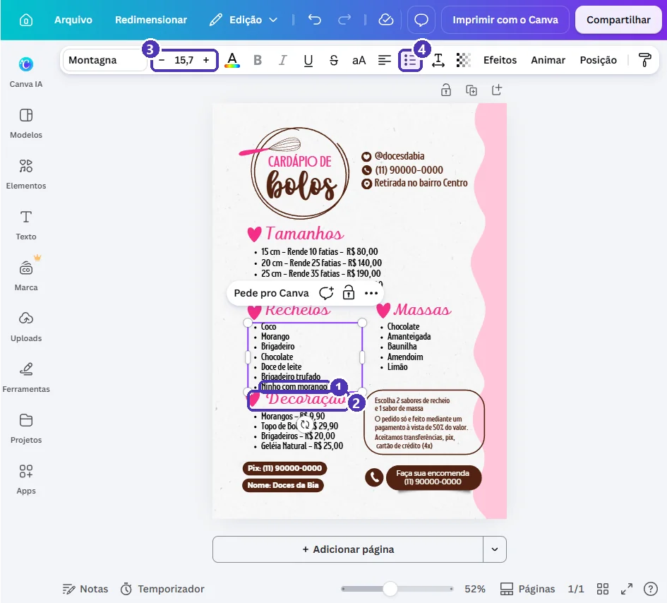{ loading=lazy }
  <figcaption>(1) O item novo · (2) a lista cresceu e <strong>encostou no título de baixo</strong> · (3) o tamanho da fonte · (4) o botão de lista com marcadores.</figcaption>
</figure>

!!! warning "A lista cresce para baixo"
    Cada item novo empurra a caixa para baixo, e ela não para quando encontra outro texto: os dois ficam um por cima do outro. Resolva de um destes jeitos:

    - **Diminua a fonte da lista** um ou dois pontos, com o **−** da barra (foi o que fizemos: de 15,7 para 13,7).
    - **Divida em duas colunas:** selecione a lista, `Ctrl + D` para duplicar, apague metade dos itens em cada uma e coloque lado a lado.
    - **Tire uma opção** que vende pouco.

---

## Passo 5 — Trocar uma cor

Clique no elemento (aqui, a faixa ondulada da lateral) e no **quadradinho de cor** da barra de cima:

<figure markdown="span">
  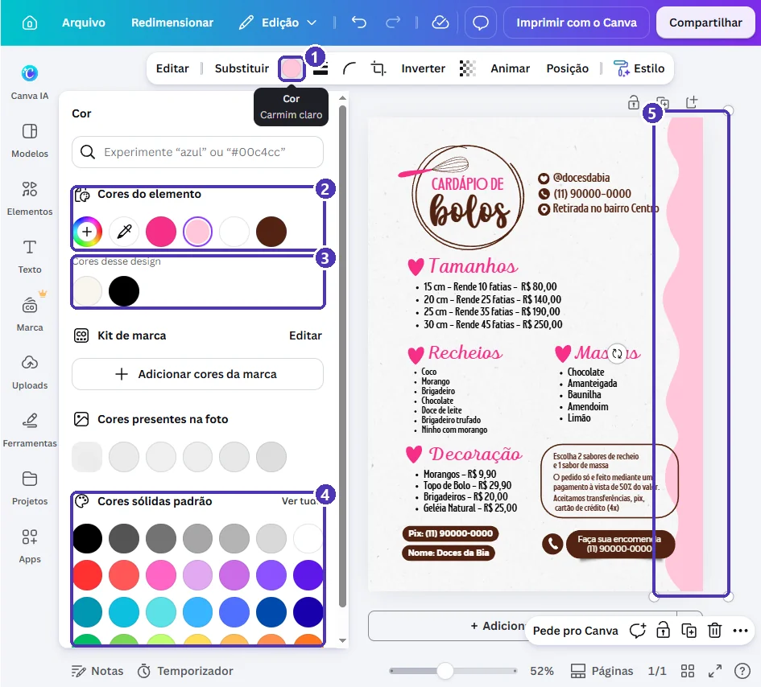{ loading=lazy }
  <figcaption>(1) A cor do elemento · (2) <em>Cores do elemento</em>: a atual está marcada · (3) <em>Cores desse design</em> · (4) <em>Cores sólidas padrão</em> · (5) o elemento selecionado.</figcaption>
</figure>

- Clique numa cor das **Cores sólidas padrão** ou escreva o nome ou código na busca (`lilás`, `#e2a9f1`).
- O **+** colorido abre o seletor livre; o **conta-gotas** copia uma cor de qualquer ponto da tela.
- Repita em cada elemento que deve mudar.

!!! tip "Paleta curta"
    Use **no máximo três cores**: uma de fundo, uma para títulos e uma para destaques. Para combinar, escolha nas **Cores desse design**: são as que o modelo já usa, então elas combinam entre si.

---

## Passo 6 — QR code para pedir pelo WhatsApp

No cardápio **impresso**, o cliente não consegue clicar no telefone. O QR code resolve: ele aponta a câmera e a conversa abre.

1. **Elementos** ➔ busque `QR code`. O primeiro resultado é o gerador do próprio Canva.

<figure markdown="span">
  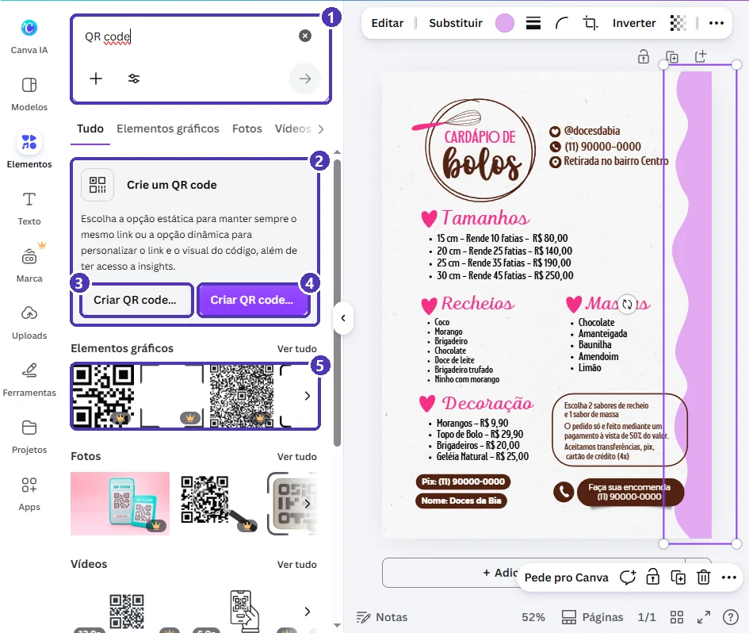{ loading=lazy }
  <figcaption>(1) A busca · (2) o gerador do Canva · (3) <strong>estático</strong>: o link fica fixo · (4) <strong>dinâmico</strong>: o link pode ser trocado depois · (5) os desenhos de QR code prontos são só enfeite, e com coroa.</figcaption>
</figure>

2. Clique em **Criar QR code estático** ➔ **Abrir**. É um app **do Canva** (aparece “App de Canva”).

<figure markdown="span">
  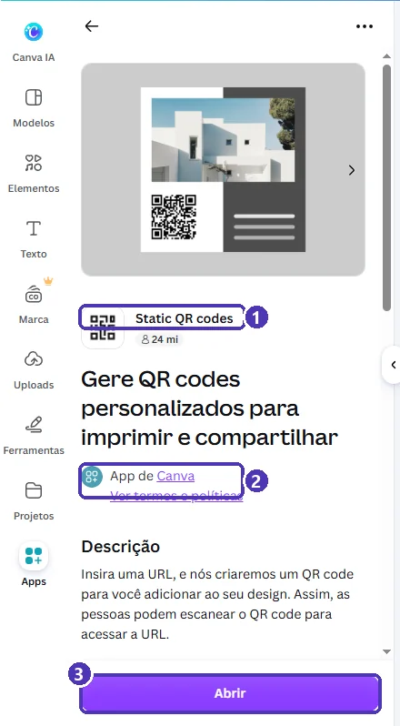{ loading=lazy }
  <figcaption>(1) O app <em>Static QR codes</em> · (2) feito pelo Canva · (3) <strong>Abrir</strong>.</figcaption>
</figure>

3. Em **URL**, cole o link do WhatsApp (`https://wa.me/55DDDNUMERO`, como no [projeto 01](01_catalogo_de_produtos.md)) ➔ **Gerar código**.

<figure markdown="span">
  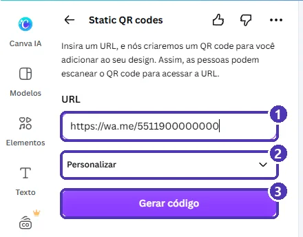{ loading=lazy }
  <figcaption>(1) O link do WhatsApp · (2) <em>Personalizar</em>: cor e margem do código · (3) <strong>Gerar código</strong>.</figcaption>
</figure>

4. O QR code entra **grande, no meio da página**. Diminua pelo **canto** e arraste para um espaço livre.

<figure markdown="span">
  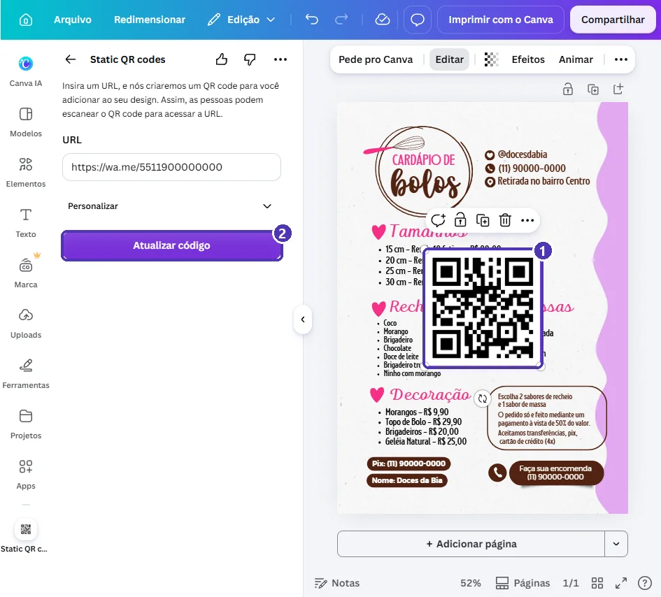{ loading=lazy }
  <figcaption>(1) O QR code recém-criado, por cima de tudo · (2) <strong>Atualizar código</strong>: se errou o link, corrija a URL e clique aqui com o QR code selecionado.</figcaption>
</figure>

5. **Legenda:** QR code sem explicação ninguém escaneia. Painel **Texto** ➔ **Adicionar uma caixa de texto** ➔ escreva `Peça pelo WhatsApp` ➔ arraste para baixo do código. Para a legenda ficar com a fonte do cardápio: selecione um texto do cardápio ➔ `Ctrl + Alt + C` (**Copiar estilo**) ➔ clique na legenda.

<figure markdown="span">
  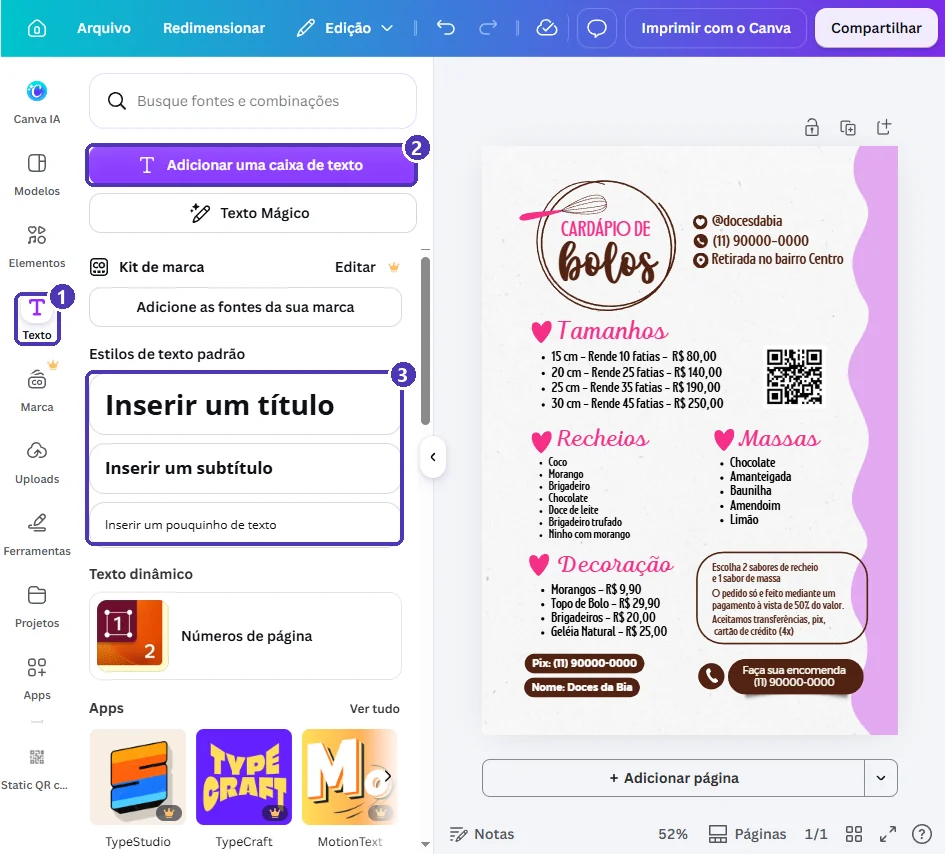{ loading=lazy }
  <figcaption>(1) <strong>Texto</strong> · (2) <strong>Adicionar uma caixa de texto</strong> · (3) estilos prontos de título, subtítulo e texto pequeno.</figcaption>
</figure>

!!! warning "Estático ou dinâmico?"
    O **estático** grava o link no desenho do código: funciona para sempre e não depende de nenhum serviço. O **dinâmico** passa por um endereço intermediário e permite trocar o link depois, mas depende desse serviço continuar no ar. Para WhatsApp, que não muda, use o **estático**. Na busca de **Apps** aparecem dezenas de geradores de outras empresas; alguns cobram ou expiram. O do Canva resolve.

!!! tip "Teste antes de imprimir"
    Aponte a câmera do **seu** celular para o QR code na tela do computador. Se abrir a conversa certa, pode imprimir. Na impressão, deixe o código com pelo menos **2 cm** de lado e com um espaço branco em volta.

---

## Passo 7 — Baixar

### JPG para o WhatsApp

**Compartilhar** ➔ **Baixar** ➔ **JPG**:

<figure markdown="span">
  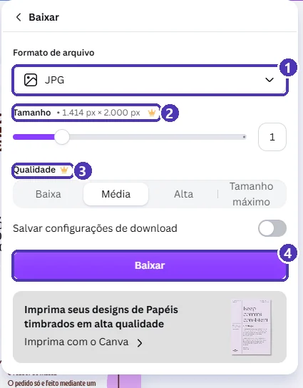{ loading=lazy }
  <figcaption>(1) Formato <strong>JPG</strong> · (2) o tamanho, 1.414 × 2.000 px · (3) mudar tamanho e qualidade é do Pro · (4) <strong>Baixar</strong>.</figcaption>
</figure>

No plano gratuito, o JPG sai com **1.414 × 2.000 px**: nítido no celular, e o cliente consegue dar zoom nos preços. Mande como **foto** no WhatsApp e no status.

### PDF para imprimir

**PDF** ➔ **Impressão** ➔ *Baixar*, como no [cartão de visita](../modulo_01_primeiros_passos/05_projeto_cartao_de_visita.md). Para imprimir em casa, não precisa ligar as marcas de corte.

---

## Revisão final

- [ ] Todas as opções têm **preço**, e no mesmo formato (`R$ 80,00`).
- [ ] Nenhum texto saiu da sua caixa ou encostou em outro.
- [ ] A **chave Pix** confere com a do banco.
- [ ] O **QR code** abre a conversa certa no seu celular.
- [ ] No máximo três cores.
- [ ] Nenhum elemento com coroa 👑.

---

## Para outros negócios

| Negócio | Busque | O que muda |
|---|---|---|
| Lanchonete | `cardápio lanches` | Uma linha de ingredientes embaixo de cada lanche. |
| Salgados para festa | `cardápio salgados` | Preço **por cento** e quantidade mínima. |
| Açaí | `cardápio açaí` | Tamanhos em ml e uma lista de acompanhamentos. |
| Marmitas | `cardápio do dia` | Um modelo por dia da semana: duplique a página e troque só os pratos. |

---

## Exercícios

### Básico (fixação)

Adapte o modelo do exemplo para um negócio seu (ou inventado): troque contatos, preços e pelo menos **dois sabores**, e coloque a forma de pagamento.

<!-- gabarito -->
??? success "Gabarito — Básico"
    1. *Modelos* ➔ `cardápio` ➔ grupo **Cardápios** ➔ um modelo sem coroa ➔ *Personalizar este modelo*.
    2. Contatos e preços: dois cliques ➔ `Ctrl + A` ➔ digite ➔ `Esc`.
    3. Sabores: dois cliques na lista ➔ selecione a linha do sabor antigo ➔ digite o novo.
    4. Se algum texto estourar a pílula ou a caixa: encurte o texto ou diminua a fonte.

### Intermediário (aplicação)

Acrescente **três** opções a uma lista sem deixar ela encostar no bloco de baixo, e coloque um **QR code** com legenda para o seu WhatsApp. Teste com a câmera do celular.

<!-- gabarito -->
??? success "Gabarito — Intermediário"
    1. Dois cliques na lista ➔ `Ctrl + End` ➔ `Enter` ➔ digite. Repita três vezes.
    2. Se encostar: com a lista selecionada, clique no **−** do tamanho da fonte até caber, ou duplique a lista (`Ctrl + D`) e divida em duas colunas.
    3. *Elementos* ➔ `QR code` ➔ **Criar QR code estático** ➔ *Abrir* ➔ `https://wa.me/55DDDNUMERO` ➔ *Gerar código*. Diminua e posicione.
    4. *Texto* ➔ *Adicionar uma caixa de texto* ➔ `Peça pelo WhatsApp`. Iguale a fonte com `Ctrl + Alt + C` a partir de outro texto.
    5. Aponte a câmera para a tela: deve abrir a conversa com o seu número.

### Avançado (desafio)

Faça uma **versão story** do mesmo cardápio para o status do WhatsApp (1080 × 1920 px), com **só os tamanhos e preços** e uma chamada “Encomende pelo link da bio” ou “Me chame no WhatsApp”.

<!-- gabarito -->
??? success "Gabarito — Avançado"
    1. *Criar ➔ Tamanho personalizado* ➔ **1080 × 1920 px** (ou busque um modelo `story cardápio` sem coroa).
    2. No cardápio A4, selecione o logotipo e a tabela de tamanhos (`Shift` + clique) ➔ `Ctrl + C`. No story: `Ctrl + V`.
    3. Aumente a fonte: no story, o texto deve ser lido **sem zoom**. Use pelo menos o dobro do tamanho do A4.
    4. Deixe livres a parte de cima e a de baixo (o WhatsApp mostra o nome e a caixa de resposta ali).
    5. Baixe em **JPG** ou **PNG** e publique no status.

    **Por que não um QR code no story?** Quem vê o story já está no celular e não consegue escanear a própria tela. No story, vale mais uma chamada como “responda este status”.

---

## 💡 Resumo

- **Cardápio** (A4) para imprimir e mandar em PDF; **cartaz** para a parede; **story** para o status.
- Texto que estoura: **encurte**, **diminua a fonte** ou **aumente a forma**.
- Lista: `Ctrl + End` ➔ `Enter` acrescenta um item; ela cresce para baixo, então confira o bloco seguinte.
- Cor: elemento ➔ **quadradinho de cor**; prefira as **Cores desse design**.
- QR code: *Elementos* ➔ `QR code` ➔ **Criar QR code estático** ➔ link do WhatsApp ➔ **legenda** embaixo ➔ **teste** antes de imprimir.
- **JPG** (1.414 × 2.000 px no plano gratuito) para o WhatsApp; **PDF Impressão** para a gráfica ou a impressora.

## ➡️ Próximo passo

Volte ao [índice do módulo](index.md). Os próximos projetos (panfleto de promoção e post e story de oferta) estão em produção.
