# 03 — Projeto: panfleto de promoção que se lê de longe

> **Curso:** Canva  
> **Módulo:** 02 — Projetos para o seu negócio  
> **Tempo estimado:** 1 h 30 min  

---

## O pedido

> *“Toda semana tenho uma oferta no açougue e quero um cartaz para colar na vitrine e na porta. Tem que dar para ler da calçada, e ficar pronto em 10 minutos.”*

Neste projeto você monta um **panfleto de uma oferta só**: produto, preço gigante, validade e loja. É o tipo de material que mais se faz no comércio, e o segredo dele não está nos enfeites. Está na **hierarquia**: o que é mais importante aparece maior.

O exemplo usa um açougue **inventado**, o *Açougue Bom Corte*:

<figure markdown="span">
  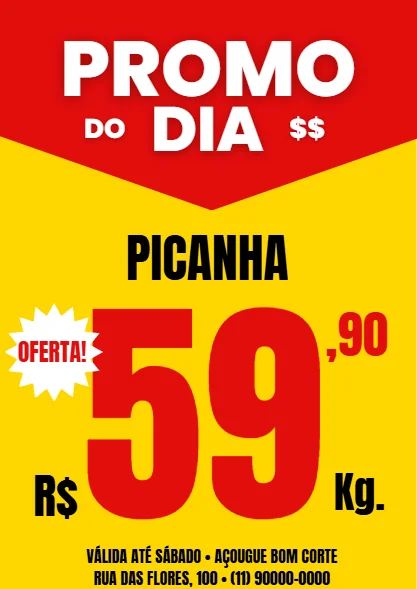{ loading=lazy }
  <figcaption>O resultado: quem passa na calçada lê, nesta ordem, “PROMO DO DIA”, o preço, o produto e, chegando perto, a validade e o endereço.</figcaption>
</figure>

## O que você vai aprender no caminho

- Filtrar modelos pela **categoria** certa.
- Montar a **hierarquia** de um anúncio: o que é maior, o que é menor.
- Encontrar **elementos gratuitos** quando a busca só mostra itens com coroa.
- Mudar a cor de um elemento e usar **Alterar tudo** com cuidado.
- **Agrupar** elementos para que se movam juntos.
- Fazer o **teste da distância** com o zoom.

## Antes de começar

- Projetos [01](01_catalogo_de_produtos.md) e [02](02_cardapio.md) deste módulo: trocar textos, cores e baixar.
- O produto, o preço e a validade da sua oferta.

---

## Passo 1 — Filtrar pela categoria

Busque `panfleto promoção` em **Modelos**. Os resultados misturam cartazes, posts e stories. Abra o filtro **Categoria** e escolha **Panfleto**:

<figure markdown="span">
  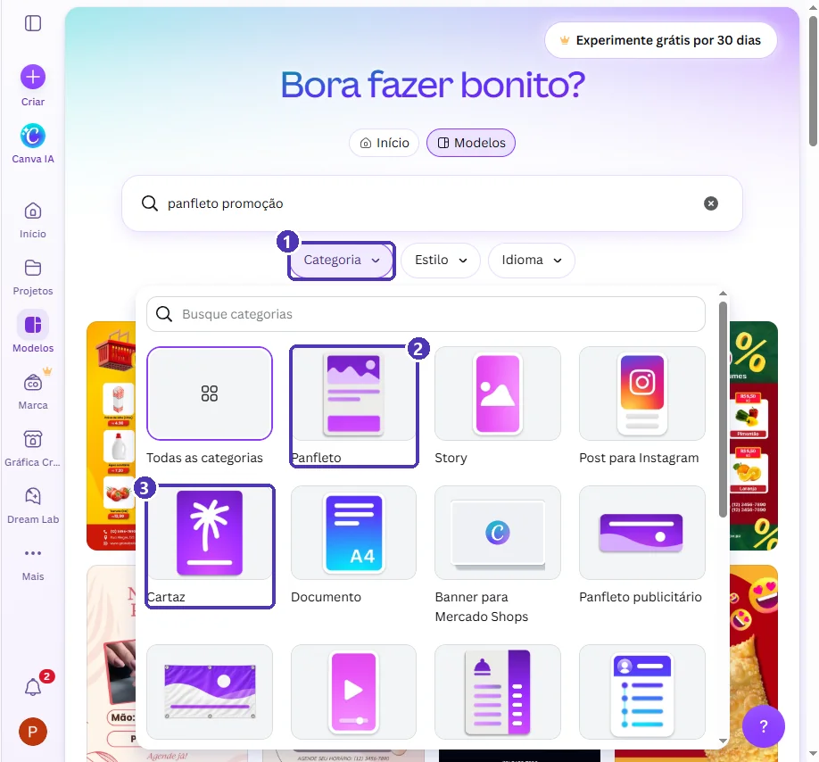{ loading=lazy }
  <figcaption>(1) O filtro <strong>Categoria</strong> · (2) <strong>Panfleto</strong>: folha A4 ou menor, para imprimir · (3) <strong>Cartaz</strong>: maior, para parede.</figcaption>
</figure>

<figure markdown="span">
  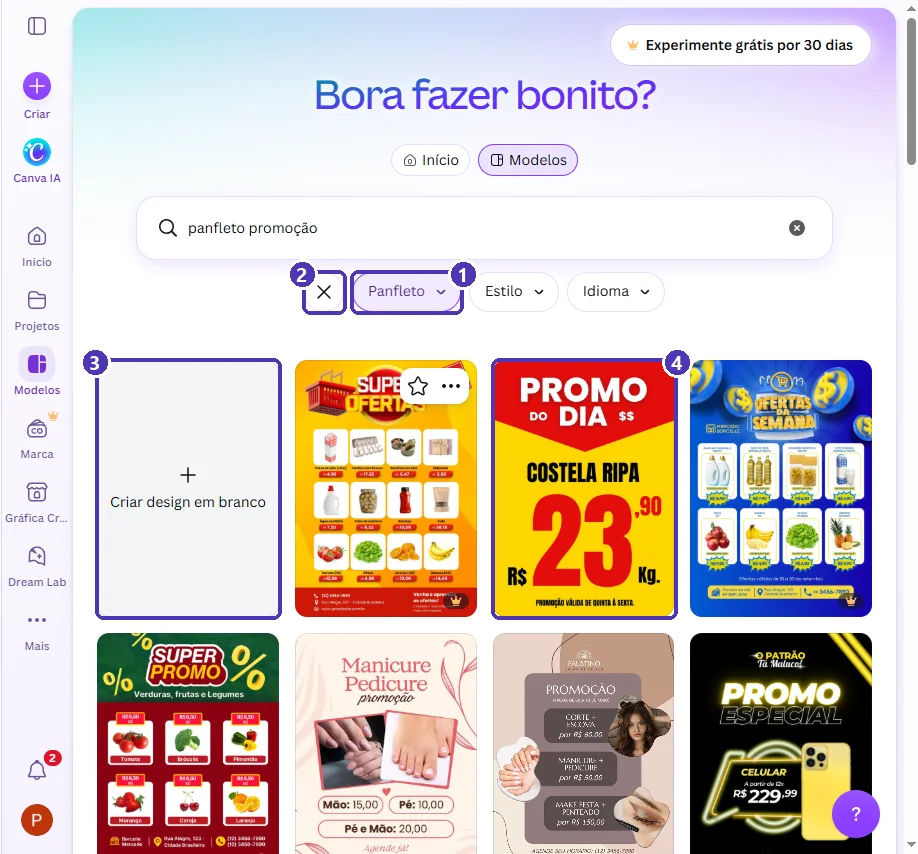{ loading=lazy }
  <figcaption>(1) O filtro ativo · (2) o <strong>X</strong> tira todos os filtros · (3) com a categoria escolhida, aparece <strong>Criar design em branco</strong> já no tamanho certo · (4) o modelo do exemplo.</figcaption>
</figure>

Abra a prévia e confira as medidas:

<figure markdown="span">
  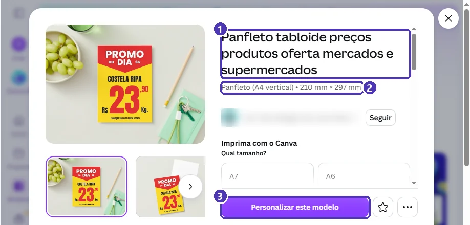{ loading=lazy }
  <figcaption>(1) O nome do modelo · (2) <strong>A4 vertical</strong>, em milímetros: 210 × 297 mm é o mesmo que 21 × 29,7 cm · (3) <strong>Personalizar este modelo</strong>.</figcaption>
</figure>

!!! tip "Uma oferta ou várias?"
    Os modelos de **tabloide** (vários produtos em grade, como o “Super Ofertas”) servem para encarte de mercado. Para a **vitrine**, prefira um modelo de **uma oferta só**: quem passa na rua tem dois segundos para ler, e um preço só chama mais atenção que doze.

---

## Passo 2 — “Imprimir com o Canva” não é obrigatório

Ao abrir alguns modelos de panfleto, o editor já abre com o painel **Gráfica Criativa** à direita:

<figure markdown="span">
  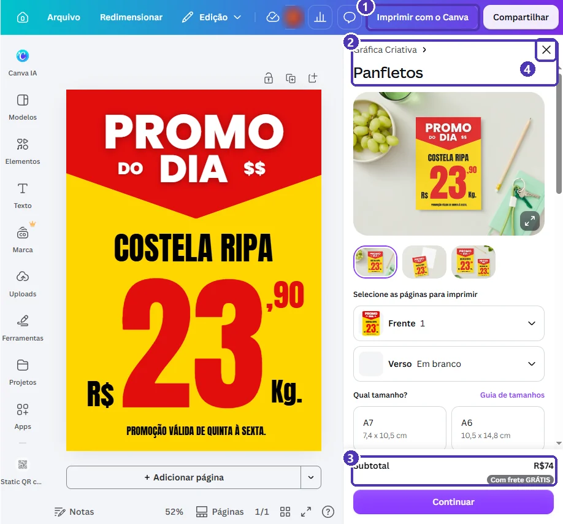{ loading=lazy }
  <figcaption>(1) <strong>Imprimir com o Canva</strong>, na barra de cima · (2) o painel da gráfica do Canva · (3) o preço da impressão · (4) o <strong>X</strong> fecha o painel.</figcaption>
</figure>

A gráfica do Canva é um **serviço pago**: ela imprime e manda pelo correio. Você **não precisa** dela. Feche o painel no **X** e siga. No fim, você baixa o PDF e imprime onde quiser: em casa, na papelaria ou numa gráfica do bairro.

---

## Passo 3 — Hierarquia: quem é maior manda

Antes de mexer, repare como o modelo organiza a informação:

<figure markdown="span">
  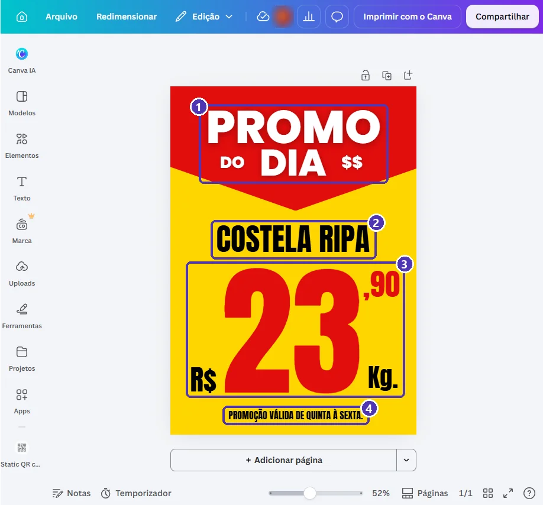{ loading=lazy }
  <figcaption>(1) O <strong>chamariz</strong>: avisa que é promoção · (2) o <strong>produto</strong> · (3) o <strong>preço</strong>, maior que tudo · (4) os <strong>detalhes</strong>, pequenos, para quem chegou perto.</figcaption>
</figure>

Essa ordem é proposital. Mantenha-a quando trocar os textos:

| Nível | O que vai | Tamanho |
|---|---|---|
| 1 | O preço (ou o desconto: “50% OFF”) | O maior do panfleto |
| 2 | O chamariz e o produto | Grande |
| 3 | Unidade (Kg., un., pacote) e centavos | Médio |
| 4 | Validade, loja, endereço, telefone | Pequeno, mas legível |

Troque os textos com os **dois cliques** ➔ `Ctrl + A` ➔ digite ➔ `Esc` de sempre.

!!! warning "Falta o mais importante: de quem é a oferta?"
    O modelo traz só “Promoção válida de quinta a sexta”. Um panfleto que sai da vitrine (alguém fotografa, alguém leva para casa) precisa dizer **de qual loja** é. Use a linha de baixo para **validade, nome da loja, endereço e telefone**. Se não couber em uma linha, quebre em duas com `Enter`.

!!! danger "Validade e estoque"
    Todo panfleto de preço precisa de **validade** (“até sábado”, “de 10 a 15/11”). Se a quantidade for limitada, escreva **“enquanto durar o estoque”**. Preço anunciado sem essas condições pode virar obrigação de vender por aquele valor.

---

## Passo 4 — Um selo de “OFERTA!”: achar um elemento gratuito

Um selo chama o olhar para o preço. Em **Elementos**, busque `selo oferta`:

<figure markdown="span">
  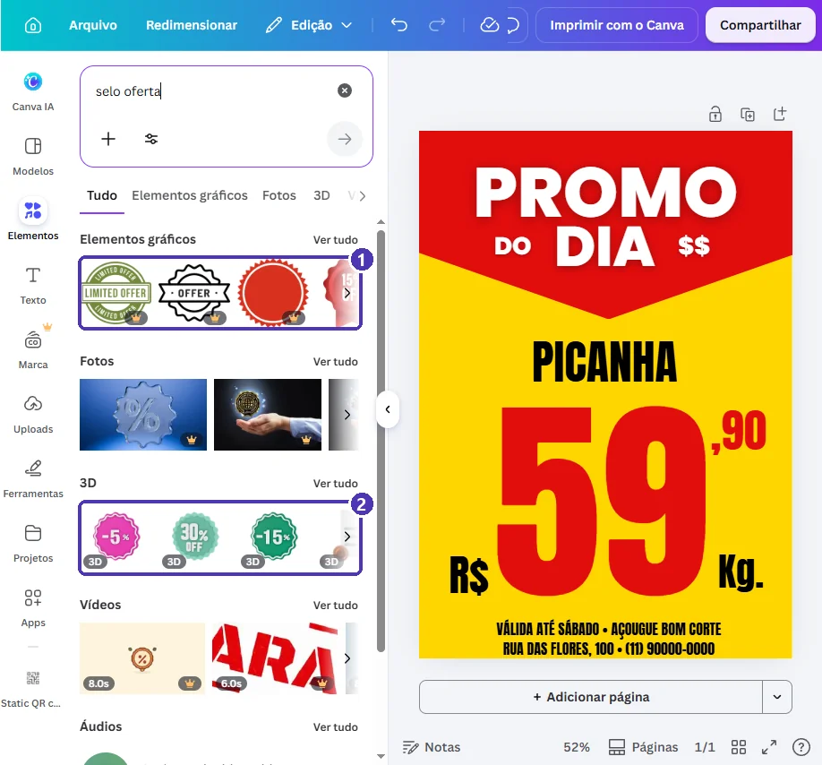{ loading=lazy }
  <figcaption>(1) Os primeiros selos gráficos têm coroa · (2) os elementos 3D também são de outra categoria. Hora de mudar a busca.</figcaption>
</figure>

O filtro (o ícone de controles ao lado da busca) **não tem** opção “só gratuitos”: ele filtra por cor, orientação, animação e fotos recortadas.

<figure markdown="span">
  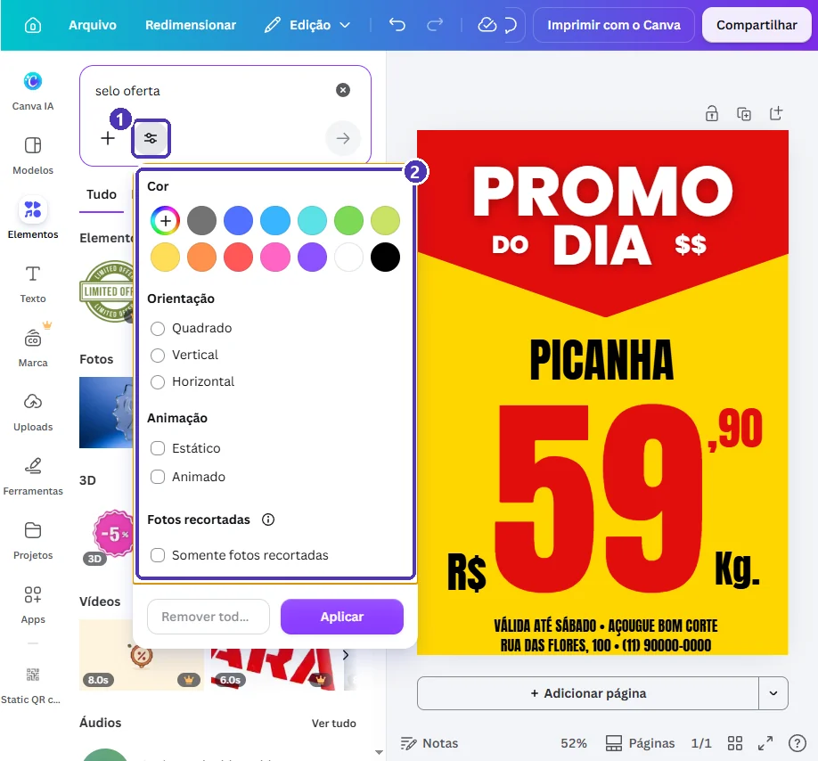{ loading=lazy }
  <figcaption>(1) O botão de filtros · (2) as opções: <strong>não existe</strong> filtro de gratuito.</figcaption>
</figure>

Quando a busca só traz coroa, **troque as palavras**. Pense na **forma** que você quer, e não no nome do produto:

<figure markdown="span">
  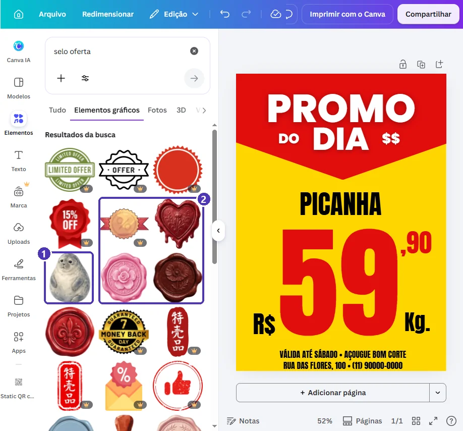{ loading=lazy }
  <figcaption>Buscar “selo” traz até (1) uma foca e (2) lacres de cera: o Canva também procura em inglês, e lá <em>seal</em> é selo, foca e lacre.</figcaption>
</figure>

<figure markdown="span">
  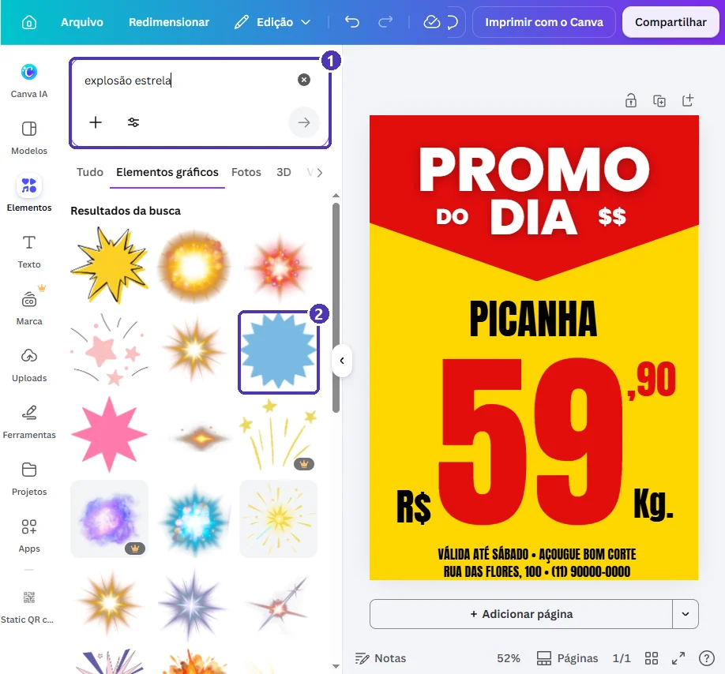{ loading=lazy }
  <figcaption>(1) A busca pela <strong>forma</strong>: <code>explosão estrela</code> · (2) uma estrela simples, sem coroa, perfeita para virar selo.</figcaption>
</figure>

!!! tip "Palavras que costumam trazer elementos gratuitos"
    `explosão`, `estrela`, `etiqueta`, `faixa`, `círculo`, `seta`, `balão de fala`. São formas simples, que você recolore e completa com o seu texto.

Clique na estrela. Ela entra **no meio da página**, por cima de tudo:

<figure markdown="span">
  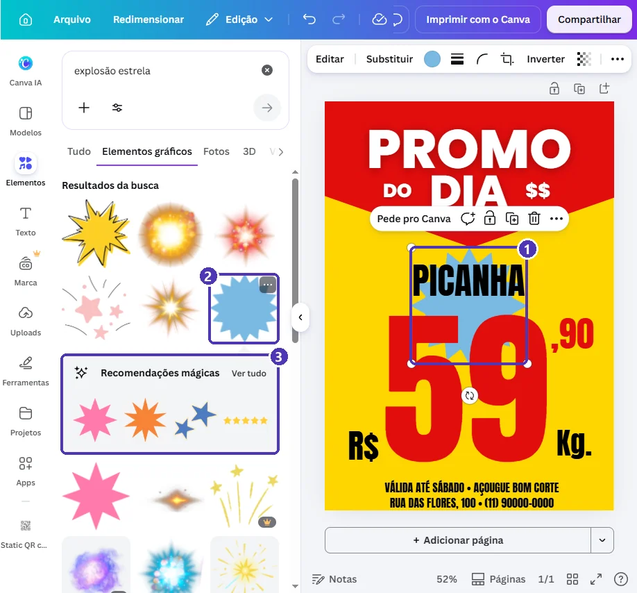{ loading=lazy }
  <figcaption>(1) O elemento novo sempre entra no centro · (2) o item escolhido · (3) <em>Recomendações mágicas</em>: formas parecidas, para comparar.</figcaption>
</figure>

Agora:

1. **Diminua** puxando o canto e **arraste** para um espaço vazio, ao lado do preço.
2. **Cor:** com a estrela selecionada, clique no quadradinho de cor e escolha **branco**, para destacar do amarelo.
3. **Texto:** painel **Texto** ➔ **Adicionar uma caixa de texto** ➔ `OFERTA!`. Aumente a fonte (aqui, 34) e use o **vermelho** do panfleto.

### Cuidado com o “Alterar tudo”

Quando você troca uma cor, aparece embaixo do painel o botão **Alterar tudo**:

<figure markdown="span">
  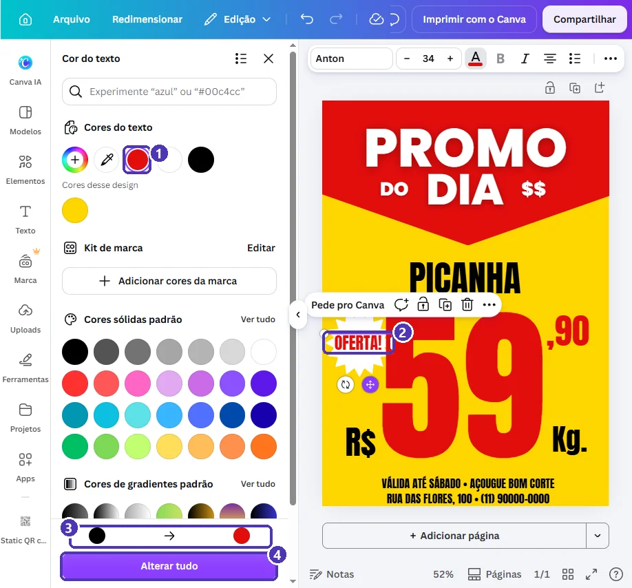{ loading=lazy }
  <figcaption>(1) A cor nova · (2) o texto que mudou · (3) a troca feita: de preto para vermelho · (4) <strong>Alterar tudo</strong> faria a mesma troca em <strong>todo o design</strong>.</figcaption>
</figure>

**Alterar tudo** troca aquela cor em **todos** os elementos do design de uma vez. Aqui seria um desastre: “PICANHA”, “R$”, “Kg.” e o rodapé também ficariam vermelhos. Use só quando quiser **repintar o design inteiro** (por exemplo, trocar o azul do modelo pelo verde da sua marca). Para mudar um elemento só, **não clique**: feche o painel no **X**.

---

## Passo 5 — Agrupar o selo

Estrela e texto são **dois elementos**. Se você arrastar um, o outro fica para trás. **Agrupe**:

1. Clique no texto `OFERTA!`.
2. Segure `Shift` e clique numa **ponta da estrela** que não esteja por baixo de outro elemento.
3. Clique em **Agrupar**.

<figure markdown="span">
  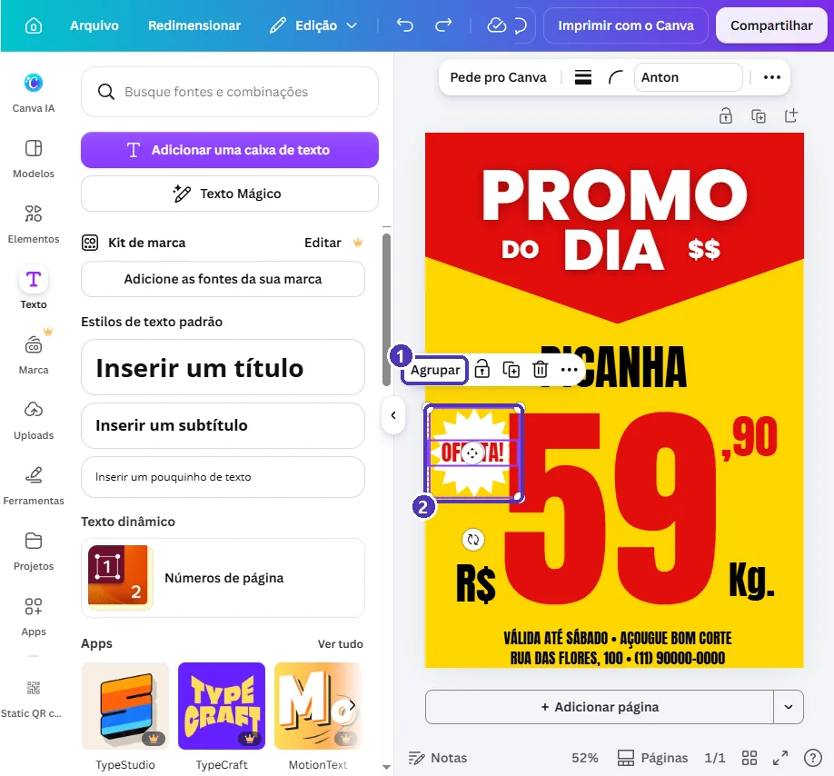{ loading=lazy }
  <figcaption>(1) <strong>Agrupar</strong> aparece quando há dois ou mais elementos selecionados · (2) a moldura cobre só a estrela e o texto.</figcaption>
</figure>

Depois de agrupar, o botão vira **Desagrupar**, caso precise mexer em um dos dois separado.

!!! warning "Shift + clique pegou a coisa errada?"
    Se a moldura ficar enorme, cobrindo o preço, o clique pegou a **caixa do preço**, que é maior do que parece e passa por baixo da estrela. Desfaça (`Ctrl + Z`) e clique numa ponta da estrela **longe do preço**. Atalho do teclado: `Ctrl + G` agrupa.

---

## Passo 6 — O teste da distância

Uma vitrine é vista de 3 a 5 metros. Simule isso no Canva: clique na **porcentagem do zoom** (embaixo, à direita) e escolha **10%**.

<figure markdown="span">
  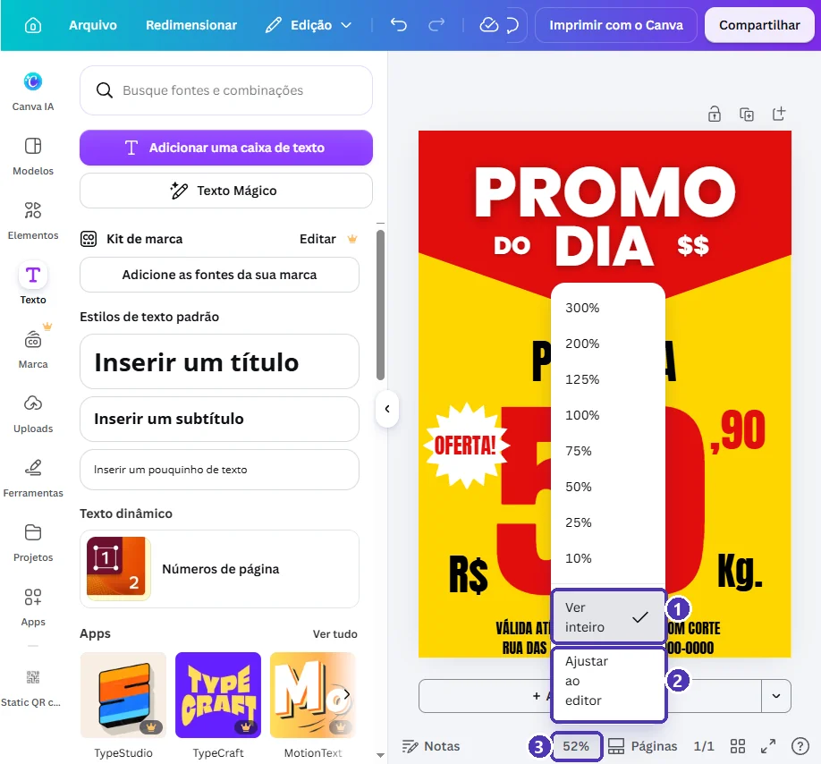{ loading=lazy }
  <figcaption>(1) <strong>Ver inteiro</strong>: a página toda na tela · (2) <strong>Ajustar ao editor</strong>: ocupa a largura · (3) a porcentagem abre este menu.</figcaption>
</figure>

<figure markdown="span">
  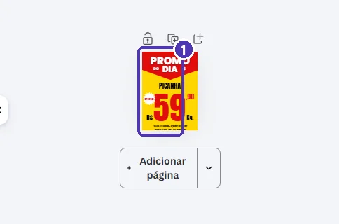{ loading=lazy }
  <figcaption>(1) Em miniatura, ainda dá para ler “PROMO DO DIA”, “PICANHA” e o <strong>59</strong>. É isso que precisa passar no teste.</figcaption>
</figure>

**Passou no teste** se, em 10%, você ainda lê o **preço** e o **produto**. O rodapé não precisa ser legível de longe: ele é para quem já se aproximou. Volte com **Ver inteiro**.

---

## Passo 7 — Baixar e imprimir

**Compartilhar** ➔ **Baixar** ➔ **PDF** ➔ **Impressão** ➔ *Baixar*, como no [cartão de visita](../modulo_01_primeiros_passos/05_projeto_cartao_de_visita.md).

- **Impressora de casa:** imprima em **A4**, papel comum, “tamanho real” (sem “ajustar à página”).
- **Vitrine com sol:** a tinta de impressora caseira desbota em poucos dias. Para durar, imprima em **laser** (papelaria) ou plastifique.
- **Também para o WhatsApp:** baixe em **JPG** e mande no status. O mesmo panfleto serve para os dois.

---

## Revisão final

- [ ] O **preço** é o maior elemento do panfleto.
- [ ] Tem **validade** e, se for o caso, “enquanto durar o estoque”.
- [ ] Tem o **nome da loja** e um contato ou endereço.
- [ ] Passou no **teste da distância** (zoom 10%).
- [ ] O selo está **agrupado**, e nenhum elemento tem coroa 👑.
- [ ] Você **não** clicou em “Alterar tudo” sem querer (as cores dos textos estão certas).

---

## Para outros negócios

| Negócio | O preço gigante vira... | Dica |
|---|---|---|
| Mercadinho | O preço do produto da semana | Um panfleto por produto, e todos com o mesmo modelo: duplique a página. |
| Salão de beleza | `50% OFF` ou “Escova R$ 30” | Troque “Kg.” por “o serviço”, e ponha um ícone de tesoura no lugar da estrela. |
| Lanchonete | O preço do combo | Use foto do lanche no lugar do selo (*Substituir*, como no catálogo). |
| Loja de roupas | `LIQUIDA` ou `TUDO R$ 29,90` | Fundo de uma cor só, para o texto aparecer de longe. |

---

## Exercícios

### Básico (fixação)

Faça o panfleto de uma oferta sua (ou inventada): produto, preço, unidade, validade, nome da loja e contato. Mantenha a hierarquia do modelo.

<!-- gabarito -->
??? success "Gabarito — Básico"
    1. *Modelos* ➔ `panfleto promoção` ➔ **Categoria: Panfleto** ➔ um modelo de uma oferta, sem coroa ➔ *Personalizar este modelo*.
    2. Feche o painel da gráfica, se abrir.
    3. Troque produto, preço e unidade com dois cliques ➔ `Ctrl + A` ➔ digite ➔ `Esc`.
    4. Na linha de baixo: `VÁLIDA ATÉ ... • NOME DA LOJA` ➔ `Enter` ➔ `ENDEREÇO • TELEFONE`.
    5. Confira: o preço continua sendo o maior texto.

### Intermediário (aplicação)

Acrescente um **selo gratuito** com uma palavra (`OFERTA!`, `SÓ HOJE`, `NOVO`), na cor do panfleto, **agrupado**, e faça o **teste da distância**.

<!-- gabarito -->
??? success "Gabarito — Intermediário"
    1. *Elementos* ➔ busque uma **forma**: `explosão estrela`, `etiqueta` ou `círculo` ➔ escolha uma **sem coroa**.
    2. Diminua pelo canto, arraste para um espaço vazio e pinte de uma cor que contraste com o fundo.
    3. *Texto* ➔ *Adicionar uma caixa de texto* ➔ a palavra ➔ aumente a fonte ➔ cor do panfleto. **Não** clique em *Alterar tudo*.
    4. Selecione o texto, `Shift` + clique na forma ➔ **Agrupar** (ou `Ctrl + G`).
    5. Zoom ➔ **10%**: o preço e o produto ainda se leem? Volte com **Ver inteiro**.

### Avançado (desafio)

Faça uma **série de três panfletos** (três ofertas diferentes) no **mesmo design**, com o mesmo visual, e baixe os três num PDF só.

<!-- gabarito -->
??? success "Gabarito — Avançado"
    1. Termine o primeiro panfleto, com o selo agrupado.
    2. Na barra em cima da página ➔ **Duplicar página**, duas vezes.
    3. Nas páginas 2 e 3, troque só produto, preço e, se quiser, a palavra do selo.
    4. *Compartilhar ➔ Baixar* ➔ **PDF** ➔ **Impressão** ➔ *Selecionar páginas*: **Tudo** ➔ *Baixar*.

    **Por que no mesmo design?** Se amanhã você mudar o rodapé (novo telefone, novo endereço), muda nas três páginas abrindo um arquivo só. E o cliente reconhece a sua loja pelo visual que se repete.

---

## 💡 Resumo

- **Categoria ➔ Panfleto** separa os modelos de impressão dos de redes sociais.
- O painel **Imprimir com o Canva** é um serviço pago; feche no **X** se não for usar.
- **Hierarquia:** preço maior que tudo; validade, loja e contato pequenos, mas presentes.
- Busca só com coroa? Procure pela **forma** (`explosão`, `etiqueta`, `círculo`).
- **Alterar tudo** troca a cor no design **inteiro**: só para repintar tudo.
- **Agrupar** (`Shift` + clique ➔ *Agrupar*, ou `Ctrl + G`) faz os elementos andarem juntos.
- **Teste da distância:** em zoom 10%, o preço e o produto precisam continuar legíveis.

## ➡️ Próximo passo

**[04 — Post e story da mesma oferta](04_post_e_story.md)**: o mesmo panfleto em post e story, sem o Redimensionar do Pro.
