# 04 — Projeto: post e story da mesma oferta

> **Curso:** Canva  
> **Módulo:** 02 — Projetos para o seu negócio  
> **Tempo estimado:** 1 h 30 min  

---

## O pedido

> *“Já tenho o panfleto da vitrine. Agora quero a mesma oferta no Instagram e no status do WhatsApp, sem começar do zero e sem pagar o Canva Pro.”*

O panfleto do [projeto 03](03_panfleto_promocao.md) é um A4 em pé. O feed do Instagram usa **4:5** e o story usa **9:16**, bem mais alto e estreito. O botão **Redimensionar**, que faria isso em um clique, é do Pro. Neste projeto você faz do jeito gratuito: **um design só, com três páginas de tamanhos diferentes**.

<figure markdown="span">
  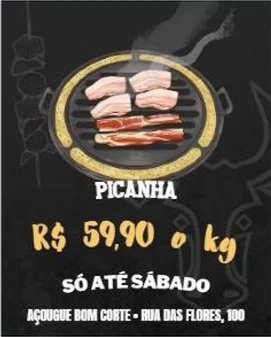{ loading=lazy }
  <figcaption>O post (4:5), para o feed.</figcaption>
</figure>

<figure markdown="span">
  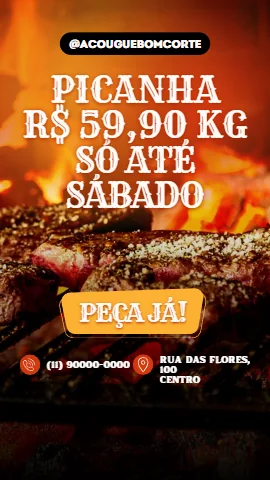{ loading=lazy }
  <figcaption>O story (9:16), para os stories e o status do WhatsApp.</figcaption>
</figure>

## O que você vai aprender no caminho

- Os tamanhos certos para **feed**, **story** e **status**.
- Pôr páginas de **tipos diferentes** no mesmo design (o “multi-design”).
- Aplicar um **modelo a uma página só**, sem mexer nas outras.
- Selecionar elementos escondidos pelo painel **Camadas** e posicionar com **X e Y**.
- Respeitar a **zona segura** do story.
- Baixar **só as páginas** que você quer.

## Antes de começar

- O panfleto do [projeto 03](03_panfleto_promocao.md), ou qualquer design de oferta seu.

---

## Os tamanhos de cada lugar

Na tela inicial, o atalho **Redes sociais** abre a janela *Criar um design* já nos formatos de rede social:

<figure markdown="span">
  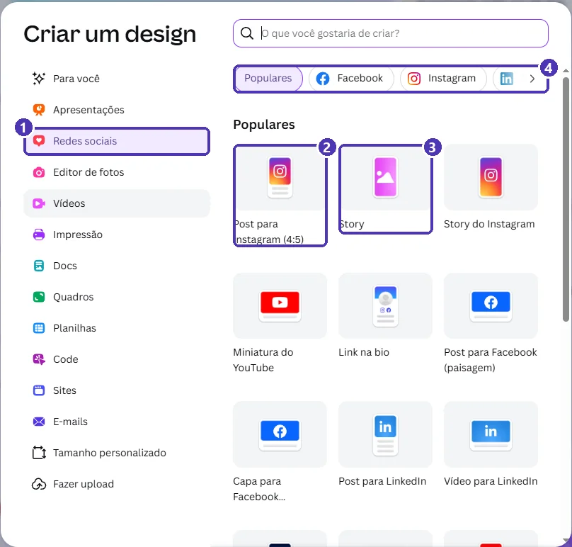{ loading=lazy }
  <figcaption>(1) <strong>Redes sociais</strong> · (2) <strong>Post para Instagram (4:5)</strong> · (3) <strong>Story</strong> · (4) abas por rede.</figcaption>
</figure>

| Onde | Formato | Tamanho |
|---|---|---|
| Feed do Instagram | 4:5, em pé | 1080 × 1350 px |
| Stories (Instagram e Facebook) e status do WhatsApp | 9:16 | 1080 × 1920 px |
| Feed quadrado (Facebook, WhatsApp) | 1:1 | 1080 × 1080 px |

!!! tip "Um story serve para três lugares"
    O mesmo arquivo 9:16 vai para os stories do Instagram, os do Facebook e o **status do WhatsApp**. Faça um e use nos três.

---

## Passo 1 — Por que não copiar e colar?

O primeiro impulso é: selecionar tudo no panfleto (`Ctrl + A`), copiar, criar um post novo e colar. Funciona em muitos computadores, mas **depende da área de transferência do navegador**. Em navegadores com bloqueio, ou se você usar o menu do botão direito, o Canva mostra este aviso, e nada é colado:

<figure markdown="span">
  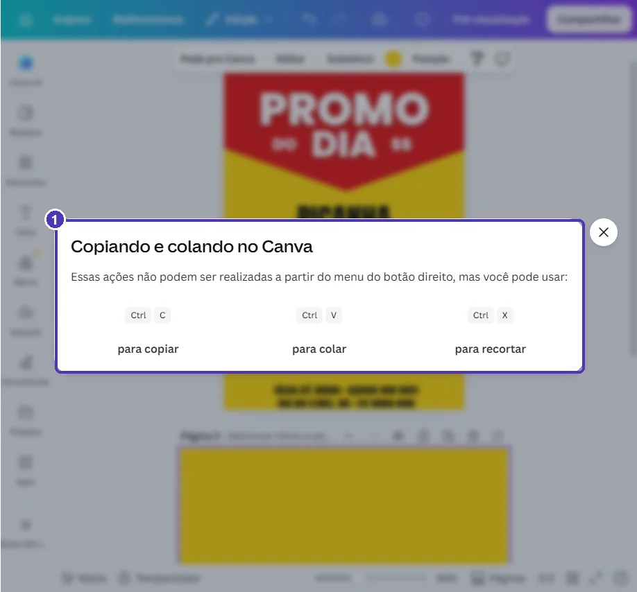{ loading=lazy }
  <figcaption>(1) Pelo menu do botão direito, o Canva <strong>não</strong> copia nem cola. Use <code>Ctrl + C</code> / <code>Ctrl + V</code> ou o caminho deste projeto.</figcaption>
</figure>

O jeito mais confiável é **não sair do design**: acrescentar o post e o story como **novas páginas** do mesmo arquivo.

---

## Passo 2 — Uma página de outro tamanho

No editor do panfleto, clique na **setinha ao lado de “Adicionar página”** ➔ **Redes sociais**:

<figure markdown="span">
  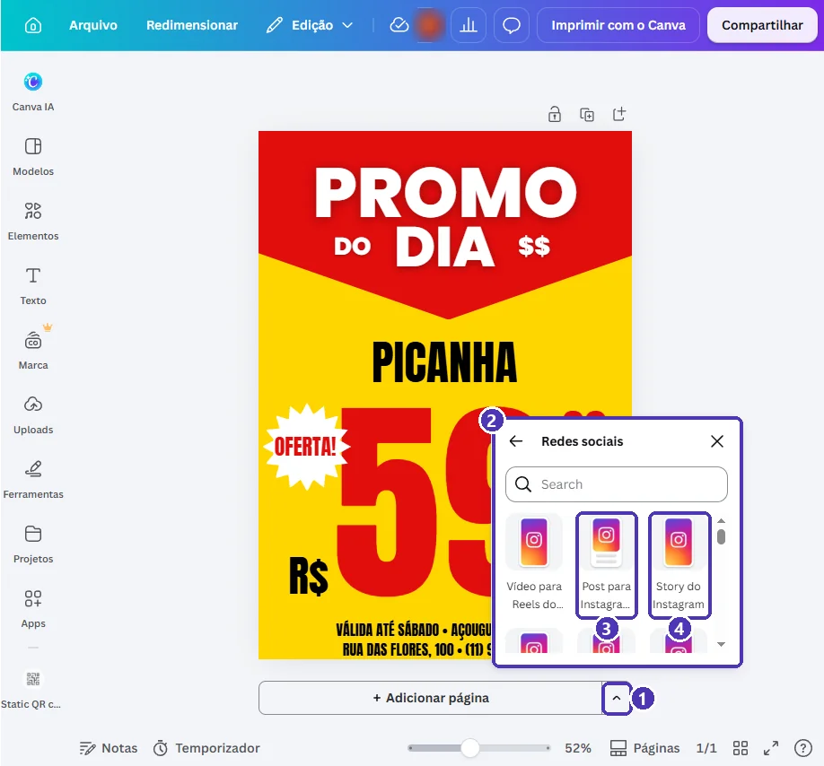{ loading=lazy }
  <figcaption>(1) A setinha · (2) a lista <em>Redes sociais</em> · (3) <strong>Post para Instagram</strong> · (4) <strong>Story do Instagram</strong>.</figcaption>
</figure>

Escolha **Post para Instagram (4:5)**. Aparece a **página 2**, em branco, com o tamanho do post, no mesmo design do panfleto:

<figure markdown="span">
  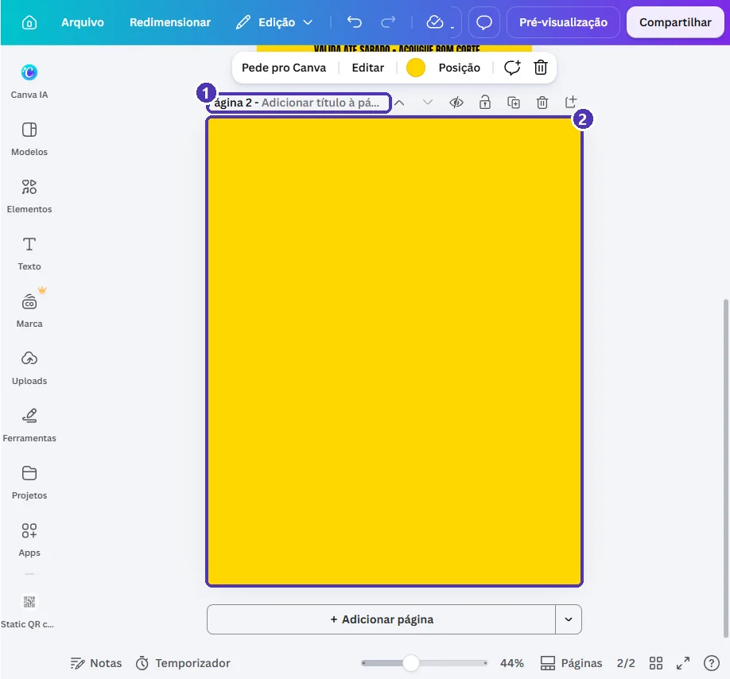{ loading=lazy }
  <figcaption>(1) A barra da página 2 · (2) a página nova, no formato 4:5. O fundo vem da cor da página anterior.</figcaption>
</figure>

Na **visualização em grade**, cada página mostra um ícone do seu tipo: impressora para o panfleto, coração para os de redes sociais.

<figure markdown="span">
  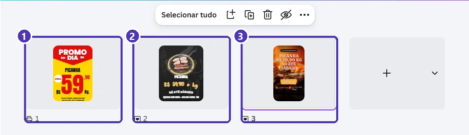{ loading=lazy }
  <figcaption>(1) Panfleto (impressão) · (2) post (4:5) · (3) story (9:16). Três tamanhos, um arquivo.</figcaption>
</figure>

!!! info "Multi-design"
    Quando um design mistura páginas de tamanhos diferentes, o Canva chama de **Multi-design** (aparece no nome da aba do navegador). É gratuito, e o **Redimensionar** não é.

---

## Passo 3 — Um modelo só para essa página

Com a página 2 selecionada, abra **Modelos** no painel lateral. Repare: a busca já diz **“Busque modelos de Post para Instagram (4:5)”**, porque o Canva entende o tipo da página. Busque pelo seu ramo (`oferta açougue`):

<figure markdown="span">
  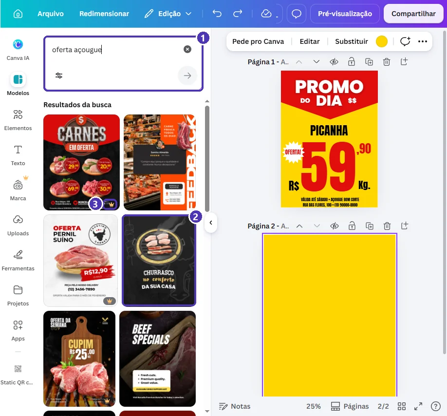{ loading=lazy }
  <figcaption>(1) A busca, já filtrada para post · (2) um modelo gratuito · (3) a coroa marca os modelos do Pro.</figcaption>
</figure>

Clique no modelo: ele é aplicado **só na página selecionada**. O panfleto continua igual.

<figure markdown="span">
  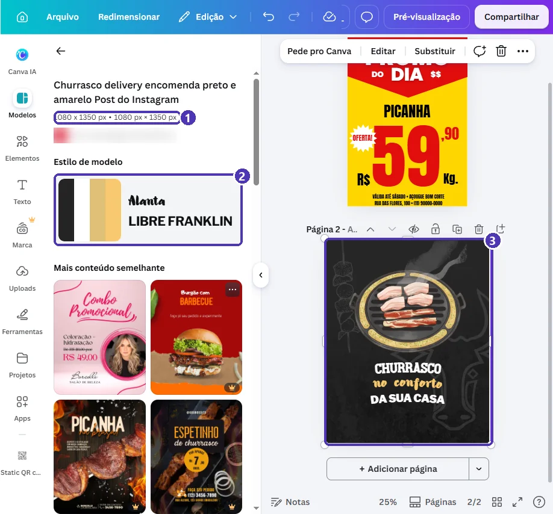{ loading=lazy }
  <figcaption>(1) As medidas do modelo, iguais às da página · (2) <em>Estilo de modelo</em>: as cores e fontes dele · (3) a página 2 com o modelo.</figcaption>
</figure>

!!! warning "Escolha a página antes de clicar no modelo"
    O modelo vai para a página **selecionada** (a que tem a moldura roxa). Clique primeiro na página certa. Se aplicou na errada, `Ctrl + Z`.

---

## Passo 4 — Adaptar o texto ao post

Troque os textos com os dois cliques ➔ `Ctrl + A` ➔ digite ➔ `Esc` de sempre. Mas cuidado: no modelo, a linha do meio era só decoração, em letra pequena. Agora ela é o **preço**:

<figure markdown="span">
  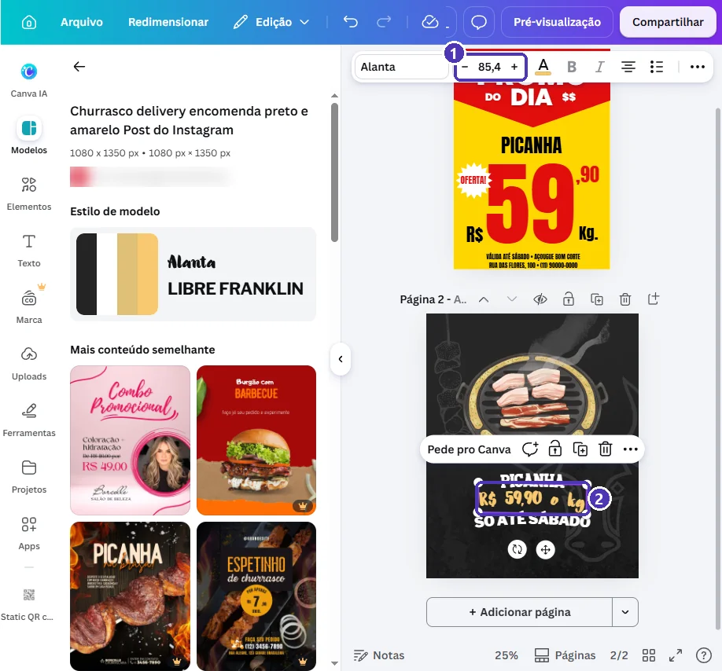{ loading=lazy }
  <figcaption>(1) O tamanho da fonte · (2) o preço ficou pequeno: a hierarquia do panfleto se perdeu.</figcaption>
</figure>

Aplique a regra do [projeto 03](03_panfleto_promocao.md): **o preço manda**. Aumente o tamanho (aqui, para 130). O preço cresce e **invade** os textos de cima e de baixo. Hora de arrumar.

### Camadas: selecionar o que está escondido

Quando caixas se sobrepõem, o clique pega a de cima. Use **⋯** (na barra de texto) ➔ **Posição** ➔ aba **Camadas**:

<figure markdown="span">
  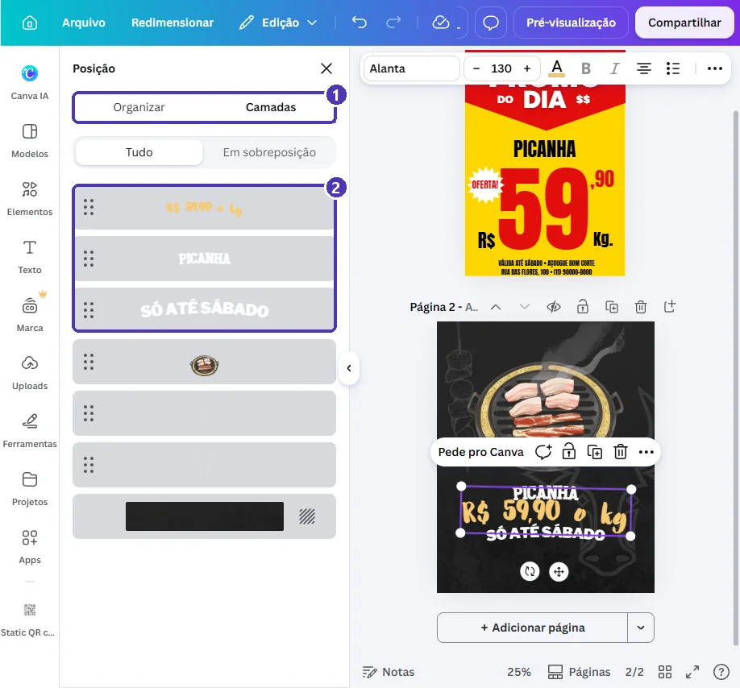{ loading=lazy }
  <figcaption>(1) A aba <strong>Camadas</strong> · (2) cada elemento da página: um clique na lista seleciona aquele elemento, mesmo que esteja por baixo de outro.</figcaption>
</figure>

### X e Y: posição exata

Com o elemento selecionado, volte para a aba **Organizar**. Em **Avançados**, digite a posição:

<figure markdown="span">
  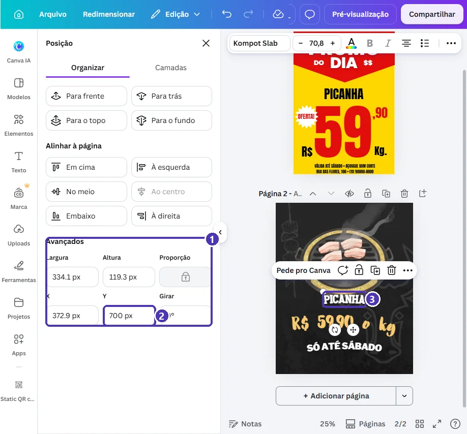{ loading=lazy }
  <figcaption>(1) <strong>Avançados</strong>: largura, altura e posição · (2) <strong>Y</strong> é a distância do topo da página · (3) o produto subiu e saiu de cima do preço.</figcaption>
</figure>

- **Y menor** = mais para cima. **Y maior** = mais para baixo.
- **X menor** = mais para a esquerda.
- Os botões **Alinhar à página** (*Ao centro*, *No meio*, *Embaixo*...) fazem os ajustes comuns em um clique.

Por último, acrescente uma linha pequena com **o nome da loja e o endereço**: *Texto* ➔ *Adicionar uma caixa de texto*. O post sai do Canva e vai rodar sozinho pelas redes; ele precisa dizer **de quem é a oferta**.

---

## Passo 5 — O story e a zona segura

Repita o Passo 2 com **Story do Instagram** e o Passo 3 com um modelo de story (`churrasco delivery`, por exemplo). Ao trocar os textos, preste atenção na **estrutura** do modelo: um título de três linhas às vezes é uma caixa de duas linhas mais uma de uma linha. Troque **caixa por caixa**, sem colar tudo numa só.

O story tem um detalhe que o post não tem: o Instagram e o WhatsApp **cobrem** partes da tela.

<figure markdown="span">
  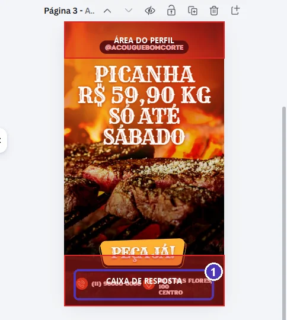{ loading=lazy }
  <figcaption>Faixas vermelhas: no alto, o <strong>nome do perfil</strong>; embaixo, a <strong>caixa de resposta</strong>. (1) O telefone e o endereço ficaram atrás da caixa de resposta.</figcaption>
</figure>

Selecione o botão e os contatos (arraste uma caixa em volta deles; tire o que não quer da seleção com `Shift` + clique) e **suba**:

<figure markdown="span">
  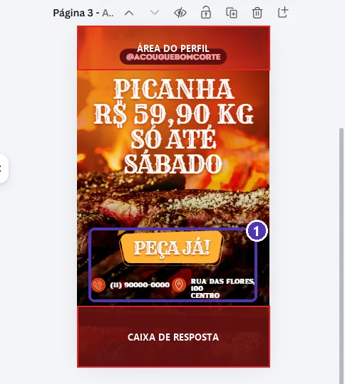{ loading=lazy }
  <figcaption>(1) Botão e contatos fora da zona coberta. A faixa de baixo ficou só com o fundo.</figcaption>
</figure>

!!! tip "Zona segura, em números"
    Num story de 1080 × 1920 px, deixe livres cerca de **250 px em cima** e **350 px embaixo**. Nada de texto importante ali: só fundo.

!!! warning "Story não precisa de QR code"
    Quem vê o story já está no celular e não consegue escanear a própria tela. No story, troque o QR code por “**responda este story**” ou pelo **adesivo de link** do próprio Instagram, colocado na hora de publicar.

---

## Passo 6 — Baixar só as páginas certas

**Compartilhar** ➔ **Baixar** ➔ **PNG**. Em **Selecionar páginas**, escolha **Seleção** e deixe marcadas só as de redes sociais:

<figure markdown="span">
  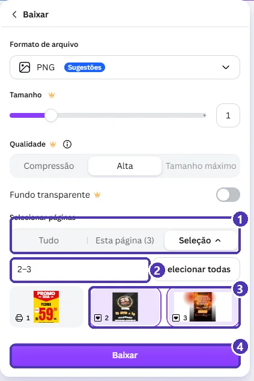{ loading=lazy }
  <figcaption>(1) <strong>Seleção</strong> · (2) as páginas escolhidas: <code>2–3</code> · (3) clique na miniatura para marcar ou desmarcar · (4) <strong>Baixar</strong>.</figcaption>
</figure>

Com mais de uma página, o Canva entrega um **.zip** com uma imagem por página. Abra o .zip no celular ou no computador e publique cada imagem no lugar certo. O panfleto continua saindo em **PDF Impressão**, como no projeto 03, quando você selecionar só a página 1.

!!! tip "PNG ou JPG para redes?"
    Os dois servem. O **PNG** deixa textos e bordas mais nítidos, o **JPG** é mais leve. Para ofertas com muito texto, prefira PNG.

---

## Revisão final

- [ ] Post em **4:5** e story em **9:16**, no mesmo design do panfleto.
- [ ] O **preço** é o maior texto nos dois.
- [ ] Os dois dizem **de qual loja** é a oferta e **até quando** vale.
- [ ] No story, nada importante nas **faixas de cima e de baixo**.
- [ ] Nenhum modelo ou elemento com coroa 👑.
- [ ] Baixou só as páginas de redes sociais, em PNG.

---

## Para outros negócios

| Negócio | No post | No story |
|---|---|---|
| Salão de beleza | Foto do resultado + preço do serviço | “Agenda aberta” + “responda este story” |
| Lanchonete | Foto do combo + preço | Contagem regressiva com o adesivo do Instagram |
| Loja de roupas | Três peças em grade, cada uma com preço | Uma peça por story, em sequência |
| Doceria | O bolo da semana | Bastidores: “saindo do forno” |

---

## Exercícios

### Básico (fixação)

No design do seu panfleto, acrescente uma página **Post para Instagram (4:5)**, aplique um modelo gratuito **só nela** e troque os textos pela sua oferta.

<!-- gabarito -->
??? success "Gabarito — Básico"
    1. Setinha ao lado de **Adicionar página** ➔ **Redes sociais** ➔ **Post para Instagram (4:5)**.
    2. Clique na página nova (moldura roxa) ➔ **Modelos** ➔ busque pelo seu ramo ➔ um modelo **sem coroa**.
    3. Troque os textos com dois cliques ➔ `Ctrl + A` ➔ digite ➔ `Esc`, **caixa por caixa**.
    4. Confira o panfleto (página 1): ele não pode ter mudado.

### Intermediário (aplicação)

No post do exercício anterior, deixe o **preço como o maior texto** sem nenhum texto encostando em outro, usando **Camadas** e **X/Y**.

<!-- gabarito -->
??? success "Gabarito — Intermediário"
    1. Selecione o preço ➔ aumente o tamanho da fonte até ele ser o maior texto.
    2. **⋯** ➔ **Posição** ➔ **Camadas** ➔ clique no texto que ficou por baixo.
    3. Aba **Organizar** ➔ **Avançados** ➔ mude o **Y** (menor para subir, maior para descer) até não encostar.
    4. Repita para o texto do outro lado do preço.

### Avançado (desafio)

Acrescente um **story** no mesmo design, respeitando a **zona segura**, e baixe **só o post e o story** num download só.

<!-- gabarito -->
??? success "Gabarito — Avançado"
    1. Setinha ➔ **Redes sociais** ➔ **Story do Instagram**. Aplique um modelo de story sem coroa só nessa página.
    2. Troque os textos caixa por caixa.
    3. Com **Posição ➔ Avançados**, confira que nenhum texto importante tem **Y menor que 250** nem termina depois de **Y 1570** (1920 − 350).
    4. **Compartilhar ➔ Baixar ➔ PNG ➔ Selecionar páginas: Seleção** ➔ desmarque o panfleto ➔ **Baixar**. Sai um .zip com as duas imagens.

---

## 💡 Resumo

- **Feed 4:5** (1080 × 1350), **story 9:16** (1080 × 1920); o story serve também para o status do WhatsApp.
- Sem Pro: **setinha de Adicionar página ➔ Redes sociais** põe páginas de outros tamanhos no mesmo design.
- O modelo clicado vai **só para a página selecionada**.
- **Camadas** seleciona o que está escondido; **X e Y** posicionam com precisão.
- Story: livre **em cima e embaixo** (zona segura).
- **Baixar ➔ Selecionar páginas ➔ Seleção** escolhe exatamente o que sai.

## ➡️ Próximo passo

Você terminou o **Módulo 02**: catálogo, cardápio, panfleto e posts, tudo para um negócio. Volte ao [índice do módulo](index.md) e confira o checklist. O **Módulo 03 — Eventos e redes sociais** está em produção.
