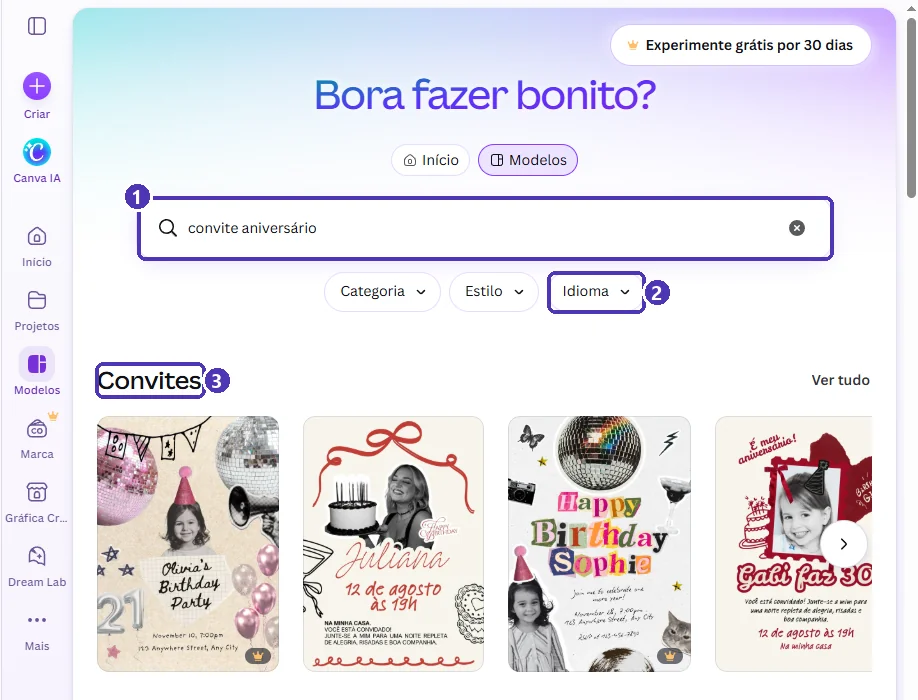
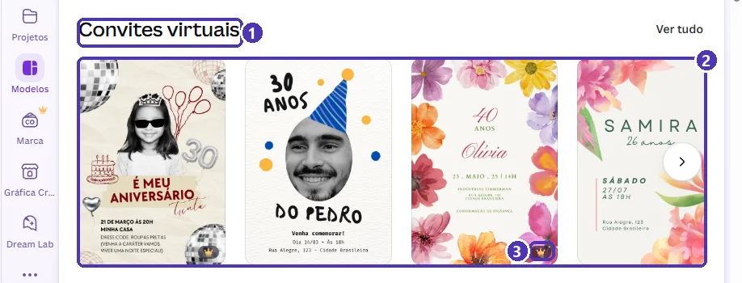
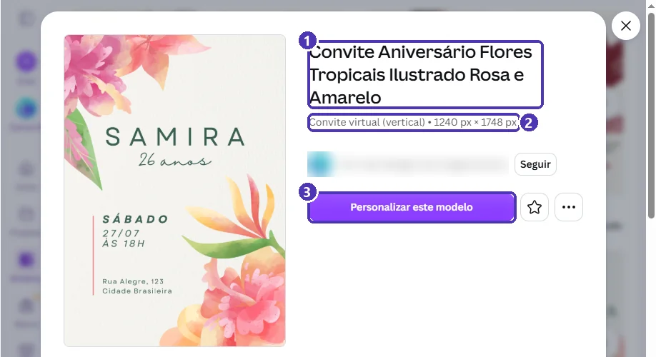
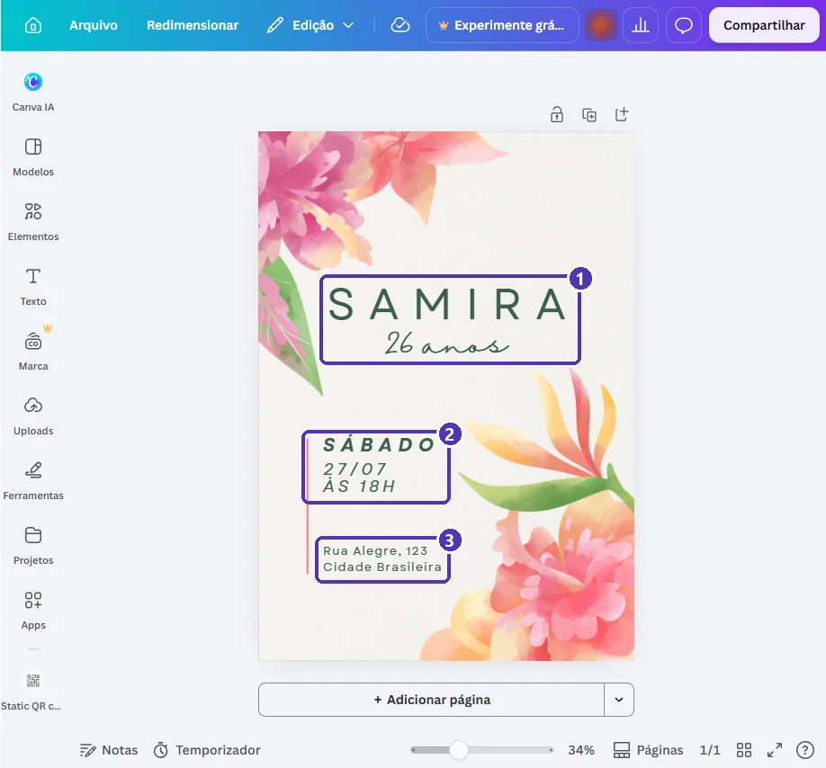
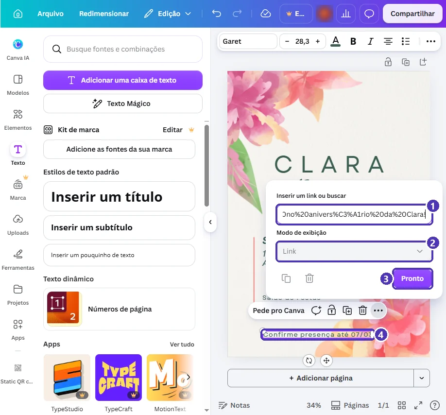
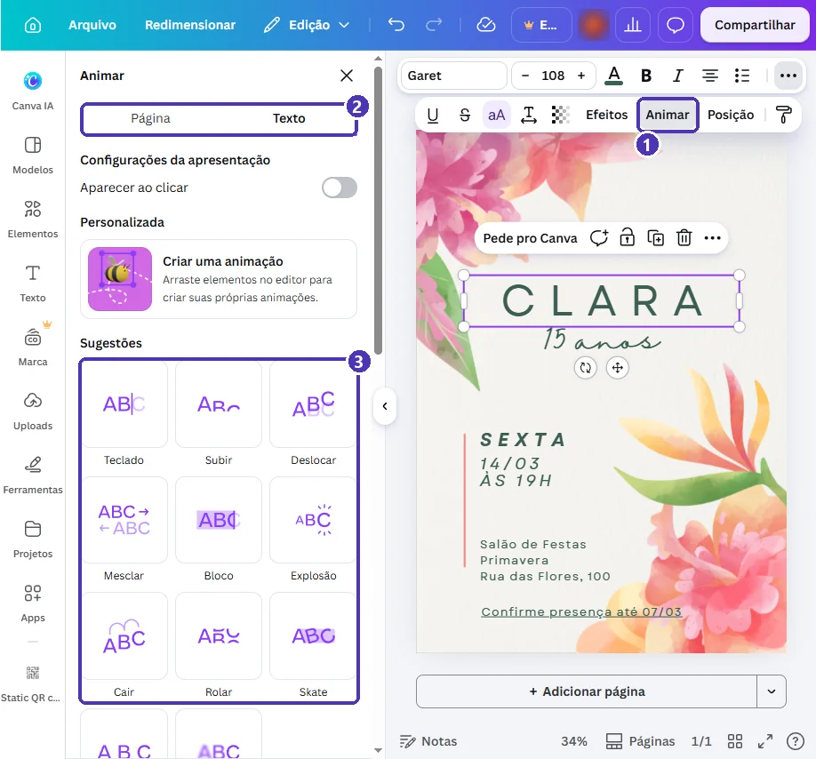
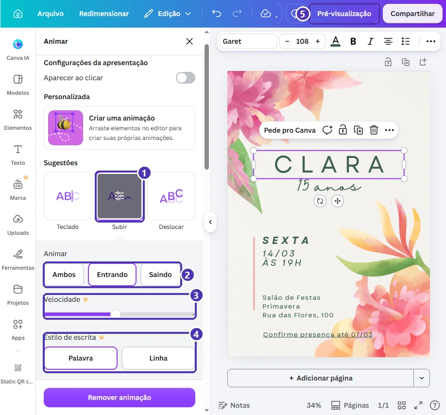
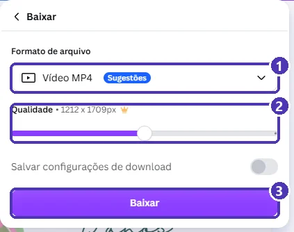

# 01 — Projeto: convite virtual com confirmação pelo WhatsApp

> **Curso:** Canva  
> **Módulo:** 03 — Eventos e redes sociais  
> **Tempo estimado:** 1 h 30 min  

---

## O pedido

> *“Vou fazer os 15 anos da minha filha e quero mandar o convite pelo WhatsApp. Bonito, com data, hora e local, e um jeito fácil de as pessoas confirmarem presença.”*

Neste projeto você monta um **convite virtual**: feito para ser visto no celular, com um **link de confirmação** que abre o WhatsApp com a mensagem já escrita, e uma **animação** leve para quando ele for mandado como vídeo.

O exemplo é de uma festa **inventada**, os 15 anos da *Clara*:

<figure markdown="span">
  { loading=lazy }
  <figcaption>O resultado: quem, quando, onde e como confirmar, nessa ordem.</figcaption>
</figure>

## O que você vai aprender no caminho

- A diferença entre **convite para imprimir** e **convite virtual**.
- Filtrar modelos por **idioma** e reconhecer os que têm **foto de pessoa**.
- Montar um **link de confirmação** com mensagem pronta.
- **Animar** um texto com o que é gratuito.
- Escolher entre **PDF**, **PNG** e **MP4**, sabendo o que cada um perde.

## Antes de começar

- [Módulo 02, projeto 01](../modulo_02_projetos_negocio/01_catalogo_de_produtos.md): links de WhatsApp com `wa.me`.
- Os dados do evento: nome, idade ou motivo, data, hora, local e prazo para confirmar.

---

## Passo 1 — Para imprimir ou para mandar?

Busque `convite aniversário`. O Canva separa os resultados em grupos:

<figure markdown="span">
  { loading=lazy }
  <figcaption>(1) A busca · (2) <strong>Idioma</strong>: escolha Português para receber os modelos já com textos em português · (3) <strong>Convites</strong>: em geral, no formato de cartão para imprimir.</figcaption>
</figure>

Role um pouco e aparece o grupo **Convites virtuais**:

<figure markdown="span">
  { loading=lazy }
  <figcaption>(1) <strong>Convites virtuais</strong> · (2) modelos feitos para a tela do celular · (3) a coroa do Pro, como sempre.</figcaption>
</figure>

| | Convite para imprimir | Convite virtual |
|---|---|---|
| Como chega | Em papel, na mão | No WhatsApp, no Instagram, por e-mail |
| Formato | Cartão (pequeno) | Vertical, do tamanho da tela |
| Link clicável | Não (use QR code) | Sim, no PDF |
| Animação | Não | Sim, se mandar como vídeo |

!!! warning "Modelo com foto de outra pessoa"
    Muitos modelos trazem a **foto de alguém** (a criança, o aniversariante). Se usar um desses, troque a foto pela sua (*Substituir ➔ Uploads*, como no [catálogo](../modulo_02_projetos_negocio/01_catalogo_de_produtos.md)) ou apague. Mandar convite com o rosto de um desconhecido é estranho, e a foto é de outra pessoa. Para não ter esse trabalho, escolha um modelo **só com ilustração**, como o do exemplo.

Abra a prévia do modelo e confira o tipo:

<figure markdown="span">
  { loading=lazy }
  <figcaption>(1) O nome do modelo · (2) <strong>Convite virtual (vertical)</strong>, em pixels: feito para tela · (3) <strong>Personalizar este modelo</strong>.</figcaption>
</figure>

---

## Passo 2 — Quem, quando, onde

<figure markdown="span">
  { loading=lazy }
  <figcaption>(1) <strong>Quem</strong> e o motivo · (2) <strong>quando</strong>: dia da semana, data e hora · (3) <strong>onde</strong>.</figcaption>
</figure>

Troque cada bloco com os dois cliques ➔ `Ctrl + A` ➔ digite ➔ `Esc`. Use `Enter` para quebrar o endereço em linhas.

!!! tip "Dia da semana junto da data"
    “Sexta, 14/03” evita a pergunta “que dia cai?” e reduz o erro de quem anota a data errada. **Confira no calendário** se o dia da semana bate com a data.

!!! danger "Endereço no convite"
    Convite virtual é encaminhado com facilidade. Para festa em **casa**, pense duas vezes antes de pôr o endereço completo num arquivo que pode circular: uma alternativa é escrever só o bairro e mandar o endereço em particular para quem confirmar. Em salão de festas, sem problema.

---

## Passo 3 — Confirmação de presença

O modelo não tem RSVP (o “confirme presença”). Acrescente:

1. **Texto** ➔ **Adicionar uma caixa de texto** ➔ `Confirme presença até 07/03`. A caixa nova já vem com a fonte do modelo.
2. Arraste para baixo do endereço, alinhada com ele (aparece a linha cor-de-rosa).
3. Com o texto selecionado, `Ctrl + K` e cole o link do WhatsApp **com mensagem pronta**:

```text
https://wa.me/5511900000000?text=Confirmo%20presen%C3%A7a%20no%20anivers%C3%A1rio%20da%20Clara!
```

4. **Pronto**. O texto fica sublinhado.

<figure markdown="span">
  { loading=lazy }
  <figcaption>(1) O link com <code>?text=</code> · (2) <em>Modo de exibição</em>: Link · (3) <strong>Pronto</strong> · (4) o texto que recebe o link.</figcaption>
</figure>

!!! tip "Montando a mensagem pronta"
    Depois de `?text=`, escreva a frase trocando cada **espaço** por `%20`. Letras com acento viram códigos (`ç` = `%C3%A7`, `á` = `%C3%A1`, `ã` = `%C3%A3`, `é` = `%C3%A9`). Se achar difícil, escreva **sem acento**: `Confirmo%20presenca%20no%20aniversario%20da%20Clara` funciona do mesmo jeito.

    Quem toca no link abre a conversa com você e a frase já escrita: só precisa apertar enviar. Você recebe todas as confirmações iguais, fáceis de contar.

---

## Passo 4 — Animação gratuita

Um convite virtual pode ir como **vídeo curto**. Selecione o nome ➔ na barra do texto, **⋯** ➔ **Animar**:

<figure markdown="span">
  { loading=lazy }
  <figcaption>(1) <strong>Animar</strong>, na barra do texto · (2) abas <em>Página</em> (a página inteira) e <em>Texto</em> (só o elemento) · (3) as animações sugeridas.</figcaption>
</figure>

Clique numa sugestão (no exemplo, **Subir**). Aparecem os ajustes:

<figure markdown="span">
  { loading=lazy }
  <figcaption>(1) A animação escolhida · (2) quando anima: <em>entrando</em>, <em>saindo</em> ou <em>ambos</em> · (3) <strong>Velocidade</strong> e (4) <strong>Estilo de escrita</strong> são do Pro · (5) <strong>Pré-visualização</strong> mostra o resultado.</figcaption>
</figure>

!!! tip "Uma animação basta"
    Anime **só o nome** (ou o título). Se tudo se mexe, nada chama atenção, e quem recebe precisa esperar a animação acabar para ler a data.

---

## Passo 5 — PDF ou vídeo?

Com uma animação no design, **Compartilhar ➔ Baixar** sugere sozinho o **Vídeo MP4**:

<figure markdown="span">
  { loading=lazy }
  <figcaption>(1) <strong>Vídeo MP4</strong>, sugerido por causa da animação · (2) mudar a qualidade é do Pro · (3) <strong>Baixar</strong>.</figcaption>
</figure>

Só que cada formato **perde** alguma coisa:

| Formato | Animação | Link de confirmação | Use quando |
|---|---|---|---|
| **PDF** (Digital) | ❌ | ✅ clicável | O mais prático para confirmar presença |
| **PNG / JPG** | ❌ | ❌ | Status do WhatsApp, foto no grupo |
| **MP4** | ✅ | ❌ | Para impressionar; mande o link de confirmação **em seguida**, como mensagem |

!!! warning "Vídeo e imagem não têm link"
    No MP4 e no PNG o texto “Confirme presença” aparece, mas **não é clicável**. Se mandar em vídeo ou imagem, escreva na mensagem logo abaixo: “Confirme aqui: *link*”. O WhatsApp deixa esse link clicável.

!!! tip "O melhor dos dois"
    Mande o **MP4** (chama atenção no grupo) e, na mesma conversa, o **PDF** (tem o link). Para baixar o PDF de um design animado, escolha **PDF** na lista de formatos: a animação simplesmente não vai junto.

---

## Revisão final

- [ ] **Quem, quando, onde**: nome, dia da semana + data + hora, local.
- [ ] O dia da semana **bate com a data** no calendário.
- [ ] O **link de confirmação** abre o seu WhatsApp com a mensagem pronta (teste no celular).
- [ ] No máximo **uma** animação.
- [ ] Nenhuma foto de desconhecido; nenhum elemento com coroa 👑.
- [ ] Endereço completo só se o local puder ser público.

---

## Para outros eventos

| Evento | Busque | Mude |
|---|---|---|
| Chá de bebê / chá revelação | `convite chá de bebê` | Lista de presentes: um link para a lista online no lugar do RSVP |
| Formatura | `convite formatura` | Nome do curso e da instituição; traje |
| Culto, missa, encontro | `convite evento igreja` | Horário de chegada e de início |
| Reunião de família | `convite churrasco` | “Cada um traz um prato”: uma linha a mais |

---

## Exercícios

### Básico (fixação)

Faça o convite de um evento seu (ou inventado) a partir de um modelo de **convite virtual** sem foto de pessoa: quem, quando e onde.

<!-- gabarito -->
??? success "Gabarito — Básico"
    1. *Modelos* ➔ `convite aniversário` (ou o seu evento) ➔ **Idioma: Português** ➔ grupo **Convites virtuais** ➔ um modelo sem coroa e sem foto.
    2. Troque nome, data e local bloco por bloco (dois cliques ➔ `Ctrl + A` ➔ digite ➔ `Esc`).
    3. Confira o dia da semana no calendário.

### Intermediário (aplicação)

Acrescente a **confirmação de presença** com link de WhatsApp e **mensagem pronta**, baixe em **PDF Digital** e teste o link no celular.

<!-- gabarito -->
??? success "Gabarito — Intermediário"
    1. *Texto* ➔ *Adicionar uma caixa de texto* ➔ `Confirme presença até DD/MM` ➔ arraste para baixo do local.
    2. Com o texto selecionado: `Ctrl + K` ➔ `https://wa.me/55DDDNUMERO?text=Confirmo%20presenca` ➔ *Pronto*.
    3. *Compartilhar ➔ Baixar* ➔ **PDF** ➔ **Digital** ➔ *Baixar*.
    4. Mande o PDF para você mesmo no WhatsApp (*clipe ➔ Documento*), abra e toque no texto: a conversa deve abrir com a frase escrita.

### Avançado (desafio)

Faça a versão **vídeo** do convite: **uma** animação no nome, baixe em **MP4** e escreva a mensagem que vai junto no WhatsApp, com o link de confirmação.

<!-- gabarito -->
??? success "Gabarito — Avançado"
    1. Selecione o nome ➔ **⋯** ➔ **Animar** ➔ uma sugestão gratuita (*Subir*, *Deslocar*, *Teclado*...) ➔ **Entrando**.
    2. **Pré-visualização** para conferir.
    3. *Compartilhar ➔ Baixar* ➔ **Vídeo MP4** ➔ *Baixar*.
    4. Mensagem de exemplo:

        > Você está convidado para os 15 anos da Clara! 🎉 Sexta, 14/03, às 19h. Confirme até 07/03 tocando aqui: https://wa.me/55DDDNUMERO?text=Confirmo%20presenca

    **Por quê?** O vídeo chama atenção no grupo, mas não tem link clicável. A mensagem de texto resolve isso.

---

## 💡 Resumo

- **Convite virtual** = vertical, em pixels, para o celular; **para imprimir** = cartão, use QR code no lugar do link.
- Filtre por **Idioma** e evite (ou troque) **fotos de pessoas** do modelo.
- Ordem do convite: **quem ➔ quando ➔ onde ➔ como confirmar**.
- Link com mensagem pronta: `wa.me/55DDDNUMERO?text=...` (espaço = `%20`).
- **Animar**: uma animação só; Velocidade e Estilo são do Pro.
- **PDF** guarda o link; **MP4** guarda a animação; nenhum guarda os dois.

## ➡️ Próximo passo

**[02 — Carrossel de dicas para o Instagram](02_carrossel.md)**: várias telas que contam uma história, uma ideia por vez.
