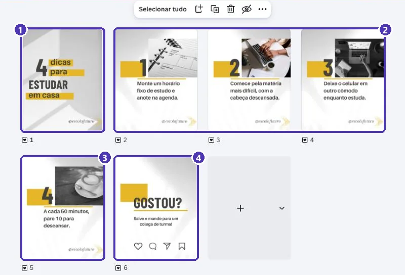
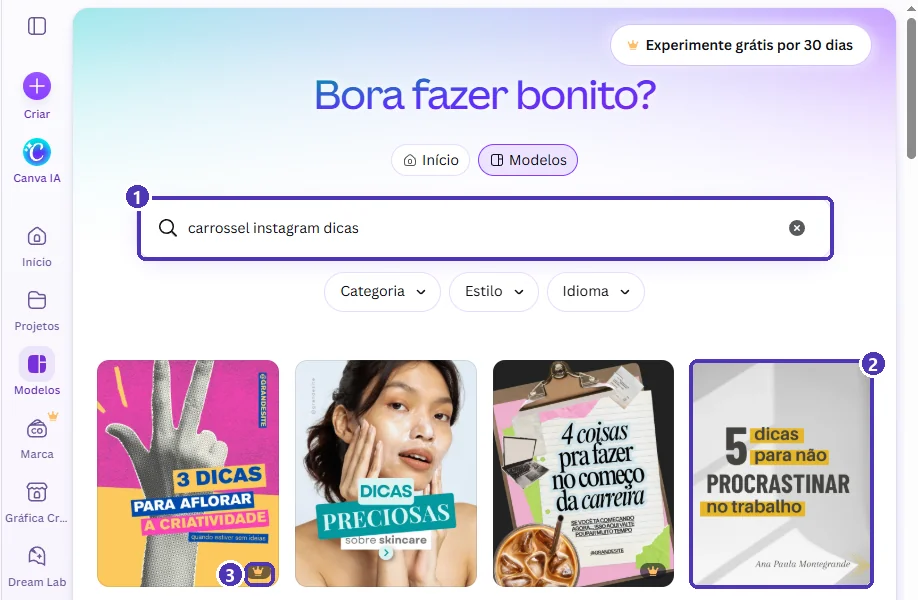
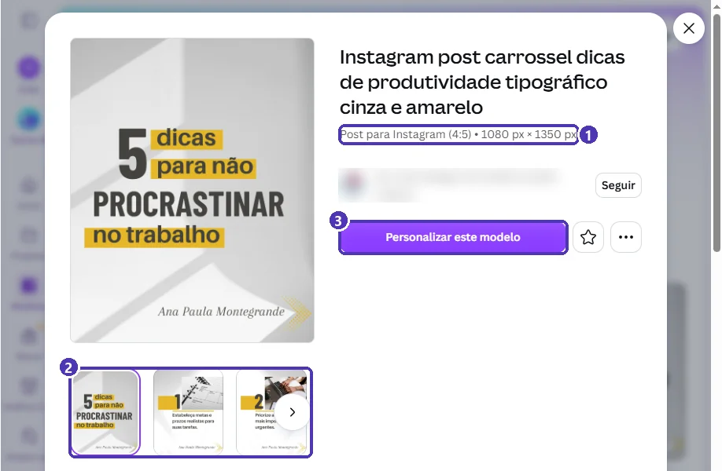
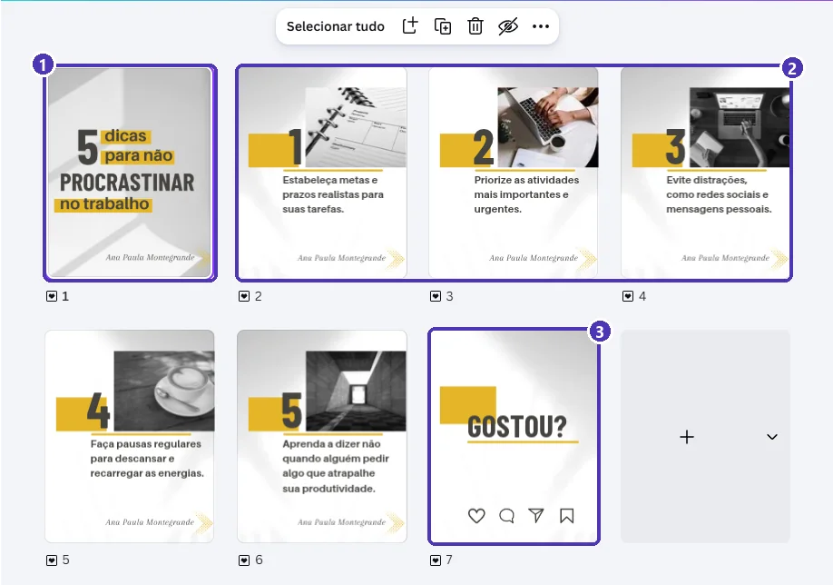
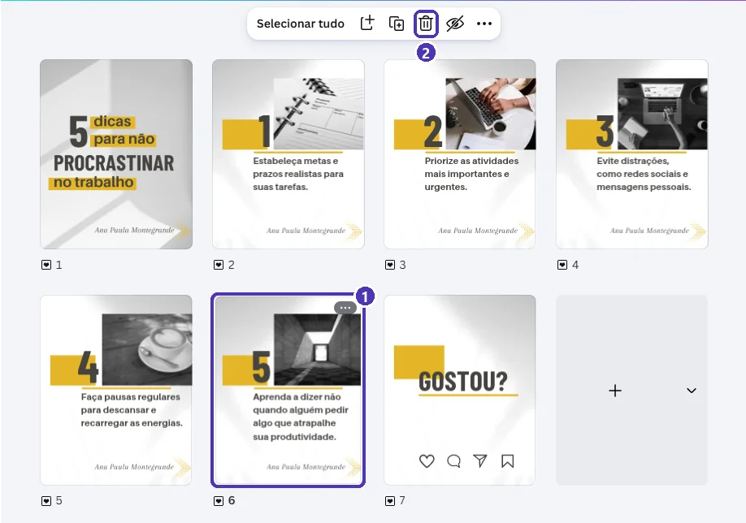
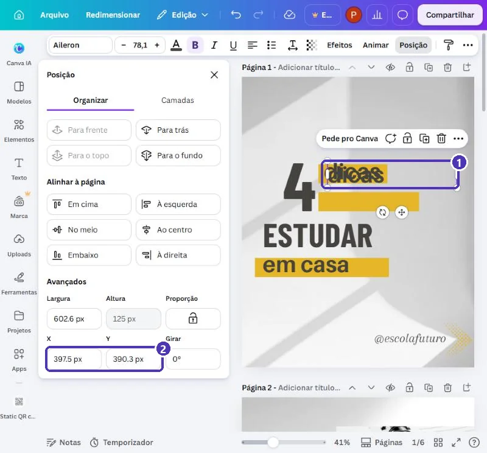
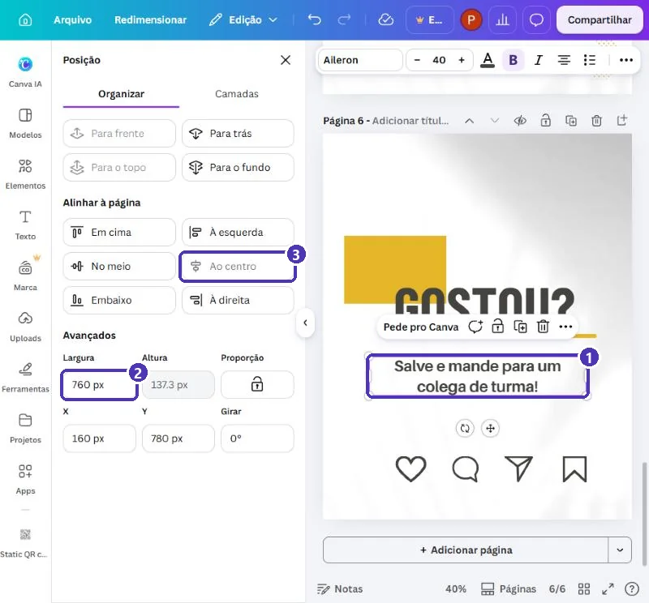
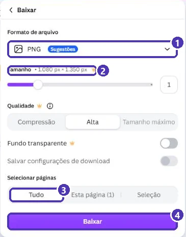

# 02 — Projeto: carrossel de dicas para o Instagram

> **Curso:** Canva  
> **Módulo:** 03 — Eventos e redes sociais  
> **Tempo estimado:** 1 h 30 min  

---

## O pedido

> *“Quero postar umas dicas de estudo no Instagram da escola, daquele jeito que a pessoa vai arrastando para o lado. Uma dica por tela, bem fácil de ler.”*

Esse formato é o **carrossel**: um post com várias imagens que o leitor passa com o dedo. Neste projeto você monta um carrossel de **6 telas**, com capa, 4 dicas e uma tela final pedindo para salvar e compartilhar.

O exemplo é de um perfil **inventado**, o *@escolafuturo*:

<figure markdown="span">
  { loading=lazy }
  <figcaption>(1) A <strong>capa</strong> promete o conteúdo · (2) e (3) uma <strong>dica por tela</strong>, sempre no mesmo layout · (4) a tela final pede uma <strong>ação</strong>.</figcaption>
</figure>

## O que você vai aprender no caminho

- A estrutura de um carrossel: **capa ➔ conteúdo ➔ chamada final**.
- Usar um modelo que já vem com **várias páginas**.
- **Excluir** páginas que sobram e conferir tudo na **grade**.
- **Duplicar** um texto e posicionar a cópia com **X e Y**.
- Centralizar um texto na página com **Alinhar à página**.
- Mandar o carrossel para o celular e publicar.

## Antes de começar

- [Módulo 02, projeto 04](../modulo_02_projetos_negocio/04_post_e_story.md): Posição, Camadas e X/Y.
- O conteúdo: um título e de 3 a 8 dicas curtas (uma frase cada).

---

## Passo 1 — Achar um modelo de carrossel

Busque `carrossel instagram dicas`. Os modelos de carrossel aparecem como posts comuns, mas têm **várias páginas** dentro:

<figure markdown="span">
  { loading=lazy }
  <figcaption>(1) A busca · (2) o modelo do exemplo, gratuito · (3) a coroa do Pro.</figcaption>
</figure>

Na prévia, as **miniaturas embaixo** mostram que o modelo tem mais de uma tela:

<figure markdown="span">
  { loading=lazy }
  <figcaption>(1) <strong>4:5</strong>, o formato em pé do feed · (2) as páginas do carrossel (a seta mostra as outras) · (3) <strong>Personalizar este modelo</strong>.</figcaption>
</figure>

!!! tip "Sem foto de pessoa"
    Como no convite, prefira modelos **tipográficos** (só letras e formas) ou com fotos de objetos. Assim você não precisa trocar o rosto de ninguém.

---

## Passo 2 — A estrutura do carrossel

Abra a **visualização em grade** (o ícone de quadradinhos, no canto de baixo):

<figure markdown="span">
  { loading=lazy }
  <figcaption>(1) <strong>Capa</strong> · (2) <strong>conteúdo</strong>: uma dica por página · (3) <strong>chamada final</strong>.</figcaption>
</figure>

| Parte | Função | Dica |
|---|---|---|
| **Capa** | Fazer a pessoa parar e arrastar | Número + promessa: “4 dicas para estudar em casa” |
| **Conteúdo** | Entregar o que a capa prometeu | Uma ideia por tela, frase curta |
| **Chamada final** | Pedir uma ação | “Salve”, “Mande para alguém”, “Siga para mais” |

!!! tip "Quantas telas?"
    O Instagram aceita **até 20** imagens num carrossel. Mas, para dicas, **5 a 8 telas** costumam funcionar melhor: dá para ver tudo sem cansar.

---

## Passo 3 — Ajustar o número de páginas

O modelo tem 5 dicas e o nosso conteúdo tem 4. Na grade, clique na página que sobra e na **lixeira** da barra de cima:

<figure markdown="span">
  { loading=lazy }
  <figcaption>(1) A página selecionada · (2) <strong>Excluir página</strong>.</figcaption>
</figure>

Precisa de **mais** dicas? Selecione uma página de dica ➔ **Duplicar página** (o ícone ao lado da lixeira) e troque o texto e o número da cópia.

!!! warning "Arrume os números"
    Depois de excluir ou duplicar, confira na grade se as dicas estão na ordem **1, 2, 3, 4**, sem pular nem repetir. Arraste as páginas na grade para mudar a ordem.

---

## Passo 4 — A capa

Dê **dois cliques** em um texto da capa (na grade, ou na visualização normal) e troque como sempre (`Ctrl + A` ➔ digite ➔ `Esc`).

A capa do modelo tem **várias caixas pequenas** (“dicas”, “para não”, “PROCRASTINAR”, “no trabalho”), cada uma sobre uma faixa amarela. Clique com atenção: é fácil editar a caixa errada.

### Quando uma caixa some

Se uma caixa ficou vazia ou foi apagada sem querer, **duplique uma caixa vizinha** e reaproveite:

1. Selecione a caixa parecida (aqui, “dicas”) ➔ `Ctrl + D`. A cópia aparece levemente deslocada.
2. **⋯ ➔ Posição** ➔ em **Avançados**, use o **mesmo X** da original e um **Y maior** (mais para baixo), até ela ficar em cima da faixa vazia.
3. Dois cliques na cópia e escreva o texto certo (“para”).

<figure markdown="span">
  { loading=lazy }
  <figcaption>(1) A cópia, com a mesma fonte e cor da original · (2) <strong>X</strong> e <strong>Y</strong>: copie o X da original para alinhar à esquerda e mude só o Y.</figcaption>
</figure>

!!! tip "Duplicar é melhor que criar do zero"
    Uma caixa nova (painel *Texto*) vem com outra fonte e outro tamanho. A cópia de uma caixa do modelo já vem **com o estilo certo**.

---

## Passo 5 — As dicas

Em cada página de dica, troque a frase. Regras para ficar legível no celular:

- **Uma frase**, de 6 a 12 palavras. “Deixe o celular em outro cômodo enquanto estuda.”
- **Comece com um verbo**: monte, comece, deixe, pare. Fica claro o que fazer.
- O **mesmo tamanho de letra** em todas as dicas. Não diminua a fonte para caber mais texto: corte o texto.

!!! warning "Não existe “Localizar e substituir”"
    O modelo repete o nome do autor (“Ana Paula Montegrande”) em todas as páginas. O Canva gratuito **não tem** um comando para trocar tudo de uma vez: troque **página por página** e confira na grade se não sobrou nenhum.

---

## Passo 6 — A chamada final

Na última página, acrescente o pedido: **Texto ➔ Adicionar uma caixa de texto** ➔ “Salve e mande para um colega de turma!”.

A caixa nova costuma cair **em cima do título**. Para arrumar, com ela selecionada, abra **⋯ ➔ Posição**:

<figure markdown="span">
  { loading=lazy }
  <figcaption>(1) O texto da chamada · (2) <strong>Largura</strong> menor que a página, para sobrar margem dos lados · (3) <strong>Ao centro</strong> centraliza na página (fica cinza depois de usado).</figcaption>
</figure>

1. **Tamanho da fonte** menor que o título (aqui, 40).
2. **Largura** de uns 70% da página (760 de 1080 px): o texto quebra em duas linhas e não encosta nas bordas.
3. **Y** maior que o do título, para descer.
4. **Alinhar à página ➔ Ao centro**.

---

## Passo 7 — Publicar

Em **Compartilhar**, além de **Baixar**, há atalhos úteis para carrossel:

<figure markdown="span">
  { loading=lazy }
  <figcaption>(1) <strong>Baixar</strong> · (2) <strong>Instagram</strong>: publica direto, depois de conectar a conta · (3) <strong>Enviar ao celular</strong>: manda o design para o app do Canva no seu telefone · (4) <strong>Agendar</strong> é do Pro.</figcaption>
</figure>

O caminho mais simples, sem conectar contas:

1. **Baixar** ➔ **PNG** ➔ **Selecionar páginas: Tudo** ➔ *Baixar*.

<figure markdown="span">
  { loading=lazy }
  <figcaption>(1) <strong>PNG</strong> · (2) 1.080 × 1.350 px, o tamanho certo do feed · (3) <strong>Tudo</strong>: todas as páginas · (4) <strong>Baixar</strong>.</figcaption>
</figure>

2. Passe as imagens para o celular (pelo WhatsApp “para você mesmo”, pelo Google Drive, ou com **Enviar ao celular**).
3. No Instagram: **+** ➔ **Publicação** ➔ toque no ícone de **selecionar várias** ➔ escolha as imagens **na ordem** (1, 2, 3...) ➔ *Avançar*.

!!! warning "A ordem importa"
    O Instagram publica na ordem em que você **toca** nas imagens, não na ordem dos nomes dos arquivos. Toque na capa primeiro.

---

## Revisão final

- [ ] A capa diz **quantas** dicas e **sobre o quê**.
- [ ] **Uma dica por tela**, numeradas em ordem, sem pular.
- [ ] Mesma letra e mesmo tamanho em todas as dicas.
- [ ] Nenhum resto do modelo (nome do autor, tema antigo) em nenhuma página.
- [ ] Tela final com uma **ação** clara.
- [ ] Baixado em **PNG**, 1.080 × 1.350 px, todas as páginas.

---

## Para outros temas

| Tema | Capa | Conteúdo |
|---|---|---|
| Passo a passo | “Como fazer brigadeiro em 5 passos” | Um passo por tela, com foto |
| Antes e depois | “O que mudou na nossa horta” | Foto antes / foto depois |
| Mitos e verdades | “3 mitos sobre ENEM” | Mito numa tela, verdade na seguinte |
| Divulgação de evento | “Feira de ciências: o que vai ter” | Uma atração por tela; data e local na última |

---

## Exercícios

### Básico (fixação)

Monte um carrossel de **capa + 3 dicas + chamada final** sobre um assunto que você domina, a partir de um modelo gratuito.

<!-- gabarito -->
??? success "Gabarito — Básico"
    1. *Modelos* ➔ `carrossel instagram dicas` ➔ um modelo sem coroa ➔ *Personalizar este modelo*.
    2. Grade ➔ selecione as páginas de dica que sobram ➔ **lixeira**.
    3. Troque capa, dicas e chamada final, caixa por caixa.
    4. Na grade, confira a numeração.

### Intermediário (aplicação)

Acrescente **mais uma dica** duplicando uma página e confira que **nenhuma** página ficou com texto do modelo original.

<!-- gabarito -->
??? success "Gabarito — Intermediário"
    1. Grade ➔ clique na última página de dica ➔ **Duplicar página**.
    2. Na cópia, troque o número e a frase.
    3. Arraste-a, na grade, para antes da chamada final.
    4. Abra cada página (dois cliques na grade) e procure nomes, @ e temas do modelo. Troque todos.

### Avançado (desafio)

Transforme o seu carrossel numa **divulgação de evento**: capa com o nome do evento, uma atração por tela e a **última tela** com data, local e um **QR code** para a inscrição (como no [cardápio](../modulo_02_projetos_negocio/02_cardapio.md)).

<!-- gabarito -->
??? success "Gabarito — Avançado"
    1. Capa: nome do evento + promessa (“O que vai ter na Feira de Ciências”).
    2. Uma atração por página, com o mesmo layout.
    3. Última página: data, horário e local; *Elementos* ➔ `QR code` ➔ **Criar QR code estático** ➔ link da inscrição ➔ *Gerar código*. Diminua e ponha uma legenda (“Inscreva-se”).
    4. **Teste o QR code** com a câmera antes de publicar.

    **Por que um QR code num post?** Muita gente vê o carrossel no computador ou em uma TV na escola. Para quem está no celular, ponha o mesmo link na legenda do post.

---

## 💡 Resumo

- Carrossel = **capa ➔ uma ideia por tela ➔ chamada final**.
- Modelos de carrossel são posts **com várias páginas**; a **grade** mostra tudo.
- Excluir/duplicar página pela barra da grade; confira a **numeração**.
- Caixa sumiu? **Duplique a vizinha** (`Ctrl + D`) e posicione com **X/Y**.
- Não há “substituir tudo”: troque nomes **página por página**.
- **PNG 1.080 × 1.350**, todas as páginas; no Instagram, selecione **na ordem**.

## ➡️ Próximo passo

**[03 — Capa de vídeo para o YouTube](03_capa_de_video.md)**: poucas palavras, foto que explica o assunto e contraste.
