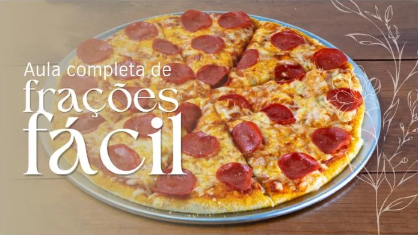
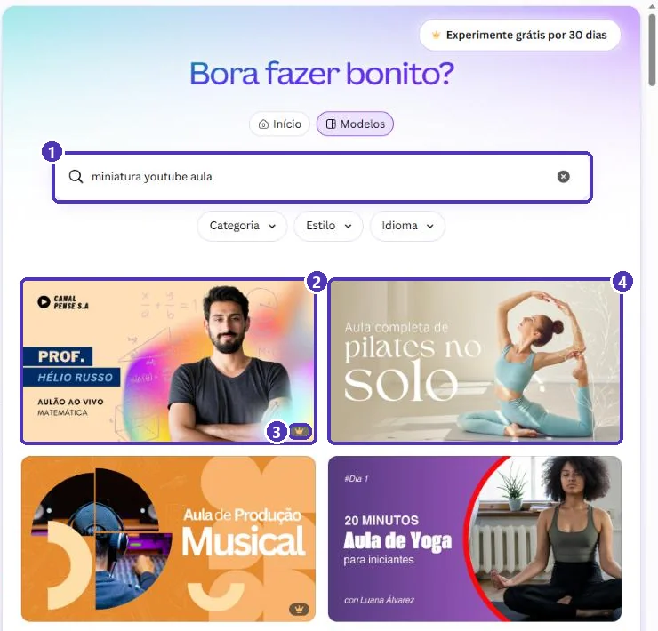
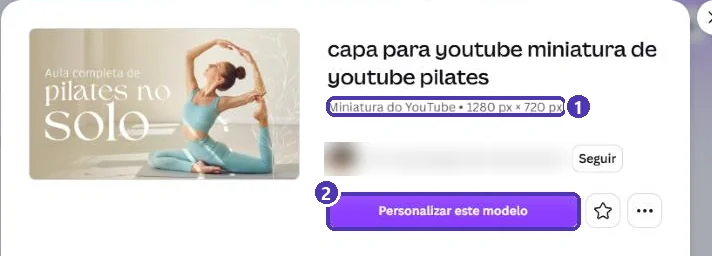
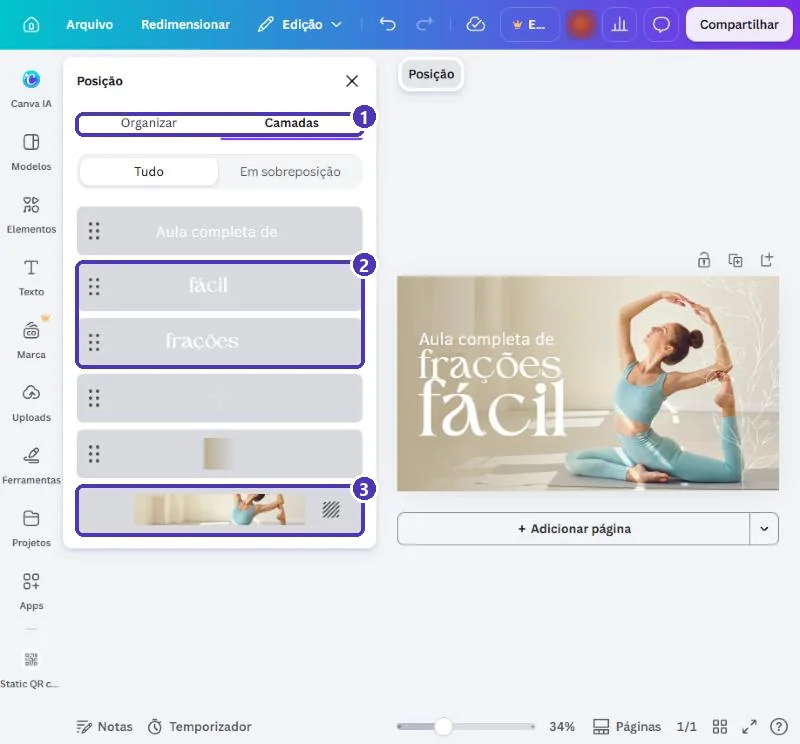
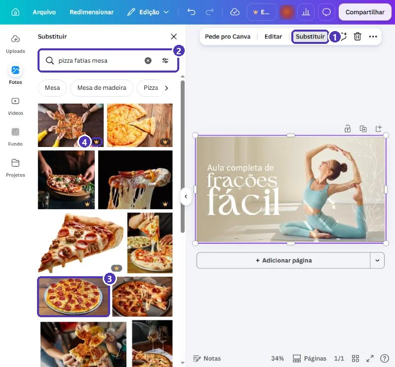
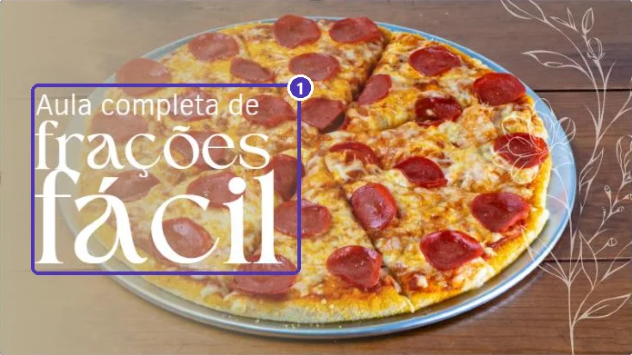
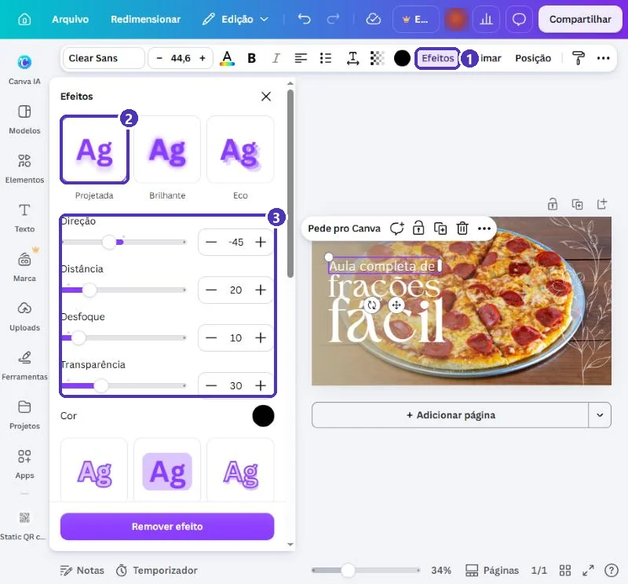
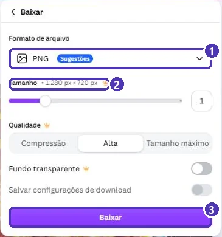

# 03 — Projeto: capa de vídeo para o YouTube

> **Curso:** Canva  
> **Módulo:** 03 — Eventos e redes sociais  
> **Tempo estimado:** 1 h  

---

## O pedido

> *“Gravei uma videoaula sobre frações para a turma e vou subir no YouTube. Quero uma capa que dê vontade de clicar, sem ser aquela imagem tirada do meio do vídeo.”*

A **capa** (ou **miniatura**, *thumbnail*) é a imagem que aparece antes de o vídeo tocar: na busca, na página do canal, nas sugestões. Ela tem um trabalho só: fazer a pessoa **clicar**.

O exemplo é de uma videoaula **inventada**:

<figure markdown="span">
  { loading=lazy }
  <figcaption>O resultado: o assunto em letra grande e uma imagem que já explica o tema (a pizza em fatias).</figcaption>
</figure>

## O que você vai aprender no caminho

- O tamanho da miniatura do YouTube.
- **Trocar a foto de fundo** de um modelo, inclusive a de uma pessoa.
- Selecionar textos sobrepostos com **Camadas**.
- Resolver **contraste** com o efeito **Sombra (Projetada)**.
- Baixar no formato certo.

## Antes de começar

- [Módulo 02, projeto 01](../modulo_02_projetos_negocio/01_catalogo_de_produtos.md): **Substituir** foto.
- [Módulo 02, projeto 04](../modulo_02_projetos_negocio/04_post_e_story.md): **Camadas**.

---

## Passo 1 — Escolher o modelo

Busque `miniatura youtube aula`. Os modelos já vêm no tipo **Miniatura do YouTube**:

<figure markdown="span">
  { loading=lazy }
  <figcaption>(1) A busca · (2) e (4) quase todas as capas têm uma <strong>pessoa</strong> · (3) a coroa do Pro.</figcaption>
</figure>

<figure markdown="span">
  { loading=lazy }
  <figcaption>(1) <strong>1280 × 720 px</strong>: o tamanho da miniatura do YouTube (16:9) · (2) <strong>Personalizar este modelo</strong>.</figcaption>
</figure>

!!! tip "Escolha pelo layout, não pela foto"
    Quase toda capa traz a foto de alguém. Isso não é problema: a foto você **troca**. Escolha o modelo pela **posição do texto** e pelo estilo das letras.

---

## Passo 2 — Trocar o texto

Troque com os dois cliques de sempre. Nesta capa, as caixas de texto são **grandes e se sobrepõem**: a caixa de “solo” cobre metade de “pilates no”. Se o clique pegar a caixa errada, use **⋯ ➔ Posição ➔ Camadas**:

<figure markdown="span">
  { loading=lazy }
  <figcaption>(1) <strong>Camadas</strong> · (2) cada linha de texto é um elemento: clique na lista para selecionar · (3) a <strong>foto de fundo</strong> é a última camada.</figcaption>
</figure>

!!! tip "Poucas palavras, letras enormes"
    No celular, a miniatura aparece **do tamanho de um selo**. Use no máximo **5 palavras** e deixe o assunto (“frações”) entre as maiores. O título completo vai no **título do vídeo**, não na capa.

---

## Passo 3 — Trocar a foto (inclusive a de uma pessoa)

Clique na foto de fundo (ou na última camada da lista) e em **Substituir**. Busque uma imagem que **explique o assunto**:

<figure markdown="span">
  { loading=lazy }
  <figcaption>(1) <strong>Substituir</strong> · (2) a busca · (3) uma foto gratuita · (4) a coroa marca as do Pro.</figcaption>
</figure>

| Assunto | Busque |
|---|---|
| Frações | `pizza fatias`, `bolo fatias` |
| Ciências | `microscópio`, `planta raiz` |
| História | `mapa antigo`, `pergaminho` |
| Português | `livros pilha`, `caderno caneta` |

!!! warning "A sua própria foto"
    Se for aparecer na capa, use uma foto **sua** (*Uploads*), tirada de frente, com fundo simples. Nunca deixe a foto da pessoa do modelo: o aluno vai achar que é outra pessoa dando a aula.

---

## Passo 4 — Contraste: o texto precisa saltar

A foto nova é colorida e cheia de detalhes. O texto branco **some** no meio dela:

<figure markdown="span">
  { loading=lazy }
  <figcaption>(1) Texto branco sobre fundo claro e cheio de detalhes: difícil de ler, ainda mais em miniatura.</figcaption>
</figure>

Selecione um texto ➔ **Efeitos** (na barra do texto) ➔ **Projetada**:

<figure markdown="span">
  { loading=lazy }
  <figcaption>(1) <strong>Efeitos</strong> · (2) <strong>Projetada</strong>: uma sombra atrás da letra · (3) os ajustes: distância, desfoque e transparência da sombra.</figcaption>
</figure>

Repita em cada texto. Os efeitos de texto **não têm coroa**.

!!! tip "Outras saídas para o contraste"
    - **Efeito Fundo**: uma faixa de cor atrás do texto. Mais forte que a sombra.
    - **Escurecer a foto**: selecione a foto ➔ **Editar** ➔ diminua o brilho.
    - **Retângulo semitransparente**: *Elementos* ➔ um quadrado preto ➔ **Transparência** em 40% ➔ **Para trás** do texto.

!!! warning "Copiar estilo leva a fonte junto"
    Para repetir o efeito, não use **Copiar estilo**: ele copia também a **fonte e o tamanho**, e as três linhas do título ficariam iguais. Aplique o efeito em cada texto.

---

## Passo 5 — Testar e baixar

**Teste do tamanho de selo:** diminua o zoom para **10%** (como no [panfleto](../modulo_02_projetos_negocio/03_panfleto_promocao.md)). Dá para ler o assunto? Então está bom.

**Compartilhar ➔ Baixar ➔ PNG**:

<figure markdown="span">
  { loading=lazy }
  <figcaption>(1) <strong>PNG</strong> (ou JPG) · (2) <strong>1.280 × 720 px</strong>, o tamanho do YouTube · (3) <strong>Baixar</strong>.</figcaption>
</figure>

No YouTube Studio: **Conteúdo** ➔ o vídeo ➔ **Miniatura** ➔ **Enviar arquivo**.

!!! info "Miniatura personalizada no YouTube"
    Para subir uma miniatura própria, o YouTube costuma pedir que o canal seja **verificado** (com um número de telefone). O arquivo precisa ter **até 2 MB**: se o PNG passar disso, baixe em **JPG**.

---

## Revisão final

- [ ] **1280 × 720 px** (Miniatura do YouTube).
- [ ] No máximo **5 palavras**, com o assunto em destaque.
- [ ] Nenhuma foto de pessoa do modelo.
- [ ] Texto **legível** sobre a foto (sombra, fundo ou foto escurecida).
- [ ] Passa no teste do **zoom 10%**.
- [ ] Nenhum elemento com coroa 👑.

---

## Para outros usos

| Uso | Tipo de design | Tamanho |
|---|---|---|
| Capa do YouTube | Miniatura do YouTube | 1280 × 720 px |
| Capa do Reels / TikTok | Vídeo para Reels | 1080 × 1920 px (deixe o texto no **centro**) |
| Capa de aula no Google Sala de Aula | Cabeçalho | 1000 × 250 px |
| Capa de podcast | Capa de podcast | 3000 × 3000 px |

---

## Exercícios

### Básico (fixação)

Faça a capa de um vídeo seu (ou inventado): troque o texto e a foto de um modelo de miniatura.

<!-- gabarito -->
??? success "Gabarito — Básico"
    1. *Modelos* ➔ `miniatura youtube` ➔ um modelo sem coroa ➔ *Personalizar este modelo*.
    2. Textos: dois cliques ➔ `Ctrl + A` ➔ digite. Se pegar a caixa errada, **Posição ➔ Camadas**.
    3. Foto: clique nela ➔ **Substituir** ➔ busque o assunto ➔ uma foto sem coroa.

### Intermediário (aplicação)

Garanta o contraste com **dois métodos diferentes** (por exemplo, sombra num texto e efeito Fundo no outro) e compare no zoom de 10%.

<!-- gabarito -->
??? success "Gabarito — Intermediário"
    1. Texto 1 ➔ **Efeitos** ➔ **Projetada**.
    2. Texto 2 ➔ **Efeitos** ➔ **Fundo** ➔ escolha uma cor escura e ajuste a transparência.
    3. Zoom ➔ **10%**: o **Fundo** costuma ganhar em fotos muito coloridas; a **Projetada** é mais discreta e funciona em fotos lisas.

### Avançado (desafio)

Faça uma **série** de 3 capas (aula 1, 2 e 3 de um mesmo assunto) no **mesmo design**, com o mesmo layout e só o número e a foto mudando.

<!-- gabarito -->
??? success "Gabarito — Avançado"
    1. Termine a capa 1 ➔ **Duplicar página** duas vezes.
    2. Em cada cópia, troque o número da aula e a foto (**Substituir**).
    3. **Baixar ➔ PNG ➔ Tudo**: sai um arquivo por capa.

    **Por quê?** No canal, capas com o mesmo visual mostram que os vídeos são de uma **série**, e quem gostou de um encontra os outros.

---

## 💡 Resumo

- Miniatura do YouTube: **1280 × 720 px**, no máximo **5 palavras**, letras grandes.
- Troque a foto de fundo com **Substituir**; nunca deixe a pessoa do modelo.
- Texto sobreposto? **Posição ➔ Camadas**.
- Contraste: **Efeitos ➔ Projetada** (ou **Fundo**), aplicado em cada texto.
- Teste em **zoom 10%** e baixe em **PNG** (ou JPG se passar de 2 MB).

## ➡️ Próximo passo

**[04 — Vídeo curto para Reels e status](04_video_curto.md)**: linha do tempo, música e download em MP4.
