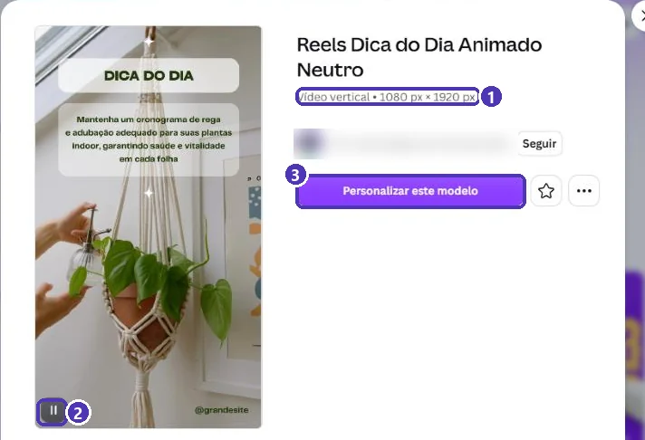
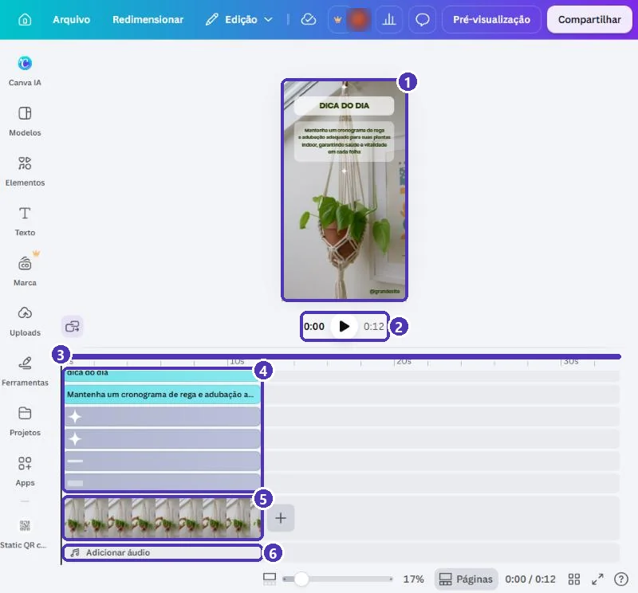
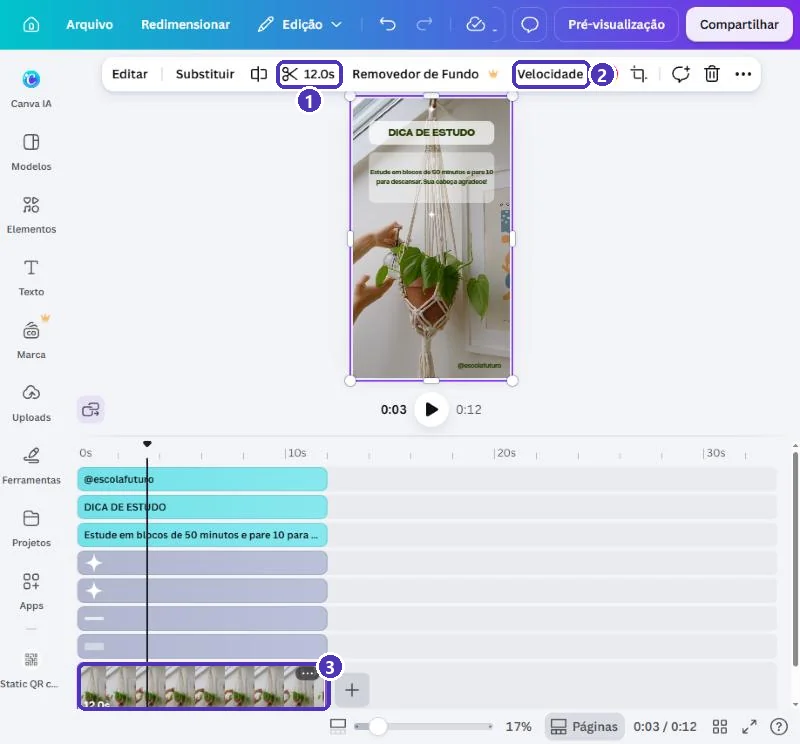
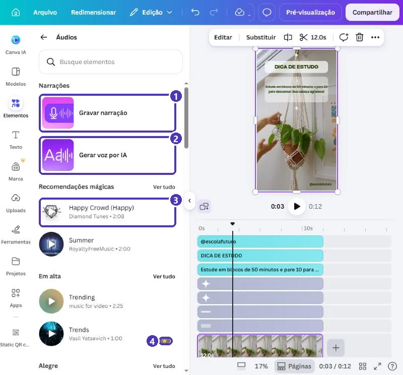
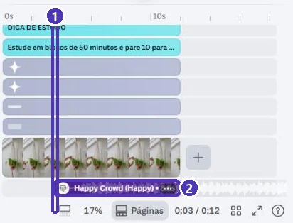
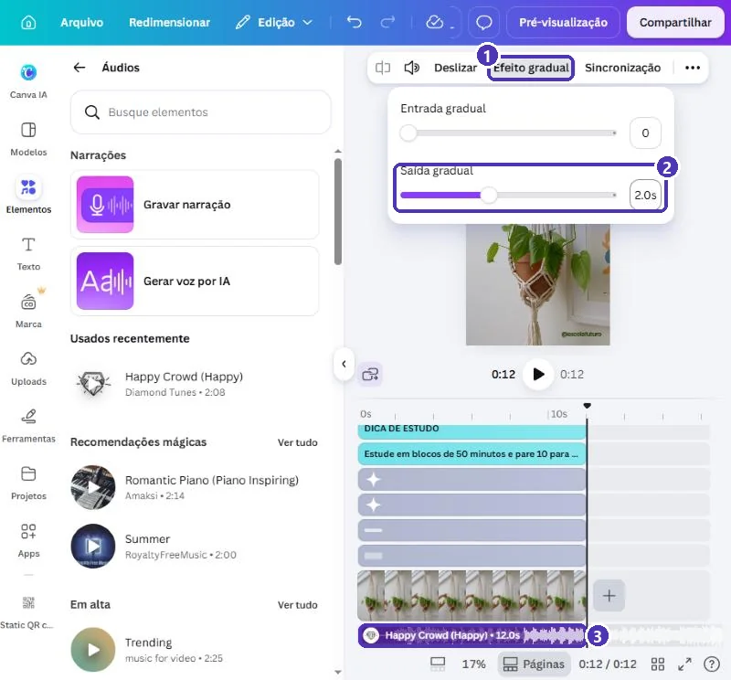
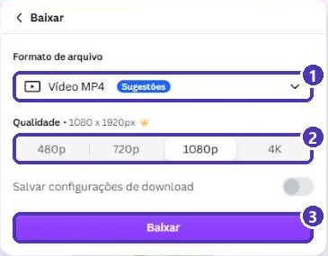

# 04 — Projeto: vídeo curto para Reels e status

> **Curso:** Canva  
> **Módulo:** 03 — Eventos e redes sociais  
> **Tempo estimado:** 1 h 30 min  

---

## O pedido

> *“Quero fazer aqueles vídeos curtinhos, de 10 a 15 segundos, com uma dica e uma musiquinha, para o Reels e o status. Não sei editar vídeo.”*

O Canva tem um **editor de vídeo** simples, com linha do tempo. Neste projeto você parte de um modelo de **vídeo vertical**, troca os textos, põe uma **música gratuita**, acerta a duração e baixa em **MP4**.

O exemplo continua no perfil **inventado** *@escolafuturo*:

<figure markdown="span">
  { loading=lazy }
  <figcaption>Um quadro do vídeo pronto: 12 segundos, com a dica no alto e música de fundo.</figcaption>
</figure>

## O que você vai aprender no caminho

- Achar modelos que são **vídeo** (e não imagem).
- As partes do **editor de vídeo**: prévia, play e **linha do tempo**.
- Selecionar e cortar um **clipe**.
- Pôr **música** e acertar o começo e o fim com o vídeo.
- **Efeito gradual** (a música some aos poucos).
- Baixar em **MP4**.

## Antes de começar

- [Projeto 01 deste módulo](01_convite_virtual.md): animação e download em MP4.
- A sua dica, em **uma frase**.

---

## Passo 1 — Achar um modelo de vídeo

Busque `reels dica`. Os modelos de vídeo têm os ícones de **play** e **som** no canto da miniatura:

<figure markdown="span">
  { loading=lazy }
  <figcaption>(1) A busca · (2) ▶ e 🔊 indicam que o modelo é <strong>vídeo</strong> · (3) o modelo do exemplo.</figcaption>
</figure>

<figure markdown="span">
  { loading=lazy }
  <figcaption>(1) <strong>Vídeo vertical, 1080 × 1920 px</strong>: Reels, TikTok, Shorts e status · (2) a prévia toca o vídeo · (3) <strong>Personalizar este modelo</strong>.</figcaption>
</figure>

---

## Passo 2 — O editor de vídeo

<figure markdown="span">
  { loading=lazy }
  <figcaption>(1) A <strong>prévia</strong> · (2) <strong>play</strong> e a duração (12 s) · (3) a régua de tempo · (4) as faixas dos <strong>textos e enfeites</strong> · (5) o <strong>clipe de vídeo</strong> · (6) <strong>Adicionar áudio</strong>.</figcaption>
</figure>

Cada faixa da linha do tempo é um elemento. O tamanho da barra mostra **quanto tempo** ele fica na tela. Aqui, tudo dura do começo ao fim (0 a 12 s).

---

## Passo 3 — Trocar os textos

Os textos se editam **na prévia**, como em qualquer design: dois cliques ➔ `Ctrl + A` ➔ digite ➔ `Esc`. A faixa do texto na linha do tempo muda junto.

!!! tip "Dá tempo de ler?"
    Uma regra prática: a pessoa lê umas **3 palavras por segundo**. Uma frase de 15 palavras precisa de **5 segundos** parada na tela. Se o vídeo é curto, encurte a frase.

---

## Passo 4 — O clipe de vídeo

Clique no **clipe** (a faixa com as miniaturas do vídeo). A barra de cima muda:

<figure markdown="span">
  { loading=lazy }
  <figcaption>(1) A <strong>tesoura</strong> e a duração: corta o começo e o fim do clipe · (2) <strong>Velocidade</strong>: mais lento ou mais rápido · (3) o clipe selecionado.</figcaption>
</figure>

- **Substituir** troca o vídeo de fundo por outro do banco do Canva, ou por um vídeo **seu** (*Uploads*).
- Para **encurtar**, você também pode arrastar a borda direita do clipe na linha do tempo.
- O **+** ao lado do clipe acrescenta outro clipe depois dele.

---

## Passo 5 — Música

**Elementos ➔ Áudios**:

<figure markdown="span">
  { loading=lazy }
  <figcaption>(1) <strong>Gravar narração</strong>: a sua voz, pelo microfone · (2) <strong>Gerar voz por IA</strong> · (3) músicas do Canva · (4) a coroa marca as músicas do Pro.</figcaption>
</figure>

Clique numa música sem coroa. **Cuidado:** ela entra **onde está a agulha** da linha do tempo (o tracinho preto), e não no começo:

<figure markdown="span">
  { loading=lazy }
  <figcaption>(1) A agulha estava em 0:03 · (2) a música entrou ali, e ficou com 8,6 s: o vídeo tem 12.</figcaption>
</figure>

Para acertar:

1. **Arraste a faixa da música** para a esquerda, até o começo (0 s).
2. **Arraste a borda direita** da música até o fim do vídeo. A faixa passa a mostrar **12.0s**.

!!! tip "Leve a agulha para o começo antes"
    Clique no **0s** da régua antes de escolher a música. Assim ela já entra no lugar certo.

---

## Passo 6 — Efeito gradual

Com a música selecionada, **Efeito gradual**:

<figure markdown="span">
  { loading=lazy }
  <figcaption>(1) <strong>Efeito gradual</strong> · (2) <strong>Saída gradual</strong> de 2 s: a música vai abaixando no fim · (3) a música, agora com os mesmos 12 s do vídeo.</figcaption>
</figure>

- **Entrada gradual**: a música começa baixinho e sobe.
- **Saída gradual**: a música abaixa até sumir. Sem isso, ela corta seco no último segundo.
- O ícone de **alto-falante** ajusta o volume. Se for gravar narração, deixe a música em 20% a 30%.
- **Deslizar** escolhe **qual trecho** da música toca (o refrão, por exemplo).

!!! warning "Música de fora do Canva"
    Uma música baixada da internet ou de um app de streaming pode render **bloqueio** ou **silenciamento** do vídeo no Instagram e no YouTube, por direito autoral. Use as músicas do Canva (sem coroa) ou, na hora de publicar, a **biblioteca de músicas do próprio Instagram/TikTok**.

---

## Passo 7 — Ver e baixar

Clique em **Pré-visualização** (no alto) para assistir em tela cheia, com som. Depois, **Compartilhar ➔ Baixar**:

<figure markdown="span">
  { loading=lazy }
  <figcaption>(1) <strong>Vídeo MP4</strong> · (2) a qualidade: <strong>1080p</strong> é a ideal para redes sociais · (3) <strong>Baixar</strong>.</figcaption>
</figure>

!!! info "Qualidade"
    O Canva marca a escolha de qualidade com a coroa. **1080p** já é a resolução do Reels e do status: não precisa de mais. Se o arquivo ficar pesado para mandar pelo WhatsApp, use **720p**.

No celular: Instagram ➔ **+** ➔ **Reel** ➔ escolha o vídeo. No WhatsApp: **Status** ➔ escolha o vídeo (o status aceita vídeos de até cerca de 1 minuto).

---

## Revisão final

- [ ] Vídeo **vertical** (1080 × 1920).
- [ ] Dá tempo de **ler** cada texto (3 palavras por segundo).
- [ ] A música **começa em 0 s e termina junto** com o vídeo.
- [ ] **Saída gradual** na música.
- [ ] Música e vídeos **sem coroa**.
- [ ] Assistido na **Pré-visualização**, com som, antes de baixar.

---

## Para outros usos

| Vídeo | Duração | Dica |
|---|---|---|
| Dica rápida | 7–15 s | Uma frase, um clipe, uma música |
| Contagem regressiva para evento | 10–15 s | Uma página por número (3, 2, 1) com transição |
| Bastidores | 15–30 s | Vários clipes curtos seus (*Uploads*), cada um com 2–3 s |
| Anúncio de produto | 10–20 s | Foto do produto + preço + “link na bio” |

---

## Exercícios

### Básico (fixação)

Faça um vídeo curto com **uma dica sua**, a partir de um modelo de vídeo vertical, e assista na **Pré-visualização**.

<!-- gabarito -->
??? success "Gabarito — Básico"
    1. *Modelos* ➔ `reels dica` ➔ um modelo com ▶ e sem coroa ➔ *Personalizar este modelo*.
    2. Troque os textos na prévia (dois cliques ➔ `Ctrl + A` ➔ digite).
    3. **Pré-visualização** (no alto) ➔ assista. Dá tempo de ler?

### Intermediário (aplicação)

Ponha uma **música gratuita** que comece no 0 s, termine junto com o vídeo e tenha **saída gradual** de 2 segundos.

<!-- gabarito -->
??? success "Gabarito — Intermediário"
    1. Clique no **0s** da régua.
    2. *Elementos* ➔ **Áudios** ➔ uma música sem coroa.
    3. Arraste a borda direita da música até o fim do vídeo (a faixa mostra a mesma duração do vídeo).
    4. **Efeito gradual** ➔ **Saída gradual: 2**.

### Avançado (desafio)

**Troque o vídeo de fundo** por outro que combine com a sua dica (do banco do Canva ou um vídeo seu) e **corte** para a mesma duração do resto.

<!-- gabarito -->
??? success "Gabarito — Avançado"
    1. Clique no clipe ➔ **Substituir** ➔ aba **Vídeos** (ou **Uploads**, para um vídeo seu) ➔ escolha um sem coroa.
    2. Se o vídeo novo for mais longo, use a **tesoura** ou arraste a borda direita do clipe até a duração das faixas de texto.
    3. Se ficou mais curto, os textos vão continuar depois do vídeo acabar: encurte as faixas de texto e a música também.
    4. **Pré-visualização** para conferir tudo junto.

---

## 💡 Resumo

- Modelos de **vídeo** têm ▶ e 🔊 na miniatura; vertical = **1080 × 1920**.
- Editor de vídeo = **prévia** + **linha do tempo** (uma faixa por elemento).
- Clipe: **tesoura** corta, **Substituir** troca, **Velocidade** acelera.
- Música entra **na agulha**: leve-a para 0 s, e estique até o fim do vídeo.
- **Efeito gradual** para a música não cortar seco.
- **MP4 1080p**; assista na **Pré-visualização** antes de baixar.

## ➡️ Próximo passo

Você terminou o **Módulo 03** e os projetos do curso. Volte ao [índice do módulo](index.md) e confira o checklist. Para o certificado, reúna os projetos dos **Módulos 02 e 03** num portfólio, como pede a [página do curso](../docs/index.md).
