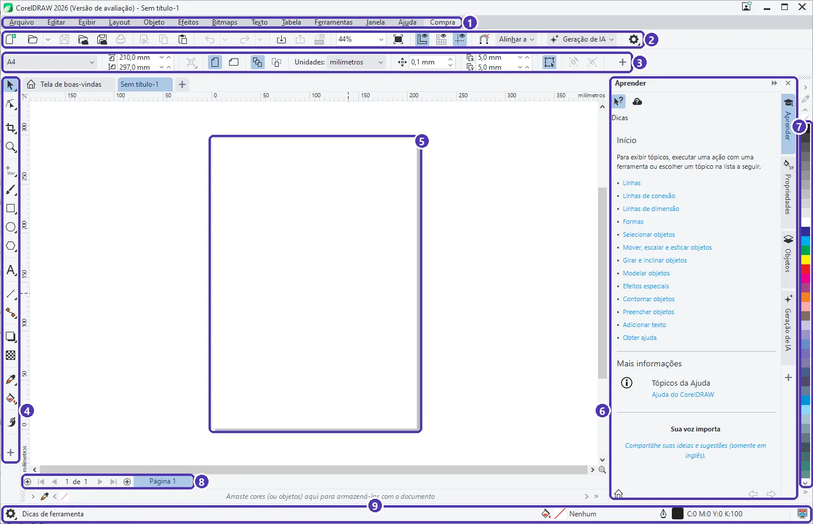

# 01 — Conhecendo o CorelDRAW: boas-vindas e interface

> **Curso:** CorelDRAW  
> **Módulo:** 01 — Primeiros passos  
> **Tempo estimado:** 1 h  

---

## Objetivos

Ao final desta aula, você será capaz de:

- Explicar o que é uma imagem **vetorial** e por que a gráfica gosta dela.
- Usar a **tela de boas-vindas** para criar ou abrir um documento.
- Reconhecer as **nove áreas** da interface do CorelDRAW.
- Saber onde ficam as **dicas** do próprio programa.

## Pré-requisitos

- CorelDRAW instalado (a versão de avaliação serve) ou o Inkscape.

---

## Vetor × pixel

Uma foto do celular é feita de **pixels**: milhares de quadradinhos coloridos. Amplie demais e os quadradinhos aparecem; a imagem fica “estourada”.

Um desenho **vetorial** é feito de **formas descritas por matemática**: “um círculo com tal raio, nesta posição, preenchido de amarelo”. Ampliar é só refazer a conta, por isso a borda continua lisa em qualquer tamanho.

| | Pixel (bitmap) | Vetor |
|---|---|---|
| Exemplos | foto, print de tela | logotipo, cartão, faixa, adesivo |
| Ampliar | perde qualidade | fica nítido |
| Programas | Photoshop, GIMP, Paint | **CorelDRAW**, Illustrator, Inkscape |
| Arquivos | JPG, PNG | **CDR**, SVG, PDF, AI, EPS |

!!! tip "Por que a gráfica pede o vetor"
    A mesma marca vai para o cartão de 9 cm, para o adesivo do carro e para a fachada da loja. Com o arquivo vetorial, a gráfica imprime todos sem pedir “uma imagem maior”.

---

## A tela de boas-vindas

Ao abrir o CorelDRAW, aparece a **Tela de boas-vindas**:

<figure markdown="span">
  { loading=lazy }
  <figcaption>(1) <strong>Novo documento</strong> · (2) <strong>Abrir documento</strong>, para continuar um trabalho salvo · (3) quantos dias de avaliação ainda restam · (4) a aba <strong>Tela de boas-vindas</strong>: clique na casinha para voltar a ela.</figcaption>
</figure>

- **Começar** mostra os atalhos para criar e abrir. **Área de trabalho** troca a arrumação da tela (deixe a padrão por enquanto).
- **Treinamento** e **Aprendizado** trazem tutoriais da Corel. **Loja** e os avisos de assinatura são propaganda: pode ignorar.
- O botão **Gerar com IA** usa créditos da assinatura. Neste curso não vamos usá-lo.

!!! warning "Versão de avaliação"
    A avaliação dura poucos dias e o contador (3) diminui a cada dia. Ao fechar o programa, aparece uma janela oferecendo a assinatura. Basta clicar em **Fechar**. Quando a avaliação acabar, continue as aulas no **Inkscape**.

---

## A interface

Clique em **Novo documento** e depois em **OK** (a janela de opções é assunto da próxima aula). Esta é a tela de trabalho:

<figure markdown="span">
  { loading=lazy }
  <figcaption>As nove áreas da interface, explicadas na tabela abaixo.</figcaption>
</figure>

| Nº | Área | Para que serve |
|---|---|---|
| 1 | **Barra de menus** | Todos os comandos: *Arquivo*, *Editar*, *Objeto*, *Texto*… |
| 2 | **Barra de ferramentas padrão** | Novo, abrir, salvar, desfazer, importar, exportar, publicar em PDF e o **zoom** (44%). |
| 3 | **Barra de propriedades** | Muda conforme a ferramenta e o que está selecionado. Sem nada selecionado, mostra o tamanho da página e as unidades. |
| 4 | **Caixa de ferramentas** | Seleção, formas, texto, cor… Um triângulo pequeno no canto do botão indica que há mais ferramentas escondidas ali. |
| 5 | **Página** | O retângulo branco é o que será impresso ou exportado. O espaço em volta é a **área de desenho**: dá para guardar coisas ali, mas elas não saem na impressão. |
| 6 | **Janelas de encaixe** | Painéis à direita: **Aprender** (dicas), **Propriedades**, **Objetos**. Clique nas abas verticais para trocar. |
| 7 | **Paleta de cores** | Clique numa cor para pintar o objeto selecionado (aula 04). |
| 8 | **Navegador de páginas** | Mostra “1 de 1”, as abas das páginas e o **+** para criar páginas. |
| 9 | **Barra de status** | Diz o que está selecionado, a cor do preenchimento e do contorno e dicas da ferramenta atual. |

As **réguas**, no alto e à esquerda da página, mostram a medida na unidade do documento (aqui, milímetros).

!!! tip "O painel Aprender"
    O painel **Aprender** (6) muda de assunto conforme o que você faz. Selecionou um objeto? Ele explica como mover, escalar e esticar. Quando ficar em dúvida, olhe para ele antes de procurar na internet.

### Navegar: zoom e rolagem

| Ação | Como fazer |
|---|---|
| Aproximar / afastar | Gire a **roda do mouse** (o zoom segue o ponteiro) |
| Ver a página inteira | `Shift + F4` |
| Ver todos os objetos | `F4` |
| Rolar para os lados | Arraste as barras de rolagem ou use `Ctrl` + roda |
| Desfazer | `Ctrl + Z` (refazer: `Ctrl + Shift + Z`) |

---

??? note "No Inkscape"
    - A tela inicial do Inkscape (*Bem-vindo ao Inkscape*) também cria um documento por tamanho ou abre um recente.
    - **Barra de menus**, **barra de controles de ferramenta** (equivale à barra de propriedades), **caixa de ferramentas** à esquerda, **paleta** embaixo e **painéis** à direita (*Preenchimento e contorno*, *Camadas e objetos*).
    - Zoom: roda do mouse com `Ctrl`; página inteira: `5`; todos os objetos: `4`.
    - Formato próprio: **SVG** (no CorelDRAW, CDR).

---

## Exercícios

### Básico (fixação)

Abra o CorelDRAW, crie um documento novo e aponte na tela, em voz alta ou num papel, as nove áreas da interface.

<!-- gabarito -->
??? success "Gabarito — Básico"
    De cima para baixo: (1) barra de menus, (2) barra de ferramentas padrão, (3) barra de propriedades; à esquerda, (4) caixa de ferramentas; no centro, (5) página na área de desenho; à direita, (6) janelas de encaixe e (7) paleta; embaixo, (8) navegador de páginas e (9) barra de status.

### Intermediário (aplicação)

Volte à tela de boas-vindas **sem fechar** o documento e depois retorne a ele.

<!-- gabarito -->
??? success "Gabarito — Intermediário"
    Clique na aba com a **casinha** (*Tela de boas-vindas*), acima da régua. Para voltar, clique na aba do documento (*Sem título-1*). As abas funcionam como as do navegador: cada documento aberto ganha a sua.

### Avançado (desafio)

Explique para um colega por que um logotipo enviado em **JPG pequeno** pode ficar ruim numa faixa de 2 metros, e qual arquivo você pediria no lugar.

<!-- gabarito -->
??? success "Gabarito — Avançado"
    O JPG é feito de pixels: ao ampliar para 2 metros, cada pixel vira um quadrado visível e a borda fica serrilhada e borrada. O certo é pedir o **arquivo vetorial** do logotipo (CDR, SVG, AI, EPS ou um PDF vetorial), que pode ser ampliado sem perder nitidez.

---

## 💡 Resumo

- **Vetor** é forma descrita por matemática: amplia sem perder qualidade. **Pixel** é foto.
- A **tela de boas-vindas** cria, abre e mostra os dias de avaliação. A casinha volta para ela.
- A **barra de propriedades** muda conforme o que está selecionado: é o lugar mais importante depois da página.
- Só a **página** sai na impressão; o resto é área de rascunho.

## ➡️ Próximo passo

Na **[aula 02](02_documento_e_paginas.md)** você cria documentos no tamanho certo: A4, cartão e o tamanho que a gráfica pedir.
