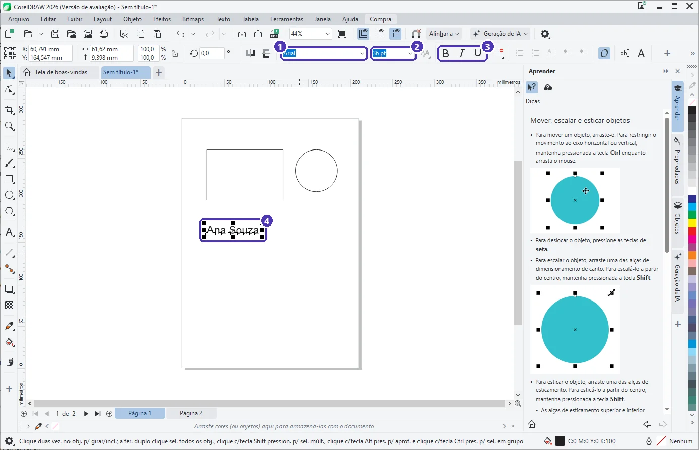

# 03 — Formas, seleção e texto

> **Curso:** CorelDRAW  
> **Módulo:** 01 — Primeiros passos  
> **Tempo estimado:** 1 h 30 min  

---

## Objetivos

Ao final desta aula, você será capaz de:

- Desenhar **retângulos** e **elipses**, inclusive quadrados e círculos perfeitos.
- **Selecionar** um ou vários objetos e reconhecer as **alças** de seleção.
- Mover, redimensionar e girar objetos com o mouse e com **medidas exatas**.
- Escrever e formatar um **texto** (fonte, tamanho, negrito).

## Pré-requisitos

- [Aula 02](02_documento_e_paginas.md) deste módulo. Crie um documento A4 em milímetros para praticar.

---

## As quatro ferramentas desta aula

<figure markdown="span">
  { loading=lazy }
  <figcaption>(1) <strong>Seleção</strong> · (2) <strong>Retângulo</strong> · (3) <strong>Elipse</strong> · (4) <strong>Texto</strong> · (5) três objetos selecionados: as <strong>alças</strong> (quadradinhos pretos) cercam o conjunto · (6) <strong>posição</strong> (X, Y) e <strong>tamanho</strong> na barra de propriedades.</figcaption>
</figure>

| Ferramenta | Atalho | Para quê |
|---|---|---|
| **Seleção** | barra de espaço (alterna com a ferramenta atual) | Selecionar, mover, redimensionar, girar |
| **Retângulo** | `F6` | Retângulos e quadrados |
| **Elipse** | `F7` | Elipses e círculos |
| **Texto** | `F8` | Escrever |

---

## Desenhar formas

1. Escolha **Retângulo** (`F6`).
2. Clique na página e **arraste** na diagonal. Solte.
3. Para a **elipse** (`F7`), é igual.

| Segure... | Enquanto arrasta, para... |
|---|---|
| `Ctrl` | um **quadrado** ou um **círculo** perfeito |
| `Shift` | desenhar **a partir do centro** |
| `Ctrl + Shift` | círculo perfeito a partir do centro |

!!! tip "Retângulo do tamanho da página"
    **Dois cliques** no botão da ferramenta Retângulo criam um retângulo exatamente do tamanho da página. É o jeito mais rápido de fazer um **fundo**, como no projeto da aula 05.

---

## Selecionar

Com a ferramenta **Seleção**:

| Para... | Faça |
|---|---|
| Selecionar um objeto | Clique nele (num objeto **sem preenchimento**, clique na linha) |
| Juntar mais objetos à seleção | `Shift` + clique |
| Selecionar vários de uma vez | Arraste um retângulo em volta deles (só entra quem fica **inteiro** dentro) |
| Selecionar tudo | `Ctrl + A`, ou **dois cliques** na ferramenta Seleção |
| Selecionar o que está **atrás** | `Alt` + clique |
| Tirar a seleção | `Esc` ou clique numa área vazia |

A **barra de status** sempre diz o que está selecionado, e a **barra de propriedades** passa a mostrar as medidas do objeto.

### Mover, redimensionar e girar

- **Mover:** arraste pelo meio do objeto. As **setas** do teclado empurram um pouquinho (o passo aparece na barra de propriedades quando nada está selecionado; aqui, 0,1 mm).
- **Redimensionar:** arraste uma **alça de canto** (mantém a proporção) ou uma **alça do meio** (estica só um lado).
- **Girar:** clique **de novo** no objeto já selecionado. As alças viram setas curvas; arraste uma alça de canto.
- **Medida exata:** digite na barra de propriedades: **X** e **Y** (posição), **largura** e **altura**, e tecle `Enter`.
- **Apagar:** `Delete`. **Duplicar:** `Ctrl + D`.

!!! info "O cadeado da proporção"
    Ao lado da largura e da altura há um **cadeado**. Fechado, mudar a largura muda a altura na mesma proporção. Aberto, cada medida muda sozinha.

---

## Texto

1. Escolha **Texto** (`F8`), clique na página e digite. Esse é o **texto artístico**, bom para títulos e frases curtas. (Arrastar uma caixa antes de digitar cria o **texto de parágrafo**, assunto do Módulo 02.)
2. Para formatar o texto inteiro, volte para a ferramenta **Seleção** e clique no texto. A barra de propriedades vira a barra de texto:

<figure markdown="span">
  { loading=lazy }
  <figcaption>(1) <strong>fonte</strong> · (2) <strong>tamanho</strong> em pontos (pt) · (3) <strong>negrito</strong>, <strong>itálico</strong> e <strong>sublinhado</strong> · (4) o objeto de texto selecionado.</figcaption>
</figure>

- Para mudar **só uma palavra**, use a ferramenta Texto, selecione a palavra arrastando sobre ela e formate.
- Arrastar uma **alça de canto** de um texto artístico também aumenta a letra, mas o tamanho em pt fica quebrado (36,4 pt). Prefira digitar o tamanho.

!!! warning "Fontes e a gráfica"
    Se a gráfica não tiver a fonte que você usou, o texto aparece trocado no computador dela. Na aula 05 você vê como **incorporar fontes** ao salvar. No Módulo 03, como mandar um PDF que não depende delas.

---

??? note "No Inkscape"
    | CorelDRAW | Inkscape |
    |---|---|
    | Seleção (barra de espaço) | **Seletor** (`S`) |
    | Retângulo (`F6`) | **Retângulo** (`R`) |
    | Elipse (`F7`) | **Círculo/Elipse** (`E`) |
    | Texto (`F8`) | **Texto** (`T`) |
    | `Ctrl` ao arrastar = quadrado/círculo | igual |
    | Clicar de novo = girar | igual: o segundo clique mostra as setas de rotação |
    | X, Y, largura, altura na barra de propriedades | **X, Y, L, A** na barra de controles do Seletor |

---

## Exercícios

### Básico (fixação)

Desenhe um **quadrado** e um **círculo** perfeitos e dê a cada um exatamente **40 × 40 mm** pela barra de propriedades.

<!-- gabarito -->
??? success "Gabarito — Básico"
    `F6` + arrastar com `Ctrl` (quadrado); `F7` + arrastar com `Ctrl` (círculo). Selecione cada um, feche o cadeado, digite **40** na largura e `Enter`: a altura acompanha.

### Intermediário (aplicação)

Escreva seu nome em **Arial 36 pt, negrito**, e coloque-o na posição **X = 105 mm** (o meio de uma folha A4).

<!-- gabarito -->
??? success "Gabarito — Intermediário"
    `F8` ➔ clique ➔ digite ➔ ferramenta Seleção ➔ clique no texto ➔ fonte **Arial**, tamanho **36**, botão **B** ➔ no campo **X**, `105` e `Enter`. O X indica o **centro** do objeto, por isso o nome fica centralizado na largura da folha.

### Avançado (desafio)

Monte uma “carinha”: um círculo grande, dois círculos pequenos iguais (olhos) e um retângulo fino (boca). Os olhos devem ser **iguais**, sem desenhar o segundo à mão.

<!-- gabarito -->
??? success "Gabarito — Avançado"
    Desenhe o primeiro olho com `F7` + `Ctrl`. Com ele selecionado, `Ctrl + D` cria uma cópia idêntica. Arraste a cópia para o lado. Para que ela fique na **mesma altura**, segure `Ctrl` enquanto arrasta (o movimento fica só na horizontal) ou copie o valor **Y** do primeiro olho.

---

## 💡 Resumo

- `F6` retângulo, `F7` elipse, `F8` texto; `Ctrl` = quadrado/círculo, `Shift` = a partir do centro.
- **Alças** de canto mantêm a proporção; clique de novo para **girar**.
- Medidas exatas: **X, Y, largura e altura** na barra de propriedades.
- Texto: formate com a ferramenta **Seleção** (texto todo) ou com a ferramenta **Texto** (só um trecho).

## ➡️ Próximo passo

Na **[aula 04](04_cor_preenchimento_e_contorno.md)** você dá cor às formas e aos textos.
