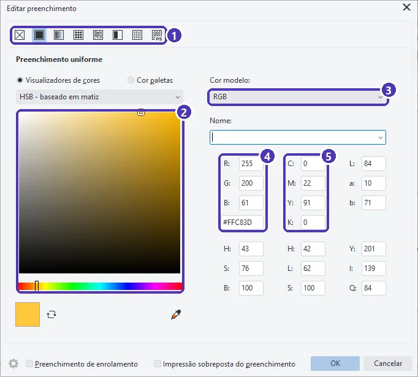

# 04 — Cor: preenchimento, contorno e paleta

> **Curso:** CorelDRAW  
> **Módulo:** 01 — Primeiros passos  
> **Tempo estimado:** 1 h  

---

## Objetivos

Ao final desta aula, você será capaz de:

- Diferenciar **preenchimento** (o “miolo”) de **contorno** (a linha em volta).
- Pintar pela **paleta** com o botão esquerdo e o direito.
- Ajustar cor e espessura no painel **Propriedades**.
- Digitar uma cor exata (RGB, CMYK ou **hexadecimal**) em **Editar preenchimento** e configurar a **Caneta de contorno**.

## Pré-requisitos

- [Aula 03](03_formas_selecao_e_texto.md) deste módulo. Tenha na página um retângulo, um círculo e um texto.

---

## Preenchimento × contorno

Todo objeto tem duas cores independentes:

- **Preenchimento:** a cor de dentro.
- **Contorno:** a linha em volta, com cor **e** espessura.

Uma forma recém-desenhada vem **sem preenchimento** e com contorno preto fino. Um texto vem com preenchimento preto e sem contorno.

---

## O jeito rápido: a paleta

Selecione o objeto e:

| Na paleta (à direita da tela) | Resultado |
|---|---|
| **Clique** numa cor | muda o **preenchimento** |
| **Botão direito** numa cor | muda o **contorno** |
| Clique no quadradinho com **X** (topo da paleta) | **remove** o preenchimento |
| Botão direito no **X** | **remove** o contorno |

!!! tip "Arrastar a cor"
    Também dá para **arrastar** uma cor da paleta e soltar sobre um objeto, mesmo sem selecioná-lo: solte no meio para o preenchimento e na borda para o contorno.

---

## O painel Propriedades

Para ver e ajustar tudo num só lugar, abra o painel **Propriedades**: clique na aba vertical *Propriedades*, à direita, ou use `Alt + Enter`.

<figure markdown="span">
  { loading=lazy }
  <figcaption>(1) objeto selecionado · (2) guias do painel: <strong>contorno</strong>, <strong>preenchimento</strong>, transparência… · (3) <strong>cor</strong> e <strong>largura</strong> do contorno · (4) a largura também fica na barra de propriedades · (5) paleta · (6) barra de status com as duas cores do objeto.</figcaption>
</figure>

- Na guia **Contorno** (primeiro ícone), escolha a cor na lista e a **largura** em milímetros.
- Na guia **Preenchimento** (segundo ícone), escolha o tipo (*uniforme* é uma cor só) e a cor.
- Confira o resultado na **barra de status** (6): à esquerda o preenchimento, à direita o contorno, com os valores da cor.

---

## Cor exata: Editar preenchimento

Quando o cliente manda a cor da marca (por exemplo, `#FFC83D`), digite o valor em vez de procurar na paleta. Selecione o objeto e tecle `Shift + F11`:

<figure markdown="span">
  { loading=lazy }
  <figcaption>(1) tipos de preenchimento: nenhum, <strong>uniforme</strong>, gradiente e padrões · (2) área para escolher a cor com o mouse · (3) <strong>modelo de cor</strong> · (4) valores <strong>RGB</strong> e <strong>hexadecimal</strong> · (5) a mesma cor em <strong>CMYK</strong>.</figcaption>
</figure>

1. Em (3), escolha o **modelo** em que a cor foi passada: RGB (tela), CMYK (impressão).
2. Digite os valores em (4) ou (5), ou o código **hexadecimal** (o que começa com `#`).
3. **OK**.

!!! info "Por que a mesma cor aparece em vários números?"
    O CorelDRAW mostra a cor escolhida em vários “idiomas”: RGB, CMYK, Lab, HSB. Para o material **impresso**, o que vale é o **CMYK**, assunto do Módulo 03. Por enquanto, guarde a regra: **cor da marca para impressão, peça os valores CMYK**.

---

## Contorno caprichado: Caneta de contorno

Com o objeto selecionado, tecle `F12`:

<figure markdown="span">
  { loading=lazy }
  <figcaption>(1) <strong>Cor</strong> · (2) <strong>Largura</strong> e unidade · (3) <strong>Estilo</strong>: contínuo, tracejado, pontilhado · (4) <strong>Cantos</strong> e <strong>extremidades</strong>: vivos ou arredondados · (5) <strong>Atrás do preenchimento</strong> e <strong>Escala com objeto</strong>.</figcaption>
</figure>

As duas opções de (5) evitam surpresas:

- **Escala com objeto:** se você reduzir um logotipo pela metade, o contorno também afina. Desligada, a linha mantém a espessura e o desenho pequeno fica “pesado”.
- **Atrás do preenchimento:** o contorno fica por trás da cor, e só a metade de fora aparece. Útil em textos com contorno, que não perdem o desenho da letra.

!!! warning "Contorno muito fino não imprime"
    Linhas abaixo de **0,1 mm** podem sumir ou falhar na impressão. Para gráfica, use pelo menos **0,2 mm**.

---

??? note "No Inkscape"
    - Paleta embaixo da tela: **clique** = preenchimento; **Shift + clique** = contorno (no Inkscape o contorno chama-se **traço**).
    - Tudo num painel: **Objeto ➔ Preenchimento e contorno** (`Ctrl + Shift + F`), com as guias *Preenchimento*, *Pintura do traço* e *Estilo do traço* (largura, tracejado, cantos).
    - Cor exata: no mesmo painel, digite o **RGBA** (o hexadecimal com mais dois dígitos de transparência, por exemplo `ffc83dff`).
    - O equivalente a *Escala com objeto* fica na barra de controles do Seletor: o botão de **escalar a largura do traço**.

---

## Exercícios

### Básico (fixação)

Deixe o retângulo **roxo com contorno amarelo** e o círculo **amarelo sem contorno**, só com a paleta.

<!-- gabarito -->
??? success "Gabarito — Básico"
    Retângulo selecionado: **clique** no roxo, **botão direito** no amarelo. Círculo selecionado: **clique** no amarelo, **botão direito** no **X** do topo da paleta.

### Intermediário (aplicação)

Pinte o texto com a cor da marca **#4F35B5** e dê ao retângulo um contorno **tracejado de 1 mm**.

<!-- gabarito -->
??? success "Gabarito — Intermediário"
    1. Texto selecionado ➔ `Shift + F11` ➔ modelo **RGB** ➔ no campo do hexadecimal, `#4F35B5` ➔ **OK**. A barra de status passa a mostrar R:79 G:53 B:181.
    2. Retângulo selecionado ➔ `F12` ➔ Largura **1,0 mm** ➔ Estilo: escolha um **tracejado** ➔ **OK**.

### Avançado (desafio)

Desenhe um ícone simples (por exemplo, um círculo com contorno de 2 mm) e reduza-o a 1/4 do tamanho. Compare o resultado **com** e **sem** *Escala com objeto*. Qual fica melhor para um ícone pequeno?

<!-- gabarito -->
??? success "Gabarito — Avançado"
    Faça duas cópias (`Ctrl + D`). Numa, `F12` ➔ ligue **Escala com objeto**; na outra, deixe desligado. Reduza as duas pela alça de canto a 25%. Com a opção **ligada**, o contorno passa a 0,5 mm e o ícone mantém o desenho original. **Desligada**, o contorno continua com 2 mm e o ícone vira quase uma bolinha preta. Para logotipos e ícones, deixe **ligada**.

---

## 💡 Resumo

- **Clique** na paleta = preenchimento; **botão direito** = contorno; o **X** remove.
- Painel **Propriedades** (`Alt + Enter`) e **barra de status** mostram as cores do objeto.
- Cor exata: `Shift + F11` (RGB, CMYK ou hexadecimal). Contorno: `F12`.
- Para impressão: valores **CMYK** e contornos de pelo menos **0,2 mm**.

## ➡️ Próximo passo

Na **[aula 05](05_projeto_cartao_de_visita.md)** você junta tudo num cartão de visita e o entrega em três formatos.
