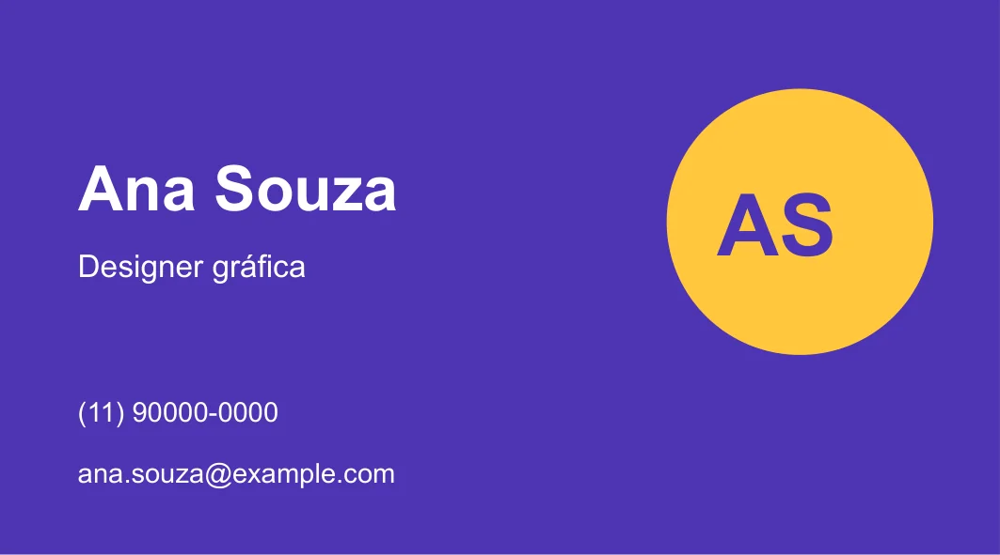
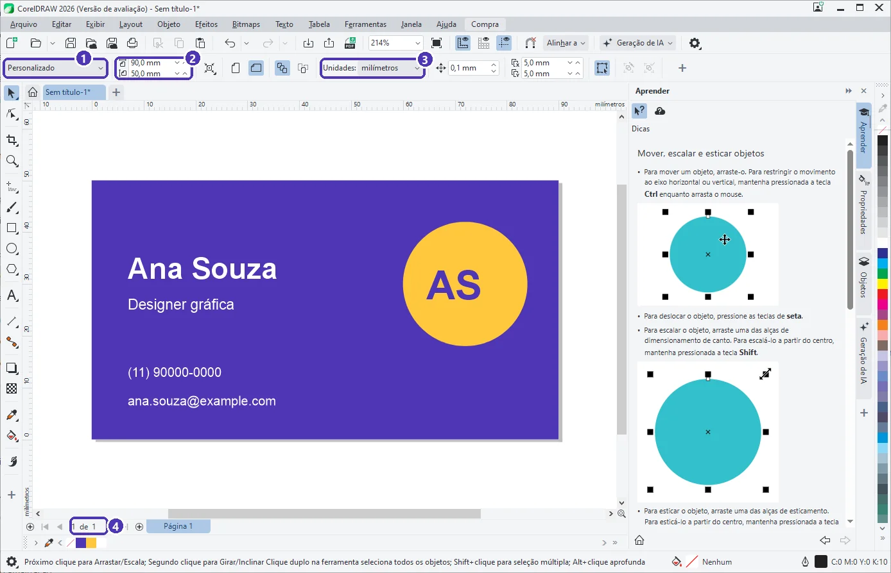
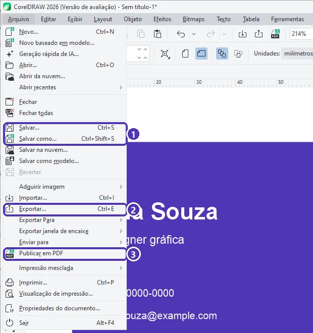
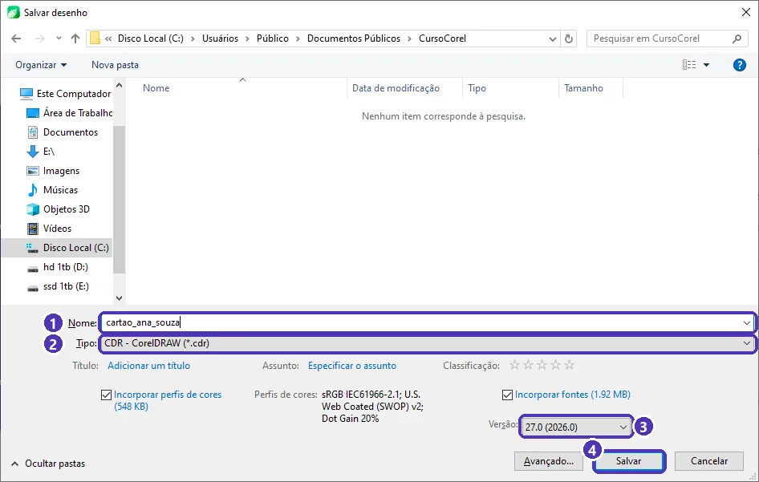
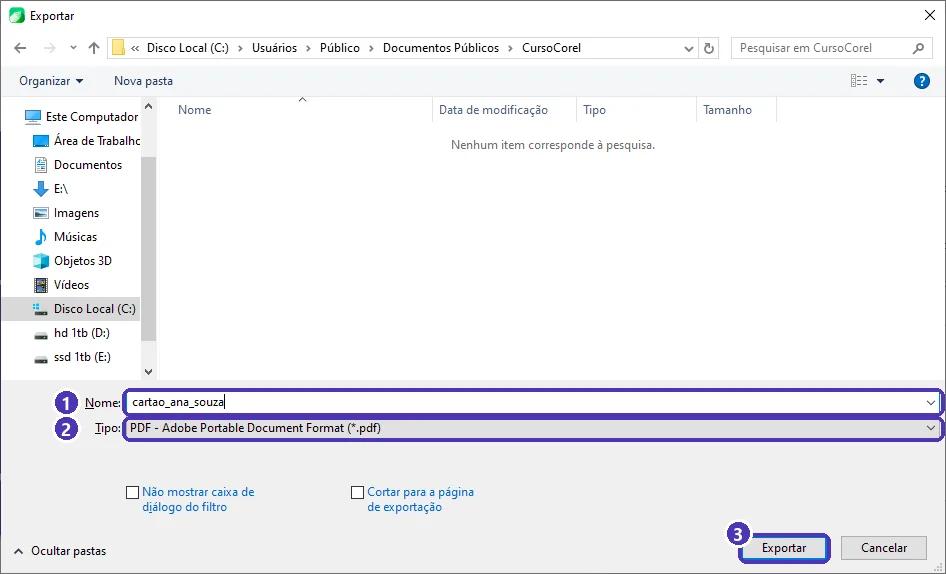

# 05 — Projeto do módulo: cartão de visita

> **Curso:** CorelDRAW  
> **Módulo:** 01 — Primeiros passos  
> **Tempo estimado:** 1 h 30 min  

---

## Objetivos

Ao final deste projeto, você terá:

- Um **cartão de visita** de **9 × 5 cm**, montado do zero no CorelDRAW.
- O arquivo editável salvo em **.cdr**.
- Uma cópia em **PDF** e uma em **PNG**, prontas para enviar.

## Pré-requisitos

- Aulas [01](01_conhecendo_o_coreldraw.md) a [04](04_cor_preenchimento_e_contorno.md) deste módulo.

---

## O resultado

Este é o cartão de exemplo, com dados **inventados** (Ana Souza não existe):

<figure markdown="span">
  { loading=lazy }
  <figcaption>O cartão pronto: fundo de cor única, um círculo com as iniciais e o texto alinhado à esquerda.</figcaption>
</figure>

!!! danger "Dados pessoais: pense antes de pôr"
    O cartão vai para pessoas que você **ainda não conhece**. Coloque só o contato profissional: um e-mail ou telefone de trabalho. **Endereço de casa, não.** Para o projeto da turma, você pode usar dados inventados, como no exemplo.

---

## Passo 1 — O documento

1. `Ctrl + N` ➔ Nome `cartao_seunome` ➔ Número de páginas **1** ➔ Modo de cores **CMYK** ➔ unidade **milímetros**, Largura **90**, Altura **50** ➔ **OK**.
2. `Shift + F4` para ver a página inteira.

<figure markdown="span">
  { loading=lazy }
  <figcaption>(1) tamanho <strong>Personalizado</strong> · (2) <strong>90 × 50 mm</strong> · (3) unidade em <strong>milímetros</strong> · (4) uma página só.</figcaption>
</figure>

!!! info "Por que 9 × 5 cm?"
    É o tamanho de cartão mais comum nas gráficas brasileiras. O *Cartão de visita* da lista de predefinições tem 3,5 × 2 polegadas (8,9 × 5,1 cm), o padrão americano. Se a gráfica pedir outro tamanho, use o dela.

---

## Passo 2 — O fundo

1. **Dois cliques** na ferramenta **Retângulo**: surge um retângulo do tamanho exato da página.
2. Pinte o preenchimento (`Shift + F11`, por exemplo `#4F35B5`) e **remova o contorno** (botão direito no **X** da paleta).

!!! tip "Desenhe o fundo primeiro"
    O que você desenha depois fica **na frente**. Se o fundo foi feito por último e cobriu tudo, selecione-o e tecle `Shift + Page Down` (*para trás da camada*).

---

## Passo 3 — O círculo com as iniciais

1. `F7` + `Ctrl`: desenhe um círculo. Na barra de propriedades, dê **24 × 24 mm** e posicione-o à direita (por exemplo, **X = 72**, **Y = 30**).
2. Preenchimento amarelo (`#FFC83D`), sem contorno.
3. `F8`: escreva as iniciais (`AS`), **Arial 22 pt, negrito**, na cor do fundo.
4. Para centralizar as iniciais no círculo: selecione as **iniciais** e depois, com `Shift`, o **círculo** ➔ tecle `C` (centraliza na vertical) e `E` (centraliza na horizontal). O CorelDRAW alinha pelo objeto selecionado **por último**.

---

## Passo 4 — Os textos

Com `F8`, escreva cada linha como um **texto separado**, todos em **branco**:

| Texto | Tamanho |
|---|---|
| Nome (`Ana Souza`) | 16 pt, negrito |
| Profissão (`Designer gráfica`) | 8 pt |
| Telefone (`(11) 90000-0000`) | 7 pt |
| E-mail (`ana.souza@example.com`) | 7 pt |

Para alinhar todos à esquerda: posicione o **nome** onde quiser; depois selecione os outros textos com `Shift` + clique, terminando pelo **nome**, e tecle `L`. Todos se alinham pela esquerda do nome, o último selecionado.

!!! warning "Margem de segurança"
    Deixe pelo menos **5 mm** entre os textos e a borda do cartão. A guilhotina da gráfica pode desviar um pouco, e um texto colado na borda corre o risco de ser cortado. No exemplo, os textos começam em X = 7 mm.

### Revise antes de salvar

- [ ] O fundo cobre a página inteira, sem contorno.
- [ ] Todos os textos são **seus** e estão legíveis (nada menor que **7 pt**).
- [ ] Os textos estão **alinhados** à esquerda e longe da borda.
- [ ] As iniciais estão **centralizadas** no círculo.

---

## Passo 5 — Salvar em .cdr

O `.cdr` é o arquivo **editável**: guarde-o sempre, é dele que saem as próximas versões do cartão. Abra o menu **Arquivo**:

<figure markdown="span">
  { loading=lazy }
  <figcaption>(1) <strong>Salvar</strong> (<code>Ctrl + S</code>) e <strong>Salvar como</strong> · (2) <strong>Exportar</strong> (<code>Ctrl + E</code>) · (3) <strong>Publicar em PDF</strong>.</figcaption>
</figure>

Clique em **Salvar** (`Ctrl + S`):

<figure markdown="span">
  { loading=lazy }
  <figcaption>(1) <strong>Nome</strong> do arquivo · (2) <strong>Tipo</strong>: CDR · (3) <strong>Versão</strong> do CorelDRAW · (4) <strong>Salvar</strong>.</figcaption>
</figure>

1. Escolha a pasta (crie uma pasta `Curso de CorelDRAW` em *Documentos*).
2. Confira o **Nome** (1) e o **Tipo** CDR (2).
3. Deixe **Incorporar fontes** marcado: se o arquivo for aberto num computador sem a fonte, o texto não muda.
4. **Salvar** (4).

!!! info "Versão: cuidado com computadores mais antigos"
    Um `.cdr` salvo na versão **27.0 (2026)** não abre num CorelDRAW mais antigo. Se a gráfica ou a escola usa uma versão anterior, escolha essa versão na lista (3) ao salvar.

---

## Passo 6 — Exportar em PDF e PNG

### PDF

**Arquivo ➔ Publicar em PDF** ➔ escolha a pasta e o nome ➔ **Salvar**. O PDF abre em qualquer computador e celular, sem precisar do CorelDRAW. (O PDF com **sangria e marcas de corte**, para a gráfica, fica para o Módulo 03.)

### PNG

**Arquivo ➔ Exportar** (`Ctrl + E`):

<figure markdown="span">
  { loading=lazy }
  <figcaption>(1) <strong>Nome</strong> · (2) <strong>Tipo</strong>: troque para <strong>PNG</strong> · (3) <strong>Exportar</strong>.</figcaption>
</figure>

1. Em **Tipo** (2), escolha **PNG - Portable Network Graphics**.
2. **Exportar** (3). Abre uma janela de opções: confira a **resolução** (300 dpi para imprimir em casa, 150 dpi basta para mandar pelo celular) e clique em **OK**.

| Para... | Formato |
|---|---|
| Continuar editando depois | **.cdr** |
| Mandar para alguém ver ou imprimir | **PDF** (*Publicar em PDF*) |
| WhatsApp, redes sociais, site | **PNG** (*Exportar*) |

---

??? note "No Inkscape"
    - Documento: **Arquivo ➔ Propriedades do documento** ➔ 90 × 50 mm.
    - Fundo do tamanho da página: desenhe um retângulo e, na barra de controles, digite **X 0, Y 0, L 90, A 50** (mm).
    - Alinhar: **Objeto ➔ Alinhar e distribuir** (`Ctrl + Shift + A`), com *Relativo a: Último selecionado*.
    - Salvar: **Arquivo ➔ Salvar** em **SVG do Inkscape**.
    - PDF: **Arquivo ➔ Salvar uma cópia** (`Ctrl + Shift + Alt + S`) ➔ tipo **PDF**.
    - PNG: **Arquivo ➔ Exportar** (`Ctrl + Shift + E`) ➔ *Página* ➔ formato **PNG**, DPI ➔ **Exportar**.

---

## Entrega

Entregue ao professor:

1. O arquivo **.cdr** (`cartao_seunome.cdr`), ou **.svg** se você usou o Inkscape.
2. O **PDF** (`cartao_seunome.pdf`).
3. O **PNG** (`cartao_seunome.png`).

### Critérios de avaliação

| Critério | O que se espera |
|---|---|
| Tamanho | Página de exatamente 90 × 50 mm. |
| Conteúdo | Nome, profissão e dois contatos profissionais (ou inventados). |
| Legibilidade | Nenhum texto menor que 7 pt; bom contraste entre texto e fundo. |
| Organização visual | Textos alinhados, iniciais centralizadas, margem de 5 mm nas bordas. |
| Arquivos | .cdr, PDF e PNG, com nomes claros. |

---

## Exercícios extras

### Básico (fixação)

Exporte o PNG em **72 dpi** e em **300 dpi** e compare o tamanho dos dois arquivos e a nitidez ao ampliar.

<!-- gabarito -->
??? success "Gabarito — Básico"
    `Ctrl + E` ➔ Tipo **PNG** ➔ *Exportar* ➔ resolução **72** ➔ *OK*; repita com **300** e outro nome. O de 300 dpi tem mais pixels: arquivo maior e texto nítido quando ampliado. O de 72 dpi é leve, mas fica borrado ao dar zoom.

### Intermediário (aplicação)

Faça o **verso** do cartão: uma segunda página com o fundo amarelo e só as iniciais em roxo, no centro. Publique frente e verso num **único PDF**.

<!-- gabarito -->
??? success "Gabarito — Intermediário"
    1. Navegador de páginas ➔ **+** (página 2, do mesmo tamanho).
    2. Dois cliques na ferramenta Retângulo ➔ preenchimento amarelo, sem contorno.
    3. `F8` ➔ `AS` em roxo ➔ selecione as iniciais ➔ tecle `P` (centraliza na página).
    4. **Arquivo ➔ Publicar em PDF**: o PDF sai com as duas páginas.

### Avançado (desafio)

Um colega só tem o CorelDRAW **2020**. Entregue a ele um `.cdr` que abra no programa dele, sem perder as fontes.

<!-- gabarito -->
??? success "Gabarito — Avançado"
    **Arquivo ➔ Salvar como** (`Ctrl + Shift + S`) ➔ outro nome (`cartao_seunome_v2020`) ➔ em **Versão**, escolha a do CorelDRAW 2020 ➔ deixe **Incorporar fontes** marcado ➔ **Salvar**. Recursos que não existiam em 2020 podem ser simplificados, por isso guarde também o original.

---

## 💡 Resumo

- Cartão brasileiro: **90 × 50 mm**, em CMYK, com **5 mm** de margem de segurança.
- Fundo: **dois cliques** na ferramenta Retângulo. Alinhar: `C`, `E`, `L`, `P` com os objetos selecionados.
- Guarde sempre o **.cdr**; envie **PDF** (*Publicar em PDF*) e **PNG** (*Exportar*).
- Ao salvar, **Incorporar fontes** e, se preciso, uma **versão** mais antiga.

## ➡️ Próximo passo

Você terminou o **Módulo 01**. Volte ao [índice do módulo](index.md) e confira o checklist. O **Módulo 02 — Vetor na prática**, com o projeto de logotipo, está em produção.
