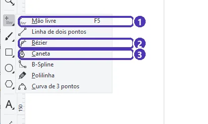
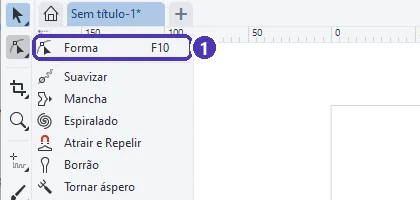
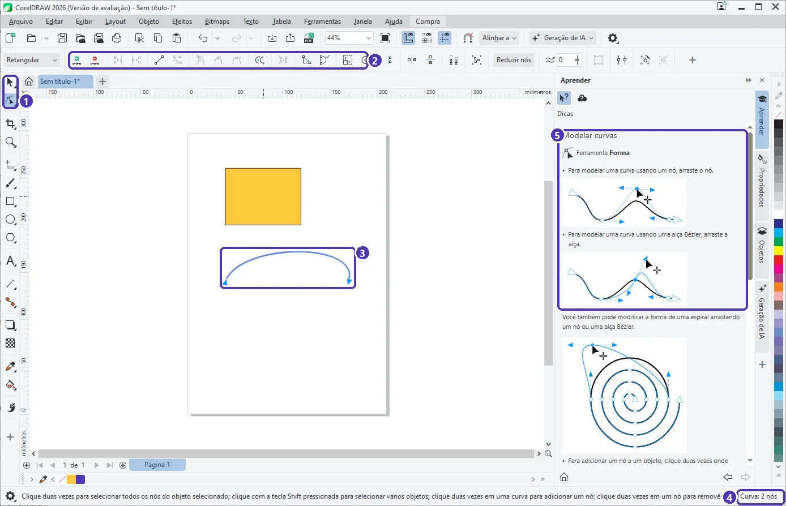
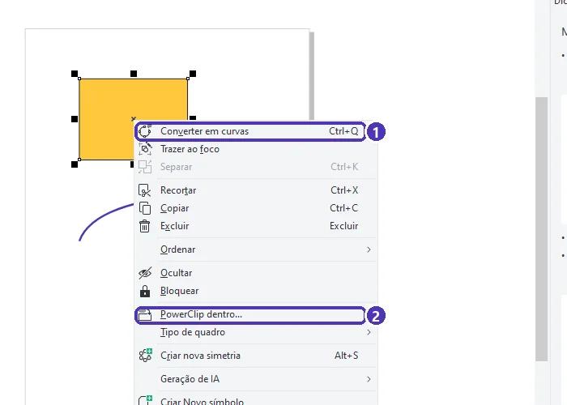
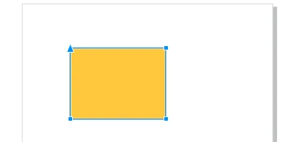

# 01 — Curvas e Bézier

> **Curso:** CorelDRAW  
> **Módulo:** 02 — Vetor na prática  
> **Tempo estimado:** 1 h 30 min  

---

## Objetivos

Ao final desta aula, você será capaz de:

- Entender o que são **nós** e **alças** de uma curva.
- Desenhar com **Mão livre**, **Bézier** e **Caneta**.
- Ajustar uma curva pelos nós com a ferramenta **Forma** (`F10`).
- **Converter em curvas** um retângulo, uma elipse ou um texto.

## Pré-requisitos

- [Módulo 01](../modulo_01_primeiros_passos/index.md) completo.

---

## Nós e alças

Toda forma vetorial é um caminho que passa por **nós** (pontinhos). Entre dois nós há um **segmento**, reto ou curvo. Num nó de curva aparecem **alças** (as setinhas azuis): puxar a alça muda o quanto e para onde a curva se dobra. Essa é a curva de **Bézier**, a mesma usada no Illustrator, no Inkscape e nas fontes do computador.

---

## As ferramentas de curva

Segure o botão da ferramenta **Mão livre**, na caixa de ferramentas, para abrir o grupo:

<figure markdown="span">
  { loading=lazy }
  <figcaption>(1) <strong>Mão livre</strong> (<code>F5</code>) · (2) <strong>Bézier</strong> · (3) <strong>Caneta</strong>. As outras desenham linhas retas, polilinhas e curvas suaves.</figcaption>
</figure>

| Ferramenta | Como desenhar | Bom para |
|---|---|---|
| **Mão livre** (`F5`) | Arraste como um lápis. Clique, mova e clique de novo faz uma **linha reta** | Rabiscos, contornos rápidos |
| **Bézier** | **Clique** = nó de canto (reta). **Clique e arraste** = nó de curva, com alças | Formas precisas, contornos de logotipo |
| **Caneta** | Igual à Bézier, mas mostra a prévia do próximo segmento. **Dois cliques** terminam | Quem está aprendendo Bézier |

Para **fechar** a forma (e poder pintar o miolo), termine clicando em cima do **primeiro nó**.

!!! tip "Retas perfeitas"
    Segure `Ctrl` enquanto clica: os segmentos ficam presos a ângulos de 15° (horizontal, vertical, 45°…).

---

## Editar com a ferramenta Forma

A ferramenta **Forma** (`F10`) é a segunda da caixa de ferramentas:

<figure markdown="span">
  { loading=lazy }
  <figcaption>(1) <strong>Forma</strong> (<code>F10</code>), para mexer nos nós. As outras do grupo deformam a curva “no pincel”.</figcaption>
</figure>

Selecione a curva e tecle `F10`:

<figure markdown="span">
  { loading=lazy }
  <figcaption>(1) ferramenta <strong>Forma</strong> · (2) botões dos nós na barra de propriedades · (3) a curva com seus nós · (4) a barra de status conta os nós · (5) o painel Aprender explica como modelar.</figcaption>
</figure>

| Para... | Faça (com a ferramenta Forma) |
|---|---|
| Mover um nó | Arraste o nó |
| Dobrar a curva | Arraste o meio do segmento, ou a **alça** de um nó |
| **Acrescentar** um nó | **Dois cliques** na curva |
| **Apagar** um nó | **Dois cliques** no nó (ou selecione e tecle `Delete`) |
| Selecionar todos os nós | `Ctrl + A` |
| Transformar um segmento reto em curvo (e vice-versa) | Selecione o nó e use os botões **Converter em curva** / **Converter em linha** da barra |
| Deixar a curva mais leve | Selecione os nós ➔ **Reduzir nós** |

!!! info "Cúspide, suave e simétrico"
    Na barra de propriedades, três botões mudam o tipo do nó: **cúspide** (as alças se mexem separadas: faz “bico”), **suave** (as alças ficam alinhadas: curva sem bico) e **simétrico** (alinhadas e do mesmo tamanho).

---

## Converter em curvas

Retângulos, elipses e textos são objetos “especiais”: você muda o arredondamento do canto ou a fonte, mas não consegue puxar um nó. Para editá-los nó a nó, **converta em curvas**: botão direito ➔ **Converter em curvas** (`Ctrl + Q`).

<figure markdown="span">
  { loading=lazy }
  <figcaption>(1) <strong>Converter em curvas</strong> (<code>Ctrl + Q</code>) · (2) <strong>PowerClip dentro…</strong>, que põe uma imagem dentro de uma forma (Módulo 03).</figcaption>
</figure>

Depois de convertido, o retângulo mostra os **4 nós** dos cantos, e cada um pode ser arrastado:

<figure markdown="span">
  { loading=lazy }
  <figcaption>O retângulo virou uma curva com 4 nós.</figcaption>
</figure>

!!! warning "Não tem volta (a não ser com `Ctrl + Z`)"
    Um **texto** convertido em curvas deixa de ser texto: não dá mais para corrigir uma letra digitando. Guarde sempre uma cópia com o texto editável (aula 05).

---

??? note "No Inkscape"
    | CorelDRAW | Inkscape |
    |---|---|
    | Mão livre (`F5`) | **Lápis** (`P`) |
    | Bézier / Caneta | **Caneta** (`B`): clique = reta, clique e arraste = curva, `Enter` termina |
    | Forma (`F10`) | **Nós** (`N`): dois cliques na curva acrescentam nó; `Delete` apaga |
    | Converter em curvas (`Ctrl + Q`) | **Caminho ➔ Objeto para caminho** (`Ctrl + Shift + C`) |
    | Reduzir nós | **Caminho ➔ Simplificar** (`Ctrl + L`) |

---

## Exercícios

### Básico (fixação)

Com a **Bézier**, desenhe um **triângulo** fechado e pinte o miolo.

<!-- gabarito -->
??? success "Gabarito — Básico"
    Bézier ➔ três **cliques** (sem arrastar) nos cantos ➔ clique de novo no **primeiro nó** para fechar ➔ clique numa cor da paleta. Se o miolo não pinta, a forma não fechou: com `F10`, junte o último nó ao primeiro.

### Intermediário (aplicação)

Desenhe um retângulo, converta em curvas e transforme-o numa **casinha** (telhado em ponta).

<!-- gabarito -->
??? success "Gabarito — Intermediário"
    `F6` ➔ retângulo ➔ `Ctrl + Q` ➔ `F10` ➔ **dois cliques** no meio do lado de cima (acrescenta um nó) ➔ arraste esse nó para cima. O lado de cima vira duas retas em ponta.

### Avançado (desafio)

Desenhe uma **gota** (ponta em cima, redonda embaixo) usando uma elipse.

<!-- gabarito -->
??? success "Gabarito — Avançado"
    `F7` ➔ círculo (`Ctrl`) ➔ `Ctrl + Q` ➔ `F10` ➔ selecione o nó de **cima** ➔ botão **cúspide** ➔ arraste o nó para cima e aproxime as duas alças dele, apontando para baixo. Os outros nós continuam **suaves**: por isso a parte de baixo fica redonda.

---

## 💡 Resumo

- Curvas são feitas de **nós** e **segmentos**; as **alças** controlam a dobra.
- **Bézier/Caneta**: clique = reta, clique e arraste = curva; feche no primeiro nó.
- **Forma** (`F10`): dois cliques acrescentam ou apagam nós.
- **Converter em curvas** (`Ctrl + Q`) libera os nós de retângulos, elipses e textos.

## ➡️ Próximo passo

Na **[aula 02](02_soldar_aparar_intersecao.md)** você cria formas novas juntando e recortando formas simples.
