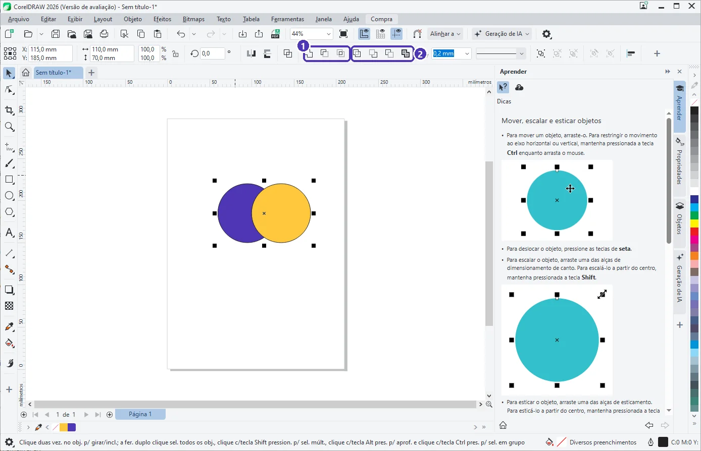
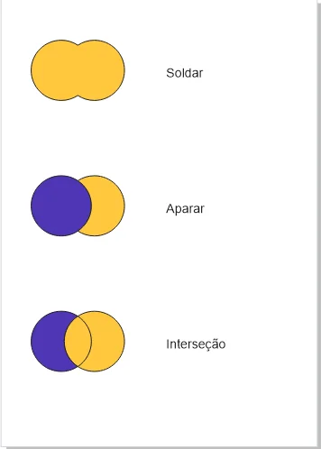

# 02 — Soldar, aparar e interseção

> **Curso:** CorelDRAW  
> **Módulo:** 02 — Vetor na prática  
> **Tempo estimado:** 1 h  

---

## Objetivos

Ao final desta aula, você será capaz de:

- Criar formas novas combinando formas simples com **Soldar**, **Aparar** e **Interseção**.
- Saber qual objeto “manda” no resultado (o **último selecionado**).
- Conhecer **Simplificar**, **Frente menos trás**, **Trás menos frente** e **Criar limite**.

## Pré-requisitos

- [Aula 01](01_curvas_e_bezier.md) deste módulo.

---

## A ideia

Desenhar um ícone curva por curva dá trabalho. Muitas vezes é mais fácil **montar com peças**: uma nuvem são três círculos **soldados**; uma lua é um círculo **aparado** por outro; uma folha é a **interseção** de dois círculos.

---

## Os botões de modelagem

Selecione **dois ou mais** objetos (`Shift` + clique). A barra de propriedades mostra os botões de modelagem:

<figure markdown="span">
  { loading=lazy }
  <figcaption>(1) <strong>Soldar</strong>, <strong>Aparar</strong> e <strong>Interseção</strong> · (2) <strong>Simplificar</strong>, <strong>Frente menos trás</strong>, <strong>Trás menos frente</strong> e <strong>Criar limite</strong>. Pare o ponteiro sobre um botão para ver o nome.</figcaption>
</figure>

O resultado de cada um, com o círculo **roxo** selecionado primeiro e o **amarelo** por último:

<figure markdown="span">
  { loading=lazy }
  <figcaption>Soldar, Aparar e Interseção aplicados aos mesmos dois círculos.</figcaption>
</figure>

| Botão | O que faz | O que sobra |
|---|---|---|
| **Soldar** | Junta tudo numa forma só, pelo contorno de fora | Uma forma, com a cor do **último selecionado** |
| **Aparar** | Usa os outros objetos como “cortador” do **último selecionado** | O cortador continua; o último ganha a “mordida” |
| **Interseção** | Cria uma forma **nova** só com a área que os objetos têm em comum | Os originais continuam; a forma nova fica por cima |
| **Simplificar** | Apara todas as partes escondidas atrás de outras | Cada objeto, sem as sobreposições |
| **Frente menos trás** | O objeto da frente perde tudo o que se sobrepõe aos de trás | Só o da frente, recortado |
| **Trás menos frente** | O objeto de trás perde o que os da frente cobrem | Só o de trás, recortado |
| **Criar limite** | Desenha uma forma nova em volta de todos | Os originais e o contorno novo |

!!! tip "A ordem da seleção importa"
    Ao selecionar com `Shift` + clique, o **último** clicado é o “alvo”: em Soldar, ele dá a cor; em Aparar, é ele quem é cortado. Se o resultado saiu ao contrário, `Ctrl + Z` e selecione na outra ordem.

!!! info "Combinar não é Soldar"
    **Objeto ➔ Combinar** (`Ctrl + L`) junta as formas num objeto só, mas **sem** fundir os contornos: onde elas se sobrepõem, aparece um **buraco**. É assim que se faz a letra “O” (um círculo grande combinado com um pequeno). **Separar** (`Ctrl + K`) desfaz.

---

??? note "No Inkscape"
    Menu **Caminho**, com dois ou mais objetos selecionados:

    | CorelDRAW | Inkscape |
    |---|---|
    | Soldar | **União** (`Ctrl + +`) |
    | Aparar / Trás menos frente | **Diferença** (`Ctrl + -`): o de **cima** recorta o de **baixo** |
    | Interseção | **Interseção** (`Ctrl + *`) |
    | Combinar (`Ctrl + L`) | **Combinar** (`Ctrl + K`) |
    | Separar (`Ctrl + K`) | **Separar** (`Ctrl + Shift + K`) |

    No Inkscape quem manda é a **ordem de empilhamento** (quem está por cima), e não a ordem da seleção.

---

## Exercícios

### Básico (fixação)

Faça uma **nuvem** soldando três ou quatro círculos e um retângulo de base.

<!-- gabarito -->
??? success "Gabarito — Básico"
    Desenhe os círculos sobrepostos (`F7` + `Ctrl`) e um retângulo embaixo, cobrindo as metades de baixo. Selecione todos (arraste em volta) ➔ **Soldar**. Sobra uma forma só, com um contorno único.

### Intermediário (aplicação)

Desenhe uma **lua crescente** com dois círculos.

<!-- gabarito -->
??? success "Gabarito — Intermediário"
    Dois círculos do mesmo tamanho, o segundo deslocado para a direita. Selecione **primeiro** o da direita e **por último** o da esquerda ➔ **Aparar**. Apague o da direita (o cortador). Sobra a lua.

### Avançado (desafio)

Faça a letra **“O”** de um logotipo com um buraco de verdade (que mostre o fundo), usando dois círculos.

<!-- gabarito -->
??? success "Gabarito — Avançado"
    Um círculo grande e um menor, centralizados (`C` + `E`). Selecione os dois ➔ **Combinar** (`Ctrl + L`). O miolo vira um buraco: ponha um retângulo colorido atrás para conferir. (Também funciona com **Aparar**, selecionando o pequeno primeiro e o grande por último e depois apagando o pequeno.)

---

## 💡 Resumo

- Monte formas com peças: **Soldar** junta, **Aparar** corta, **Interseção** pega o comum.
- Os botões aparecem na **barra de propriedades** com dois ou mais objetos selecionados.
- O **último selecionado** é o alvo.
- **Combinar** (`Ctrl + L`) faz buracos; **Separar** (`Ctrl + K`) desfaz.

## ➡️ Próximo passo

Na **[aula 03](03_powertrace.md)** você transforma uma imagem de pixels em vetor com o PowerTRACE.
