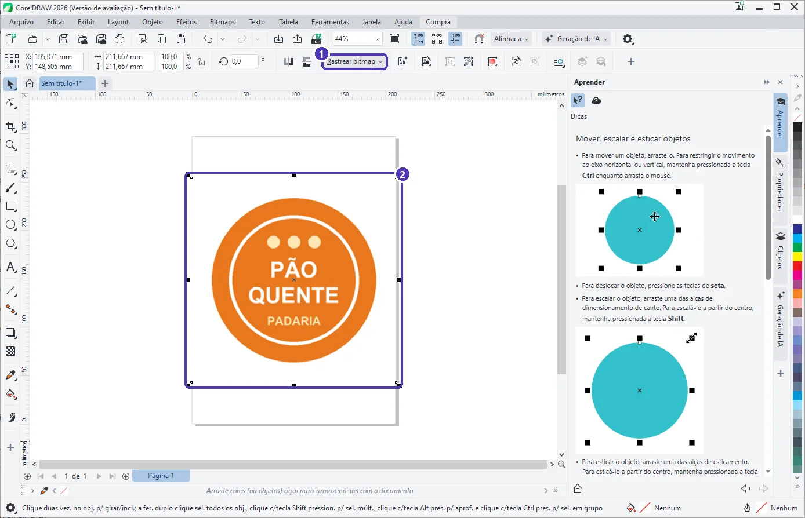
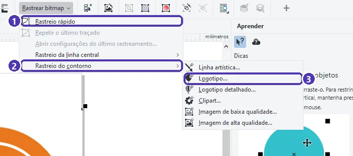
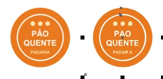

# 03 — PowerTRACE: de imagem para vetor

> **Curso:** CorelDRAW  
> **Módulo:** 02 — Vetor na prática  
> **Tempo estimado:** 1 h  

---

## Objetivos

Ao final desta aula, você será capaz de:

- **Importar** uma imagem (`Ctrl + I`).
- Vetorizar a imagem com o **PowerTRACE**, escolhendo o tipo de rastreio.
- Ajustar **detalhe**, **suavização** e **fundo** e comparar o antes e depois.
- Reconhecer os erros comuns do rastreio e **corrigi-los** à mão.

## Pré-requisitos

- Aulas [01](01_curvas_e_bezier.md) e [02](02_soldar_aparar_intersecao.md) deste módulo.

---

## O pedido

> *“Tenho o logotipo da padaria só nesta foto do Instagram. Dá para fazer uma faixa grande?”*

Ampliada, uma imagem de pixels fica borrada (Módulo 01, aula 01). O **PowerTRACE** lê a imagem e desenha curvas por cima dela. Para o exemplo, usamos o logotipo de uma padaria **inventada**.

!!! danger "Direitos autorais"
    Vetorize só logotipos e imagens que **você** fez ou que o **dono** pediu para você vetorizar. Copiar a marca de outra empresa não é permitido, mesmo redesenhando.

---

## Passo 1 — Importar a imagem

**Arquivo ➔ Importar** (`Ctrl + I`) ➔ escolha a imagem ➔ **Importar** ➔ tecle `Enter` (coloca no centro da página) ou clique na página.

<figure markdown="span">
  { loading=lazy }
  <figcaption>(1) com uma imagem selecionada, aparece o botão <strong>Rastrear bitmap</strong> · (2) a imagem importada (bitmap).</figcaption>
</figure>

---

## Passo 2 — Escolher o tipo de rastreio

Clique em **Rastrear bitmap**:

<figure markdown="span">
  { loading=lazy }
  <figcaption>(1) <strong>Rastreio rápido</strong>: sem perguntas · (2) <strong>Rastreio do contorno</strong>: formas preenchidas · (3) <strong>Logotipo…</strong>, a predefinição para logotipos de poucas cores.</figcaption>
</figure>

| Tipo | Para... |
|---|---|
| **Rastreio do contorno ➔ Logotipo** | Logotipos com poucas cores chapadas (o nosso caso) |
| **Logotipo detalhado** / **Clipart** | Desenhos com mais cores e detalhes |
| **Imagem de baixa / alta qualidade** | Fotos (o resultado tem milhares de curvas: use com cuidado) |
| **Rastreio da linha central** | Desenhos a traço, assinaturas, mapas: vira **linhas** em vez de formas |

---

## Passo 3 — Ajustar no PowerTRACE

<figure markdown="span">
  { loading=lazy }
  <figcaption>(1) <strong>Visualizar</strong>: <em>Antes e depois</em> · (2) original em cima, vetor embaixo · (3) tipo e perfil do traçado · (4) <strong>Remover o fundo da imagem</strong> · (5) <strong>Detalhe</strong>, <strong>Densidade dos nós</strong> e <strong>Curvatura</strong> · (6) <strong>OK</strong>.</figcaption>
</figure>

- **Detalhe:** mais detalhe preserva letras pequenas, mas cria mais curvas.
- **Densidade dos nós** e **Curvatura:** menos nós e mais curvatura deixam as bordas mais lisas.
- **Remover o fundo da imagem:** tira o branco em volta, para o logotipo não vir com um quadrado branco.
- Embaixo, a janela informa quantas **curvas**, **nós** e **cores** o resultado terá. Para logotipo, quanto menos, melhor.

Olhe o exemplo: o vetor **perdeu o til** (“PAO”) e **uma letra** (“PADAR A”). Isso é normal: detalhes pequenos de uma imagem borrada se perdem. Clique em **OK** assim mesmo e corrija no passo 4.

---

## Passo 4 — Conferir e corrigir

O vetor aparece **por cima** da imagem original. Arraste-o para o lado e compare:

<figure markdown="span">
  { loading=lazy }
  <figcaption>Original (pixels) à esquerda, vetor à direita. Os textos precisam ser refeitos.</figcaption>
</figure>

1. O vetor vem **agrupado**. Para mexer nas peças: **Objeto ➔ Agrupar ➔ Desagrupar** (ou `Ctrl + U`).
2. **Apague os textos rastreados** e **redigite** com a fonte certa (aula 04). Texto rastreado nunca fica tão bom quanto texto digitado.
3. Formas simples (círculos, retângulos) também ficam melhores **redesenhadas** com as ferramentas do Módulo 01. Use o vetor como **guia**.
4. Apague a imagem original quando terminar.

!!! tip "PowerTRACE é ponto de partida"
    Para logotipos simples, muitas vezes é mais rápido **redesenhar** por cima da imagem (com ela travada, em *Objeto ➔ Bloquear*) do que consertar o rastreio. O projeto da aula 05 faz assim.

---

??? note "No Inkscape"
    - Importar: **Arquivo ➔ Importar** (`Ctrl + I`) ➔ *Incorporar*.
    - Rastrear: **Caminho ➔ Vetorizar bitmap** (`Alt + Shift + B`). Modos *Corte de brilho* (uma cor), *Multicores* (várias cores), e *Centerline* (linha central). Ajuste **Suavizar**, **Otimizar** e marque **Remover fundo** ➔ **Aplicar**.
    - O resultado também vem agrupado: **Objeto ➔ Desagrupar** (`Ctrl + Shift + G`).

---

## Exercícios

### Básico (fixação)

Importe uma imagem simples (um desenho seu, fotografado) e faça um **Rastreio rápido**. Quantos objetos foram criados?

<!-- gabarito -->
??? success "Gabarito — Básico"
    `Ctrl + I` ➔ imagem ➔ `Enter` ➔ **Rastrear bitmap ➔ Rastreio rápido**. Arraste o resultado para o lado, selecione e leia a **barra de status**: ela diz quantos objetos há no grupo. Desagrupe (`Ctrl + U`) para ver as peças separadas.

### Intermediário (aplicação)

Rastreie a mesma imagem com **Logotipo** duas vezes: uma com **Detalhe** baixo e outra com Detalhe alto. Compare o número de **nós** informado pelo PowerTRACE.

<!-- gabarito -->
??? success "Gabarito — Intermediário"
    Na janela do PowerTRACE, mova **Detalhe** e veja os números de *Curvas* e *Nós* embaixo da prévia. Detalhe **alto** preserva mais o desenho, mas gera **mais nós** (arquivo mais pesado e bordas mais “nervosas”). Detalhe **baixo** simplifica e pode apagar partes pequenas.

### Avançado (desafio)

Rastreie uma **assinatura** escrita com caneta (fotografada sobre papel branco) de forma que ela vire **linhas**, e não formas preenchidas.

<!-- gabarito -->
??? success "Gabarito — Avançado"
    **Rastrear bitmap ➔ Rastreio da linha central** ➔ escolha *Desenho de linha*. O resultado são curvas com **contorno** e sem preenchimento: dá para mudar a espessura (`F12`) depois. Use uma assinatura **sua** ou inventada.

---

## 💡 Resumo

- `Ctrl + I` importa; **Rastrear bitmap** abre o PowerTRACE.
- **Logotipo** para marcas de poucas cores; **linha central** para traços.
- Confira o antes e depois: **textos e detalhes pequenos** se perdem e devem ser **redigitados** ou redesenhados.
- Só vetorize imagens que você tem direito de usar.

## ➡️ Próximo passo

Na **[aula 04](04_texto_artistico_e_paragrafo.md)** você vê os dois tipos de texto do CorelDRAW.
