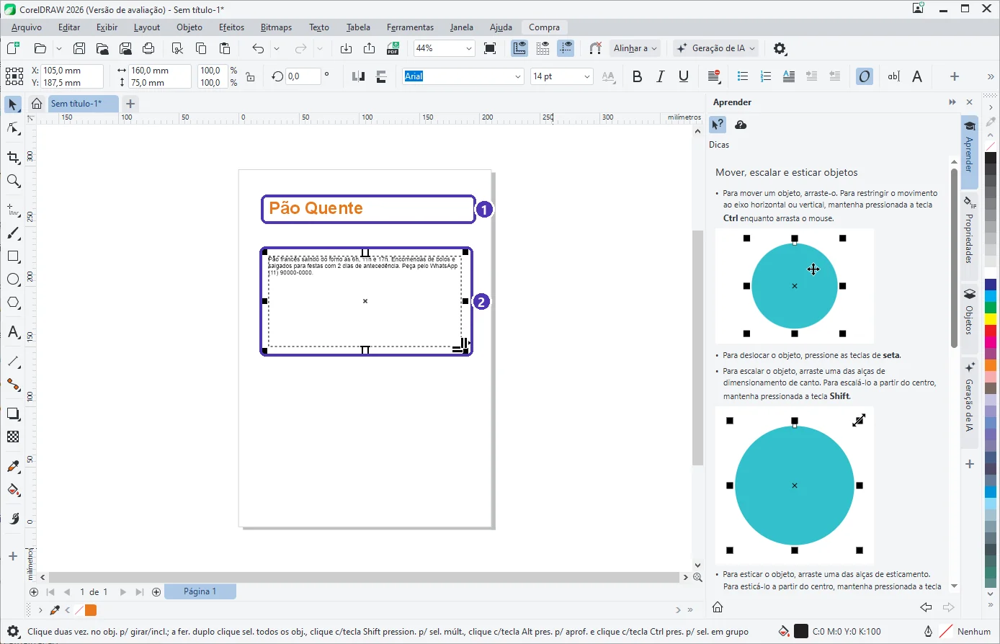

# 04 — Texto artístico × texto de parágrafo

> **Curso:** CorelDRAW  
> **Módulo:** 02 — Vetor na prática  
> **Tempo estimado:** 1 h  

---

## Objetivos

Ao final desta aula, você será capaz de:

- Criar **texto artístico** e **texto de parágrafo** e saber quando usar cada um.
- Ajustar a **moldura** do parágrafo e resolver texto que não cabe.
- **Converter** um tipo no outro (`Ctrl + F8`).
- Usar o menu **Texto**: colunas, marcadores, ajustar ao caminho e o painel **Texto** (`Ctrl + T`).

## Pré-requisitos

- [Módulo 01, aula 03](../modulo_01_primeiros_passos/03_formas_selecao_e_texto.md) (ferramenta Texto).

---

## Dois tipos de texto

Com a ferramenta **Texto** (`F8`):

- **Clicar** e digitar cria **texto artístico**: uma linha (ou poucas), que cresce conforme você digita.
- **Arrastar uma caixa** e depois digitar cria **texto de parágrafo**: o texto quebra as linhas sozinho dentro da **moldura**.

<figure markdown="span">
  { loading=lazy }
  <figcaption>(1) <strong>texto artístico</strong>: o título · (2) <strong>texto de parágrafo</strong>: a moldura tracejada define até onde vão as linhas.</figcaption>
</figure>

| | Texto artístico | Texto de parágrafo |
|---|---|---|
| Como criar | Clicar e digitar | Arrastar a caixa e digitar |
| Quebra de linha | Só com `Enter` | Automática, na largura da moldura |
| Arrastar a alça de canto | **Aumenta a letra** | **Muda a moldura** (a letra fica igual) |
| Bom para | Títulos, logotipos, textos curtos | Avisos, cardápios, panfletos, catálogos |
| Efeitos (ajustar ao caminho, envelope, converter em curvas) | Sim | Limitados |

!!! warning "Texto que não cabe na moldura"
    Se o parágrafo for maior que a moldura, o final **some** da página, e a moldura avisa mudando de cor. Aumente a moldura (arraste a alça do meio de baixo) ou diminua a letra. Antes de mandar para a gráfica, confira sempre se o texto está **inteiro**.

---

## O menu Texto

<figure markdown="span">
  { loading=lazy }
  <figcaption>(1) <strong>Converter</strong> entre parágrafo e artístico (<code>Ctrl + F8</code>) · (2) <strong>Colunas</strong> do parágrafo · (3) <strong>Ajustar texto ao caminho</strong> · (4) painel <strong>Texto</strong> (<code>Ctrl + T</code>).</figcaption>
</figure>

- **Converter (`Ctrl + F8`):** com um parágrafo selecionado, a opção vira *Converter em texto artístico*; com um texto artístico, *Converter em texto de parágrafo*.
- **Colunas / Marcadores e numeração / Capitulação:** formatações de parágrafo, como no Word.
- **Ajustar texto ao caminho:** o texto artístico acompanha uma curva ou um círculo. Muito usado em selos e logotipos redondos.
- **Painel Texto (`Ctrl + T`):** reúne fonte, tamanho, espaçamento entre letras e linhas, alinhamento e recuos.
- **Glifos (`Ctrl + F11`):** todos os caracteres da fonte, inclusive símbolos (©, ®, →).

!!! tip "Espaço entre letras"
    Títulos em maiúsculas ficam mais elegantes com um pouco mais de **espaçamento entre caracteres** (no painel Texto). Com a ferramenta **Forma** (`F10`) sobre um texto, também dá para arrastar as setinhas no canto da caixa para abrir as letras e as linhas.

---

??? note "No Inkscape"
    - Ferramenta **Texto** (`T`): **clicar** = texto comum (como o artístico); **arrastar uma caixa** = **texto fluído** (como o parágrafo).
    - **Texto ➔ Texto e fonte** (`Ctrl + Shift + T`): fonte, tamanho, espaçamentos.
    - **Texto ➔ Colocar no caminho**: selecione o texto e a curva juntos.
    - Converter o texto fluído em comum: **Texto ➔ Converter em texto**.

---

## Exercícios

### Básico (fixação)

Crie um aviso de 3 linhas como **texto de parágrafo** numa moldura de 80 mm de largura. Depois estreite a moldura para 50 mm e observe.

<!-- gabarito -->
??? success "Gabarito — Básico"
    `F8` ➔ arraste uma caixa ➔ digite ➔ ferramenta Seleção ➔ largura **80** na barra de propriedades. Ao mudar para **50**, as linhas quebram de novo e o texto ocupa mais linhas, mas a **letra continua do mesmo tamanho**. Se faltar espaço embaixo, a moldura avisa: aumente a altura.

### Intermediário (aplicação)

Escreva o nome de uma loja (inventada) **em volta de um círculo**, como num selo.

<!-- gabarito -->
??? success "Gabarito — Intermediário"
    Desenhe um círculo (`F7` + `Ctrl`) e um **texto artístico**. Selecione o texto ➔ **Texto ➔ Ajustar texto ao caminho** ➔ clique no círculo. Ajuste a posição e a distância pela barra de propriedades. O círculo pode ficar sem contorno depois.

### Avançado (desafio)

Recebeu um aviso digitado como **texto artístico**, com `Enter` no fim de cada linha, e precisa colocá-lo numa coluna estreita de panfleto. Resolva sem redigitar.

<!-- gabarito -->
??? success "Gabarito — Avançado"
    Selecione o texto ➔ `Ctrl + F8` (**Converter em texto de parágrafo**) ➔ ajuste a largura da moldura. Depois, com a ferramenta Texto, apague os `Enter` que sobraram no meio das frases (deixe só os de fim de parágrafo) para as linhas quebrarem sozinhas.

---

## 💡 Resumo

- **Clicar** = texto artístico (títulos); **arrastar** = texto de parágrafo (textos longos).
- No artístico, a alça aumenta a letra; no parágrafo, muda a moldura.
- `Ctrl + F8` converte; `Ctrl + T` abre o painel Texto.
- Confira se o parágrafo coube **inteiro** na moldura.

## ➡️ Próximo passo

Na **[aula 05](05_projeto_logotipo.md)** você junta curvas, modelagem e texto num logotipo.
