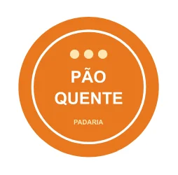
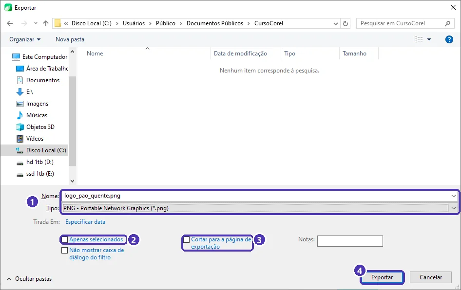
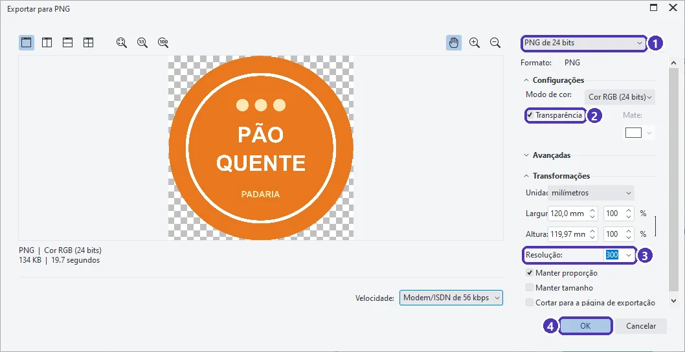
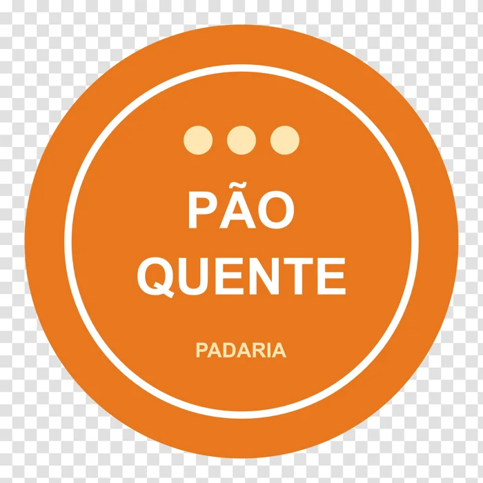

# 05 — Projeto do módulo: logotipo

> **Curso:** CorelDRAW  
> **Módulo:** 02 — Vetor na prática  
> **Tempo estimado:** 1 h 30 min  

---

## Objetivos

Ao final deste projeto, você terá:

- Um **logotipo vetorial** para um negócio (real ou inventado).
- Uma versão **editável** e uma com os **textos convertidos em curvas**.
- O logotipo exportado em **PNG com fundo transparente**, pronto para redes sociais, site e Canva.

## Pré-requisitos

- Aulas [01](01_curvas_e_bezier.md) a [04](04_texto_artistico_e_paragrafo.md) deste módulo.

---

## O pedido e o resultado

> *“A padaria só tem o logotipo numa imagem pequena e borrada. Precisamos dele em vetor para a fachada e em PNG para o Instagram.”*

Na aula 03, o PowerTRACE estragou os textos. Aqui o logotipo é **redesenhado** com formas e texto de verdade. A padaria **Pão Quente** é inventada.

<figure markdown="span">
  { loading=lazy }
  <figcaption>O logotipo refeito: só formas simples e texto digitado, depois convertido em curvas.</figcaption>
</figure>

---

## Passo 1 — Preparar

1. `Ctrl + N` ➔ A4, milímetros. Importe a imagem antiga (`Ctrl + I`), ponha-a ao lado da página e **trave-a** (botão direito ➔ **Bloquear**): ela serve só de **referência** para cores e proporções.
2. Anote as cores. Use o **conta-gotas** da caixa de ferramentas sobre a imagem para descobrir o laranja, ou peça ao cliente os códigos da marca.

## Passo 2 — Desenhar as formas

1. **Círculo de fundo:** `F7` + `Ctrl`, 120 mm, laranja, **sem contorno**.
2. **Anel:** outro círculo menor, **sem preenchimento**, contorno branco de 2 mm. Centralize os dois (`C` e `E`).
3. **Bolinhas:** um círculo pequeno, creme, sem contorno ➔ `Ctrl + D` duas vezes ➔ alinhe (`T` alinha pelo topo) e distribua.

!!! tip "Precisa de uma forma diferente?"
    Monte com **Soldar** e **Aparar** (aula 02) ou desenhe com a **Bézier** e ajuste com `F10` (aula 01). Um pão, por exemplo, é uma elipse soldada a três círculos pequenos.

## Passo 3 — Os textos

1. `F8` ➔ `PÃO`, `QUENTE` e `PADARIA`, cada um como **texto artístico**, em negrito, branco e creme.
2. Centralize cada texto no círculo: selecione o texto e, por último, o círculo ➔ `E`.
3. Confira **acentos e ortografia** agora: depois de converter em curvas, não dá mais para corrigir digitando.

## Passo 4 — Duas versões: editável e “para a gráfica”

1. **Salve** (`Ctrl + S`) como `logo_pao_quente_editavel.cdr`. Essa é a versão com **texto de verdade**, para mudanças futuras.
2. Selecione os textos ➔ **Converter em curvas** (`Ctrl + Q`). Agora o logotipo não depende mais da fonte: abre igual em qualquer computador.
3. **Arquivo ➔ Salvar como** ➔ `logo_pao_quente_curvas.cdr`.

!!! warning "Por que converter em curvas?"
    Se a gráfica abrir um `.cdr` e não tiver a fonte, o CorelDRAW **troca a letra** por outra. Com os textos em curvas, isso não acontece. Mas guarde **sempre** a versão editável: para trocar uma palavra, é nela que você mexe.

---

## Passo 5 — PNG com fundo transparente

Para o Instagram, o site ou para usar no **Canva**, o logotipo precisa de fundo **transparente** (sem quadrado branco).

1. Selecione o logotipo inteiro ➔ **Arquivo ➔ Exportar** (`Ctrl + E`).

<figure markdown="span">
  { loading=lazy }
  <figcaption>(1) <strong>Nome</strong> e <strong>Tipo: PNG</strong> · (2) <strong>Apenas selecionados</strong> · (3) <strong>Cortar para a página de exportação</strong>: deixe <strong>desmarcado</strong>, para o PNG ter só o tamanho do logotipo · (4) <strong>Exportar</strong>.</figcaption>
</figure>

2. Na janela **Exportar para PNG**, confira:

<figure markdown="span">
  { loading=lazy }
  <figcaption>(1) predefinição do PNG · (2) <strong>Transparência</strong> marcada: o xadrez da prévia é a parte transparente · (3) <strong>Resolução</strong> · (4) <strong>OK</strong>.</figcaption>
</figure>

O resultado: o logotipo sem fundo, que se encaixa em qualquer cor. O xadrez abaixo mostra onde é transparente:

<figure markdown="span">
  { loading=lazy }
  <figcaption>PNG transparente exportado do CorelDRAW (1417 × 1417 px).</figcaption>
</figure>

| Para... | Entregue |
|---|---|
| Alterar no futuro | `.cdr` **editável** |
| Gráfica, fachada, faixa, adesivo | `.cdr` **em curvas** ou **PDF** (*Publicar em PDF*) |
| Instagram, site, WhatsApp, **Canva** | **PNG transparente** |
| Outro programa vetorial (Illustrator, Inkscape) | **SVG** (*Exportar* ➔ Tipo *SVG*) |

!!! info "Do CorelDRAW para o Canva"
    No Canva gratuito, envie o PNG transparente em **Uploads** e use-o nos posts, stories e cardápios. Assim a marca fica igual em tudo, e os designs do dia a dia continuam rápidos de fazer no Canva.

---

??? note "No Inkscape"
    - Converter textos em curvas: **Caminho ➔ Objeto para caminho** (`Ctrl + Shift + C`).
    - Salvar a versão editável em **SVG do Inkscape** e a versão em curvas com **Arquivo ➔ Salvar como**.
    - PNG transparente: **Arquivo ➔ Exportar** (`Ctrl + Shift + E`) ➔ *Seleção* ➔ PNG. O fundo já sai transparente se a página não tiver cor de fundo (*Propriedades do documento*).

---

## Entrega

1. `logo_seunegocio_editavel.cdr` (ou `.svg` no Inkscape).
2. `logo_seunegocio_curvas.cdr`.
3. `logo_seunegocio.png` com **fundo transparente**.
4. Uma frase dizendo **para que negócio** é o logotipo e **por que** escolheu as cores.

### Critérios de avaliação

| Critério | O que se espera |
|---|---|
| Vetor de verdade | Feito com formas e texto, não com a imagem rastreada sem correção. |
| Texto | Ortografia e acentos corretos; versão em curvas sem nenhum texto editável. |
| Simplicidade | Funciona pequeno (2 cm) e grande; no máximo 3 cores. |
| Arquivos | Editável, em curvas e PNG transparente, com nomes claros. |
| Direitos | Marca própria ou inventada; nada copiado de outra empresa. |

---

## Exercícios extras

### Básico (fixação)

Faça uma versão do logotipo **em uma cor só** (todo preto), para carimbo ou fax.

<!-- gabarito -->
??? success "Gabarito — Básico"
    Duplique o logotipo (`Ctrl + D`) ➔ selecione tudo ➔ clique no **preto** da paleta (preenchimento) e botão direito no preto (contorno). As partes brancas ficam **sem preenchimento** ou são recortadas do fundo com **Aparar**, para virar “buraco”.

### Intermediário (aplicação)

Faça a versão **negativa**: logotipo branco sobre um quadrado laranja, para usar como foto de perfil.

<!-- gabarito -->
??? success "Gabarito — Intermediário"
    Desenhe um quadrado laranja atrás (`Shift + Page Down`). Pinte o círculo e as bolinhas de branco e os textos de laranja, ou só os contornos em branco. Exporte em PNG **sem** transparência (o fundo laranja já faz parte da imagem), com 1080 × 1080 px.

### Avançado (desafio)

Escreva o nome da padaria **em arco**, acompanhando o círculo, como num selo.

<!-- gabarito -->
??? success "Gabarito — Avançado"
    Desenhe um círculo-guia um pouco menor que o anel ➔ texto artístico `PADARIA PÃO QUENTE` ➔ **Texto ➔ Ajustar texto ao caminho** ➔ clique no círculo-guia (aula 04). Ajuste a posição pela barra de propriedades, tire o contorno do círculo-guia e, no fim, converta em curvas.

---

## 💡 Resumo

- PowerTRACE ajuda, mas logotipo bom é **redesenhado** com formas simples e texto digitado.
- Guarde a versão **editável** e entregue a versão **em curvas**.
- **PNG transparente** para redes sociais e Canva; **PDF/CDR em curvas** para a gráfica.
- Teste o logotipo **pequeno**: se não funciona com 2 cm, simplifique.

## ➡️ Próximo passo

Você terminou o **Módulo 02**. Volte ao [índice do módulo](index.md) e confira o checklist. O **Módulo 03 — Arquivos para gráfica** está em produção.
