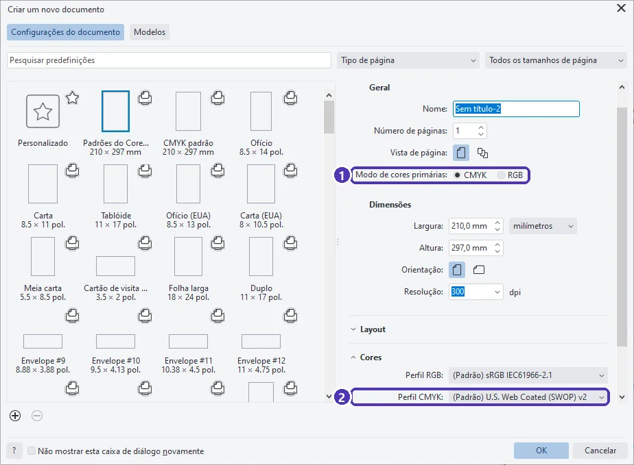
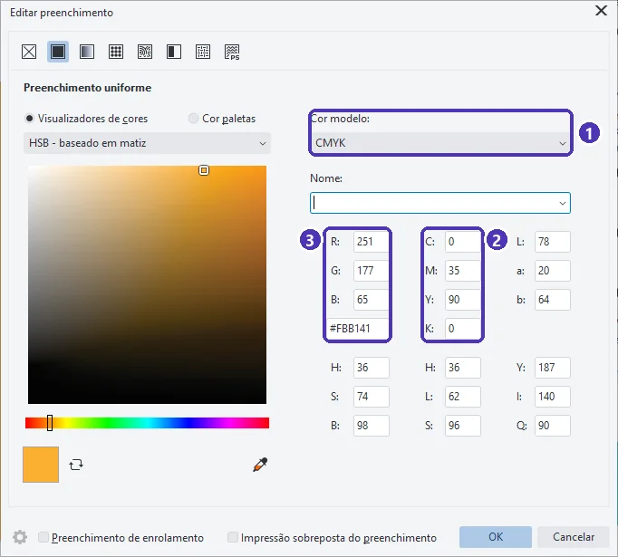
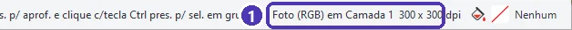
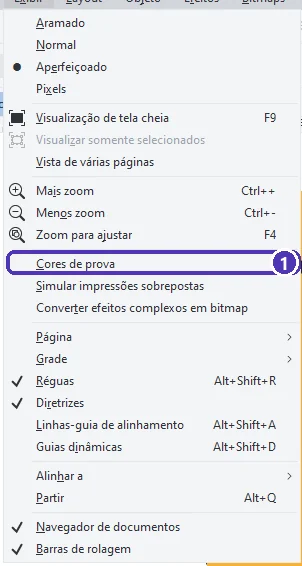

# 01 — Cores para impressão: CMYK × RGB

> **Curso:** CorelDRAW  
> **Módulo:** 03 — Arquivos para gráfica  
> **Tempo estimado:** 1 h  

---

## Objetivos

Ao final desta aula, você será capaz de:

- Explicar a diferença entre **RGB** (tela) e **CMYK** (impressão).
- Criar um documento no modo de cores **CMYK** e saber qual **perfil de cor** ele usa.
- Escolher cores pelos valores **C, M, Y e K** na janela **Editar preenchimento**.
- Reconhecer uma **foto em RGB** dentro do documento e prever o que muda na impressão.

## Pré-requisitos

- [Módulo 02](../modulo_02_vetor_na_pratica/index.md) completo.

---

## O pedido

> *“O laranja do panfleto ficou lindo na tela, mas veio meio apagado da gráfica. O que aconteceu?”*

A tela e a impressora fazem cor de jeitos diferentes. Quem prepara arquivos para gráfica precisa pensar nas cores **da impressora** desde o começo.

| | **RGB** | **CMYK** |
|---|---|---|
| Onde | Telas: monitor, celular, TV | Impressão: gráfica, impressora |
| Como forma a cor | **Luz**: vermelho, verde e azul somados (tudo junto = branco) | **Tinta**: ciano, magenta, amarelo e preto sobre o papel (tudo junto = quase preto) |
| Cores possíveis | Mais cores, inclusive verdes e azuis muito vivos | Menos cores: alguns tons vivos da tela **não existem** em tinta |
| Use para | Posts, sites, vídeos, apresentações | Cartões, panfletos, adesivos, faixas |

Quando um arquivo em RGB vai para a gráfica, ele é **convertido** para CMYK. As cores que não existem em tinta são trocadas pelas mais próximas, e é aí que o laranja “apaga”. Se você já desenha em CMYK, vê na tela uma prévia mais honesta do que vai sair.

---

## Passo 1 — Documento em CMYK

**Arquivo ➔ Novo** (`Ctrl + N`). Na janela *Criar um novo documento*:

<figure markdown="span">
  { loading=lazy }
  <figcaption>(1) <strong>Modo de cores primárias</strong>: CMYK para impressão, RGB para tela · (2) na seção <strong>Cores</strong>, o <strong>perfil CMYK</strong> que o documento usa.</figcaption>
</figure>

- Para impressão, deixe **CMYK** marcado (é o padrão do CorelDRAW).
- O **perfil CMYK** descreve o tipo de impressão e de papel. O padrão do programa é **U.S. Web Coated (SWOP) v2**, um perfil americano.

!!! warning "Pergunte à gráfica qual perfil ela usa"
    Muitas gráficas no Brasil trabalham com perfis europeus, como o **Coated FOGRA39** ou o **ISO Coated v2**, e algumas mandam o próprio arquivo de perfil. Se a gráfica indicar um perfil, escolha-o aqui **antes** de começar. Se ela disser que tanto faz, use o padrão e mande o PDF do jeito da aula 05.

---

## Passo 2 — Escolher cores em CMYK

Selecione um objeto e abra **Editar preenchimento** com `Shift + F11` (ou com um duplo clique no quadradinho de preenchimento da barra de status).

<figure markdown="span">
  { loading=lazy }
  <figcaption>(1) <strong>Cor modelo: CMYK</strong> · (2) os valores de <strong>C, M, Y e K</strong>, de 0 a 100 (% de cada tinta) · (3) os valores equivalentes em RGB e o código hexadecimal, para usar na tela.</figcaption>
</figure>

- **C 0, M 35, Y 90, K 0** é o laranja da Padaria Pão Quente: 35% de magenta e 90% de amarelo.
- Anote os valores CMYK das cores da marca junto com o logotipo. Com eles, o laranja sai **igual** em todo material, de qualquer gráfica.
- A barra de status, embaixo da janela, também mostra os valores do preenchimento e do contorno do objeto selecionado (por exemplo, `C:0 M:0 Y:0 K:100` = preto).

!!! tip "Preto para texto, preto para fundo"
    Texto pequeno em preto: use **só K 100** (C 0, M 0, Y 0). Se o texto tiver as quatro tintas, um desalinhamento mínimo na impressora deixa as letras com bordas coloridas. Para um **fundo grande** preto, algumas gráficas recomendam um “preto rico” (por exemplo, C 40, M 30, Y 30, K 100), que sai mais escuro. Pergunte à gráfica qual ela prefere.

---

## Passo 3 — Fotos em RGB

Fotos de celular e de câmera são **RGB**. Ao importar uma (`Ctrl + I`), a barra de status mostra:

<figure markdown="span">
  { loading=lazy }
  <figcaption>(1) A foto selecionada é <strong>RGB</strong>, com <strong>300 dpi</strong> no tamanho em que está na página.</figcaption>
</figure>

Duas coisas para conferir em toda foto:

- **Modo de cor:** RGB é normal. Na hora de gerar o PDF para a gráfica (aula 05), a predefinição certa **converte** a foto para CMYK. Fotos com verdes e azuis muito vivos podem mudar um pouco: confira na prova (abaixo).
- **Resolução:** para impressão, a foto precisa de pelo menos **300 dpi** no tamanho em que vai ser impressa. Se você ampliar a foto na página, os dpi **caem**: uma foto de 300 dpi esticada para o dobro do tamanho fica com 150 dpi e sai borrada.

---

## Passo 4 — Prever as cores com a prova

**Exibir ➔ Cores de prova** simula na tela como as cores vão sair no perfil CMYK do documento:

<figure markdown="span">
  { loading=lazy }
  <figcaption>(1) <strong>Cores de prova</strong>: liga e desliga a simulação. Compare com ela ligada e desligada.</figcaption>
</figure>

Se uma cor muda muito com a prova ligada, ela **não existe em tinta**: escolha outra em CMYK, em vez de se decepcionar com o impresso.

!!! info "A tela nunca é igual ao papel"
    Mesmo em CMYK e com a prova ligada, a tela mostra luz, e o papel reflete luz. Brilho do monitor, tipo de papel e acabamento mudam a cor final. Para trabalhos em que a cor é crítica (uma marca, uma embalagem), peça uma **prova impressa** à gráfica antes da tiragem.

---

??? note "No Inkscape"
    - O Inkscape trabalha em **RGB**. Dá para escolher cores pelo modo **CMYK** no painel *Preencher e contorno* (`Ctrl + Shift + F`), mas o arquivo continua em RGB.
    - O PDF do Inkscape sai em **RGB**: a gráfica converte para CMYK. Por isso, pergunte se ela aceita PDF em RGB e peça uma prova quando a cor for importante.
    - Evite verdes e azuis muito vivos em peças impressas: são as cores que mais mudam na conversão.

---

## Exercícios

### Básico (fixação)

Crie um documento novo e responda olhando a janela *Criar um novo documento*: qual é o modo de cores primárias e qual é o perfil CMYK padrão?

<!-- gabarito -->
??? success "Gabarito — Básico"
    `Ctrl + N` ➔ **Modo de cores primárias: CMYK** ➔ abra a seção **Cores**: **Perfil CMYK: U.S. Web Coated (SWOP) v2** (o padrão do CorelDRAW 2026). Ele serve, mas o certo é perguntar à gráfica qual perfil ela usa.

### Intermediário (aplicação)

Desenhe três retângulos e pinte-os, pela janela **Editar preenchimento** em CMYK, com: o laranja da padaria (C 0, M 35, Y 90, K 0), um preto só de K e um verde bem vivo escolhido no quadrado de cores. Ligue **Exibir ➔ Cores de prova** e compare.

<!-- gabarito -->
??? success "Gabarito — Intermediário"
    `F6` ➔ desenhe ➔ `Shift + F11` ➔ *Cor modelo: CMYK* ➔ digite os valores. O laranja e o preto mudam pouco ou nada com a prova ligada, porque foram escolhidos em tinta. Um verde muito vivo escolhido “no olho” pode ficar mais apagado com a prova: é a prévia do que aconteceria no papel. Troque por um verde que não mude com a prova.

### Avançado (desafio)

Importe uma foto de 1200 × 800 pixels e descubra, pela barra de status, os dpi dela em três tamanhos na página: 10 cm, 20 cm e 40 cm de largura. Qual desses tamanhos serve para impressão?

<!-- gabarito -->
??? success "Gabarito — Avançado"
    Selecione a foto e mude a largura na barra de propriedades; a barra de status mostra os dpi. A conta: 10 cm = 3,94 polegadas ➔ 1200 ÷ 3,94 ≈ **305 dpi** (serve). 20 cm ➔ ≈ **152 dpi** (fraco). 40 cm ➔ ≈ **76 dpi** (borrado de perto). Com essa foto, só o tamanho de 10 cm atinge os 300 dpi. Para imprimir maior, é preciso uma foto com mais pixels; aumentar a foto no programa não cria detalhe.

---

## 💡 Resumo

- **RGB** é luz (tela); **CMYK** é tinta (impressão). Algumas cores vivas da tela não existem em tinta.
- Para impressão: documento em **CMYK**, cores da marca anotadas em **C, M, Y e K**, e o **perfil** combinado com a gráfica.
- Fotos chegam em **RGB** e precisam de **300 dpi** no tamanho impresso.
- **Exibir ➔ Cores de prova** simula o resultado; cor crítica pede **prova impressa**.

## ➡️ Próximo passo

Na **[aula 02](02_sangria_e_marcas_de_corte.md)** você prepara o arquivo para o **corte** da gráfica: sangria e marcas de corte.
