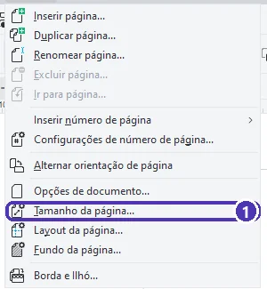
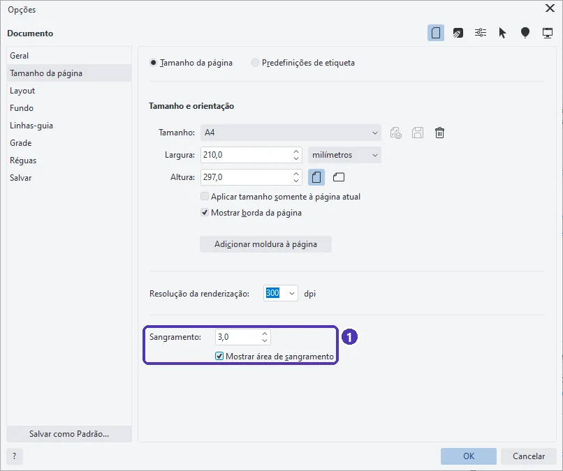
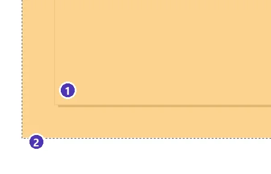
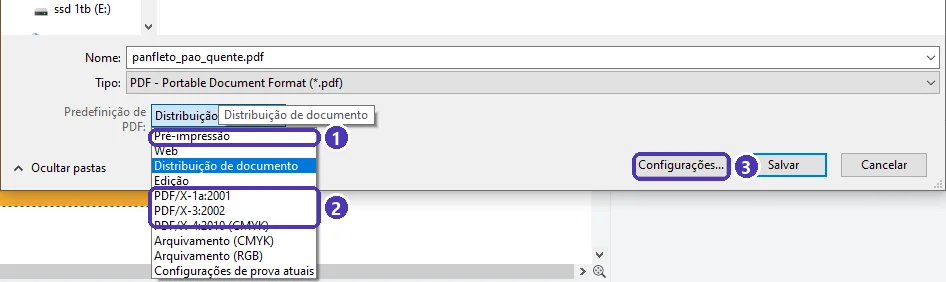
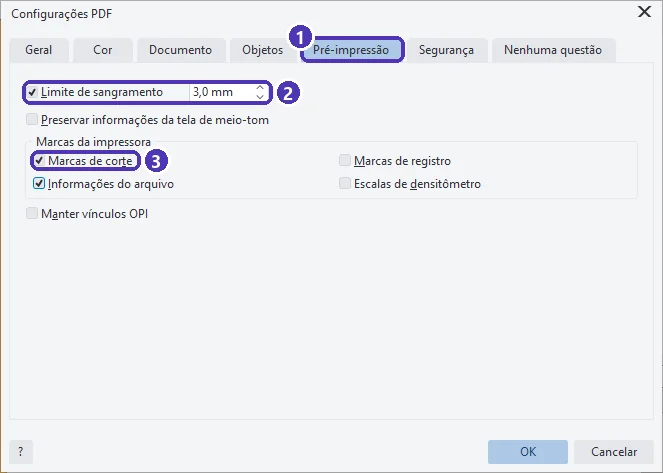
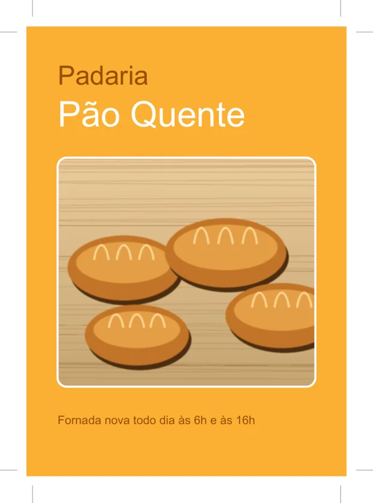

# 02 — Sangria e marcas de corte

> **Curso:** CorelDRAW  
> **Módulo:** 03 — Arquivos para gráfica  
> **Tempo estimado:** 1 h  

---

## Objetivos

Ao final desta aula, você será capaz de:

- Explicar por que a gráfica pede **sangria** e **margem de segurança**.
- Configurar o **sangramento** do documento e mostrar a área de sangria na tela.
- Fazer fundos e imagens **passarem** da borda da página.
- Gerar um PDF com **sangria** e **marcas de corte**.

## Pré-requisitos

- [Aula 01](01_cores_para_impressao.md) deste módulo.

---

## O pedido

> *“Os panfletos chegaram com um filete branco em um dos lados. A gráfica disse que faltou sangria.”*

A gráfica imprime várias peças numa folha grande e depois **corta** com uma guilhotina. O corte nunca é perfeito: pode variar 1 ou 2 milímetros para um lado. Por isso:

| Área | O que é | Regra |
|---|---|---|
| **Sangria** | Faixa **fora** da página que vai ser cortada fora | Fundos, faixas e fotos que encostam na borda **passam** da página. O comum é **3 mm** (confirme com a gráfica). |
| **Linha de corte** | A borda da página: o tamanho final da peça | É o tamanho que o cliente pediu (A5 = 148 × 210 mm). |
| **Margem de segurança** | Faixa **dentro** da página, perto da borda | Textos, logotipos e telefones ficam **longe** do corte: pelo menos **5 mm** para dentro. |

Sem sangria, se o corte desviar 1 mm para fora, aparece o **filete branco** do papel. Sem margem, se desviar para dentro, o corte **come** o telefone.

---

## Passo 1 — Configurar o sangramento

**Layout ➔ Tamanho da página…**

<figure markdown="span">
  { loading=lazy }
  <figcaption>(1) <strong>Tamanho da página…</strong> abre as opções do documento.</figcaption>
</figure>

Na janela *Opções*, página **Tamanho da página**, embaixo:

<figure markdown="span">
  { loading=lazy }
  <figcaption>(1) <strong>Sangramento</strong>: 3,0 (mm) e <strong>Mostrar área de sangramento</strong> marcado.</figcaption>
</figure>

- No CorelDRAW 2026, a sangria se chama **Sangramento**. O padrão é 4,0 mm: troque pelo que a gráfica pedir (3 mm é o mais comum).
- **Mostrar área de sangramento** desenha uma linha tracejada 3 mm **fora** da página.

---

## Passo 2 — Fundos que passam da página

Desenhe o fundo **do tamanho da área de sangria**, e não do tamanho da página. Numa página A4 com 3 mm de sangria, o retângulo de fundo tem 216 × 303 mm, 3 mm para fora em cada lado.

<figure markdown="span">
  { loading=lazy }
  <figcaption>(1) Canto da <strong>página</strong>: é onde a gráfica corta · (2) a linha tracejada: <strong>limite da sangria</strong>. O fundo vai até ela. (Fundo deixado semitransparente só para mostrar as duas linhas.)</figcaption>
</figure>

- Jeito rápido: desenhe o retângulo com um **duplo clique** na ferramenta Retângulo (fica do tamanho da página) e, na barra de propriedades, some **6 mm** à largura e à altura, mantendo o centro.
- Só **fundos, faixas e fotos** que encostam na borda vão até a sangria. Textos e logotipos ficam a **5 mm** para dentro da borda.

---

## Passo 3 — PDF com sangria e marcas de corte

**Arquivo ➔ Publicar em PDF**. Antes de tudo, escolha a **pasta** e o nome do arquivo. Depois:

<figure markdown="span">
  { loading=lazy }
  <figcaption>(1) <strong>Pré-impressão</strong> · (2) as predefinições <strong>PDF/X</strong>, próprias para gráfica (aula 05) · (3) <strong>Configurações…</strong>, para conferir o que a predefinição faz.</figcaption>
</figure>

Escolha **Pré-impressão** e clique em **Configurações…** ➔ aba **Pré-impressão**:

<figure markdown="span">
  { loading=lazy }
  <figcaption>(1) Aba <strong>Pré-impressão</strong> · (2) <strong>Limite de sangramento</strong>: marcado, com o mesmo valor do documento · (3) <strong>Marcas de corte</strong>.</figcaption>
</figure>

- **Limite de sangramento**: quanto da sangria vai para o PDF. O padrão vem 3,175 mm; use o **mesmo** valor do documento.
- **Marcas de corte**: risquinhos nos cantos, fora da arte, que mostram à gráfica onde cortar.
- **Informações do arquivo**: imprime o nome e o **caminho** do arquivo fora da página. Deixe **desmarcado**: o caminho pode mostrar o seu nome de usuário do computador.

O resultado:

<figure markdown="span">
  { loading=lazy }
  <figcaption>O PDF tem a arte, a sangria em volta e as <strong>marcas de corte</strong> nos quatro cantos.</figcaption>
</figure>

!!! warning "Algumas gráficas não querem marcas"
    Gráficas online e muitas copiadoras pedem o PDF **com sangria, mas sem marcas** (elas colocam as próprias). Leia as instruções da gráfica antes de mandar: ela sempre diz o tamanho da sangria e se quer ou não as marcas.

---

??? note "No Inkscape"
    - Sangria: **Arquivo ➔ Propriedades do documento** (`Ctrl + Shift + D`) ➔ campo de **sangria** (*bleed*), nas versões 1.3 ou mais novas.
    - Fundo com sangria: desenhe o retângulo 3 mm maior que a página em cada lado.
    - Marcas de corte: **Extensões ➔ Renderizar ➔ Layout ➔ Marcas de impressão**, com a sangria indicada. Depois salve como **PDF**.

---

## Exercícios

### Básico (fixação)

Num cartão de visita de 90 × 50 mm, com 3 mm de sangria, de que tamanho deve ser o retângulo de fundo? E até onde os textos podem ir?

<!-- gabarito -->
??? success "Gabarito — Básico"
    Fundo: **96 × 56 mm** (3 mm a mais em cada um dos quatro lados). Textos: pelo menos **5 mm** para dentro da borda, ou seja, dentro de uma área de **80 × 40 mm** no centro do cartão.

### Intermediário (aplicação)

Configure o sangramento de 3 mm num documento A5, desenhe um fundo colorido que vá até a linha tracejada e publique um PDF de **Pré-impressão** com sangria e marcas de corte.

<!-- gabarito -->
??? success "Gabarito — Intermediário"
    **Layout ➔ Tamanho da página…** ➔ A5 ➔ **Sangramento** 3 ➔ **Mostrar área de sangramento** ➔ OK. Duplo clique na ferramenta Retângulo ➔ largura **154** e altura **216** (148 + 6 e 210 + 6), com o centro no mesmo lugar ➔ cor. **Arquivo ➔ Publicar em PDF** ➔ **Pré-impressão** ➔ **Configurações** ➔ aba **Pré-impressão** ➔ **Limite de sangramento** 3 mm e **Marcas de corte** ➔ OK ➔ **Salvar**. Abra o PDF: as marcas aparecem nos quatro cantos, e o fundo passa delas.

### Avançado (desafio)

Um cliente mandou um panfleto feito por ele, **sem sangria**: o fundo azul termina exatamente na borda da página. Que opções você tem para não sair filete branco?

<!-- gabarito -->
??? success "Gabarito — Avançado"
    1. **Esticar o fundo** até a sangria (o mais comum). Se o fundo for uma cor chapada ou um degradê simples, basta aumentar o retângulo 3 mm para cada lado.
    2. Se for uma **foto** que não pode ser esticada sem deformar, **aumentar** a foto um pouco, mantendo a proporção, e conferir se nada importante foi para a área de corte.
    3. Se nada disso der (uma foto com texto na borda, por exemplo), **combinar com o cliente**: margem branca proposital em volta de toda a peça, ou refazer a arte. Nunca mande sem sangria esperando que “dê sorte” no corte.

---

## 💡 Resumo

- **Sangria** (fora, ~3 mm): fundos e fotos passam da página. **Margem de segurança** (dentro, ~5 mm): textos longe do corte.
- **Layout ➔ Tamanho da página ➔ Sangramento** e **Mostrar área de sangramento**.
- No PDF: **Limite de sangramento** igual ao do documento e, se a gráfica pedir, **Marcas de corte**. **Informações do arquivo** desmarcado.

## ➡️ Próximo passo

Na **[aula 03](03_powerclip.md)** você coloca fotos **dentro** de formas com o PowerClip.
