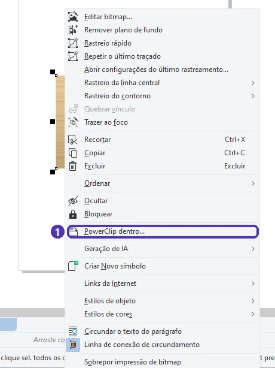
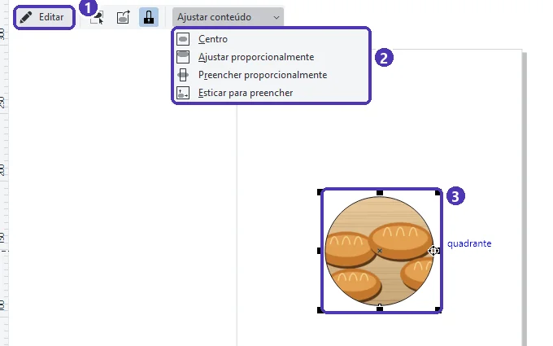
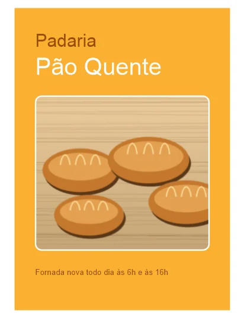

# 03 — PowerClip: foto dentro de forma

> **Curso:** CorelDRAW  
> **Módulo:** 03 — Arquivos para gráfica  
> **Tempo estimado:** 1 h  

---

## Objetivos

Ao final desta aula, você será capaz de:

- Colocar uma foto **dentro** de uma forma com o **PowerClip**.
- **Ajustar** o conteúdo (centralizar, preencher) e **editar** a posição da foto dentro da forma.
- Tirar a foto de dentro da forma quando precisar.

## Pré-requisitos

- Aulas [01](01_cores_para_impressao.md) e [02](02_sangria_e_marcas_de_corte.md) deste módulo.

---

## O pedido

> *“Quero a foto dos pães no panfleto, mas com os cantos arredondados, como no Instagram.”*

Cortar a foto num programa de fotos e importar de novo funciona, mas é trabalhoso e perde o resto da imagem. No CorelDRAW, a foto vai **dentro** de uma forma: a forma funciona como uma **janela**, e a foto continua inteira lá dentro. Isso se chama **PowerClip**.

- **Forma** (a janela): qualquer objeto fechado. Pode ser um retângulo de cantos arredondados, um círculo, um texto convertido em curvas ou um logotipo.
- **Conteúdo**: a foto (ou qualquer grupo de objetos) que vai dentro dela.

---

## Passo 1 — Preparar a forma e a foto

1. Desenhe a **forma** onde a foto vai aparecer. Para cantos arredondados: ferramenta Retângulo (`F6`) ➔ na barra de propriedades, os campos de **raio do canto** (por exemplo, 8 mm).
2. Importe a **foto** (`Ctrl + I` ➔ escolha ➔ `Enter`).
3. Ajuste o tamanho da foto para que ela **cubra a forma inteira**, com folga. A parte que sobrar fica escondida, não some.

---

## Passo 2 — Colocar a foto dentro

Clique na foto com o **botão direito**:

<figure markdown="span">
  { loading=lazy }
  <figcaption>(1) <strong>PowerClip dentro…</strong></figcaption>
</figure>

O ponteiro vira uma **seta grande**: clique na **borda** da forma. A foto entra na forma e só aparece a parte que está dentro dela.

Outro caminho: **Objeto ➔ PowerClip ➔ Colocar dentro do recipiente…**, com a foto selecionada. O mesmo submenu tem **Extrair conteúdo**, **Editar PowerClip…** e **Finalizar edição do PowerClip**.

---

## Passo 3 — Ajustar e editar

Com o PowerClip selecionado, aparece uma barrinha flutuante logo abaixo dele:

<figure markdown="span">
  { loading=lazy }
  <figcaption>(1) <strong>Editar</strong>: mexer na foto dentro da forma · (2) <strong>Ajustar conteúdo</strong> · (3) o PowerClip: a forma com a foto dentro.</figcaption>
</figure>

| Opção de **Ajustar conteúdo** | O que faz |
|---|---|
| **Centro** | Centraliza a foto na forma, sem mudar o tamanho |
| **Ajustar proporcionalmente** | A foto **inteira** aparece; pode sobrar espaço vazio na forma |
| **Preencher proporcionalmente** | A foto **cobre** a forma toda, sem deformar (o mais usado) |
| **Esticar para preencher** | Cobre a forma **deformando** a foto. Evite com fotos de pessoas e produtos. |

- **Editar** mostra a foto inteira, com a forma como guia: arraste para escolher que parte aparece, aumente ou gire. Para voltar, clique em **Concluir** (o botão que aparece no lugar da barrinha).
- Para tirar a foto de dentro: botão direito ➔ **Extrair conteúdo**. A foto volta a ser um objeto separado, inteira.
- No mesmo menu, **Bloquear conteúdo no PowerClip** (ligado por padrão) faz a foto acompanhar a forma quando você a move.

O panfleto da padaria, com a foto num retângulo de cantos arredondados:

<figure markdown="span">
  { loading=lazy }
  <figcaption>A foto foi colocada dentro do retângulo arredondado com <strong>PowerClip</strong>; o contorno branco é o da própria forma.</figcaption>
</figure>

!!! tip "PowerClip e sangria"
    Uma foto que vai **até a borda** do panfleto também pode ir num PowerClip: desenhe a forma do tamanho da **área de sangria** (aula 02) e coloque a foto dentro. Assim a foto passa 3 mm da página sem você precisar recortá-la.

---

??? note "No Inkscape"
    - Coloque a forma **por cima** da foto ➔ selecione as duas (`Shift + clique`) ➔ **Objeto ➔ Recorte ➔ Definir recorte**.
    - Para mudar a parte que aparece: entre no grupo (duplo clique) ou **Objeto ➔ Recorte ➔ Liberar recorte**, ajuste e recorte de novo.
    - Um recorte (*clip*) esconde as partes de fora, mas a foto continua inteira no arquivo, como no PowerClip.

---

## Exercícios

### Básico (fixação)

Coloque uma foto sua dentro de um **círculo** e use **Ajustar conteúdo ➔ Preencher proporcionalmente**.

<!-- gabarito -->
??? success "Gabarito — Básico"
    `F7` com `Ctrl` (círculo perfeito) ➔ `Ctrl + I` (foto) ➔ botão direito na foto ➔ **PowerClip dentro…** ➔ clique na borda do círculo ➔ na barrinha, **Ajustar conteúdo ➔ Preencher proporcionalmente**. O círculo fica todo preenchido, e a foto não fica deformada.

### Intermediário (aplicação)

No mesmo PowerClip, use **Editar** para mostrar outra parte da foto (por exemplo, um pão que ficou de fora) e depois volte.

<!-- gabarito -->
??? success "Gabarito — Intermediário"
    Selecione o PowerClip ➔ **Editar** na barrinha ➔ a foto inteira aparece, com a forma como guia ➔ arraste a foto (ou aumente segurando `Shift` para manter o centro) ➔ **Concluir**. Se a barrinha não estiver visível, o mesmo comando está no botão direito: **Editar PowerClip…**.

### Avançado (desafio)

Escreva **PÃO** com letras bem grossas, converta em curvas e coloque a foto dos pães **dentro das letras**.

<!-- gabarito -->
??? success "Gabarito — Avançado"
    Ferramenta Texto (`F8`) ➔ digite **PÃO** ➔ escolha uma fonte bem grossa (*Arial Black*, *Impact*) num tamanho grande ➔ `Ctrl + Q` (**converter em curvas**) ➔ foto ➔ botão direito ➔ **PowerClip dentro…** ➔ clique numa das letras. As três letras viram uma única forma, e a foto aparece só dentro delas. Converter em curvas antes garante que a gráfica veja as letras mesmo sem ter a fonte.

---

## 💡 Resumo

- **PowerClip** coloca a foto **dentro** de uma forma: a forma é a janela; a foto continua inteira.
- Botão direito na foto ➔ **PowerClip dentro…** ➔ clique na forma.
- **Ajustar conteúdo ➔ Preencher proporcionalmente** cobre a forma sem deformar; **Editar** muda a parte que aparece; **Extrair conteúdo** tira a foto.

## ➡️ Próximo passo

Na **[aula 04](04_adesivo_com_linha_de_corte.md)** você faz um **adesivo** com a linha que a máquina de corte segue.
