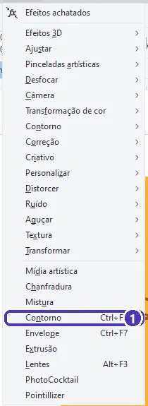
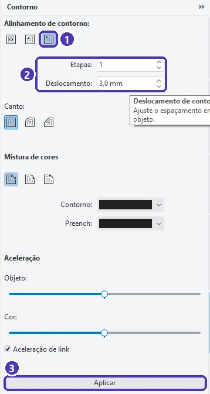
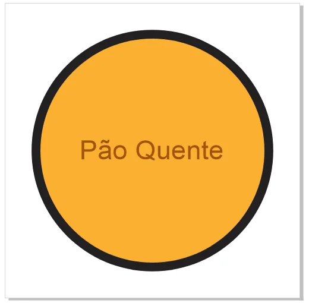
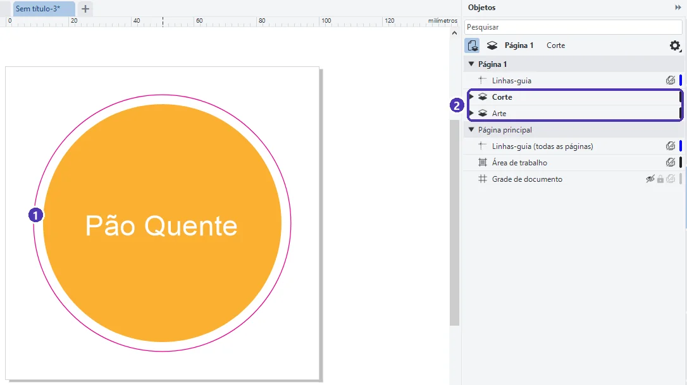

# 04 — Adesivo com linha de corte

> **Curso:** CorelDRAW  
> **Módulo:** 03 — Arquivos para gráfica  
> **Tempo estimado:** 1 h 30 min  

---

## Objetivos

Ao final desta aula, você será capaz de:

- Explicar o que é a **linha de corte** (a “faca”) de um adesivo recortado.
- Criar a linha de corte com o efeito **Contorno** (`Ctrl + F9`), a uma distância certa da arte.
- **Separar** o contorno da arte e deixar a linha como a gráfica pede.
- Organizar a arte e o corte em **camadas** separadas.

## Pré-requisitos

- Aulas [01](01_cores_para_impressao.md) a [03](03_powerclip.md) deste módulo.

---

## O pedido

> *“Quero adesivos redondos com o logotipo para fechar os saquinhos de pão, recortados no formato, com uma bordinha branca.”*

Um adesivo **recortado no formato** (e não quadrado) é impresso e depois cortado por uma **plotter de recorte**, que segue uma linha desenhada no arquivo: a **linha de corte**, também chamada de **faca**. Essa linha:

- **não é impressa**: serve só para a máquina;
- fica numa **camada separada** e com uma cor que a gráfica reconhece;
- é uma **curva fechada**, simples, sem cantos muito finos (a lâmina não faz detalhes minúsculos).

| Estilo | Onde fica a linha de corte |
|---|---|
| **Com borda branca** (o do pedido) | Alguns milímetros **fora** da arte: sobra uma borda de papel em volta |
| **Sangrado** (sem borda) | Um pouco **dentro** da arte: a arte passa da linha uns 2 mm, como a sangria da aula 02 |

---

## Passo 1 — A arte

Para o exemplo: um círculo de 76 mm laranja (C 0, M 35, Y 90, K 0), sem contorno, com o nome da padaria em branco por cima, numa página de 100 × 100 mm. Agrupe a arte (`Ctrl + G`) se ela tiver várias peças.

---

## Passo 2 — Criar o contorno

Selecione o círculo ➔ **Efeitos ➔ Contorno** (`Ctrl + F9`):

<figure markdown="span">
  { loading=lazy }
  <figcaption>(1) <strong>Contorno</strong> (<code>Ctrl + F9</code>). Não confunda com o <em>contorno</em> do objeto (a linha em volta, <code>F12</code>): este é o <strong>efeito</strong> que cria cópias para fora ou para dentro.</figcaption>
</figure>

O painel **Contorno** abre à direita:

<figure markdown="span">
  { loading=lazy }
  <figcaption>(1) <strong>Alinhamento</strong>: o terceiro botão cria o contorno <strong>para fora</strong> · (2) <strong>Etapas</strong> 1 e <strong>Deslocamento</strong> 3,0 mm · (3) <strong>Aplicar</strong>.</figcaption>
</figure>

- **Etapas: 1**: uma única cópia (a faca). Mais etapas criam vários anéis, um efeito decorativo.
- **Deslocamento: 3 mm**: a largura da borda branca. Pergunte à gráfica o mínimo dela; 2 a 3 mm é comum.
- Com uma arte de várias peças, aplique o contorno numa **forma de base** do tamanho da arte toda (um círculo, um retângulo arredondado, ou as peças soldadas com o que você viu no Módulo 02).

<figure markdown="span">
  { loading=lazy }
  <figcaption>Logo depois de aplicar, o contorno vem <strong>preenchido</strong> e ligado ao círculo (se o círculo mudar, ele acompanha).</figcaption>
</figure>

---

## Passo 3 — Transformar em linha de corte

1. Clique no anel do contorno e **separe** do original: **Objeto ➔ Separar** (`Ctrl + K`). Agora o anel é uma forma comum, independente.
2. Com o anel selecionado: **sem preenchimento** (clique com o botão esquerdo no **X** da paleta de cores) e um **contorno fino**, por exemplo 0,25 mm (`F12`).
3. Pinte o contorno com a **cor de corte** combinada com a gráfica. No exemplo, magenta (C 0, M 100, Y 0, K 0).
4. Dê um nome ao objeto no painel Objetos: **Linha de corte**.

!!! warning "Cada gráfica pede a faca de um jeito"
    Algumas pedem a linha em **magenta 100%**; outras, uma **cor especial** com um nome combinado (muitas plotters usam o nome *CutContour*); outras querem a faca num **arquivo separado**. Leia o manual da gráfica ou pergunte antes. O que não muda: linha **fechada**, **fina**, **sem preenchimento** e **fora** da camada da arte.

---

## Passo 4 — Camada própria

Abra o painel **Objetos** (aba lateral **Objetos**, ou **Objeto ➔ Objetos**). Crie uma camada nova (o primeiro botão embaixo do painel), chame-a de **Corte** e arraste a linha para ela. A arte fica na camada **Arte**:

<figure markdown="span">
  { loading=lazy }
  <figcaption>(1) A <strong>linha de corte</strong> magenta, 3 mm fora da arte · (2) as camadas <strong>Corte</strong> e <strong>Arte</strong>, separadas.</figcaption>
</figure>

Com camadas separadas, dá para **esconder** a faca para conferir a arte, **trancar** a camada para não mexer nela sem querer, e a gráfica encontra a linha de corte na hora.

---

??? note "No Inkscape"
    - Contorno para fora: selecione a forma ➔ **Caminho ➔ Deslocamento vinculado** e arraste a alça para fora; ou **Caminho ➔ Expandir** (`Ctrl + )`), que cresce a forma um passo por vez.
    - Linha de corte: sem preenchimento, traço fino na cor combinada, numa **camada** própria (**Camada ➔ Adicionar camada**).
    - Se a gráfica pedir SVG ou PDF com a faca, confira se a camada **Corte** foi junto.

---

## Exercícios

### Básico (fixação)

Faça um adesivo **quadrado de cantos arredondados** de 50 mm com uma linha de corte 2 mm para fora.

<!-- gabarito -->
??? success "Gabarito — Básico"
    `F6` ➔ 50 × 50 mm ➔ raio do canto 5 mm ➔ cor ➔ `Ctrl + F9` ➔ **Fora do contorno**, **Etapas 1**, **Deslocamento 2 mm** ➔ **Aplicar** ➔ clique no contorno ➔ `Ctrl + K` ➔ sem preenchimento, contorno 0,25 mm magenta. A linha fica com os cantos arredondados também, porque acompanha a forma.

### Intermediário (aplicação)

Monte **seis** adesivos redondos numa folha A4, cada um com a sua linha de corte, e deixe todas as linhas na camada **Corte**.

<!-- gabarito -->
??? success "Gabarito — Intermediário"
    Faça **um** adesivo completo (arte + linha). Selecione os dois ➔ `Ctrl + D` (duplicar) e arraste, ou use **Objeto ➔ Alinhar e distribuir** para organizar em 2 colunas e 3 linhas, com pelo menos 5 mm entre as linhas de corte. Depois, no painel Objetos, confira que as seis linhas estão na camada **Corte** (as duplicatas ficam na mesma camada do original). Esconda a camada Arte (o olho) para ver só as facas.

### Avançado (desafio)

O cliente quer o adesivo **sangrado**, sem borda branca. O que muda na arte e na linha de corte?

<!-- gabarito -->
??? success "Gabarito — Avançado"
    A linha de corte fica no **tamanho final** do adesivo, e a **arte** passa dela uns 2 mm (a sangria do adesivo). Um jeito: desenhe a linha de corte (o círculo do tamanho final) e faça um **Contorno para fora** de 2 mm na **arte** (ou aumente o fundo da arte). O texto e o logotipo continuam a pelo menos 3 mm **para dentro** da linha. Se o corte desviar, a cor continua até a borda, sem filete branco.

---

## 💡 Resumo

- A **linha de corte** (faca) guia a plotter: curva **fechada**, **fina**, **sem preenchimento**, na cor e no jeito que a gráfica pede.
- **Efeitos ➔ Contorno** (`Ctrl + F9`), **para fora**, 1 etapa, com o deslocamento da borda ➔ **Aplicar** ➔ `Ctrl + K` para separar.
- Arte e corte em **camadas** separadas.

## ➡️ Próximo passo

Na **[aula 05](05_projeto_kit_grafica.md)**, o projeto: o **kit para a gráfica**, com o panfleto frente e verso e o PDF de impressão.
