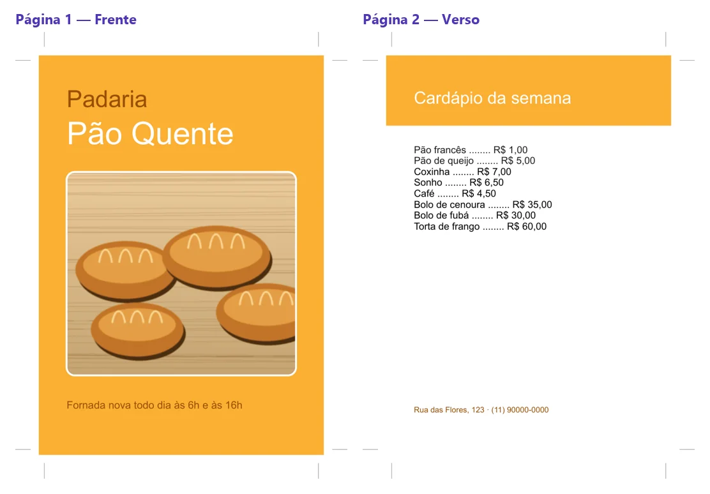
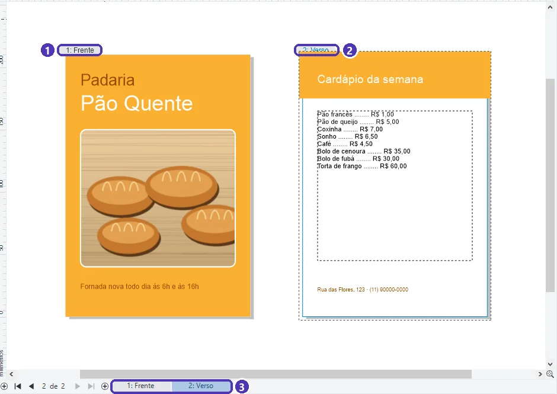
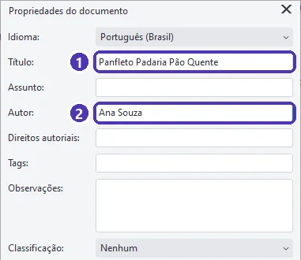
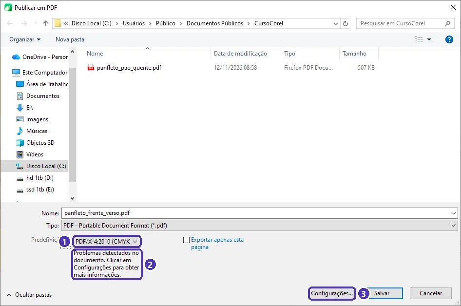
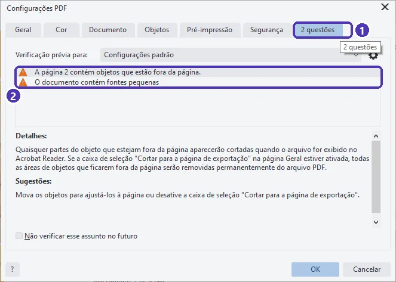
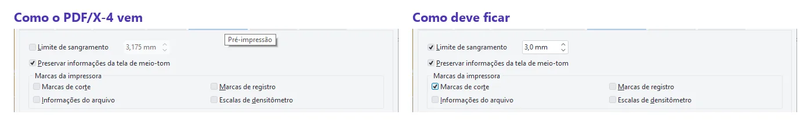
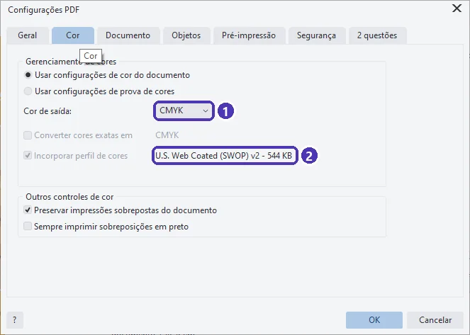

# 05 — Projeto do módulo: kit para a gráfica

> **Curso:** CorelDRAW  
> **Módulo:** 03 — Arquivos para gráfica  
> **Tempo estimado:** 2 h 30 min  

---

## Objetivos

Ao final desta aula, você terá:

- Um **panfleto A5 frente e verso** em CMYK, com sangria, foto em PowerClip e texto conferido.
- O **PDF de impressão** em **PDF/X-4**, com sangria e marcas de corte, sem dados pessoais nos metadados.
- O **kit para a gráfica**: o PDF, o arquivo editável e uma mensagem com as especificações do pedido.

## Pré-requisitos

- Aulas [01](01_cores_para_impressao.md) a [04](04_adesivo_com_linha_de_corte.md) deste módulo e o [logotipo do Módulo 02](../modulo_02_vetor_na_pratica/05_projeto_logotipo.md).

---

## O pedido e o resultado

> *“Preciso de 1.000 panfletos A5 da padaria, frente e verso: na frente a foto e o horário da fornada, no verso o cardápio com os preços. A gráfica pediu ‘PDF/X com 3 mm de sangria’.”*

<figure markdown="span">
  { loading=lazy }
  <figcaption>O PDF que vai para a gráfica: duas páginas A5, com sangria e marcas de corte. Dados inventados.</figcaption>
</figure>

---

## Passo 1 — O documento

1. `Ctrl + N` ➔ **A5** (148 × 210 mm), **retrato**, **CMYK**, **2 páginas** (campo *Número de páginas*), e o perfil CMYK que a gráfica indicar (aula 01).
2. **Layout ➔ Tamanho da página…** ➔ **Sangramento 3** ➔ **Mostrar área de sangramento** (aula 02).
3. Dê nome às páginas: botão direito na aba da página ➔ **Renomear página…** ➔ **Frente** e **Verso**.

!!! warning "Página inserida depois não herda o tamanho"
    Ao testar este projeto, a página 2, inserida **depois** de mudar a página 1 para A5, veio em **A4**. E mudar o tamanho de uma página que já tem objetos muda a página **pelo centro**: tudo fica fora do lugar. Por isso, escolha o tamanho e o número de páginas **logo ao criar** o documento, ou confira o tamanho de cada página (na barra de propriedades) **antes** de colocar os objetos. Se as páginas tiverem tamanhos diferentes sem você querer, a gráfica vai devolver o arquivo.

---

## Passo 2 — A frente

- **Fundo**: um retângulo de **154 × 216 mm** (A5 + 3 mm de cada lado), laranja C 0, M 35, Y 90, K 0, sem contorno.
- **Título**: “Padaria” e “Pão Quente” em texto artístico, a pelo menos 5 mm das bordas. Se você fez o **logotipo** no Módulo 02, use-o aqui: `Ctrl + I` ➔ o `.cdr` ou o PDF em curvas.
- **Foto**: um retângulo de cantos arredondados como moldura ➔ foto dentro com **PowerClip** ➔ **Ajustar conteúdo ➔ Preencher proporcionalmente** (aula 03). Confira os **dpi** da foto no tamanho final (aula 01).
- **Rodapé**: “Fornada nova todo dia às 6h e às 16h”.

## Passo 3 — O verso

- **Faixa** no alto, passando da página até a sangria (aula 02), com o título “Cardápio da semana”.
- **Cardápio** em **texto de parágrafo** (Módulo 02, aula 04), com produto e preço por linha. Confira se a moldura **não ficou vermelha** (sinal de texto que não coube).
- **Endereço e telefone** (inventados) embaixo, dentro da margem de segurança.

Veja as duas páginas lado a lado com **Exibir ➔ Vista de várias páginas**:

<figure markdown="span">
  { loading=lazy }
  <figcaption>(1) Página <strong>Frente</strong> · (2) página <strong>Verso</strong>, selecionada, com a linha tracejada da sangria · (3) as abas das páginas, com os nomes.</figcaption>
</figure>

---

## Passo 4 — Conferência antes do PDF

- [ ] Ortografia, preços, telefone e endereço **revisados** (peça para outra pessoa ler).
- [ ] Fundos e faixas que encostam na borda **passam** 3 mm da página.
- [ ] Textos e logotipo a **5 mm** ou mais da borda.
- [ ] Cores da marca em **CMYK**; textos pretos pequenos só em **K 100**.
- [ ] Fotos com **300 dpi** no tamanho final.
- [ ] As **duas páginas** em A5.
- [ ] **Arquivo ➔ Propriedades do documento**: **Título** e **Autor** preenchidos.

<figure markdown="span">
  { loading=lazy }
  <figcaption>(1) <strong>Título</strong> · (2) <strong>Autor</strong>: o nome que vai para o PDF.</figcaption>
</figure>

!!! danger "O PDF leva o nome do usuário do computador"
    Ao testar este projeto, o PDF saiu com o **Autor** igual ao **nome de usuário do Windows**, que pode ser o seu nome completo ou um apelido. Qualquer pessoa vê isso nas propriedades do PDF. Preencha o **Autor** com o nome da empresa ou o seu nome profissional **antes** de publicar. Num computador da escola, o autor pode sair com o nome de outra pessoa.

---

## Passo 5 — O PDF/X-4

**Arquivo ➔ Publicar em PDF** ➔ escolha a pasta e o nome (por exemplo, `panfleto_pao_quente_A5_PDFX4.pdf`) ➔ **Predefinição de PDF: PDF/X-4:2010 (CMYK)**:

<figure markdown="span">
  { loading=lazy }
  <figcaption>(1) <strong>PDF/X-4:2010 (CMYK)</strong> · (2) o aviso de <strong>problemas detectados</strong> · (3) <strong>Configurações…</strong>, para ver os problemas e conferir a sangria.</figcaption>
</figure>

**PDF/X** é uma família de PDFs feita para gráficas: as fontes vão dentro do arquivo, as cores são de impressão e o perfil de cor vai junto. A **X-4** é a mais atual das três da lista; se a gráfica pedir **X-1a**, escolha essa.

### Leia os avisos (com senso crítico)

Clique em **Configurações…** ➔ última aba, que mostra quantas **questões** (avisos) a verificação achou:

<figure markdown="span">
  { loading=lazy }
  <figcaption>(1) A aba de <strong>questões</strong> · (2) os avisos. Clique em cada um para ver os detalhes e a sugestão.</figcaption>
</figure>

| Aviso | O que fazer |
|---|---|
| **A página contém objetos que estão fora da página** | Aqui é **esperado**: é a faixa que passa da página **de propósito** (a sangria). Confira se não há outra coisa fora da página por engano. |
| **O documento contém fontes pequenas** | O aviso usa a regra de **leitura na tela** (letras menores que 18 pontos). Num impresso, 9 a 12 pontos é normal para texto corrido. Confira só se nada ficou **ilegível** (menor que uns 6 pontos). |
| Imagens com **resolução baixa**, **cores RGB** que não serão convertidas, **fontes** que não podem ir no PDF | Esses **precisam** ser resolvidos antes de mandar. |

### Confira a sangria (ela vem desligada)

Ainda nas Configurações, aba **Pré-impressão**:

<figure markdown="span">
  { loading=lazy }
  <figcaption>Na predefinição <strong>PDF/X-4</strong>, o <strong>Limite de sangramento</strong> e as <strong>Marcas de corte</strong> vêm <strong>desmarcados</strong>. Marque e ponha 3,0 mm (ou o que a gráfica pedir).</figcaption>
</figure>

Esse é o detalhe que mais causa devolução de arquivo: o documento tem sangria, mas o **PDF sai sem ela**, porque a predefinição não a inclui. Confira **sempre**, a cada PDF.

Na aba **Cor**, confirme que a saída é **CMYK** e que o perfil vai junto:

<figure markdown="span">
  { loading=lazy }
  <figcaption>(1) <strong>Cor de saída: CMYK</strong>: a foto RGB é <strong>convertida</strong> no PDF · (2) o <strong>perfil</strong> que vai junto, o mesmo do documento.</figcaption>
</figure>

**OK** ➔ **Salvar**. Abra o PDF e confira: duas páginas, marcas nos cantos, fundo passando delas, nada cortado.

---

## Entrega: o kit para a gráfica

Uma pasta com:

1. `panfleto_pao_quente_A5_PDFX4.pdf`: o **PDF de impressão**.
2. `panfleto_pao_quente.cdr`: o **editável**, para correções futuras (fica com você; só mande se a gráfica pedir).
3. Uma **mensagem para a gráfica** com as especificações do pedido:

```text
Olá! Segue o arquivo do panfleto da Padaria Pão Quente:
- Tamanho final: A5 (148 x 210 mm), frente e verso
- Quantidade: 1.000
- Papel: couchê 115 g (ou o que vocês recomendarem)
- Cores: 4x4 (colorido dos dois lados)
- Arquivo: PDF/X-4, CMYK, com 3 mm de sangria e marcas de corte
Podem me mandar a prova digital antes de imprimir? Obrigada!
```

- **4x4** quer dizer quatro cores (CMYK) na frente e quatro no verso. Um panfleto colorido só na frente é **4x0**.
- Peça sempre a **prova digital** (a gráfica manda um PDF ou uma imagem para você aprovar) e **confira** antes de autorizar a impressão.

### Critérios de avaliação

| Critério | O que se espera |
|---|---|
| Formato | Duas páginas A5, frente e verso, com nomes. |
| Sangria e margem | Fundos passando 3 mm; textos a 5 mm ou mais da borda. |
| Cor | Documento em CMYK; cores da marca em CMYK; texto preto pequeno em K 100. |
| Foto | PowerClip bem enquadrado, sem deformar, com 300 dpi. |
| PDF | PDF/X-4 (ou o pedido pela gráfica) com sangria e marcas; avisos lidos e explicados. |
| Metadados | Título e autor preenchidos; nenhum dado pessoal indevido. |
| Comunicação | Mensagem com tamanho, quantidade, papel, cores e o pedido de prova. |

!!! success "Certificado do curso"
    O certificado do curso de CorelDRAW é liberado com a entrega do **logotipo** do [Módulo 02](../modulo_02_vetor_na_pratica/05_projeto_logotipo.md) e deste **kit para a gráfica**. Se você fez o adesivo da aula 04, junte ao kit: ele mostra que você sabe preparar uma faca.

---

??? note "No Inkscape"
    - Várias páginas: ferramenta **Página** (versão 1.2 ou mais nova) ➔ o botão de página nova; cada página pode ter o seu tamanho (confira!).
    - PDF: **Arquivo ➔ Salvar uma cópia** ➔ PDF ➔ marque **Usar a área de sangria do documento** ou indique a sangria em mm, se a sua versão tiver essa opção.
    - O PDF do Inkscape sai em **RGB** e não é PDF/X: pergunte à gráfica se ela aceita e se faz a conversão, e peça a prova digital.

---

## Exercícios extras

### Básico (fixação)

Gere o PDF do panfleto com a predefinição **PDF/X-4** **sem** mexer nas configurações e abra-o. O que está faltando?

<!-- gabarito -->
??? success "Gabarito — Básico"
    Faltam a **sangria** e as **marcas de corte**: o PDF tem exatamente o tamanho A5, e o fundo termina na borda. É o que acontece se você confiar na predefinição sem abrir a aba **Pré-impressão**. Gere de novo com **Limite de sangramento** 3 mm e **Marcas de corte**.

### Intermediário (aplicação)

A gráfica respondeu: *“Mandem PDF/X-1a, sem marcas de corte, com 2 mm de sangria.”* O que você muda no documento e no PDF?

<!-- gabarito -->
??? success "Gabarito — Intermediário"
    No **documento**: **Layout ➔ Tamanho da página ➔ Sangramento 2** e confira se os fundos chegam até a nova linha tracejada (com 3 mm, eles já passam). No **PDF**: predefinição **PDF/X-1a:2001** ➔ **Configurações ➔ Pré-impressão** ➔ **Limite de sangramento 2 mm** e **Marcas de corte desmarcada**. Leia as questões de novo: a X-1a é mais rígida (não aceita transparência viva, por exemplo) e pode mostrar avisos diferentes.

### Avançado (desafio)

Faça o **cartão de visita** do Módulo 01 virar um arquivo para gráfica: 90 × 50 mm, frente e verso, com sangria, em PDF/X-4, e escreva a mensagem para a gráfica pedindo 500 cartões em papel de 300 g, colorido só na frente.

<!-- gabarito -->
??? success "Gabarito — Avançado"
    Documento **90 × 50 mm**, **2 páginas**, **CMYK**, **Sangramento 3**. Fundo de **96 × 56 mm**; textos a 5 mm da borda. No verso, pode ir o logotipo sozinho ou ficar em branco. PDF: **PDF/X-4** ➔ **Pré-impressão**: sangramento 3 mm e marcas de corte. Na mensagem: *tamanho 90 × 50 mm, 500 unidades, papel 300 g, cores 4x0 (colorido só na frente; o verso vai em branco), PDF/X-4 com 3 mm de sangria e marcas, pedido de prova digital*. Se o verso tiver impressão em preto, são **4x1**.

---

## 💡 Resumo

- Documento com **tamanho, páginas, CMYK e sangria** definidos **logo no começo**.
- Antes do PDF: revisão, sangria, margem, cores, dpi, **título e autor**.
- **PDF/X-4**: leia os avisos com senso crítico e **ligue a sangria e as marcas**, que vêm desligadas.
- O kit: **PDF de impressão**, **editável** e uma **mensagem** com as especificações e o pedido de **prova digital**.

## ➡️ Próximo passo

Você terminou o **Módulo 03** e o curso de **CorelDRAW**! Volte ao [índice do módulo](index.md), confira o checklist e entregue o logotipo e o kit para receber o certificado.
