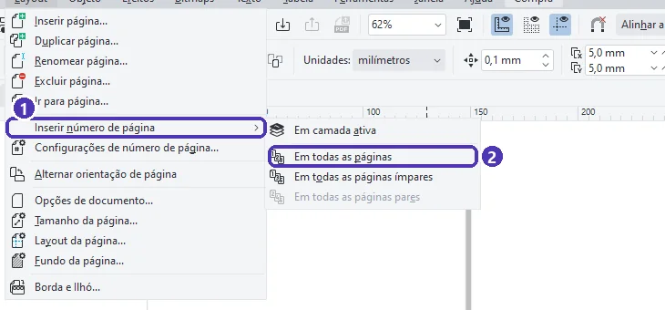
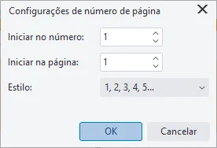
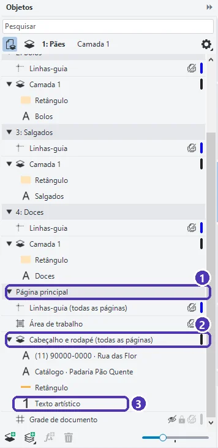
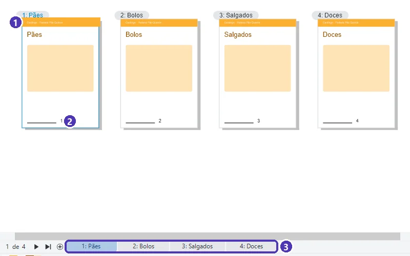

# 01 — Catálogo de várias páginas

> **Curso:** CorelDRAW  
> **Módulo:** 04 — Peças comerciais  
> **Tempo estimado:** 1 h 30 min  

---

## Objetivos

Ao final desta aula, você será capaz de:

- Montar um documento com **várias páginas** do mesmo tamanho e dar **nome** a cada uma.
- Numerar as páginas **automaticamente**.
- Usar a **página principal** para que cabeçalho e rodapé apareçam em **todas** as páginas.
- Conferir o catálogo inteiro com a **vista de várias páginas**.

## Pré-requisitos

- [Módulo 03](../modulo_03_arquivos_para_grafica/index.md) completo (sangria, PowerClip e PDF para a gráfica).

---

## O pedido

> *“Quero um catálogo de 4 páginas com os produtos da padaria: pães, bolos, salgados e doces. Em todas as páginas, o nome da padaria em cima, o telefone embaixo e o número da página.”*

Copiar o cabeçalho para cada página funciona até a primeira mudança de telefone: aí são 4 lugares para corrigir (ou 40, num catálogo grande). O CorelDRAW tem uma **página principal** (*página mestra*): o que está nela aparece em **todas** as páginas, e é corrigido **uma vez só**.

---

## Passo 1 — As páginas

1. `Ctrl + N` ➔ **A5**, **CMYK**, **Número de páginas: 4** (aula 05 do Módulo 03: escolha o tamanho e as páginas **ao criar**).
2. Dê nome às páginas: botão direito na aba ➔ **Renomear página…** ➔ *Pães*, *Bolos*, *Salgados*, *Doces*.
3. Se precisar de mais páginas depois: **Layout ➔ Inserir página…** ou **Duplicar página…** (duplicar copia também o conteúdo, ótimo para repetir a estrutura de uma página de produto). Confira o tamanho da página nova.

---

## Passo 2 — Número de página automático

**Layout ➔ Inserir número de página** ➔ **Em todas as páginas**:

<figure markdown="span">
  { loading=lazy }
  <figcaption>(1) <strong>Inserir número de página</strong> (clique no item para abrir o submenu) · (2) <strong>Em todas as páginas</strong>.</figcaption>
</figure>

O CorelDRAW coloca um número que **muda sozinho** em cada página. Arraste-o para o lugar certo (por exemplo, o canto de baixo, a 5 mm das bordas) e mude a fonte como qualquer texto.

- **Em todas as páginas ímpares / pares**: para revistas e catálogos impressos dos dois lados, com o número sempre no canto de fora.
- **Layout ➔ Configurações de número de página…** muda o começo e o estilo:

<figure markdown="span">
  { loading=lazy }
  <figcaption><strong>Iniciar no número</strong> e <strong>Iniciar na página</strong>: por exemplo, a capa sem número e a contagem começando em 1 na página 2. <strong>Estilo</strong>: números, letras ou algarismos romanos.</figcaption>
</figure>

---

## Passo 3 — Cabeçalho e rodapé na página principal

O número de página foi criado numa camada da **página principal**. Abra o painel **Objetos** e role até o fim:

<figure markdown="span">
  { loading=lazy }
  <figcaption>(1) <strong>Página principal</strong> · (2) a camada criada pelo número de página, aqui renomeada <strong>Cabeçalho e rodapé (todas as páginas)</strong> · (3) o número de página, um texto especial.</figcaption>
</figure>

1. Clique no nome da camada para que ela fique **ativa** (os próximos desenhos vão para ela). Dê um nome claro: dois cliques no nome ➔ *Cabeçalho e rodapé*.
2. Desenhe o **cabeçalho**: uma faixa laranja passando da página até a sangria, com *Catálogo · Padaria Pão Quente*.
3. Escreva o **rodapé**: telefone e endereço (inventados, no exemplo).
4. Volte a desenhar nas páginas normais clicando na camada da página (por exemplo, *Camada 1* da página *Pães*).

O resultado: as 4 páginas com o mesmo cabeçalho, o mesmo rodapé e o número certo em cada uma.

<figure markdown="span">
  { loading=lazy }
  <figcaption><strong>Exibir ➔ Vista de várias páginas</strong>: (1) o cabeçalho, desenhado <strong>uma vez</strong> na página principal · (2) o número de página, diferente em cada página.</figcaption>
</figure>

!!! tip "O que vai na página principal"
    Só o que se **repete igual** em todas as páginas: cabeçalho, rodapé, número, logotipo pequeno, fundo. O conteúdo de cada página (fotos, nomes, preços) fica nas camadas da **própria página**. Para mudar o telefone do catálogo inteiro, basta editar uma vez na página principal.

---

??? note "No Inkscape"
    - Várias páginas: ferramenta **Página** (versão 1.2 ou mais nova) ➔ botão de página nova.
    - O Inkscape não tem página principal nem número automático. Faça o cabeçalho numa página, copie (`Ctrl + C`) e use **Editar ➔ Colar no lugar** (`Ctrl + Alt + V`) nas outras; escreva os números à mão.
    - Para catálogos grandes, um programa de diagramação gratuito, o **Scribus**, tem páginas mestras e numeração automática.

---

## Exercícios

### Básico (fixação)

Crie um documento de 4 páginas A5 com os nomes *Capa*, *Pães*, *Bolos* e *Contato*, e numere todas as páginas automaticamente.

<!-- gabarito -->
??? success "Gabarito — Básico"
    `Ctrl + N` ➔ A5, 4 páginas ➔ botão direito em cada aba ➔ **Renomear página…** ➔ **Layout ➔ Inserir número de página ➔ Em todas as páginas** ➔ arraste o número para o canto. Em **Exibir ➔ Vista de várias páginas**, cada página mostra o próprio número (1 a 4).

### Intermediário (aplicação)

A capa não deve ter número, e a página *Pães* deve ser a página **1**. Como configurar?

<!-- gabarito -->
??? success "Gabarito — Intermediário"
    **Layout ➔ Configurações de número de página…** ➔ **Iniciar na página: 2** e **Iniciar no número: 1**. A ideia é a capa ficar sem número, *Pães* virar 1, *Bolos* 2 e *Contato* 3. Confira o resultado em **Exibir ➔ Vista de várias páginas**: é sempre assim que se verifica uma numeração, página por página.

### Avançado (desafio)

Ponha o **logotipo** do Módulo 02 no cabeçalho de todas as páginas e mude depois a cor do cabeçalho de laranja para marrom. Quantas vezes você precisou mudar a cor?

<!-- gabarito -->
??? success "Gabarito — Avançado"
    Com a camada da página principal **ativa**, `Ctrl + I` ➔ o logotipo (o `.cdr` ou o PDF em curvas) ➔ posicione no cabeçalho. Para mudar a cor: selecione a faixa do cabeçalho (ela está na página principal, então clique nela no painel Objetos, em *Página principal*) ➔ nova cor. **Uma vez só**: as 4 páginas mudam juntas. É essa a vantagem da página principal.

---

## 💡 Resumo

- Escolha tamanho e número de páginas **ao criar**; dê **nome** às páginas.
- **Layout ➔ Inserir número de página ➔ Em todas as páginas** cria um número automático na **página principal**.
- Cabeçalho, rodapé e número na **página principal**: aparecem em todas as páginas e são editados **uma vez**.

## ➡️ Próximo passo

Na **[aula 02](02_impressao_mesclada.md)**, uma peça com **dados diferentes em cada cópia**: crachás com o nome de cada pessoa, direto de uma planilha.
