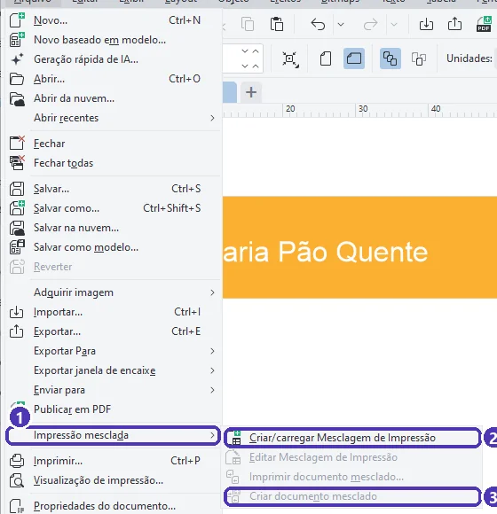
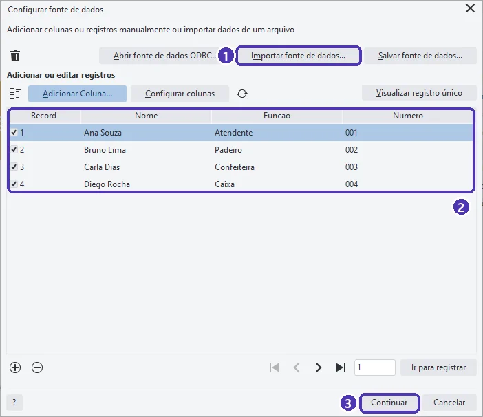
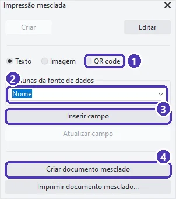
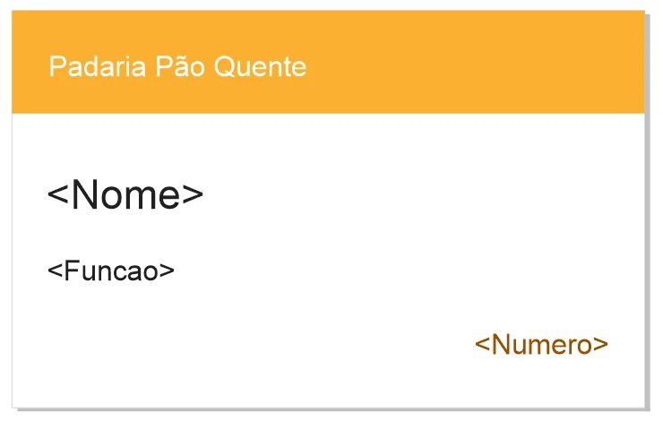
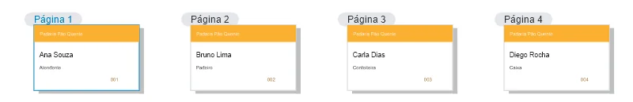

# 02 — Impressão mesclada: crachás a partir de uma planilha

> **Curso:** CorelDRAW  
> **Módulo:** 04 — Peças comerciais  
> **Tempo estimado:** 1 h 30 min  

---

## Objetivos

Ao final desta aula, você será capaz de:

- Preparar uma **planilha** (CSV) com os dados de cada cópia.
- Ligar a planilha ao desenho com a **Impressão mesclada**.
- Colocar **campos** (nome, função, número) no desenho.
- Gerar um **documento mesclado**: uma página por linha da planilha, pronta para revisar e mandar para a gráfica.

## Pré-requisitos

- [Aula 01](01_catalogo_varias_paginas.md) deste módulo.
- Saber salvar uma planilha no Excel, no LibreOffice Calc ou no Google Planilhas.

---

## O pedido

> *“Preciso de crachás para os 4 funcionários da padaria, com nome, função e um número. E no fim do ano vou fazer uma rifa com 200 bilhetes numerados.”*

Digitar 4 nomes à mão ainda dá; 200 bilhetes, não, e cada digitação é uma chance de erro. A **Impressão mesclada** junta **um desenho** (o modelo) com **uma planilha** (os dados): o CorelDRAW repete o desenho para cada linha, trocando os campos. É o mesmo princípio da mala direta do Word e da *Secretaria automática* do curso de Automação com Python.

---

## Passo 1 — A planilha

Cada **coluna** é um campo; cada **linha** é uma cópia. Os dados do exemplo são **inventados**:

```text
Nome;Funcao;Numero
Ana Souza;Atendente;001
Bruno Lima;Padeiro;002
Carla Dias;Confeiteira;003
Diego Rocha;Caixa;004
```

- No Excel: **Arquivo ➔ Salvar como ➔ CSV UTF-8**. No Excel em português, as colunas saem separadas por ponto e vírgula, como no exemplo.
- Prefira nomes de coluna **sem acento e sem espaço** (*Funcao*, *Numero*): eles viram os nomes dos campos.
- Números com zeros à esquerda (*001*): formate a coluna como **Texto** antes de digitar; senão a planilha transforma *001* em *1*.

!!! warning "Dados pessoais"
    Crachás e listas de clientes têm **dados pessoais**. Use só o necessário (nome e função num crachá; nada de CPF), guarde a planilha num lugar seguro e apague as cópias de teste. Para treinar, use dados inventados.

---

## Passo 2 — O modelo e a fonte de dados

Desenhe o crachá **uma vez** (86 × 54 mm, o tamanho de um cartão), com tudo o que é igual em todos: fundo, nome da padaria, logotipo. Depois, **Arquivo ➔ Impressão mesclada**:

<figure markdown="span">
  { loading=lazy }
  <figcaption>(1) <strong>Impressão mesclada</strong> · (2) <strong>Criar/carregar Mesclagem de Impressão</strong>, para começar · (3) <strong>Criar documento mesclado</strong>, que só fica disponível depois.</figcaption>
</figure>

Na janela **Configurar fonte de dados**, clique em **Importar fonte de dados…** e escolha o CSV:

<figure markdown="span">
  { loading=lazy }
  <figcaption>(1) <strong>Importar fonte de dados…</strong> · (2) cada linha da planilha é um <strong>registro</strong>, com uma caixa para incluir ou deixar de fora · (3) <strong>Continuar</strong>.</figcaption>
</figure>

O CorelDRAW leu o ponto e vírgula e os acentos sem nenhuma configuração. Confira a tabela: se as colunas vierem todas juntas numa só, o separador do arquivo é outro (salve de novo como CSV UTF-8).

---

## Passo 3 — Inserir os campos

Depois de **Continuar**, aparece a janela flutuante **Impressão mesclada**:

<figure markdown="span">
  { loading=lazy }
  <figcaption>(1) o campo pode virar <strong>texto</strong>, <strong>imagem</strong> ou <strong>QR code</strong> · (2) a coluna da planilha · (3) <strong>Inserir campo</strong> · (4) <strong>Criar documento mesclado</strong>.</figcaption>
</figure>

Para cada coluna: escolha na lista **Colunas da fonte de dados** ➔ **Inserir campo**. O campo entra no desenho como um texto entre os sinais `<` e `>`. Mova, aumente e pinte como qualquer texto:

<figure markdown="span">
  { loading=lazy }
  <figcaption>O modelo com os campos <code>&lt;Nome&gt;</code>, <code>&lt;Funcao&gt;</code> e <code>&lt;Numero&gt;</code>.</figcaption>
</figure>

!!! tip "Deixe espaço para o nome maior"
    O campo mostra o **nome da coluna**, mas cada cópia terá um texto de tamanho diferente. Pense no nome **mais comprido** da planilha (*Maria Aparecida dos Santos*) e deixe espaço para ele, ou reduza a letra.

A janela também tem a opção **QR code**: cada cópia ganha um código diferente, com o conteúdo da coluna escolhida (por exemplo, um link de cada vendedor).

---

## Passo 4 — Criar o documento mesclado

Clique em **Criar documento mesclado**. O CorelDRAW abre um **documento novo**, com **uma página por registro**:

<figure markdown="span">
  { loading=lazy }
  <figcaption>Quatro crachás, gerados a partir de um modelo e quatro linhas da planilha.</figcaption>
</figure>

- **Revise** página por página: nomes longos, acentos, números. Corrigir uma página do documento mesclado não muda a planilha: para erros nos dados, corrija a planilha e gere de novo.
- Para mandar à gráfica: **Arquivo ➔ Publicar em PDF** do documento mesclado, como no Módulo 03 (sangria, marcas, autor). A gráfica imprime e corta.
- **Imprimir documento mesclado…** manda direto para a impressora, sem criar o documento. Prefira criar o documento antes: dá para conferir tudo.

---

??? note "No Inkscape"
    - O Inkscape não tem impressão mesclada embutida. Existe uma extensão gratuita (*Next Generator*) que faz algo parecido a partir de um CSV.
    - Outra saída gratuita: a mala direta do **LibreOffice Writer**, ou um script como os do curso **Automação com Python** (certificados e crachás a partir de planilha).

---

## Exercícios

### Básico (fixação)

Crie a planilha de exemplo, salve como CSV e gere os 4 crachás com nome e função.

<!-- gabarito -->
??? success "Gabarito — Básico"
    Planilha com as colunas *Nome*, *Funcao* e *Numero* ➔ **Salvar como ➔ CSV UTF-8**. No CorelDRAW: modelo de 86 × 54 mm ➔ **Arquivo ➔ Impressão mesclada ➔ Criar/carregar** ➔ **Importar fonte de dados…** ➔ **Continuar** ➔ insira *Nome* e *Funcao* ➔ **Criar documento mesclado**. Resultado: um documento de 4 páginas.

### Intermediário (aplicação)

Faça **bilhetes de rifa** numerados de 001 a 020, sem digitar os números um por um.

<!-- gabarito -->
??? success "Gabarito — Intermediário"
    Na planilha, coluna **Numero** formatada como **Texto**: digite *001* e *002*, selecione as duas células e arraste a alça para baixo até *020* (a planilha continua a sequência). Salve em CSV. No CorelDRAW, um modelo de bilhete com o campo `<Numero>` (e, se quiser, o mesmo número no canhoto, inserindo o campo duas vezes) ➔ **Criar documento mesclado**: 20 páginas, uma por bilhete. Rifas e sorteios podem precisar de autorização legal: confira as regras antes de vender bilhetes de verdade.

### Avançado (desafio)

Os crachás têm 86 × 54 mm, e a gráfica imprime em folhas A4. Como você mandaria os 4 crachás para a gráfica?

<!-- gabarito -->
??? success "Gabarito — Avançado"
    O mais simples é mandar o **PDF do documento mesclado**, uma página por crachá, com sangria e marcas de corte: a gráfica faz a **montagem** (encaixa vários na folha) com o programa dela. Pergunte antes: algumas pedem o arquivo **já montado** na folha. Nesse caso, combine o tamanho da folha e o espaço entre os crachás e monte um documento A4 com os crachás lado a lado (copiando de cada página do documento mesclado e usando **Objeto ➔ Alinhar e distribuir**), cada um com as suas marcas de corte.

---

## 💡 Resumo

- **Impressão mesclada** = um modelo + uma planilha (CSV): uma cópia por linha.
- **Importar fonte de dados…** ➔ **Inserir campo** para cada coluna ➔ **Criar documento mesclado**.
- Revise o documento mesclado e publique o PDF como no Módulo 03. Dados pessoais: só o necessário.

## ➡️ Próximo passo

Na **[aula 03](03_post_para_redes.md)**, peças para a **tela**: post e story para as redes sociais.
