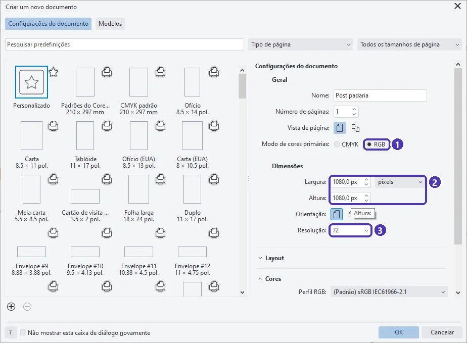
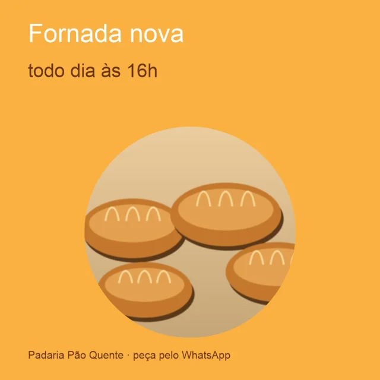
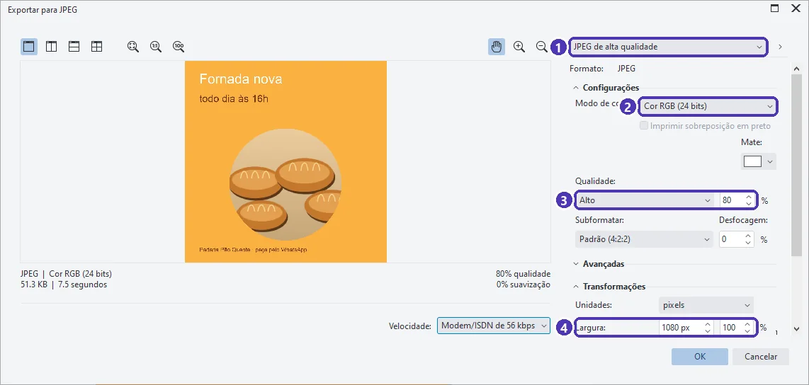

# 03 — Post e story para as redes sociais

> **Curso:** CorelDRAW  
> **Módulo:** 04 — Peças comerciais  
> **Tempo estimado:** 1 h  

---

## Objetivos

Ao final desta aula, você será capaz de:

- Criar um documento para **tela**: **RGB** e medido em **pixels**.
- Usar os tamanhos certos de **post** e **story**.
- **Exportar** em JPG (fotos e fundos) e PNG (transparência), no tamanho exato.

## Pré-requisitos

- [Aula 02](02_impressao_mesclada.md) deste módulo e a [aula 01 do Módulo 03](../modulo_03_arquivos_para_grafica/01_cores_para_impressao.md) (RGB × CMYK).

---

## O pedido

> *“Quero um post para o Instagram avisando da fornada das 16h, com a mesma cara do panfleto.”*

No Módulo 03, tudo era para **papel**: CMYK, milímetros, sangria, PDF. Para a **tela**, as regras mudam:

| | Impressão (Módulo 03) | Tela (esta aula) |
|---|---|---|
| Cores | CMYK | **RGB** |
| Medida | milímetros | **pixels** |
| Sangria | sim | não |
| Arquivo final | PDF | **JPG** ou **PNG** |

### Tamanhos mais usados

| Peça | Pixels | Proporção |
|---|---|---|
| Post quadrado | 1080 × 1080 | 1:1 |
| Post em pé (retrato) | 1080 × 1350 | 4:5 |
| Story, Reels, status | 1080 × 1920 | 9:16 |

Os tamanhos das redes mudam de tempos em tempos: confira na central de ajuda da rede antes de um trabalho importante.

---

## Passo 1 — Documento em RGB e pixels

`Ctrl + N`, e nesta ordem:

<figure markdown="span">
  { loading=lazy }
  <figcaption>(1) <strong>RGB</strong> · (2) unidade <strong>pixels</strong>, largura e altura <strong>1080</strong> · (3) <strong>Resolução</strong>: escolha <strong>antes</strong> de digitar os pixels.</figcaption>
</figure>

!!! warning "Resolução primeiro, pixels depois"
    Ao testar esta aula, os **1080 px** viraram **259,2 px** quando a resolução foi trocada de 300 para 72 dpi **depois**: o CorelDRAW guarda o tamanho em milímetros e recalcula os pixels. Por isso: escolha a unidade **pixels**, depois a **resolução**, e só então digite **1080**. Confira os números antes de clicar em OK.

---

## Passo 2 — A arte

A arte usa o que você já sabe: fundo do tamanho da página (sem sangria), textos, a foto num **PowerClip** circular (Módulo 03, aula 03) e o logotipo. Para a tela:

- **Texto grande**: o post é visto num celular, muitas vezes de passagem. Poucas palavras, letras grossas.
- **Nada importante colado na borda**: algumas telas cortam um pouco do post nas miniaturas.
- No **story**, deixe o texto longe do alto e do pé da tela, onde o aplicativo põe o nome do perfil e o campo de resposta.
- As cores da marca têm um equivalente **RGB** (ou um código hexadecimal, como `#FBB141`), que aparece na janela **Editar preenchimento** (Módulo 03, aula 01).

<figure markdown="span">
  { loading=lazy }
  <figcaption>O post de 1080 × 1080 px, exportado em JPG.</figcaption>
</figure>

---

## Passo 3 — Exportar

**Arquivo ➔ Exportar** (`Ctrl + E`) ➔ escolha a pasta e o nome ➔ **Tipo: JPG** ➔ **Exportar**:

<figure markdown="span">
  { loading=lazy }
  <figcaption>(1) a predefinição · (2) <strong>Modo de cor: Cor RGB (24 bits)</strong> · (3) <strong>Qualidade</strong>: 80% é um bom equilíbrio · (4) <strong>Largura</strong>: confira os <strong>1080 px</strong>.</figcaption>
</figure>

| Formato | Quando usar |
|---|---|
| **JPG** | Posts com foto ou fundo colorido. Arquivo pequeno; não tem transparência. |
| **PNG** | Logotipo com fundo transparente, artes com pouco texto e cor chapada (fica mais nítido). Arquivo maior. |

Embaixo da prévia, a janela mostra o **tamanho do arquivo** (no teste, cerca de 50 KB): ótimo para mandar pelo WhatsApp e postar.

---

??? note "No Inkscape"
    - **Arquivo ➔ Propriedades do documento** ➔ unidade **px**, 1080 × 1080. O Inkscape já trabalha em RGB.
    - Exportar: **Arquivo ➔ Exportar** (`Ctrl + Shift + E`) ➔ **Página** ➔ confira 1080 px ➔ formato **PNG** ou **JPG** ➔ **Exportar**.

---

## Exercícios

### Básico (fixação)

Crie um documento para **story** em RGB e pixels. Qual é o tamanho?

<!-- gabarito -->
??? success "Gabarito — Básico"
    `Ctrl + N` ➔ **RGB** ➔ unidade **pixels** ➔ resolução ➔ **1080 × 1920** (largura × altura, em pé). Confira os números depois de mudar a resolução.

### Intermediário (aplicação)

Transforme o post quadrado num **story**, sem refazer a arte do zero.

<!-- gabarito -->
??? success "Gabarito — Intermediário"
    Crie o documento de 1080 × 1920 e copie os objetos do post (`Ctrl + C` e `Ctrl + V`). O fundo precisa crescer até a nova altura; os textos e a foto são reorganizados **na vertical**, com o texto principal no meio da tela, longe do alto e do pé. Exporte em JPG com 1080 px de largura.

### Avançado (desafio)

O cliente pediu o **mesmo** aviso para o panfleto impresso e para o post. O que muda entre os dois arquivos?

<!-- gabarito -->
??? success "Gabarito — Avançado"
    | | Panfleto | Post |
    |---|---|---|
    | Documento | CMYK, mm, A5 com 3 mm de sangria | RGB, px, 1080 × 1080 |
    | Cores | valores CMYK da marca | valores RGB ou hex da marca |
    | Foto | 300 dpi no tamanho impresso | basta cobrir os 1080 px |
    | Texto | pode ter mais informação | poucas palavras, letra grande |
    | Arquivo | PDF/X para a gráfica | JPG ou PNG |

    Copiar os objetos de um documento para o outro economiza tempo, mas **o documento** (modo de cor, unidade, tamanho) é sempre criado do jeito certo para cada um.

---

## 💡 Resumo

- Tela = **RGB** + **pixels**, sem sangria. Post 1080 × 1080, retrato 1080 × 1350, story 1080 × 1920.
- No documento novo: unidade **pixels** ➔ **resolução** ➔ só então os **1080 px**.
- **JPG** para fotos e fundos; **PNG** para transparência e cores chapadas. Confira a largura na hora de exportar.

## ➡️ Próximo passo

Na **[aula 04](04_faixa_e_qr_code.md)**, uma peça **enorme**, a faixa em lona, e um **QR code** gerado no próprio CorelDRAW.
