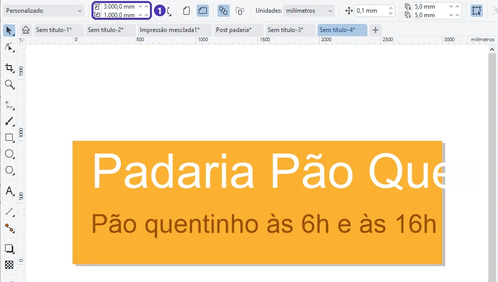
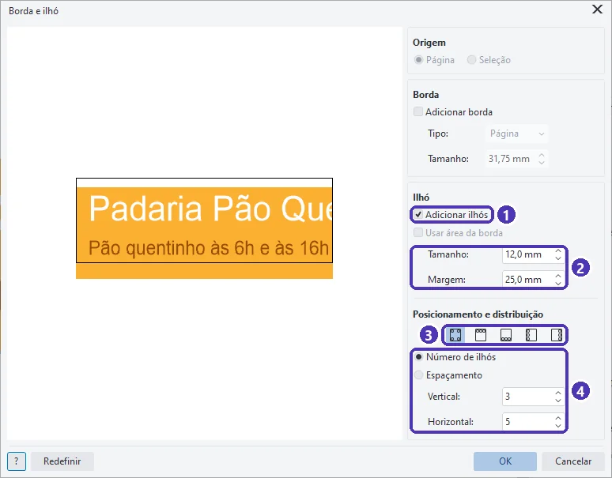
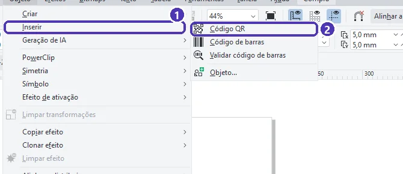
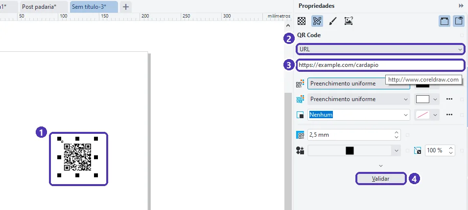
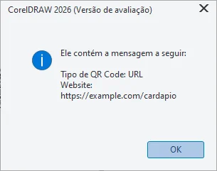

# 04 — Faixa em lona e QR code

> **Curso:** CorelDRAW  
> **Módulo:** 04 — Peças comerciais  
> **Tempo estimado:** 1 h 30 min  

---

## Objetivos

Ao final desta aula, você será capaz de:

- Montar uma **faixa em lona** no tamanho real e pensar no que muda numa peça grande.
- Marcar os **ilhós** com **Layout ➔ Borda e ilhó**.
- Criar, configurar e **validar** um **QR code** no próprio CorelDRAW.

## Pré-requisitos

- Aulas [01](01_catalogo_varias_paginas.md) a [03](03_post_para_redes.md) deste módulo.

---

## O pedido

> *“Quero uma faixa de 3 × 1 m para a frente da loja e um cartaz no balcão com um QR code que leve ao cardápio.”*

---

## Parte 1 — A faixa em lona

### Tamanho real

Uma página de **3.000 × 1.000 mm** funciona normalmente no CorelDRAW: a faixa pode ser feita no **tamanho real**, com o zoom bem baixo.

<figure markdown="span">
  { loading=lazy }
  <figcaption>(1) A página no tamanho da lona: <strong>3.000 × 1.000 mm</strong>. O título ainda passa da borda: no tamanho real, é fácil errar a proporção, e a vista da página inteira (<code>Shift + F4</code>) ajuda a conferir.</figcaption>
</figure>

O que muda numa peça grande:

| Ponto | Faixa em lona | Cartão ou panfleto |
|---|---|---|
| Distância de leitura | Vista de **longe** (metros) | Na mão |
| Texto | **Pouquíssimas** palavras, letras enormes | Pode ter mais texto |
| Resolução das fotos | Em geral 100 a 150 dpi no tamanho final bastam (pergunte à gráfica) | 300 dpi |
| Acabamento | **Ilhós** (argolas para amarrar), bainha, bastão | Corte |
| Sangria e margem | A gráfica diz quanto: em lona, a margem de segurança costuma ser maior | 3 mm e 5 mm |

Algumas gráficas preferem receber faixas grandes em **escala** (por exemplo, 1:10, a faixa de 3 m desenhada com 300 mm). Pergunte antes: se for em escala, as fotos precisam ter 10 vezes mais dpi no arquivo.

### Os ilhós

**Layout ➔ Borda e ilhó…** marca onde vão as argolas:

<figure markdown="span">
  { loading=lazy }
  <figcaption>(1) <strong>Adicionar ilhós</strong> · (2) <strong>Tamanho</strong> do ilhó e <strong>Margem</strong> (distância da borda) · (3) onde: cantos, lados, todos · (4) <strong>Número de ilhós</strong> na vertical e na horizontal (ou o espaçamento).</figcaption>
</figure>

- Pergunte à gráfica o **espaçamento** dos ilhós; muitas usam um a cada 50 cm, mais os cantos.
- **Adicionar borda** cria uma faixa em volta da arte (para a bainha ou o acabamento), se a gráfica pedir.

!!! warning "O OK cria um documento novo"
    Ao testar, o **OK** do *Borda e ilhó* **abriu um documento novo**, com os ilhós numa camada chamada **Borda e ilhó**; o documento original continuou sem eles. Trabalhe e salve no documento novo (ou refaça os ilhós no final), para não mandar à gráfica o arquivo errado.

<figure markdown="span">
  { loading=lazy }
  <figcaption>(1) A marca do <strong>ilhó</strong>, a 25 mm das bordas. Mantenha textos e logotipos longe dessas marcas.</figcaption>
</figure>

---

## Parte 2 — QR code

### Criar

**Objeto ➔ Inserir ➔ Código QR**:

<figure markdown="span">
  { loading=lazy }
  <figcaption>(1) <strong>Inserir</strong> · (2) <strong>Código QR</strong>. No mesmo lugar ficam o código de barras e a validação.</figcaption>
</figure>

O QR code aparece na página, e o painel **Propriedades** mostra as opções:

<figure markdown="span">
  { loading=lazy }
  <figcaption>(1) o QR code · (2) o <strong>tipo</strong> de conteúdo · (3) o conteúdo: aqui, o endereço do cardápio · (4) <strong>Validar</strong>.</figcaption>
</figure>

| Tipo | Ao escanear, o celular… |
|---|---|
| **URL** | Abre um site (cardápio, loja, formulário) |
| **Endereço de e-mail** / **SMS** / **Telefone** | Abre o e-mail, a mensagem ou a ligação já preenchidos |
| **Contato** | Oferece salvar um contato (vCard) |
| **Evento de calendário** / **Localização geográfica** | Cria o evento / abre o mapa |
| **Texto simples** | Mostra um texto |

No exemplo, o endereço é `https://example.com/cardapio`, um domínio **reservado para exemplos**. Num trabalho real, use o endereço de verdade e **teste**.

### Validar e testar

**Validar** lê o código desenhado e mostra o que ele contém:

<figure markdown="span">
  { loading=lazy }
  <figcaption>A validação confere o conteúdo. Mesmo assim, teste com a <strong>câmera de um celular</strong>, no tamanho em que vai ser impresso.</figcaption>
</figure>

Para o QR code funcionar no impresso:

- **Contraste**: escuro sobre claro (preto ou marrom sobre branco). QR claro sobre fundo escuro, ou colorido demais, muitos celulares não leem.
- **Tamanho**: no balcão, pelo menos uns **2 a 3 cm**; numa faixa vista de longe, bem maior. Teste impresso.
- **Margem em volta**: deixe uma área livre (sem texto nem desenho) em volta do código.
- Escreva **o que o código faz** perto dele (“Aponte a câmera e veja o cardápio”).

!!! danger "QR code também engana"
    Golpistas colam QR codes falsos por cima dos verdadeiros (em cartazes, maquininhas e mesas de restaurante). Num cartaz da sua loja, prefira um endereço **curto e reconhecível** escrito embaixo do código, para o cliente conferir. Veja o curso [Segurança digital](../../seguranca_digital/docs/index.md).

---

??? note "No Inkscape"
    - QR code: **Extensões ➔ Renderizar ➔ Códigos de barras ➔ Código QR**, com o texto ou o endereço.
    - Ilhós: desenhe círculos pequenos (`F5` ou `E`) e distribua com **Objeto ➔ Alinhar e distribuir**.

---

## Exercícios

### Básico (fixação)

Crie um QR code do tipo **Telefone** com o número `(11) 90000-0000` e valide.

<!-- gabarito -->
??? success "Gabarito — Básico"
    **Objeto ➔ Inserir ➔ Código QR** ➔ no painel Propriedades, tipo **Telefone** ➔ digite o número ➔ **Validar**. A mensagem mostra o tipo e o número. Ao escanear, o celular oferece ligar para ele.

### Intermediário (aplicação)

Faça um **cartaz A4** para o balcão com o título “Veja o cardápio”, um QR code de 4 cm do tipo URL e o endereço escrito embaixo.

<!-- gabarito -->
??? success "Gabarito — Intermediário"
    Documento A4 em CMYK com sangria ➔ título grande ➔ QR code ➔ na barra de propriedades, **40 × 40 mm** (com o cadeado de proporção fechado) ➔ uma área branca em volta ➔ endereço em texto embaixo ➔ **Validar** ➔ PDF para a gráfica (Módulo 03). Imprima um teste numa impressora comum e escaneie com dois celulares diferentes.

### Avançado (desafio)

A padaria vai mudar o site no mês que vem, e já há 500 cartazes impressos com o QR code. O que poderia ter sido feito para não perder os cartazes?

<!-- gabarito -->
??? success "Gabarito — Avançado"
    Apontar o QR code para um endereço que a **padaria controla e pode redirecionar** (por exemplo, `padariapaoquente.com.br/cardapio`, que depois leva ao lugar certo), em vez do endereço final, que muda. Serviços de “QR code dinâmico” fazem isso, mas muitos são pagos ou somem com o tempo; um endereço no domínio da própria empresa é mais seguro. Lição: o QR code é **impresso**; o endereço dentro dele precisa durar tanto quanto o papel.

---

## 💡 Resumo

- Faixa: dá para fazer no **tamanho real**; pouco texto, letras enormes, fotos com os dpi que a gráfica indicar.
- **Layout ➔ Borda e ilhó** marca os ilhós, num **documento novo**.
- **Objeto ➔ Inserir ➔ Código QR**: escolha o tipo, preencha, **Validar** e teste com o celular, no tamanho real, com contraste e margem.

## ➡️ Próximo passo

Na **[aula 05](05_projeto_kit_lancamento.md)**, o projeto: o **kit de lançamento** da padaria, com todas as peças do módulo.
