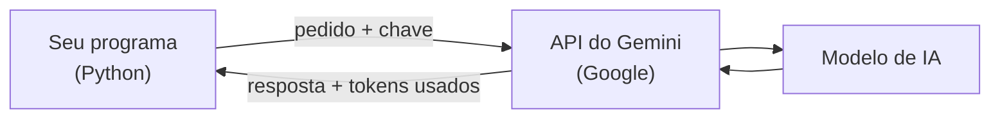

# 01 — O que é uma API de IA

> **Curso:** IA na prática com Python  
> **Módulo:** 01 — Conversando com um modelo por API  
> **Tempo estimado:** 1 h 30 min  

---

## 🎯 Objetivos

Ao final desta aula, você será capaz de:

- Explicar o que são **modelo**, **API**, **chave de API** e **tokens**.
- Entender os **limites** e a **privacidade** do plano gratuito, e a regra de **idade**.
- Escolher o seu caminho no curso: **com chave** (18 anos ou mais) ou **sem chave** (motor simulado).
- Preparar o projeto: ambiente virtual, bibliotecas, **`.env`** e **`.gitignore`**.

## Pré-requisitos

- Python básico ([Módulo 01 de Python para Desktop](../../python_para_desktop/modulo_01_fundamentos/index.md)) e ambiente virtual ([Automação com Python, Módulo 02](../../automacao_com_python/modulo_02_planilhas/01_ler_planilhas.md#o-ambiente-virtual-e-o-openpyxl)).
- Recomendado: o curso [Introdução à IA](../../introducao_a_ia/docs/index.md), que explica o que a IA faz (e não faz) e como usá-la com responsabilidade.

---

## Do site para o seu programa

Quando você usa um assistente de IA no site, **você** digita e lê. Com uma **API**, quem pergunta e lê a resposta é o **seu programa**. Isso permite usar a IA **dentro** das suas automações: resumir 30 textos de uma vez, classificar mensagens de clientes, extrair dados de documentos.



| Palavra | O que é |
|---|---|
| **Modelo** | O "cérebro" que gera o texto (por exemplo, `gemini-3.8-flash`). Há modelos mais rápidos e baratos e outros mais capazes. |
| **API** | A "porta" pela qual o programa conversa com o modelo, pela internet. |
| **Chave de API** | A **senha do seu programa**: identifica quem usa, controla os limites e, nos planos pagos, a cobrança. |
| **Token** | O pedacinho de texto que o modelo lê e escreve (em português, mais ou menos 3 a 4 letras). Limites e preços são contados em tokens, **de entrada** (o que você manda) e **de saída** (o que ele responde). |

!!! danger "A chave é uma senha"
    Nunca coloque a chave no código, em prints, em mensagens ou no GitHub. Quem tem a sua chave usa a API **em seu nome**. Se vazar, apague a chave no site onde foi criada e crie outra.

## O plano gratuito: limites, privacidade e idade

Este curso usa o **Gemini**, do Google, o mesmo do mini-assistente da [Introdução à IA](../../introducao_a_ia/modulo_05_projeto_mini_assistente/03_conectando_a_uma_api.md).

- **Limites:** o plano gratuito tem um número máximo de pedidos e de tokens **por minuto** e **por dia**. Quando acabam, a API responde com o erro **429** até renovar. Os números mudam com o tempo e por modelo: veja os seus no **Google AI Studio**.
- **Privacidade:** pelos termos conferidos em outubro de 2026, no plano gratuito o Google **pode usar** as mensagens para melhorar os produtos, e elas **podem ser lidas** por revisores. Por isso, **nada de dados pessoais** (nomes de alunos, notas, telefones, documentos) nos pedidos. O Módulo 04 trata disso em detalhe.
- **Idade:** criar a chave exige **18 anos ou mais** (termos do Google). Quem tem menos de 18 faz o curso inteiro pelo **caminho sem chave** (abaixo).

!!! info "Os nomes dos modelos mudam"
    `gemini-3.8-flash` é o modelo usado na documentação oficial em novembro de 2026. As empresas lançam modelos novos e aposentam os antigos com frequência: se aparecer o erro de modelo não encontrado, confira o nome atual na documentação e troque **só** a linha `GEMINI_MODELO` do `.env`.

## Os dois caminhos do curso

| | **Com chave** (18+) | **Sem chave** (qualquer idade) |
|---|---|---|
| Como | Chave própria do Google AI Studio no `.env` | **Motor simulado** e **cliente falso**, que imitam a API sem internet |
| Respostas | Do modelo de verdade | Simples, mas o programa funciona igual |
| Custo e limites | Plano gratuito, com limites | Nenhum |
| Serve para | Ver a IA de verdade | Aprender a programar com a API e **testar** tudo |

Todos os programas do curso funcionam nos **dois** caminhos. E mesmo quem tem chave usa o caminho sem chave para **testar**: não gasta a cota e não depende da internet. É assim que os exemplos do curso foram testados.

## Preparando o projeto

Numa pasta nova (por exemplo, `C:\IA`), no terminal do VS Code:

```powershell
python -m venv .venv
.venv\Scripts\activate
python -m pip install google-genai==2.34.0 python-dotenv==1.2.1
```

Crie o **`.gitignore`**, para o Git nunca enviar o `.env` nem o ambiente virtual:

```text
.env
.venv/
__pycache__/
```

### Com chave: o `.env`

1. Entre no **Google AI Studio** (`aistudio.google.com`) com a sua conta Google pessoal e aceite os termos.
2. Procure **Get API key** / **Criar chave de API** e copie a chave.
3. Crie o arquivo **`.env`** na pasta do projeto:

```ini
GEMINI_API_KEY=cole-aqui-a-sua-chave
GEMINI_MODELO=gemini-3.8-flash
```

Sem chave? Não crie o `.env`: os programas percebem e usam o caminho sem chave.

---

## ⚠️ Erros comuns

- **Chave no código** "só para testar": acaba indo para o GitHub. Sempre no `.env`.
- **`ModuleNotFoundError: No module named 'google'`**: o ambiente virtual não está ativado, ou a biblioteca instalada foi outra. O pacote é **`google-genai`**.
- **Dados pessoais nos pedidos** do plano gratuito.
- **Usar a chave de outra pessoa** (ou emprestar a sua): os limites e a responsabilidade são de quem criou.

---

## Exercícios

### Básico (fixação)

Estime quantos **tokens** tem a frase *"Resuma o texto abaixo em duas frases, sem inventar informações."*, usando a regra de **4 caracteres por token**. Escreva uma função `estimar_tokens(texto)` para fazer a conta.

<!-- gabarito -->
??? success "Gabarito — Básico"
    ```python
    def estimar_tokens(texto: str) -> int:
        """Estimativa grosseira: cerca de 4 caracteres por token em português."""
        return max(1, round(len(texto) / 4))


    frase = "Resuma o texto abaixo em duas frases, sem inventar informações."
    estimativa = estimar_tokens(frase)
    print(f"{len(frase)} caracteres, cerca de {estimativa} tokens")
    ```

    São 63 caracteres, cerca de **16 tokens**. É só uma estimativa: cada modelo divide o texto do seu jeito, e a contagem exata vem na resposta da API ([aula 02](02_primeira_chamada.md)).

### Intermediário (aplicação)

Escreva o `conferir_ambiente.py`, que diz qual caminho do curso vai ser usado: mostra **"Com chave: modelo X"** se houver `GEMINI_API_KEY` no `.env`, ou **"Sem chave: motor simulado"** se não houver. Nunca mostre a chave.

<!-- gabarito -->
??? success "Gabarito — Intermediário"
    ```python
    import os

    from dotenv import load_dotenv

    load_dotenv()
    chave = os.getenv("GEMINI_API_KEY", "")
    if chave:
        caminho = f"Com chave: modelo {os.getenv('GEMINI_MODELO', 'gemini-3.8-flash')}"
    else:
        caminho = "Sem chave: motor simulado"
    print(caminho)
    print(f"Chave: {'*' * 8 if chave else '(nenhuma)'}")
    ```

    A chave aparece como `********`: dá para saber que ela existe sem expor o valor.

### Avançado (desafio)

Uma empresa quer usar IA para responder automaticamente às mensagens de clientes que chegam com nome, CPF e endereço. Liste **três cuidados** antes de mandar essas mensagens para uma API no plano gratuito.

<!-- gabarito -->
??? success "Gabarito — Avançado"
    1. **Termos do plano:** no gratuito, as mensagens podem ser usadas e lidas pelo provedor. Para dados de clientes, é preciso um plano pago com termos de privacidade adequados, ou não usar a API.
    2. **Tirar os dados pessoais antes** (nome, CPF, endereço): mandar só o necessário para a tarefa ("o cliente pergunta sobre o prazo de entrega").
    3. **LGPD:** a empresa precisa ter uma base legal e informar os clientes de que usa um serviço externo; e uma pessoa deve revisar respostas importantes, porque a IA pode errar.

    O Módulo 04 do curso trata desses cuidados com exemplos em código.

---

## 💡 Resumo

- **API** = porta para o seu programa usar o modelo; **chave** = senha do programa; **tokens** = a medida de uso.
- Plano gratuito: **limites** (erro 429), mensagens **podem ser lidas**, chave só para **18+**.
- Dois caminhos: **com chave** e **sem chave** (motor simulado e cliente falso). Todo programa do curso funciona nos dois.
- `pip install google-genai python-dotenv`; chave e modelo no **`.env`**, protegido pelo **`.gitignore`**.

## ➡️ Próximo passo

**[02 — A primeira chamada](02_primeira_chamada.md)**.
