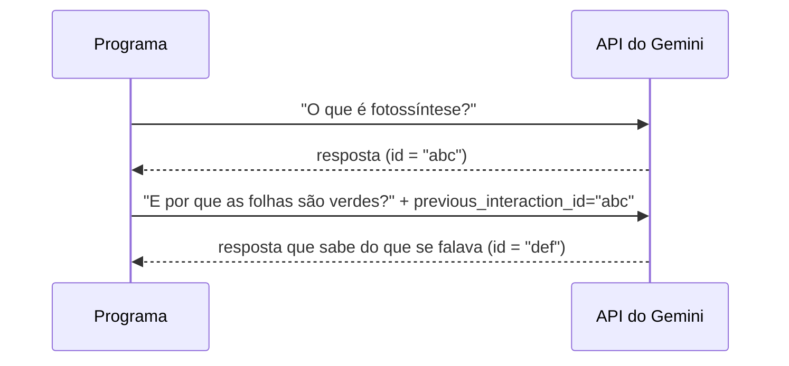

# 04 — Conversa com memória e motores

> **Curso:** IA na prática com Python  
> **Módulo:** 01 — Conversando com um modelo por API  
> **Tempo estimado:** 1 h 30 min  

---

## 🎯 Objetivos

Ao final desta aula, você será capaz de:

- Fazer a IA **lembrar** da conversa com `previous_interaction_id`.
- Organizar o programa com **motores** que têm o mesmo "jeito": o do Gemini e o **simulado**.
- Escrever um motor simulado que **resume** um texto sem IA nenhuma.
- Montar uma **conversa no terminal**, com comando para começar de novo e a conta de tokens.

## Pré-requisitos

- [Aula 03](03_instrucoes_e_ajustes.md): instruções de sistema e `thinking_level`.

---

## Como a API "lembra" da conversa

Cada pedido à API é **independente**: o modelo não lembra sozinho do pedido anterior. Para continuar uma conversa, o programa manda junto o **id da resposta anterior** (`previous_interaction_id`), e a API recupera o que foi dito antes.



!!! warning "Conversa longa custa mais"
    O que veio antes continua sendo **lido** pelo modelo a cada nova mensagem, e isso conta como tokens de **entrada**. Uma conversa de 30 mensagens gasta bem mais por pergunta do que uma de 3. Por isso o comando **/nova** (esquecer a conversa) também economiza a cota.

## Dois motores, o mesmo jeito

```python title="motores.py"
"""Os dois "motores" do curso: o simulado (sem internet) e o do Gemini (com chave)."""
import re
from collections import Counter

PALAVRAS_VAZIAS = set("""a o as os um uma uns umas de da do das dos em na no nas nos por para com
sem e ou que se é são foi ser ao aos à às mais muito como mas também já não sim
seu sua seus suas ele ela eles elas isso isto esse essa este esta há""".split())


class MotorSimulado:
    """Resume escolhendo as frases mais importantes do próprio texto. Sem internet e sem chave.

    Não "entende" o texto: dá pontos para as frases que repetem as palavras mais frequentes.
    É bom para testar o programa inteiro antes de gastar a cota da API.
    """

    def __init__(self):
        self.tokens_usados = 0

    def responder(self, texto: str, frases: int = 2) -> str:
        sentencas = [s.strip() for s in re.split(r"(?<=[.!?])\s+", texto.strip()) if s.strip()]
        if len(sentencas) <= frases:
            return " ".join(sentencas)
        palavras = [p for p in re.findall(r"\w+", texto.lower()) if p not in PALAVRAS_VAZIAS and len(p) > 2]
        frequencia = Counter(palavras)

        def pontos(sentenca: str) -> float:
            termos = [p for p in re.findall(r"\w+", sentenca.lower()) if p in frequencia]
            return sum(frequencia[p] for p in termos) / (len(termos) + 1)

        melhores = sorted(range(len(sentencas)), key=lambda i: pontos(sentencas[i]), reverse=True)[:frases]
        return " ".join(sentencas[i] for i in sorted(melhores))  # na ordem original

    def nova_conversa(self):
        pass


class MotorGemini:
    """Responde com um modelo do Gemini pela API (chave própria no .env, 18 anos ou mais)."""

    def __init__(self, instrucoes: str, modelo: str, raciocinio: str = "low", cliente=None):
        if cliente is None:
            from google import genai
            cliente = genai.Client()  # lê a GEMINI_API_KEY do ambiente
        self.cliente = cliente
        self.instrucoes = instrucoes
        self.modelo = modelo
        # "minimal", "low", "medium" ou "high": quanto o modelo "pensa" antes de responder.
        # A temperatura fica no padrão, como o Google recomenda para os modelos Gemini 3.
        self.config = {"thinking_level": raciocinio}
        self.ultima = None          # id da última resposta: a "memória" da conversa
        self.tokens_usados = 0

    def responder(self, texto: str, frases: int | None = None) -> str:
        pedido = {
            "model": self.modelo,
            "input": texto if frases is None else f"Resuma em no máximo {frases} frases:\n\n{texto}",
            # As instruções e a configuração valem só para ESTE pedido: vão em todos
            "system_instruction": self.instrucoes,
            "generation_config": self.config,
        }
        if self.ultima:
            pedido["previous_interaction_id"] = self.ultima
        resposta = self.cliente.interactions.create(**pedido)
        self.ultima = resposta.id
        self.tokens_usados += resposta.usage.total_tokens
        return resposta.output_text

    def nova_conversa(self):
        self.ultima = None
```

Os dois motores têm os mesmos métodos, **`responder(texto, frases=...)`** e **`nova_conversa()`**, e o atributo **`tokens_usados`**. Quem usa um motor não precisa saber qual é: o mesmo programa roda com a IA de verdade ou com o simulado.

### O motor simulado

O `MotorSimulado` **não entende** o texto: ele faz um **resumo extrativo**, uma técnica antiga e simples.

1. Divide o texto em **frases** (pelo ponto, exclamação ou interrogação seguido de espaço).
2. Conta as **palavras** mais frequentes, ignorando as "vazias" (`de`, `que`, `para`...).
3. Dá **pontos** a cada frase pelas palavras frequentes que ela tem.
4. Pega as frases com mais pontos e devolve **na ordem original**.

Ele é ótimo para **testar** o programa inteiro (e funciona de verdade para textos informativos), mas não reescreve com outras palavras nem percebe ironia: é aí que a IA faz diferença.

### O motor do Gemini

- **`cliente=None`**: se ninguém passar um cliente, ele cria o de verdade (`genai.Client()`). Nos testes, passamos o **cliente falso** ([aula 02](02_primeira_chamada.md#testando-sem-a-api-o-cliente-falso)).
- **`self.ultima`** guarda o id da última resposta; **`nova_conversa()`** apaga, e a próxima pergunta começa do zero.
- **Instruções e `generation_config` em todo pedido**, porque valem só para aquele pedido ([aula 03](03_instrucoes_e_ajustes.md)).
- **`frases=`**: quando é um resumo, o próprio motor monta o pedido ("Resuma em no máximo 2 frases: ...").

## A conversa no terminal

```python title="conversa.py"
"""Conversa no terminal com o motor do Gemini (ou o simulado, sem chave)."""
import os

from dotenv import load_dotenv

from erros_ia import explicar_erro
from motores import MotorGemini, MotorSimulado

INSTRUCOES = ("Você é um assistente de estudos para alunos do ensino médio. Responda em português do Brasil, "
              "em até 4 frases, com um exemplo do dia a dia. Se não souber, diga que não sabe.")


def escolher_motor():
    load_dotenv()
    if os.getenv("GEMINI_API_KEY"):
        return MotorGemini(INSTRUCOES, os.getenv("GEMINI_MODELO", "gemini-3.8-flash"))
    print("(Sem GEMINI_API_KEY: usando o motor simulado, que só repete as frases principais do que você digitar.)")
    return MotorSimulado()


def conversar(motor) -> None:
    print("Digite a sua pergunta. Comandos: /nova (esquece a conversa), /sair.")
    while True:
        pergunta = input("\nVocê: ").strip()
        if not pergunta:
            continue
        if pergunta == "/sair":
            break
        if pergunta == "/nova":
            motor.nova_conversa()
            print("(Conversa nova: o assistente esqueceu o que foi dito antes.)")
            continue
        try:
            print(f"Assistente: {motor.responder(pergunta)}")
        except Exception as erro:
            print(f"(A API não respondeu: {explicar_erro(erro)})")
    print(f"\nTokens usados nesta conversa: {motor.tokens_usados}")


if __name__ == "__main__":
    conversar(escolher_motor())
```

```text
> python conversa.py
Digite a sua pergunta. Comandos: /nova (esquece a conversa), /sair.

Você: O que é fotossíntese?
Assistente: ...

Você: E por que as folhas são verdes?
Assistente: ...   ← sabe que "as folhas" são as da fotossíntese

Você: /sair

Tokens usados nesta conversa: ...
```

Sem chave, o programa avisa e usa o motor simulado, que só devolve as frases principais do que você digitou: dá para testar todo o fluxo (comandos, erros, contagem) sem a API.

---

## ⚠️ Erros comuns

- **Esquecer o `previous_interaction_id`**: a IA responde a cada pergunta como se fosse a primeira.
- **Nunca começar conversa nova**: o custo por pergunta só cresce.
- **Motores com métodos diferentes** (`responder` num, `perguntar` no outro): o programa precisa de `if` para cada um. Mantenha o mesmo jeito.
- **Criar o cliente de verdade dentro dos testes**: use `cliente=ClienteFalso(...)`.

---

## Exercícios

### Básico (fixação)

Com o `ClienteFalso`, mostre que o `MotorGemini` manda o `previous_interaction_id` na **segunda** pergunta, e que depois de `nova_conversa()` ele **não** manda mais.

<!-- gabarito -->
??? success "Gabarito — Básico"
    ```python
    from cliente_falso import ClienteFalso
    from motores import MotorGemini

    falso = ClienteFalso("Resposta.")
    motor = MotorGemini("Você é um assistente de estudos.", "gemini-3.8-flash", cliente=falso)
    motor.responder("O que é fotossíntese?")
    motor.responder("E por que as folhas são verdes?")
    motor.nova_conversa()
    motor.responder("Assunto novo.")

    ids = [p.get("previous_interaction_id") for p in falso.pedidos]
    print(ids)
    ```

    Saída: `[None, 'falso-1', None]`. A primeira pergunta não tem conversa anterior; a segunda continua a primeira; depois do `nova_conversa()`, começa do zero.

### Intermediário (aplicação)

Use o `MotorSimulado` para resumir o `texto_exemplo.txt` (do projeto, [aula 05](05_projeto_resumidor.md)) em **1**, **2** e **3** frases. O que acontece com um texto de **uma frase só**?

<!-- gabarito -->
??? success "Gabarito — Intermediário"
    ```python
    from pathlib import Path

    from motores import MotorSimulado

    texto = Path("texto_exemplo.txt").read_text(encoding="utf-8")
    motor = MotorSimulado()
    resumos = {n: motor.responder(texto, frases=n) for n in (1, 2, 3)}
    for n, resumo in resumos.items():
        print(f"{n} frase(s): {resumo}\n")
    curto = motor.responder("Uma frase só.", frases=2)
    print(curto)
    ```

    Com 2 frases saem a abertura da padaria e a parte dos salgados e encomendas. Um texto com **menos** frases do que o pedido volta **inteiro**: não há o que cortar.

### Avançado (desafio)

Crie um **terceiro motor**, o `MotorMaiusculas`, só para provar que o `conversar()` funciona com qualquer motor que tenha o mesmo jeito: ele responde repetindo a pergunta em maiúsculas. Rode o `conversar()` com ele, simulando o que o usuário digita.

<!-- gabarito -->
??? success "Gabarito — Avançado"
    ```python
    import builtins

    from conversa import conversar


    class MotorMaiusculas:
        def __init__(self):
            self.tokens_usados = 0

        def responder(self, texto: str, frases: int | None = None) -> str:
            self.tokens_usados += len(texto) // 4
            return texto.upper()

        def nova_conversa(self):
            pass


    entradas = iter(["oi, tudo bem?", "/sair"])
    builtins.input = lambda _prompt="": next(entradas)   # simula o teclado
    motor = MotorMaiusculas()
    conversar(motor)
    ```

    Saída: `Assistente: OI, TUDO BEM?` e a conta de tokens. O `conversar()` não foi alterado em nada: basta o motor ter `responder()`, `nova_conversa()` e `tokens_usados`. É assim que o curso troca o Gemini pelo simulado (e, se um dia quiser, por outro serviço de IA).

---

## 💡 Resumo

- A API não lembra sozinha: o programa manda o **`previous_interaction_id`**; **/nova** esquece (e economiza).
- **Motores com o mesmo jeito** (`responder`, `nova_conversa`, `tokens_usados`) deixam o programa independente do motor.
- O **motor simulado** faz resumo extrativo: testa o fluxo inteiro sem IA, sem chave e sem cota.

## ➡️ Próximo passo

**[05 — Projeto do módulo: resumidor de textos](05_projeto_resumidor.md)**.
