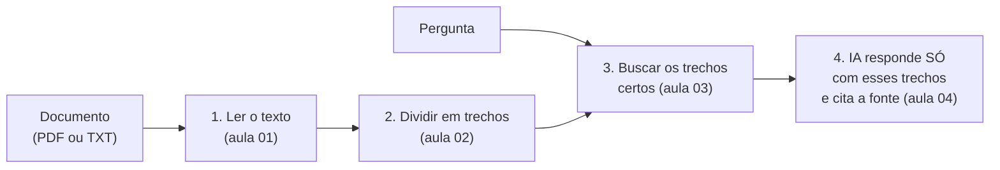

# 01 — Lendo PDF e TXT

> **Curso:** IA na prática com Python  
> **Módulo:** 03 — IA com os seus documentos  
> **Tempo estimado:** 1 h  

---

## 🎯 Objetivos

Ao final desta aula, você será capaz de:

- Entender por que a IA precisa **receber o documento** para responder sobre ele.
- Instalar o **pypdf** e ler o texto de um PDF, **página por página**.
- Ler arquivos **TXT** com o mesmo código.
- Reconhecer um **PDF escaneado** (imagem), que não tem texto para ler.

## Pré-requisitos

- [Módulo 02](../modulo_02_tarefas_uteis/index.md), com `erros_ia.py` e `cliente_falso.py` na pasta.

---

## O problema: a IA não conhece o seu documento

Pergunte a um assistente de IA "quantos livros posso pegar na biblioteca da minha escola?" e ele vai **inventar** um número plausível, porque não leu o regulamento da **sua** escola. Para responder certo, o programa precisa:



Essa técnica tem nome em inglês: **RAG** (*retrieval-augmented generation*, geração com busca). A IA não "aprende" o documento: a cada pergunta, o programa **entrega** os trechos que importam.

## Instalando e preparando

```powershell
python -m pip install pypdf==6.21.4 fpdf2==2.8.9
```

O **pypdf** lê PDFs. O **fpdf2** (do [curso de Automação](../../automacao_com_python/modulo_03_documentos_e_pdfs/02_pdf_com_fpdf2.md)) só é usado para **criar** o regulamento de treino, de uma escola inventada:

```python title="criar_regulamento.py"
"""Cria o regulamento de treino (escola inventada) em PDF, com várias páginas."""
from pathlib import Path

from fpdf import FPDF

SECOES = [
    ("1. Horários", "As aulas do turno da manhã começam às 7h10 e terminam às 12h20. As do turno da tarde "
     "começam às 13h10 e terminam às 18h20. O portão fecha 10 minutos depois do início das aulas."),
    ("2. Atrasos", "O aluno que chegar depois do fechamento do portão entra na segunda aula, com registro "
     "na coordenação. Três atrasos no mesmo bimestre geram comunicação aos responsáveis."),
    ("3. Frequência", "O aluno precisa de pelo menos 75% de presença nas aulas de cada disciplina para ser "
     "aprovado. Faltas justificadas com atestado médico não são abonadas, mas permitem a segunda chamada de avaliações."),
    ("4. Avaliação", "A média para aprovação é 6,0 em cada disciplina. O aluno com média entre 4,0 e 5,9 faz a "
     "recuperação final. Abaixo de 4,0, o aluno é reprovado na disciplina."),
    ("5. Segunda chamada", "O aluno que faltar a uma prova pode pedir a segunda chamada na secretaria em até 48 horas "
     "depois da prova, apresentando atestado ou declaração que justifique a falta."),
    ("6. Celular", "O uso do celular em sala de aula só é permitido quando o professor autorizar, para atividades "
     "da aula. Fora disso, o aparelho deve ficar desligado ou no silencioso, guardado na mochila."),
    ("7. Uniforme", "O uso da camiseta da escola é obrigatório. Em dias de educação física, o aluno deve usar "
     "tênis e roupa adequada para atividade física."),
    ("8. Biblioteca", "O aluno pode pegar até 2 livros por vez, pelo prazo de 7 dias. O empréstimo pode ser renovado "
     "uma vez, por mais 7 dias, se ninguém tiver reservado o livro. Quem atrasar a devolução fica sem novos empréstimos "
     "pelo mesmo número de dias do atraso."),
    ("9. Laboratório de informática", "O laboratório pode ser usado fora do horário de aula com agendamento na "
     "coordenação, de segunda a sexta, das 14h às 17h. É proibido instalar programas nos computadores do laboratório."),
]


def main() -> None:
    destino = Path("treino_docs") / "regulamento_escola.pdf"
    if destino.exists():
        print("O regulamento de treino já existe.")
        return
    pdf = FPDF(format="A4")
    pdf.set_auto_page_break(True, margin=20)
    pdf.add_page()
    pdf.set_font("Helvetica", "B", 16)
    pdf.cell(0, 12, "Regulamento Interno - Escola Exemplo", new_x="LMARGIN", new_y="NEXT")
    for i, (titulo, texto) in enumerate(SECOES):
        if i in (3, 6):  # algumas seções em páginas novas, como num regulamento de verdade
            pdf.add_page()
        pdf.ln(4)
        pdf.set_font("Helvetica", "B", 12)
        pdf.cell(0, 8, titulo, new_x="LMARGIN", new_y="NEXT")
        pdf.set_font("Helvetica", "", 11)
        pdf.multi_cell(0, 6, texto)
    destino.parent.mkdir(exist_ok=True)
    pdf.output(destino)
    print(f"Regulamento criado: {destino} ({pdf.pages_count} páginas)")


if __name__ == "__main__":
    main()
```

## Lendo o documento

```python title="ler_documento.py"
"""Lê o texto de um PDF (página por página) ou de um TXT."""
from pathlib import Path

from pypdf import PdfReader


def ler_paginas(caminho: Path) -> list[str]:
    """Uma string por página. TXT conta como uma página só."""
    if caminho.suffix.lower() == ".txt":
        return [caminho.read_text(encoding="utf-8")]
    if caminho.suffix.lower() != ".pdf":
        raise ValueError(f"Formato não suportado: {caminho.suffix} (use .pdf ou .txt)")
    leitor = PdfReader(caminho)
    return [pagina.extract_text() or "" for pagina in leitor.pages]


if __name__ == "__main__":
    paginas = ler_paginas(Path("treino_docs") / "regulamento_escola.pdf")
    for numero, texto in enumerate(paginas, start=1):
        print(f"--- página {numero}: {len(texto)} caracteres ---")
        print(texto[:200], "...\n")
    if not any(p.strip() for p in paginas):
        print("Nenhum texto encontrado: o PDF pode ser uma imagem escaneada.")
```

```text
--- página 1: 617 caracteres ---
Regulamento Interno - Escola Exemplo
1. Horários
As aulas do turno da manhã começam às 7h10 e terminam às 12h20. As do turno da tarde começam às
13h10 e terminam às 18h20. O portão fecha 10 minutos de ...
```

- `PdfReader(caminho).pages` é a lista de páginas; `pagina.extract_text()` devolve o texto da página.
- O **número da página** é guardado (a posição na lista): é ele que vai aparecer na **citação** da resposta.
- TXT entra como uma página só, então o resto do programa funciona igual para os dois formatos.

!!! warning "Repare nas quebras de linha"
    O texto vem com as linhas do jeito que estavam **na folha**: "começam às" numa linha e "13h10" na seguinte. Para a busca e para a IA, isso precisa ser juntado ([aula 02](02_dividir_em_trechos.md)).

!!! info "PDF escaneado não tem texto"
    Se o PDF for a **foto** de um documento (escaneado), o `extract_text()` devolve vazio: não há letras, só imagem. O script avisa. Para esses casos existe o **OCR** (reconhecimento de texto em imagens), que fica fora deste módulo. Antes de tudo, tente achar a versão digital do documento.

---

## ⚠️ Erros comuns

- **`ModuleNotFoundError: No module named 'pypdf'`**: instale no ambiente virtual (o pacote antigo `PyPDF2` é outro e está desatualizado).
- **Texto vazio**: PDF escaneado, ou protegido contra cópia.
- **Acentos estranhos** num TXT: o arquivo não está em UTF-8. Salve de novo em UTF-8 (no VS Code, canto inferior direito).
- **Mandar o documento inteiro para a IA a cada pergunta**: gasta muitos tokens. A [aula 03](03_buscar_trechos.md) mostra como mandar só o necessário.

---

## Exercícios

### Básico (fixação)

Conte quantas **páginas** e quantos **caracteres** tem o regulamento de treino.

<!-- gabarito -->
??? success "Gabarito — Básico"
    ```python
    from pathlib import Path

    from ler_documento import ler_paginas

    paginas = ler_paginas(Path("treino_docs") / "regulamento_escola.pdf")
    total = sum(len(p) for p in paginas)
    print(f"{len(paginas)} páginas, {total} caracteres")
    ```

    3 páginas, cerca de 1.800 caracteres (um regulamento de verdade costuma ter dezenas de páginas).

### Intermediário (aplicação)

Crie um `faq.txt` com três perguntas e respostas inventadas sobre a escola e leia com a mesma `ler_paginas()`. Quantas "páginas" ele tem?

<!-- gabarito -->
??? success "Gabarito — Intermediário"
    ```python
    from pathlib import Path

    from ler_documento import ler_paginas

    Path("faq.txt").write_text(
        "1. Onde fica a secretaria?\nNo térreo, ao lado da biblioteca.\n"
        "2. Tem armário para alunos?\nSim, com cadeado próprio.\n"
        "3. Posso trazer lanche?\nSim, e há bebedouros em todos os andares.\n",
        encoding="utf-8",
    )
    paginas = ler_paginas(Path("faq.txt"))
    print(len(paginas), paginas[0][:40])
    ```

    **1** página: TXT não tem páginas. Para a citação, o programa vai mostrar o **título** da seção ("2. Tem armário para alunos?") junto com "página 1".

### Avançado (desafio)

Escreva a função `pdf_sem_texto(caminho)` que devolve `True` quando **menos de 20%** das páginas têm texto (provavelmente escaneado). Teste com o regulamento de treino.

<!-- gabarito -->
??? success "Gabarito — Avançado"
    ```python
    from pathlib import Path

    from ler_documento import ler_paginas


    def pdf_sem_texto(caminho: Path, minimo: float = 0.2) -> bool:
        paginas = ler_paginas(caminho)
        com_texto = sum(1 for p in paginas if len(p.strip()) >= 30)
        return com_texto / len(paginas) < minimo if paginas else True


    resultado = pdf_sem_texto(Path("treino_docs") / "regulamento_escola.pdf")
    print(resultado)
    ```

    `False`: as 3 páginas têm texto. O limite de 30 caracteres evita contar páginas que só têm um número de página ou um cabeçalho. Use a função no começo do programa para avisar **antes** de tentar responder.

---

## 💡 Resumo

- A IA só responde sobre o **seu** documento se o programa **entregar** os trechos certos (RAG).
- `pypdf`: `PdfReader(caminho).pages` e `extract_text()`, página por página; guarde o **número da página**.
- PDF escaneado não tem texto (precisa de OCR); TXT entra como uma página.

## ➡️ Próximo passo

**[02 — Dividir em trechos](02_dividir_em_trechos.md)**.
