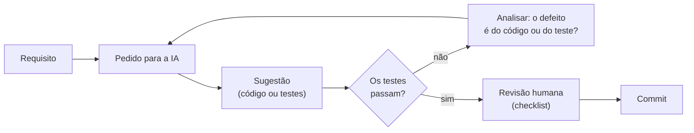

# 01 — Onde a IA entra no desenvolvimento

> **Curso:** IA no desenvolvimento de software  
> **Módulo:** 01 — IA como parceira de programação  
> **Tempo estimado:** 5 min em aula · 20 min de estudo  

---

## 🎯 Objetivos

Ao final desta aula, você será capaz de:

- Apontar em que etapas do desenvolvimento a IA ajuda.
- Citar os principais riscos de usar código gerado por IA.
- Montar um pedido (prompt) com **papel**, **contexto**, **requisito** e **formato**.

---

## A IA no ciclo de desenvolvimento

Um sistema passa por etapas: entender o que o cliente precisa, planejar, programar, testar, corrigir e documentar. A IA pode ajudar em quase todas, **mas o papel dela muda**:

| Etapa | Como a IA ajuda | O que **você** continua fazendo |
|---|---|---|
| **Requisitos** | Faz perguntas que faltaram, organiza a lista de requisitos funcionais e não funcionais. | Confirmar com o cliente: a IA não conhece a empresa. |
| **Código** | Sugere funções, explica erros, traduz de uma linguagem para outra. | Entender cada linha antes de usar. |
| **Entender código alheio** | Explica o que uma função faz, em português. | Conferir se a explicação bate com o comportamento real. |
| **Testes** | Sugere casos, inclusive os de **limite** e de **dados inválidos**. | Rodar os testes e decidir quem está certo: o teste ou o código. |
| **Manutenção** | Aponta a causa provável de um defeito e propõe a correção. | Revisar a correção e rodar todos os testes de novo. |
| **Documentação** | Escreve comentários, README e mensagens de commit. | Corrigir o que estiver inventado ou genérico. |



## Ferramentas gratuitas

Você não precisa de plano pago para usar IA no código. Há dois jeitos:

| Jeito | Exemplos (com plano gratuito) | Bom para |
|---|---|---|
| **Chat no navegador** | ChatGPT, Gemini, Microsoft Copilot, Claude | Explicar, gerar testes, revisar trechos copiados. Funciona em qualquer computador. |
| **Assistente dentro do editor** | GitHub Copilot (plano Free) no VS Code | Sugestões enquanto digita e conversa sobre os arquivos abertos. |

!!! info "Nomes, limites e termos mudam"
    Os planos gratuitos têm **limite de uso** (mensagens por dia ou por hora) e as empresas mudam os modelos com frequência. Quando o limite acabar num assistente, **troque de assistente**: o pedido bem escrito funciona em qualquer um. Por isso, nesta aula, os pedidos não dependem de nenhuma ferramenta específica.

## Os riscos (e como se proteger)

| Risco | Exemplo | Proteção |
|---|---|---|
| **Resposta inventada** | A IA cita uma função ou biblioteca que não existe, com toda a confiança. | Rodar o código. Conferir na documentação oficial. |
| **Testes que confirmam o defeito** | Você mostra só o código, e a IA escreve testes que esperam o comportamento errado. | Gerar testes a partir do **requisito**, não do código. |
| **Falha de segurança** | Consulta SQL montada com texto do usuário, senha no código. | Revisar com o checklist da [aula 03](03_revisao_e_autoavaliacao.md). |
| **Vazamento de dados** | Colar planilha de clientes, senha ou chave de API no chat. | **Nunca** colar dados reais. Use dados inventados. |
| **Dependência** | Copiar sem entender e não saber manter depois. | Pedir explicação e conseguir explicar com as suas palavras. |

!!! danger "Sigilo vem primeiro"
    Nos planos gratuitos, as conversas **podem ser usadas** para treinar os modelos e **lidas** por revisores, conforme os termos de cada empresa. Código da empresa, dados de clientes, senhas e chaves **não vão para o chat**. Troque nomes e valores reais por exemplos inventados antes de pedir ajuda.

## A anatomia de um bom pedido

Um pedido vago gera uma resposta genérica. Um bom pedido para programação tem quatro partes:

| Parte | Para quê | Exemplo |
|---|---|---|
| **Papel** | Define o tipo de resposta. | "Você é um testador de software experiente." |
| **Contexto** | Linguagem, ferramentas, para quem é. | "Python 3.11, testes com pytest, sistema de uma escola." |
| **Requisito** | A **regra** que o código precisa cumprir. | "Aprovado se tiver menção D em todas as UCs e frequência mínima de 75%." |
| **Formato** | Como você quer receber. | "Responda só com o arquivo `test_situacao.py`, usando `parametrize`." |

Compare:

```text title="Pedido vago"
Faz uns testes pra essa função.
```

```text title="Pedido completo"
Você é um testador de software experiente.
Contexto: Python 3.11 e pytest, sistema de notas de uma escola técnica.
Requisito: a função situacao_final(mencoes, frequencia) devolve "AP" quando
todas as menções são "D" e a frequência é de pelo menos 75%; senão, "RP".
Escreva testes para esse requisito, incluindo os casos de limite.
Formato: só o arquivo test_situacao.py, com pytest.mark.parametrize.
```

O segundo pedido diz **o que é certo**. Com isso, os testes da IA conseguem pegar um defeito, e é isso que você vai fazer na prática.

---

## ⚠️ Erros comuns

- **Colar o código e pedir "testes"** sem dizer a regra: os testes copiam o comportamento atual, com defeito e tudo.
- **Aceitar a primeira resposta** sem rodar. Código que "parece certo" não é código testado.
- **Colar dados reais** (nomes de alunos, CPF, senhas) para "dar contexto".

## 💡 Resumo

- A IA ajuda em todas as etapas, mas **a decisão é sua**, com base em testes.
- Use as ferramentas gratuitas; se o limite acabar, troque de assistente.
- Proteja dados sigilosos: só exemplos inventados no chat.
- Bom pedido = **papel + contexto + requisito + formato**.

## ➡️ Próximo passo

**[02 — Prática: testes e correção com IA](02_pratica_testes_com_ia.md)**.
