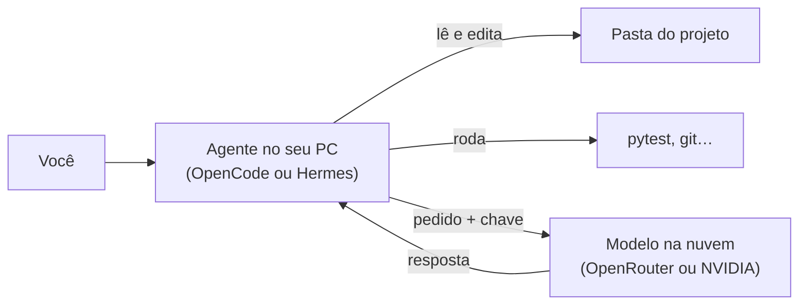

# 04 — Agentes de IA no seu computador: Hermes e OpenCode

> **Curso:** IA no desenvolvimento de software  
> **Módulo:** 01 — IA como parceira de programação  
> **Tempo estimado:** 1 h 30 min (aula complementar, fora dos 20 minutos)  

---

## 🎯 Objetivos

Ao final desta aula, você será capaz de:

- Explicar a diferença entre um **chat** de IA e um **agente** que trabalha na pasta do projeto.
- Conseguir uma chave de API gratuita no **OpenRouter** ou na **NVIDIA** e guardá-la com segurança.
- Instalar e configurar o **OpenCode** e o **Hermes Agent** com essas chaves.
- Refazer a prática do chamado #142 com um agente, mantendo o controle do que ele faz.

## Pré-requisitos

- [Aula 02 — Prática: testes e correção com IA](02_pratica_testes_com_ia.md) (a pasta `chamado_142`).
- **Git** instalado e o projeto num repositório (para desfazer o que o agente mudar).
- Para o OpenCode pelo npm: **Node.js** instalado.
- **18 anos ou mais** para criar contas e chaves de API (confira os termos de cada serviço). Quem tem menos acompanha pela demonstração do professor.

---

## Do chat ao agente

No chat do navegador, **você** copia o código, cola, lê a resposta e cola de volta. Um **agente** faz isso sozinho: ele roda **no seu computador**, lê os arquivos da pasta, executa comandos (como o `pytest`) e edita o código.

| | Chat no navegador | Agente no terminal |
|---|---|---|
| Onde roda | No site da empresa | No **seu computador**, dentro da pasta do projeto |
| O que enxerga | Só o que você colar | Os arquivos da pasta |
| O que faz | Responde | Lê, roda comandos e **edita arquivos** |
| Modelo de IA | O da empresa do site | O que **você** escolher, por uma chave de API |
| Risco principal | Colar dados sigilosos | Mudar ou apagar arquivos sem você perceber |

!!! info "\"Local\" aqui quer dizer o agente"
    O **agente** é local: o programa roda no seu PC. O **modelo** (o "cérebro") continua na nuvem, no OpenRouter ou na NVIDIA, e é acessado pela chave de API. Há também modelos que rodam inteiros no PC (com LM Studio ou Ollama, por exemplo), mas eles pedem uma máquina bem mais forte. O Hermes aceita esses dois caminhos.



## Chaves de API gratuitas

### OpenRouter

O [OpenRouter](https://openrouter.ai/) reúne modelos de várias empresas numa chave só. Os modelos com **`:free`** no nome são gratuitos, com limites ([página oficial de limites](https://openrouter.ai/docs/api_reference/limits), conferida em novembro de 2026):

| Créditos comprados na conta | Pedidos por minuto | Pedidos por dia (modelos `:free`) |
|---|---|---|
| Menos de 10 | 20 | 50 |
| Pelo menos 10 | 20 | 1000 |

Passada a cota, a API responde com o erro **429**. Crie a conta, gere a chave na área **Keys** e guarde-a (abaixo).

### NVIDIA

A NVIDIA oferece inferência gratuita de modelos (como os da família **Nemotron**) em [build.nvidia.com](https://build.nvidia.com/). A chave é criada em **build.nvidia.com/settings/api-keys**. A API é compatível com a da OpenAI, no endereço `https://integrate.api.nvidia.com/v1` ([referência da NVIDIA](https://docs.api.nvidia.com/nim/reference/llm-apis)). Os limites do plano gratuito aparecem na sua conta.

!!! danger "A chave é uma senha"
    Quem tem a sua chave usa a API **em seu nome**. Nunca coloque a chave no código, em prints, no chat ou no GitHub. Se vazar, apague a chave no site e crie outra. Nas configurações desta aula, a chave fica **fora** do projeto: no arquivo de credenciais do agente ou numa variável de ambiente.

!!! warning "Termos e privacidade"
    Cada modelo gratuito tem os seus termos: alguns provedores podem guardar os pedidos. Use os agentes com **código de estudo** e **dados inventados**, como no chamado #142, e não com o código ou os dados de uma empresa sem autorização.

## OpenCode

O [OpenCode](https://opencode.ai/docs) é um agente de programação que roda no terminal.

### Instalar

Com o Node.js instalado, no PowerShell:

```powershell
npm install -g @opencode/cli
```

No Windows, a documentação oficial **não** oferece instalação por winget, Scoop ou Chocolatey; além do npm, há o instalador e o executável para baixar no site.

### Conectar o OpenRouter

Abra o terminal **na pasta do projeto** e inicie o agente:

```powershell
cd chamado_142
opencode
```

Dentro do OpenCode:

1. Digite `/connect`, escolha **OpenRouter** e cole a chave. Ela fica guardada nas credenciais do OpenCode, fora do projeto (`opencode auth list` mostra as chaves salvas).
2. Digite `/models` e escolha um modelo com **`:free`** no nome.

### Conectar a NVIDIA

A NVIDIA entra como provedor **compatível com a OpenAI**, num arquivo `opencode.json` na pasta do projeto. A chave **não** vai no arquivo: ele só diz o **nome** da variável de ambiente.

```json title="opencode.json"
{
  "$schema": "https://opencode.ai/config.json",
  "providers": {
    "nvidia": {
      "name": "NVIDIA",
      "env": ["NVIDIA_API_KEY"],
      "package": "@opencode/ai/providers/openai-compatible",
      "settings": {
        "baseURL": "https://integrate.api.nvidia.com/v1",
        "models": {
          "nvidia/nemotron-3.5-super-vl-120b-a12b": {
            "name": "Nemotron 3.5 Super"
          }
        }
      }
    }
  }
}
```

Antes de abrir o OpenCode, crie a variável **só nesta janela** do terminal:

```powershell
$env:NVIDIA_API_KEY = "cole-aqui-a-sua-chave"
opencode
```

Depois, `/models` mostra o modelo da NVIDIA.

!!! info "Os nomes mudam"
    Modelos são lançados e aposentados com frequência, e a configuração do OpenCode muda entre versões. Se algo não aparecer, confira a [página de provedores do OpenCode](https://opencode.ai/docs/providers) e o nome atual do modelo em build.nvidia.com.

## Hermes Agent

O [Hermes Agent](https://hermes-agent.nousresearch.com/docs), da Nous Research, é um agente que guarda **memória entre sessões** e cria **habilidades** a partir do que faz. Ele roda no terminal e aceita dezenas de provedores, entre eles OpenRouter e NVIDIA.

### Instalar

No PowerShell (Windows nativo), o comando oficial é:

```powershell
iex (irm https://hermes-agent.nousresearch.com/install.ps1)
```

!!! warning "Comando que baixa e executa um script"
    Esse comando baixa um script da internet e o executa na hora. Só rode comandos assim copiados do **site oficial**, conferindo o endereço. No Linux, no macOS ou no WSL2, o site indica o `install.sh` com `curl`.

### Configurar a chave

O Hermes guarda os segredos em `~/.hermes/.env` (no Windows, `C:\Users\<você>\.hermes\.env`) e as configurações em `~/.hermes/config.yaml`. Para o OpenRouter:

```powershell
hermes config set OPENROUTER_API_KEY cole-aqui-a-sua-chave
hermes model
```

O `hermes model` abre um menu para escolher o provedor e o modelo. Para a NVIDIA, a documentação indica a variável `NVIDIA_API_KEY` no mesmo `.env` e este comando:

```powershell
hermes config set NVIDIA_API_KEY cole-aqui-a-sua-chave
hermes chat --provider nvidia --model nvidia/nemotron-3.5-super-vl-120b-a12b
```

Para deixar a NVIDIA como padrão, o `config.yaml` fica assim:

```yaml title="~/.hermes/config.yaml"
model:
  provider: "nvidia"
  default: "nvidia/nemotron-3.5-super-vl-120b-a12b"
```

`hermes doctor` confere a instalação e a configuração quando algo não funciona.

## Prática: o chamado #142 com um agente

Volte a pasta `chamado_142` ao estado inicial (o `situacao.py` **com defeito**) e salve o requisito RF-07 da [aula 02](02_pratica_testes_com_ia.md) num arquivo `requisito.txt`. Antes de chamar o agente, guarde o ponto de partida no Git:

```powershell
git add .
git commit -m "chamado 142: estado antes do agente"
```

Abra o OpenCode ou o Hermes na pasta e mande:

```text title="Pedido ao agente"
Leia requisito.txt e situacao.py.
1. Escreva test_situacao.py com testes para cada item do requisito, incluindo os
   limites e os dados inválidos. NÃO altere situacao.py ainda.
2. Rode python -m pytest -q e me mostre o resumo.
3. Proponha a correção de situacao.py e me mostre o que vai mudar ANTES de aplicar.
```

Depois que o agente terminar, **você** confere:

```powershell
git diff
python -m pytest -q
```

O `git diff` mostra **tudo** o que o agente mudou. Se não gostar, `git restore .` volta ao commit anterior. O checklist da [aula 03](03_revisao_e_autoavaliacao.md) vale do mesmo jeito: código escrito por agente também passa por revisão.

!!! tip "Peça para ver antes de aplicar"
    Agentes costumam pedir permissão antes de editar arquivos ou rodar comandos. **Leia cada pedido** antes de aprovar, principalmente comandos que apagam, instalam ou enviam algo para a internet.

---

## ⚠️ Erros comuns

- **Erro 429 (limite)**: a cota gratuita acabou. Espere um minuto (limite por minuto) ou o dia seguinte, ou troque de modelo ou de provedor.
- **Modelo não encontrado**: o modelo `:free` foi retirado ou mudou de nome. Escolha outro em `/models` (OpenCode) ou `hermes model` (Hermes).
- **A chave da NVIDIA "não existe" no OpenCode**: a variável `$env:NVIDIA_API_KEY` vale só para a janela do terminal onde foi criada. Abra o OpenCode **na mesma janela**.
- **O agente mudou arquivos demais**: por isso o commit antes. `git diff` para ver, `git restore .` para desfazer.
- **Chave no `opencode.json` ou no Git**: apague a chave no site, crie outra e deixe só o nome da variável no arquivo.

## Exercícios

### Básico (fixação)

Para cada tarefa, diga se você usaria o **chat no navegador** ou um **agente**, e por quê: (a) entender um erro de um trecho de 10 linhas; (b) criar testes para 15 arquivos de um projeto de estudo; (c) revisar um código da empresa onde você estagia.

??? success "Gabarito — Básico"
    (a) **Chat**: é um trecho pequeno, e colar é rápido. (b) **Agente**: ele lê os 15 arquivos e roda os testes sozinho, e você revisa tudo com `git diff`. (c) **Nenhum dos dois sem autorização**: código da empresa não vai para um modelo gratuito sem a permissão dela. Com autorização, use a ferramenta que a empresa aprovar.

### Intermediário (aplicação)

Configure os **dois** provedores (OpenRouter e NVIDIA) no mesmo agente e faça a prática do chamado #142 com cada um. Anote numa tabela: modelo usado, quantos testes ele escreveu, se pegou o caso de 75% e se respeitou o "não altere ainda".

??? success "Gabarito — Intermediário"
    Não há resposta única: os modelos mudam e cada um se sai de um jeito. O que vale conferir:

    | Item | O que esperar |
    |---|---|
    | Caso de 75% | Deve aparecer, porque o pedido manda incluir os limites. Se não aparecer, o modelo não seguiu o pedido. |
    | Dados inválidos | Lista vazia, menção desconhecida e frequência fora de 0–100. |
    | "Não altere ainda" | O `git diff` depois do passo 1 deve mostrar **só** o arquivo de testes novo. |
    | Resultado final | `python -m pytest -q` rodado **por você**, com todos os testes passando. |

    A conclusão importante: a qualidade depende do **modelo** e do **pedido**, e a conferência (`git diff` + `pytest`) é a mesma para qualquer um.

### Avançado (desafio)

Um colega mandou este `opencode.json` para você usar a NVIDIA. Encontre os **dois** problemas e escreva a versão certa.

```json title="opencode.json do colega"
{
  "$schema": "https://opencode.ai/config.json",
  "providers": {
    "nvidia": {
      "name": "NVIDIA",
      "apiKey": "nvapi-9f3k2-exemplo-de-chave-colada",
      "package": "@opencode/ai/providers/openai-compatible",
      "settings": {
        "baseURL": "https://build.nvidia.com",
        "models": {
          "nvidia/nemotron-3.5-super-vl-120b-a12b": { "name": "Nemotron 3.5 Super" }
        }
      }
    }
  }
}
```

??? success "Gabarito — Avançado"
    1. **A chave está colada no arquivo.** Se o projeto for para o GitHub, a chave vaza. O certo é `"env": ["NVIDIA_API_KEY"]`, com a chave numa variável de ambiente (e essa chave de exemplo, se fosse real, teria de ser apagada no site).
    2. **O endereço da API está errado.** `build.nvidia.com` é o site; a API compatível com a OpenAI fica em `https://integrate.api.nvidia.com/v1`.

    ```json title="opencode.json"
    {
      "$schema": "https://opencode.ai/config.json",
      "providers": {
        "nvidia": {
          "name": "NVIDIA",
          "env": ["NVIDIA_API_KEY"],
          "package": "@opencode/ai/providers/openai-compatible",
          "settings": {
            "baseURL": "https://integrate.api.nvidia.com/v1",
            "models": {
              "nvidia/nemotron-3.5-super-vl-120b-a12b": { "name": "Nemotron 3.5 Super" }
            }
          }
        }
      }
    }
    ```

## 💡 Resumo

- O **agente** roda no seu PC e trabalha na pasta; o **modelo** fica na nuvem e é acessado por chave de API.
- **OpenRouter** (`:free`, 20 pedidos por minuto, 50 por dia) e **NVIDIA** (build.nvidia.com) dão chaves gratuitas.
- A chave fica **fora** do projeto: credenciais do agente ou variável de ambiente.
- Commit **antes**, `git diff` e `pytest` **depois**: o agente trabalha, você confere.

## ➡️ Próximo passo

Volte ao **[Catálogo de cursos](../../catalogo.md)** ou continue no curso **[IA na prática com Python](../../ia_na_pratica_com_python/docs/index.md)**, que ensina a chamar modelos de IA de dentro dos seus programas.
