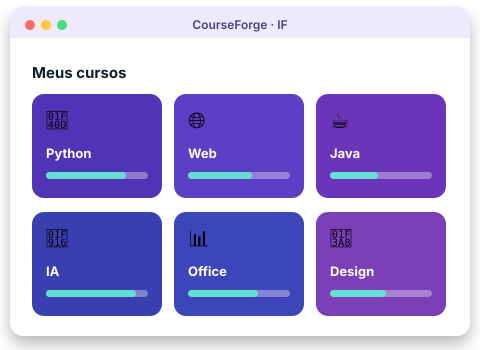
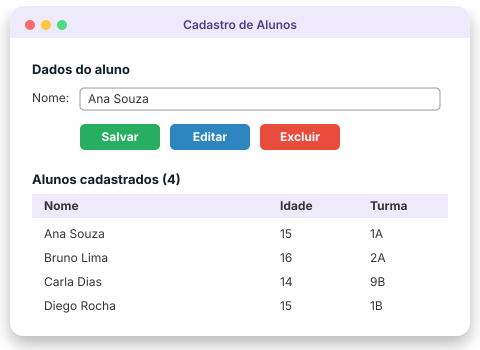
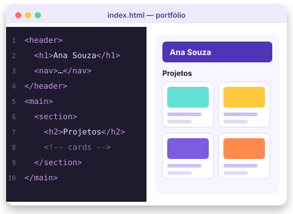
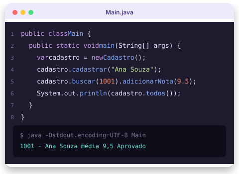
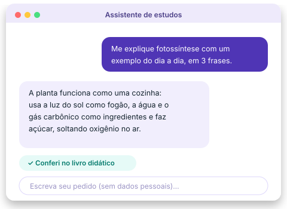
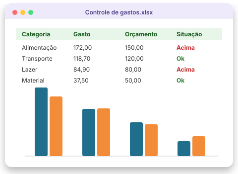
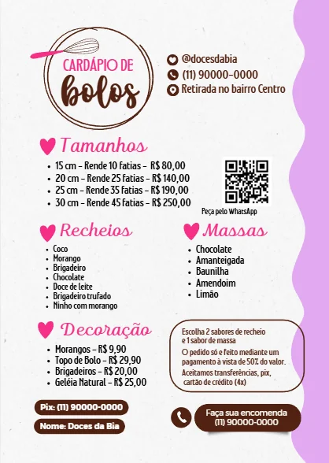
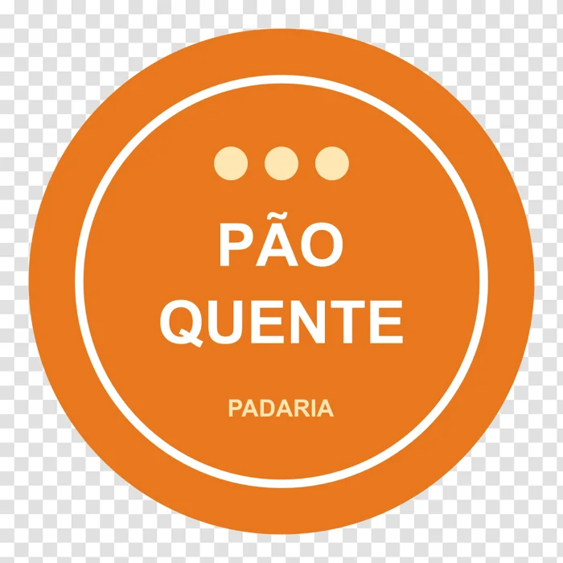

<section class="cf-slide" aria-roledescription="slide" aria-label="1 de 8" markdown>

Plataforma de cursos gratuita · Prof. Pedro Paulo IF

# Aprenda fazendo, do primeiro código ao projeto final { .cf-hero__title }

Cursos práticos em português para a sala de aula: programação, design, escritório e inteligência artificial, com aulas curtas, exemplos testados e projetos que viram portfólio.

[Ver todos os cursos](#cursos){ .md-button .md-button--primary }
[Como estudar na plataforma](como_estudar.md){ .md-button }

<ul class="cf-hero__badges" aria-label="Características">
  <li>100% gratuito</li>
  <li>Em português</li>
  <li>Feito para a sala de aula</li>
</ul>

</section>

<section class="cf-slide cf-slide--python" aria-roledescription="slide" aria-label="2 de 8" markdown>

Programação · Python para Desktop

Do zero ao sistema desktop completo

Fundamentos, orientação a objetos, interfaces gráficas e banco de dados, até um Sistema Escolar feito em equipe.

[Começar pelo Módulo 00](python_para_desktop/modulo_06_vscode_config/index.md){ .md-button .md-button--primary }
[Conhecer o curso](python_para_desktop/docs/index.md){ .md-button }

<ul class="cf-hero__badges" aria-label="Resumo do curso">
  <li>7 módulos</li>
  <li>40 aulas</li>
  <li>Projeto em equipe</li>
</ul>

</section>

<section class="cf-slide cf-slide--web" aria-roledescription="slide" aria-label="3 de 8" markdown>

Programação · Web, TypeScript e React

Crie sites e aplicações web de verdade

Uma trilha em três cursos: HTML, CSS e JavaScript, depois TypeScript e, por fim, React, com o seu portfólio e um catálogo com carrinho publicados na internet.

[Começar pelo HTML](desenvolvimento_web/modulo_01_html/index.md){ .md-button .md-button--primary }
[Conhecer a trilha](desenvolvimento_web/docs/index.md){ .md-button }

<ul class="cf-hero__badges" aria-label="Resumo da trilha">
  <li>3 cursos</li>
  <li>47 aulas</li>
  <li>Projetos publicados</li>
</ul>

</section>

<section class="cf-slide cf-slide--java" aria-roledescription="slide" aria-label="4 de 8" markdown>

Programação · Java

A linguagem dos bancos, das empresas e dos concursos

Lógica, orientação a objetos, coleções e arquivos, até um cadastro de alunos que guarda os dados em CSV.

[Começar pelo Módulo 01](java/modulo_01_fundamentos/index.md){ .md-button .md-button--primary }
[Conhecer o curso](java/docs/index.md){ .md-button }

<ul class="cf-hero__badges" aria-label="Resumo do curso">
  <li>3 módulos</li>
  <li>15 aulas</li>
  <li>Java 21</li>
</ul>

</section>

<section class="cf-slide cf-slide--ia" aria-roledescription="slide" aria-label="5 de 8" markdown>

Tecnologia · Introdução à IA

Use a inteligência artificial com responsabilidade

Como a IA funciona, como escrever bons pedidos, onde ela ajuda no estudo e no trabalho, ética e privacidade, e um mini-assistente em Python.

[Começar pelo Módulo 01](introducao_a_ia/modulo_01_o_que_e_ia/index.md){ .md-button .md-button--primary }
[Conhecer o curso](introducao_a_ia/docs/index.md){ .md-button }

<ul class="cf-hero__badges" aria-label="Resumo do curso">
  <li>5 módulos</li>
  <li>25 aulas</li>
  <li>LGPD e ética</li>
</ul>

</section>

<section class="cf-slide cf-slide--office" aria-roledescription="slide" aria-label="6 de 8" markdown>

Escritório · Pacote Office

Word, Excel e PowerPoint para estudar e trabalhar

Do trabalho no padrão ABNT à tabela dinâmica e à apresentação segura, com alternativas gratuitas, terminando no kit da sua primeira candidatura.

[Começar pelo Word](pacote_office/modulo_01_word/index.md){ .md-button .md-button--primary }
[Conhecer o curso](pacote_office/docs/index.md){ .md-button }

<ul class="cf-hero__badges" aria-label="Resumo do curso">
  <li>5 módulos</li>
  <li>25 aulas</li>
  <li>LibreOffice e Google</li>
</ul>

</section>

<section class="cf-slide cf-slide--canva" aria-roledescription="slide" aria-label="7 de 8" markdown>

Design · Canva

Design para o seu negócio, sem saber design

Catálogo, cardápio, panfleto, posts, convites e vídeos curtos, tudo no Canva gratuito, a partir de pedidos reais.

[Começar pelo Módulo 01](canva/modulo_01_primeiros_passos/index.md){ .md-button .md-button--primary }
[Conhecer o curso](canva/docs/index.md){ .md-button }

<ul class="cf-hero__badges" aria-label="Resumo do curso">
  <li>3 módulos</li>
  <li>13 aulas</li>
  <li>Plano gratuito</li>
</ul>

</section>

<section class="cf-slide cf-slide--corel" aria-roledescription="slide" aria-label="8 de 8" markdown>

Design · CorelDRAW Em andamento

Do cartão de visita ao arquivo pronto para a gráfica

Formas, cores, curvas, PowerTRACE e um logotipo vetorial, com o Inkscape gratuito indicado em cada aula.

[Começar pelo Módulo 01](coreldraw/modulo_01_primeiros_passos/index.md){ .md-button .md-button--primary }
[Conhecer o curso](coreldraw/docs/index.md){ .md-button }

<ul class="cf-hero__badges" aria-label="Resumo do curso">
  <li>2 módulos no ar</li>
  <li>10 aulas</li>
  <li>Inkscape gratuito</li>
</ul>

</section>

## Cursos

-   :material-language-python:{ .lg .middle } __Python para Desktop__

    Disponível

    ---

    Do zero ao sistema desktop completo: fundamentos, POO, interfaces gráficas, banco de dados e um projeto final em equipe.

    7 módulos · 40 aulas · 14 aulas de revisão

    [:octicons-arrow-right-24: Acessar o curso](python_para_desktop/docs/index.md)

-   :material-microsoft-office:{ .lg .middle } __Pacote Office__

    Disponível

    ---

    Word, Excel e PowerPoint para estudar e trabalhar, com alternativas gratuitas (LibreOffice e Google Workspace).

    5 módulos · 48 h · do trabalho ABNT ao kit da primeira candidatura

    [:octicons-arrow-right-24: Começar pelo Word](pacote_office/modulo_01_word/index.md)

-   :material-robot-happy-outline:{ .lg .middle } __Introdução à IA__

    Disponível

    ---

    O que é IA, como usar assistentes com responsabilidade, engenharia de prompt e um mini-projeto com Python.

    5 módulos · 40 h · do funcionamento ao seu mini-assistente

    [:octicons-arrow-right-24: Começar pelo Módulo 01](introducao_a_ia/modulo_01_o_que_e_ia/index.md)

-   :material-palette-outline:{ .lg .middle } __Canva__

    Disponível

    ---

    Canva gratuito com projetos reais: catálogo para clientes, cardápio, panfleto, convite, posts e vídeos — com capturas reais da plataforma.

    3 módulos · 13 aulas · do primeiro acesso ao vídeo curto

    [:octicons-arrow-right-24: Começar pelo Módulo 01](canva/modulo_01_primeiros_passos/index.md)

-   :material-vector-bezier:{ .lg .middle } __CorelDRAW__

    Em andamento

    ---

    CorelDRAW do zero, em projetos: cartão de visita, logotipo e arquivos prontos para a gráfica — com o Inkscape gratuito em cada aula.

    Módulos 01 e 02 disponíveis · 10 aulas · do cartão de visita ao logotipo

    [:octicons-arrow-right-24: Começar pelo Módulo 01](coreldraw/modulo_01_primeiros_passos/index.md)

-   :material-language-html5:{ .lg .middle } __Desenvolvimento Web__

    Disponível

    ---

    HTML, CSS e JavaScript do zero, em projetos — da primeira página ao portfólio publicado na internet.

    4 módulos · 19 aulas · da primeira tag ao portfólio publicado

    [:octicons-arrow-right-24: Começar pelo Módulo 01](desenvolvimento_web/modulo_01_html/index.md)

-   :material-language-typescript:{ .lg .middle } __TypeScript__

    Disponível

    ---

    JavaScript com tipos: o editor avisa os erros antes de rodar. A base para React e projetos profissionais.

    3 módulos · 14 aulas · do primeiro tsc à lista de tarefas tipada no navegador

    [:octicons-arrow-right-24: Começar pelo Módulo 01](typescript/modulo_01_fundamentos/index.md)

-   :material-react:{ .lg .middle } __React__

    Disponível

    ---

    Interfaces modernas com componentes, props e estado, em React com TypeScript e Vite.

    3 módulos · 14 aulas · do primeiro componente ao catálogo publicado

    [:octicons-arrow-right-24: Começar pelo Módulo 01](react/modulo_01_fundamentos/index.md)

-   :material-language-java:{ .lg .middle } __Java__

    Disponível

    ---

    Programação em Java do zero: lógica, orientação a objetos, coleções e arquivos, até um sistema de cadastro.

    3 módulos · 15 aulas · do primeiro programa ao cadastro que salva em arquivo

    [:octicons-arrow-right-24: Começar pelo Módulo 01](java/modulo_01_fundamentos/index.md)

-   :material-shield-lock-outline:{ .lg .middle } __Segurança digital__

    Em andamento

    ---

    Proteja as suas contas, reconheça golpes de WhatsApp e Pix e conheça os seus direitos na internet. Para qualquer pessoa, sem programar.

    Módulos 01 a 04 disponíveis · 20 aulas · senhas, golpes de WhatsApp e Pix, celular protegido, gov.br e direitos

    [:octicons-arrow-right-24: Começar pelo Módulo 01](seguranca_digital/modulo_01_senhas_e_contas/index.md)

[Ver o catálogo completo, com as fichas dos cursos](catalogo.md){ .md-button }
[Como estudar na plataforma](como_estudar.md){ .md-button }

## Como funciona

1

__Escolha um curso__

Veja no [catálogo](catalogo.md) o nível, a carga horária e os pré-requisitos de cada um.

2

__Prepare o ambiente__

A primeira aula de cada curso mostra o que instalar ou criar, sempre com opções gratuitas.

3

__Pratique de verdade__

Siga os módulos na ordem, refaça os exemplos e resolva os exercícios: todos têm gabarito.

4

__Entregue o projeto__

Cada curso termina num projeto para o seu portfólio, que libera o certificado.

## Trilhas dos cursos

Escolha um curso nas abas para ver os módulos dele.

=== "Python"

    

    -   :material-tools:{ .middle } __00 · Ambiente__

        Python, VS Code, extensões e `venv`. **Comece por aqui.**

        [:octicons-arrow-right-24: 2 aulas](python_para_desktop/modulo_06_vscode_config/index.md)

    -   :material-code-braces:{ .middle } __01 · Fundamentos__

        Variáveis, decisões, laços, funções, coleções, arquivos e exceções.

        [:octicons-arrow-right-24: 11 aulas](python_para_desktop/modulo_01_fundamentos/index.md)

    -   :material-cube-outline:{ .middle } __02 · POO__

        Classes, objetos, `self`, encapsulamento e `@property`.

        [:octicons-arrow-right-24: 3 aulas](python_para_desktop/modulo_07_poo/index.md)

    -   :material-application-outline:{ .middle } __03 · Interfaces Gráficas__

        Tkinter, layouts, eventos e CustomTkinter.

        [:octicons-arrow-right-24: 5 aulas](python_para_desktop/modulo_02_interfaces_graficas/index.md)

    -   :material-database-outline:{ .middle } __04 · Banco de Dados__

        SQLite, integração com a interface e `.env`.

        [:octicons-arrow-right-24: 4 aulas](python_para_desktop/modulo_03_banco_de_dados/index.md)

    -   :material-hammer-wrench:{ .middle } __05 · Projeto Finalizador__

        Sistema Escolar em equipe: login, CRUD, SQLite e nuvem. **Libera o certificado.**

        [:octicons-arrow-right-24: 13 aulas](python_para_desktop/modulo_04_projeto_finalizador/index.md)

    -   :material-source-branch:{ .middle } __06 · Git & GitHub__ Bônus

        Versionar, colaborar e publicar o projeto como portfólio.

        [:octicons-arrow-right-24: 2 aulas](python_para_desktop/modulo_05_git_github/index.md)

    -   :material-lightbulb-on-outline:{ .middle } __Central de Revisão Visual__ Apoio

        Analogias do dia a dia, fluxogramas e erros comuns para revisar a qualquer momento.

        [:octicons-arrow-right-24: 14 aulas](python_para_desktop/modulo_00_revisao_e_fixacao/index.md)

    

=== "Web"

    

    -   :material-language-html5:{ .middle } __01 · HTML__

        Estrutura, textos, links, imagens, listas, tabelas e formulários.

        [:octicons-arrow-right-24: 5 aulas](desenvolvimento_web/modulo_01_html/index.md)

    -   :material-language-css3:{ .middle } __02 · CSS__

        Cores, fontes, modelo de caixa, Flexbox, Grid e layout responsivo.

        [:octicons-arrow-right-24: 5 aulas](desenvolvimento_web/modulo_02_css/index.md)

    -   :material-language-javascript:{ .middle } __03 · JavaScript__

        Lógica, funções, DOM, eventos e uma lista de tarefas que guarda os dados.

        [:octicons-arrow-right-24: 5 aulas](desenvolvimento_web/modulo_03_javascript/index.md)

    -   :material-web:{ .middle } __04 · Publicar__

        APIs com `fetch`, organização do projeto e GitHub Pages. **Libera o certificado.**

        [:octicons-arrow-right-24: 4 aulas](desenvolvimento_web/modulo_04_publicar/index.md)

    

=== "TypeScript"

    

    -   :material-language-typescript:{ .middle } __01 · Fundamentos__

        `npm`, `tsc`, tipos, inferência, arrays, objetos e funções tipadas.

        [:octicons-arrow-right-24: 5 aulas](typescript/modulo_01_fundamentos/index.md)

    -   :material-shape-outline:{ .middle } __02 · Modelando dados__

        `type` × `interface`, uniões, *narrowing*, valores opcionais e *generics*.

        [:octicons-arrow-right-24: 5 aulas](typescript/modulo_02_modelando_dados/index.md)

    -   :material-web:{ .middle } __03 · TypeScript no navegador__

        Módulos, DOM e `fetch` com tipos e a lista de tarefas reescrita. **Libera o certificado.**

        [:octicons-arrow-right-24: 4 aulas](typescript/modulo_03_navegador/index.md)

    

=== "React"

    

    -   :material-react:{ .middle } __01 · Fundamentos__

        Vite, JSX, componentes, props, estado e eventos.

        [:octicons-arrow-right-24: 5 aulas](react/modulo_01_fundamentos/index.md)

    -   :material-form-select:{ .middle } __02 · Listas, formulários e efeitos__

        Formulários controlados, `useEffect`, `localStorage` e dados de APIs.

        [:octicons-arrow-right-24: 5 aulas](react/modulo_02_formularios_e_efeitos/index.md)

    -   :material-cart-outline:{ .middle } __03 · Aplicação completa__

        Elevar o estado, Context, build e um catálogo publicado. **Libera o certificado.**

        [:octicons-arrow-right-24: 4 aulas](react/modulo_03_aplicacao/index.md)

    

=== "Java"

    

    -   :material-language-java:{ .middle } __01 · Fundamentos__

        JDK, variáveis, tipos, condições, laços, métodos e `Scanner`.

        [:octicons-arrow-right-24: 5 aulas](java/modulo_01_fundamentos/index.md)

    -   :material-cube-outline:{ .middle } __02 · Orientação a objetos__

        Classes, encapsulamento, herança, interfaces, `enum` e `record`.

        [:octicons-arrow-right-24: 5 aulas](java/modulo_02_poo/index.md)

    -   :material-file-delimited-outline:{ .middle } __03 · Coleções, exceções e arquivos__

        `ArrayList`, `HashMap`, streams, exceções e um cadastro em CSV. **Libera o certificado.**

        [:octicons-arrow-right-24: 5 aulas](java/modulo_03_colecoes_e_arquivos/index.md)

    

=== "IA"

    

    -   :material-brain:{ .middle } __01 · O que é IA__

        Aprendizado de máquina, redes neurais e IA generativa sem mistério.

        [:octicons-arrow-right-24: 5 aulas](introducao_a_ia/modulo_01_o_que_e_ia/index.md)

    -   :material-chat-processing-outline:{ .middle } __02 · Usando assistentes__

        Assistentes gratuitos, bons pedidos (*prompts*) e conferência das respostas.

        [:octicons-arrow-right-24: 5 aulas](introducao_a_ia/modulo_02_usando_assistentes/index.md)

    -   :material-school-outline:{ .middle } __03 · IA no estudo e no trabalho__

        Estudar, escrever, planilhas, código e imagens, sabendo quando não usar.

        [:octicons-arrow-right-24: 5 aulas](introducao_a_ia/modulo_03_ia_no_estudo_e_no_trabalho/index.md)

    -   :material-shield-account-outline:{ .middle } __04 · Ética e privacidade__

        LGPD, honestidade, direitos autorais, vieses e desinformação.

        [:octicons-arrow-right-24: 5 aulas](introducao_a_ia/modulo_04_etica_e_privacidade/index.md)

    -   :material-robot-outline:{ .middle } __05 · Projeto: mini-assistente__

        Um tutor de estudos em Python. **Libera o certificado.**

        [:octicons-arrow-right-24: 5 aulas](introducao_a_ia/modulo_05_projeto_mini_assistente/index.md)

    

=== "Office"

    

    -   :material-microsoft-word:{ .middle } __01 · Word__

        Formatação, estilos e o trabalho escolar completo no padrão ABNT.

        [:octicons-arrow-right-24: 5 aulas](pacote_office/modulo_01_word/index.md)

    -   :material-microsoft-excel:{ .middle } __02 · Excel__

        Fórmulas, funções, gráficos e tabela dinâmica.

        [:octicons-arrow-right-24: 5 aulas](pacote_office/modulo_02_excel/index.md)

    -   :material-microsoft-powerpoint:{ .middle } __03 · PowerPoint__

        Do roteiro ao design dos slides e à apresentação segura.

        [:octicons-arrow-right-24: 5 aulas](pacote_office/modulo_03_powerpoint/index.md)

    -   :material-account-group-outline:{ .middle } __04 · Equipe e alternativas__

        Nuvem, coautoria, e-mail e reuniões, e o mesmo de graça com LibreOffice e Google.

        [:octicons-arrow-right-24: 5 aulas](pacote_office/modulo_04_equipe_e_alternativas/index.md)

    -   :material-briefcase-outline:{ .middle } __05 · Projeto final__

        O kit da primeira candidatura: planilha, currículo, cartas e apresentação. **Libera o certificado.**

        [:octicons-arrow-right-24: 5 aulas](pacote_office/modulo_05_projeto_final/index.md)

    

=== "Canva"

    

    -   :material-palette-outline:{ .middle } __01 · Primeiros passos__

        A tela inicial, os modelos, o editor, as pastas e um cartão de visita.

        [:octicons-arrow-right-24: 5 aulas](canva/modulo_01_primeiros_passos/index.md)

    -   :material-storefront-outline:{ .middle } __02 · Projetos para o seu negócio__

        Catálogo, cardápio com QR code, panfleto e post e story da mesma oferta.

        [:octicons-arrow-right-24: 4 aulas](canva/modulo_02_projetos_negocio/index.md)

    -   :material-party-popper:{ .middle } __03 · Eventos e redes sociais__

        Convite, carrossel, capa de vídeo e vídeo curto. **Fecha o portfólio do certificado.**

        [:octicons-arrow-right-24: 4 aulas](canva/modulo_03_eventos_e_redes/index.md)

    

=== "CorelDRAW"

    

    -   :material-vector-square:{ .middle } __01 · Primeiros passos__

        Interface, documento, formas, cores e um cartão de visita em `.cdr`, PDF e PNG.

        [:octicons-arrow-right-24: 5 aulas](coreldraw/modulo_01_primeiros_passos/index.md)

    -   :material-vector-bezier:{ .middle } __02 · Vetor na prática__

        Curvas, soldar e aparar, PowerTRACE, texto e um logotipo vetorial.

        [:octicons-arrow-right-24: 5 aulas](coreldraw/modulo_02_vetor_na_pratica/index.md)

    -   :material-printer-outline:{ .middle } __03 · Arquivos para gráfica__ Em breve

        CMYK, sangria, marcas de corte, adesivo e o kit para a gráfica.

    

=== "Segurança"

    

    -   :material-form-textbox-password:{ .middle } __01 · Senhas e contas__

        Frase-senha, gerenciador de senhas, verificação em duas etapas e o plano de proteção das suas contas.

        [:octicons-arrow-right-24: 5 aulas](seguranca_digital/modulo_01_senhas_e_contas/index.md)

    -   :material-alert-octagon-outline:{ .middle } __02 · Golpes mais comuns__

        Falso parente, golpe do código, Pix e o MED, links, lojas e boletos falsos.

        [:octicons-arrow-right-24: 5 aulas](seguranca_digital/modulo_02_golpes/index.md)

    -   :material-cellphone-lock:{ .middle } __03 · Celular e computador seguros__

        Atualizações, apps oficiais, permissões, proteção contra roubo, Wi-Fi público, backup e o computador da escola.

        [:octicons-arrow-right-24: 5 aulas](seguranca_digital/modulo_03_aparelhos_seguros/index.md)

    -   :material-scale-balance:{ .middle } __04 · Cidadania e direitos__

        gov.br, Registrato, LGPD no dia a dia, cyberbullying, onde denunciar e checagem de notícias.

        [:octicons-arrow-right-24: 5 aulas](seguranca_digital/modulo_04_cidadania_e_direitos/index.md)

    -   :material-account-group-outline:{ .middle } __05 · Projeto final__ Em breve

        O Guia de segurança da minha família, apresentado para a turma.

    

## Certificado

!!! success "Um único requisito por curso"
    Cada curso libera o certificado com a entrega do seu **projeto final**. Os projetos dos outros módulos são prática: importantes para chegar preparado, mas não liberam o certificado sozinhos.

    | Curso | O que entregar |
    |---|---|
    | **Python para Desktop** | O [Projeto Final do Curso](python_para_desktop/modulo_04_projeto_finalizador/12_projeto_final.md) (Módulo 05), apresentado em equipe: Python, POO, interface gráfica, banco de dados e nuvem. O Módulo 06 (Git & GitHub) é bônus. |
    | **Pacote Office** | O [Projeto Final integrado](pacote_office/modulo_05_projeto_final/index.md) (Módulo 05): planilha, currículo, cartas e apresentação pessoal. |
    | **Introdução à IA** | O [mini-assistente](introducao_a_ia/modulo_05_projeto_mini_assistente/index.md) (Módulo 05), demonstrado, com o README e o relatório de responsabilidade. |
    | **Canva** | O portfólio com os projetos dos [Módulos 02](canva/modulo_02_projetos_negocio/index.md) e [03](canva/modulo_03_eventos_e_redes/index.md). |
    | **CorelDRAW** | O [logotipo](coreldraw/modulo_02_vetor_na_pratica/05_projeto_logotipo.md) do Módulo 02 e o kit para a gráfica do Módulo 03 (em produção). |
    | **Desenvolvimento Web** | O [portfólio publicado](desenvolvimento_web/modulo_04_publicar/04_projeto_portfolio.md) no GitHub Pages (Módulo 04). |
    | **TypeScript** | A [lista de tarefas em TypeScript](typescript/modulo_03_navegador/04_projeto_lista_de_tarefas.md) (Módulo 03), compilando sem erros no modo `strict`. |
    | **React** | O [catálogo com busca e carrinho](react/modulo_03_aplicacao/04_projeto_catalogo.md) (Módulo 03), publicado na internet. |
    | **Java** | O [cadastro de alunos com arquivo CSV](java/modulo_03_colecoes_e_arquivos/05_projeto_cadastro_csv.md) (Módulo 03). |
    | **Segurança digital** | O Guia de segurança da minha família (Módulo 05, em produção). |

## Perguntas frequentes

??? question "Preciso saber programar para começar?"
    Não. Os cursos de programação começam do zero: o primeiro módulo ensina a instalar tudo e parte da primeira linha de código. Os cursos de design, escritório, IA e segurança digital não pedem programação (só o projeto final de IA usa um pouco de Python).

??? question "Por qual curso eu começo?"
    Depende do seu objetivo: **programação** ➔ Python para Desktop ou a trilha Web (HTML, depois TypeScript e React); **concursos e cursos técnicos** ➔ Java; **escritório** ➔ Pacote Office; **design e redes sociais** ➔ Canva e CorelDRAW; **usar IA no dia a dia** ➔ Introdução à IA. **Proteger as contas e fugir de golpes** ➔ Segurança digital, que serve para qualquer pessoa. O [catálogo](catalogo.md) mostra o nível e os pré-requisitos de cada um.

??? question "Posso estudar em casa?"
    Sim. O site funciona no computador, no tablet e no celular. Para praticar, siga a primeira aula de cada curso no seu computador pessoal: tudo tem opção gratuita.

??? question "Tenho dúvida em um conceito. Onde reviso?"
    Cada aula termina com um resumo e exercícios com gabarito. No curso de Python, há também a [Central de Revisão Visual](python_para_desktop/modulo_00_revisao_e_fixacao/index.md), com analogias, diagramas e os erros mais comuns.

??? question "Encontrei um erro no material. Como aviso?"
    Abra uma [issue no GitHub](https://github.com/ZecaBigodinho/CourseForge/issues) ou envie um e-mail para [pedropaulo4hire@gmail.com](mailto:pedropaulo4hire@gmail.com).
