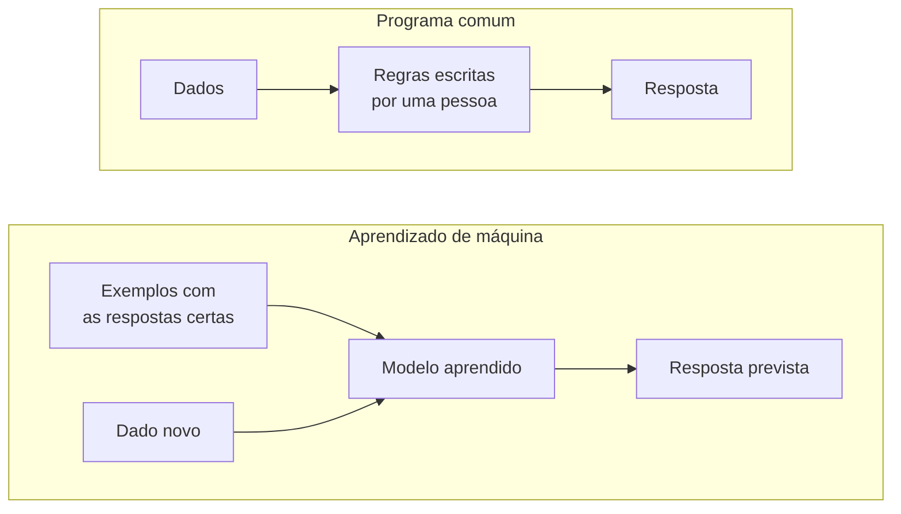

# 01 — O que é Inteligência Artificial

> **Curso:** Introdução à IA  
> **Módulo:** 01 — O que é IA (sem mistério)  
> **Tempo estimado:** 1 h 30 min  

---

## Objetivos

Ao final desta aula, você será capaz de:

- Explicar, com suas palavras, o que é **Inteligência Artificial**.
- Reconhecer **sistemas de IA** que você já usa no dia a dia.
- Diferenciar um **programa comum** (que segue regras escritas por uma pessoa) de um sistema que **aprende com exemplos**.
- Separar o que a IA **faz de verdade** do que é exagero de filme e de propaganda.
- Situar os principais momentos da **história** da IA.

## Pré-requisitos

- Usar o computador e a internet no dia a dia. Nenhum conhecimento de programação ou de matemática avançada.

---

## Uma definição sem jargão

**Inteligência Artificial (IA)** é o nome que damos a sistemas de computador que fazem tarefas que, quando feitas por pessoas, chamamos de “inteligentes”: **reconhecer** (um rosto, uma voz, uma doença em um exame), **prever** (o trânsito, a próxima palavra), **recomendar** (um vídeo, uma música), **decidir** (se um e-mail é spam) e **criar** (um texto, uma imagem).

Repare: a definição fala do que o sistema **faz**, não de como ele “pensa”. Uma IA não precisa entender o mundo como nós para acertar uma tarefa — e isso explica tanto os acertos impressionantes quanto os erros estranhos que você vai ver ao longo do curso.

!!! tip "Uma pergunta para guardar"
    Diante de qualquer IA, pergunte: **o que entra, o que sai e com que exemplos ela aprendeu?** Essa pergunta simples desmonta quase todo o mistério — e é a base do projeto deste módulo.

---

## Você já usa IA todos os dias

| Onde | O que a IA faz | Entra | Sai |
|---|---|---|---|
| Caixa de e-mail | Separa o **spam** | O texto e o remetente do e-mail | “Spam” ou “normal” |
| Celular | **Desbloqueio** pelo rosto | A imagem da câmera | “É o dono” ou “não é” |
| Vídeos e músicas | **Recomenda** o próximo | O que você assistiu, curtiu e pulou | Uma lista ordenada |
| Mapa no celular | **Prevê** o tempo de viagem | Trânsito agora e em dias parecidos | Minutos até o destino |
| Teclado do celular | **Sugere** a próxima palavra | O que você já digitou | As palavras mais prováveis |
| Tradutor | **Traduz** um texto ou a câmera | Texto ou imagem em um idioma | O texto em outro idioma |
| Banco | **Alerta de fraude** no cartão | Valor, lugar e horário da compra | “Normal” ou “suspeita” |
| Assistentes de IA (chatbots) | **Conversa** e escreve | A sua pergunta (o *prompt*) | Um texto novo |

!!! info "Na escola e no trabalho"
    Correção automática de testes, legendas automáticas em vídeos, triagem de currículos, atendimento por chat, leitura de notas fiscais, previsão de estoque. A IA raramente aparece com esse nome: ela está **dentro** de outros programas.

---

## Regras escritas × aprender com exemplos

Imagine que você precisa separar e-mails de spam.

**Jeito 1 — regras escritas por uma pessoa (programa comum):**

```text
SE o assunto tem "GRÁTIS" ou "URGENTE"  → spam
SE o remetente é desconhecido e tem mais de 5 links → spam
SENÃO → normal
```

Funciona até o golpista escrever “GR4TIS”. Aí alguém precisa escrever uma regra nova — e outra, e outra.

**Jeito 2 — aprender com exemplos (IA):** você mostra ao sistema **milhares de e-mails já marcados** como spam ou normal. O sistema descobre sozinho quais características aparecem mais em cada grupo — inclusive as que nenhuma pessoa tinha pensado em escrever. Quando chega um e-mail novo, ele compara com o que aprendeu.



Esse “jeito 2” se chama **aprendizado de máquina** e é o assunto da próxima aula. Quase tudo o que chamamos de IA hoje funciona assim.

---

## O que a IA não é

| Mito | Na verdade |
|---|---|
| “A IA pensa como uma pessoa.” | Ela encontra **padrões** nos exemplos. Pode acertar sem “entender” — e errar coisas óbvias para qualquer criança. |
| “A IA sabe tudo.” | Ela só sabe o que estava nos **dados** com que foi treinada, até uma certa data — e pode inventar quando não sabe. |
| “Se o computador disse, está certo.” | Toda IA **erra** uma parte das vezes. A pergunta é quanto, em que casos e quem confere. |
| “A IA é neutra.” | Ela aprende com dados feitos por pessoas — e pode copiar os **preconceitos** que estavam neles. |
| “A IA vai fazer tudo sozinha.” | Hoje, as IAs são boas em **tarefas específicas**. Uma IA “geral”, capaz de aprender qualquer coisa como uma pessoa, ainda é assunto de pesquisa e de muito debate. |

!!! warning "Cuidado com as duas propagandas"
    Uma diz que a IA vai resolver tudo; a outra, que ela vai destruir tudo. As duas vendem. Neste curso, a postura é a de um **usuário crítico**: entender como funciona, usar onde ajuda e conferir sempre.

---

## Uma história curta

| Ano | O que aconteceu |
|---|---|
| **1950** | Alan Turing publica um artigo perguntando se máquinas podem pensar e propõe um teste para isso, que ficou conhecido como **Teste de Turing**. |
| **1956** | Um encontro de pesquisadores em Dartmouth (EUA) usa o nome **“Inteligência Artificial”** e lança a área. |
| **1970–1990** | Períodos de euforia e de decepção (os “invernos da IA”): as promessas eram maiores que os computadores e os dados da época. |
| **1997** | O computador **Deep Blue** vence o campeão mundial de xadrez Garry Kasparov. |
| **2012** | Redes neurais treinadas com muitos dados e placas de vídeo dão um salto no **reconhecimento de imagens**. Começa a era do **aprendizado profundo**. |
| **2016** | O sistema **AlphaGo** vence um dos melhores jogadores do mundo de Go, jogo considerado difícil demais para computadores. |
| **2017** | Pesquisadores publicam a arquitetura **Transformer**, base dos modelos de linguagem atuais. |
| **2022** | O lançamento do **ChatGPT** leva os assistentes de IA generativa ao público geral; em pouco tempo surgem vários outros. |

Duas coisas explicam o salto recente: **muitos dados** (a internet) e **computadores muito mais potentes**. As ideias principais têm décadas.

---

??? note "Para saber mais: os assistentes de IA que você vai encontrar"
    O curso é **neutro**: o que você aprende vale para qualquer assistente. Os mais conhecidos hoje são **ChatGPT** (OpenAI), **Gemini** (Google), **Copilot** (Microsoft), **Claude** (Anthropic) e **Meta AI** (no WhatsApp e no Instagram). Muitas escolas e empresas liberam um deles pela conta institucional.

    Cada ferramenta tem a sua **idade mínima** e as suas regras, que mudam com o tempo. Antes de criar uma conta, leia os termos de uso — e, na escola, siga o que a instituição permite (o Módulo 04 trata disso).

---

## ⚠️ Erros comuns

- **Achar que tudo o que é automático é IA.** Uma planilha que soma sozinha segue uma fórmula escrita por alguém: é um programa comum.
- **Achar que IA é só chatbot.** O filtro de spam e a recomendação de vídeos também são IA — e há décadas.
- **Tratar a IA como pessoa** (“ela quis”, “ela mentiu de propósito”). Ela produz a saída mais provável a partir dos exemplos; não tem intenção.
- **Confiar sem conferir** porque “foi o computador que disse”.

---

## Exercícios

### Básico (fixação)

Para cada item, diga se é **IA** (aprende com exemplos) ou **programa comum** (segue regras escritas), e por quê:

1. A calculadora do celular.
2. O desbloqueio do celular pelo rosto.
3. O alarme que toca todo dia às 6 h.
4. A lista de vídeos “recomendados para você”.
5. O corretor que sublinha uma palavra que não está no dicionário.
6. O teclado que sugere a próxima palavra com base no que você costuma escrever.

<!-- gabarito -->
??? success "Gabarito — Básico"
    1. **Programa comum:** as regras da matemática foram escritas por pessoas; a resposta é sempre a mesma.
    2. **IA:** o sistema aprendeu, com muitas fotos de rostos, a reconhecer o seu rosto em luzes e ângulos diferentes.
    3. **Programa comum:** uma regra simples (“às 6 h, toque”).
    4. **IA:** aprende com o que você e milhões de pessoas assistiram, curtiram e pularam.
    5. **Programa comum:** compara com uma lista de palavras (o dicionário). Alguns corretores mais novos usam IA para sugerir a correção pelo contexto.
    6. **IA:** aprende com textos e com o **seu** jeito de escrever para prever a palavra mais provável.

    **O critério:** se alguém precisou escrever **todas** as regras, é programa comum; se o sistema descobriu os padrões a partir de **exemplos**, é IA.

### Intermediário (aplicação)

Escolha **três** sistemas de IA que você usa (no celular, na escola ou no trabalho) e monte uma tabela com: **onde está**, **o que entra**, **o que sai** e **com que exemplos você acha que ela aprendeu**.

<!-- gabarito -->
??? success "Gabarito — Intermediário"
    Um exemplo de resposta:

    | Sistema | O que entra | O que sai | Aprendeu com |
    |---|---|---|---|
    | Filtro de spam do e-mail | Texto, links e remetente | Spam ou normal | Milhões de e-mails que pessoas marcaram como spam |
    | Mapa do celular | Posição e velocidade dos celulares na via, horário, dia | Tempo estimado de viagem | Viagens anteriores nos mesmos trechos e horários |
    | Legenda automática de vídeo | O áudio | O texto falado | Muitas horas de áudio com a transcrição correta |

    **Confira:** “o que sai” é uma **previsão** ou uma **escolha** feita pelo sistema; e “aprendeu com” fala de **exemplos com a resposta certa**, não de regras.

### Avançado (desafio)

Leia as três manchetes inventadas abaixo e, para cada uma, escreva **o que pode ser verdade** e **o que provavelmente é exagero**:

1. “IA que pensa como humano é lançada e já entende tudo o que você fala.”
2. “IA acerta 95% dos diagnósticos de uma doença de pele em teste de hospital.”
3. “Nova IA vai substituir todos os professores até o ano que vem.”

<!-- gabarito -->
??? success "Gabarito — Avançado"
    1. **Verdade possível:** um assistente novo que conversa muito bem. **Exagero:** “pensa como humano” e “entende tudo” — ele produz respostas a partir de padrões, erra e pode inventar.
    2. **Verdade possível:** em um **teste específico**, com um tipo de imagem, o sistema acertou muito. **Perguntas que faltam:** 95% em quantos casos? Com que tipos de pele (se treinou só com peles claras, pode errar mais em peles escuras)? Quem confere os 5% de erros? Um bom resultado em teste não significa que funciona igual em qualquer lugar.
    3. **Verdade possível:** a IA pode ajudar em partes do trabalho (corrigir exercícios objetivos, preparar materiais). **Exagero:** “todos” e “até o ano que vem” — ensinar envolve acompanhar pessoas, avaliar, orientar e decidir, tarefas que a IA não faz sozinha.

    **O que você praticou:** separar a **notícia** da **promessa** — o primeiro passo do uso crítico de IA.

---

## 💡 Resumo

- **IA** = sistemas que reconhecem, preveem, recomendam, decidem e criam — tarefas que chamamos de inteligentes.
- A maioria das IAs **aprende com exemplos**, em vez de seguir regras escritas uma a uma.
- Ela está **dentro** de programas que você já usa: e-mail, celular, mapas, vídeos, tradutor, banco.
- IA não pensa como pessoa, **erra**, pode copiar **preconceitos** dos dados e não é neutra.
- O salto recente veio de **muitos dados** e **computadores potentes**.

## ➡️ Próximo passo

**[02 — Aprendizado de máquina: aprender com exemplos](02_aprendizado_de_maquina.md)**: como um sistema aprende a separar spam de e-mail normal — e você vai fazer isso à mão.
