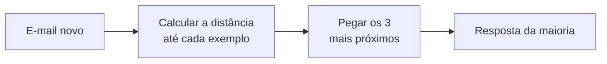

# 02 — Aprendizado de máquina: aprender com exemplos

> **Curso:** Introdução à IA  
> **Módulo:** 01 — O que é IA (sem mistério)  
> **Tempo estimado:** 1 h 30 min  

---

## Objetivos

Ao final desta aula, você será capaz de:

- Explicar o que são **dados**, **características**, **rótulos** e **modelo**.
- Entender por que se separam os dados em **treino** e **teste**.
- Reconhecer os três tipos principais de aprendizado: **supervisionado**, **não supervisionado** e **por reforço**.
- **Classificar à mão** um caso novo pelo método dos **vizinhos mais próximos**.
- Explicar o que é **decorar** em vez de aprender, e como os dados podem trazer **viés**.

## Pré-requisitos

- [Aula 01](01_o_que_e_inteligencia_artificial.md): regras escritas × aprender com exemplos.

---

## As peças do aprendizado

Pense em como uma criança aprende a reconhecer cachorros: alguém aponta vários bichos e diz “cachorro”, “gato”, “cachorro”... Depois de muitos exemplos, ela acerta bichos que nunca viu. O aprendizado de máquina segue a mesma ideia.

| Peça | O que é | No exemplo do spam |
|---|---|---|
| **Exemplos (dados)** | Os casos usados para aprender | Milhares de e-mails |
| **Características** | O que o sistema observa em cada exemplo | Número de links, palavras como “GRÁTIS”, remetente |
| **Rótulo** | A resposta certa de cada exemplo | “Spam” ou “normal”, marcado por pessoas |
| **Treino** | O momento em que o sistema procura os padrões | Descobre o que spam costuma ter |
| **Modelo** | O resultado do treino: o “aprendido” | O filtro que vai julgar e-mails novos |
| **Previsão** | A resposta do modelo para um caso novo | “Este e-mail novo é spam” |

### Treino e teste: a prova com questões novas

Para saber se o modelo **aprendeu** de verdade, separa-se uma parte dos exemplos (por exemplo, 20%) que o modelo **não vê** no treino. Depois, ele é testado com essa parte.

!!! warning "Decorar não é aprender"
    Um aluno que decora as respostas da lista de exercícios vai mal na prova com questões novas. Um modelo também pode “decorar” os exemplos de treino — acerta tudo neles e erra muito em casos novos. Por isso o teste é feito com exemplos **que ficaram de fora** do treino.

---

## Três jeitos de aprender

| Tipo | Como aprende | Exemplos |
|---|---|---|
| **Supervisionado** | Com exemplos **rotulados** (com a resposta certa) | Spam ou não; reconhecer um rosto; prever o preço de um apartamento pelo tamanho e pelo bairro |
| **Não supervisionado** | **Sem** rótulos: procura grupos e padrões sozinho | Agrupar clientes parecidos; organizar músicas por estilo; detectar compras fora do comum |
| **Por reforço** | Por **tentativa e erro**, ganhando “pontos” quando acerta | Programas que jogam xadrez e videogames; robôs que aprendem a andar |

No aprendizado supervisionado, há dois tipos de pergunta:

- **Classificação:** a resposta é uma **categoria** (spam/normal, gato/cachorro, aprovado/recusado).
- **Regressão:** a resposta é um **número** (preço, temperatura, minutos de viagem).

---

## Mão na massa: vizinhos mais próximos

Um dos métodos mais simples de aprendizado de máquina é o dos **vizinhos mais próximos**: para classificar um caso novo, procure os exemplos **mais parecidos** com ele e veja o que a maioria deles é.

Estes são 8 e-mails já rotulados. Cada um tem duas características: o número de **links** e o número de **palavras de alerta** (“GRÁTIS”, “URGENTE”, “GANHE”...).

| E-mail | Links | Palavras de alerta | Rótulo |
|---|---|---|---|
| A | 0 | 0 | Normal |
| B | 1 | 0 | Normal |
| C | 2 | 1 | Normal |
| D | 1 | 1 | Normal |
| E | 7 | 4 | Spam |
| F | 5 | 5 | Spam |
| G | 8 | 3 | Spam |
| H | 4 | 4 | Spam |

**Como medir “parecido”:** some a diferença de links com a diferença de palavras de alerta. Quanto **menor** a soma, mais parecidos.

Exemplo: um e-mail novo com **6 links** e **3 palavras**, comparado com o E (7 links, 4 palavras): diferença de links = 1, diferença de palavras = 1, **distância = 2**.

**A regra:** pegue os **3 vizinhos mais próximos** e dê a resposta da maioria.

!!! info "É assim que funciona “de verdade”?"
    Os filtros reais usam **muito** mais características (centenas ou milhares) e métodos mais sofisticados. Mas a ideia é a mesma: o modelo decide pelo que aprendeu dos **exemplos** — e não por uma regra escrita à mão.

---

## Quando o modelo erra

Nenhum modelo acerta sempre. No spam, há dois tipos de erro:

- **Falso positivo:** um e-mail **normal** que foi para o spam (a mensagem da escola que você não viu).
- **Falso negativo:** um **spam** que chegou à caixa de entrada (o golpe que passou).

Diminuir um costuma aumentar o outro. Quem projeta o sistema decide qual erro é **mais grave** — e essa é uma decisão humana, não técnica.

---

## Viés: quando os dados ensinam errado

O modelo aprende **o que está nos dados** — inclusive o que está errado neles.

- **Faltam exemplos de um grupo:** um estudo de 2018 mostrou que sistemas comerciais de análise de rosto erravam muito mais com mulheres de pele escura do que com homens de pele clara — os dados de treino tinham poucos exemplos delas.
- **Os dados repetem uma injustiça do passado:** em 2018, foi noticiado que uma grande empresa abandonou um sistema de triagem de currículos que dava notas menores a candidatas mulheres. Ele tinha aprendido com os currículos aprovados nos anos anteriores, quase todos de homens.

!!! danger "Dado de ontem decide o amanhã"
    Se uma IA decide sobre pessoas (vaga, crédito, nota, vigilância), pergunte: **com que exemplos ela aprendeu? Quem está fora desses exemplos? Quem confere os erros?** O Módulo 04 volta a esse tema.

---

??? note "Para saber mais: onde ver aprendizado de máquina funcionando"
    - **Teachable Machine** (do Google, gratuito, no navegador): você ensina o computador a reconhecer gestos, sons ou objetos pela câmera, com seus próprios exemplos, em minutos. Ótimo para ver treino e teste na prática.
    - Nos assistentes de IA, pergunte: “Explique o método dos vizinhos mais próximos com um exemplo do dia a dia” — e confira se a explicação bate com a desta aula.

---

## ⚠️ Erros comuns

- **Achar que mais dados sempre resolvem.** Mais dados **ruins** ou **enviesados** pioram o modelo.
- **Testar com os mesmos exemplos do treino.** O resultado parece ótimo e não diz nada.
- **Esquecer que alguém rotulou os exemplos.** Se os rótulos estão errados, o modelo aprende errado.
- **Ver só a taxa de acerto.** “95% de acerto” pode esconder que quase todos os erros caem sobre o mesmo grupo de pessoas.

---

## Exercícios

### Básico (fixação)

Use a tabela dos 8 e-mails e a regra dos **3 vizinhos mais próximos** para classificar:

1. Um e-mail com **6 links** e **3 palavras de alerta**.
2. Um e-mail com **2 links** e **2 palavras de alerta**.

<!-- gabarito -->
??? success "Gabarito — Básico"
    1. **(6 links, 3 palavras):** distâncias — E = 1 + 1 = **2**; G = 2 + 0 = **2**; F = 1 + 2 = **3**; H = 2 + 1 = **3**; C = 4 + 2 = 6; D = 5 + 2 = 7; B = 5 + 3 = 8; A = 6 + 3 = 9. Os 3 mais próximos são E, G e um entre F e H (empatados) — todos **Spam**. Resposta: **Spam**.
    2. **(2 links, 2 palavras):** C = 0 + 1 = **1**; D = 1 + 1 = **2**; B = 1 + 2 = **3**; A = 2 + 2 = 4; H = 2 + 2 = 4; F = 3 + 3 = 6; E = 5 + 2 = 7; G = 6 + 1 = 7. Os 3 mais próximos: C, D e B — todos **Normal**. Resposta: **Normal**.

### Intermediário (aplicação)

1. Classifique um e-mail com **3 links** e **2 palavras de alerta**. Ele está “na fronteira”: mostre as distâncias e explique a decisão.
2. Esse e-mail, na verdade, era um **golpe**. Que tipo de erro o modelo cometeu? Dê **duas** ideias para o modelo acertar casos assim no futuro.

<!-- gabarito -->
??? success "Gabarito — Intermediário"
    1. Distâncias: C = 1 + 1 = **2**; D = 2 + 1 = **3**; H = 1 + 2 = **3**; B = 2 + 2 = 4; A = 3 + 2 = 5; F = 2 + 3 = 5; E = 4 + 2 = 6; G = 5 + 1 = 6. Os 3 mais próximos: **C (Normal)**, **D (Normal)** e **H (Spam)**. Maioria: **Normal**.
    2. Foi um **falso negativo** (um spam que passou como normal). Ideias:
        - **Mais exemplos rotulados** perto da fronteira (e-mails com 2 a 4 links), para o modelo ter casos parecidos para comparar.
        - **Mais características:** remetente conhecido ou não, se o link leva para um endereço estranho, se pede senha ou dinheiro. Com mais informação, casos parecidos em links e palavras podem ficar diferentes em outras coisas.

### Avançado (desafio)

1. Classifique cada situação como aprendizado **supervisionado** (diga se é **classificação** ou **regressão**), **não supervisionado** ou **por reforço**:
    - a) Prever quantos lanches a cantina vai vender amanhã.
    - b) Separar os clientes de uma loja em grupos com hábitos parecidos, sem saber antes que grupos existem.
    - c) Um programa que aprende a jogar damas jogando milhares de partidas contra si mesmo.
    - d) Identificar se uma foto de folha mostra uma planta doente ou saudável.
2. Uma cidade quer usar IA para decidir **onde colocar mais policiamento**, treinada com os registros de ocorrências dos últimos dez anos. Que **viés** pode aparecer? O que você perguntaria antes de aprovar o sistema?

<!-- gabarito -->
??? success "Gabarito — Avançado"
    1. a) **Supervisionado — regressão** (a resposta é um número, aprendido com as vendas passadas). b) **Não supervisionado** (não há rótulos; o sistema encontra os grupos). c) **Por reforço** (tentativa e erro, com “pontos” ao vencer). d) **Supervisionado — classificação** (doente ou saudável, aprendido com fotos rotuladas).
    2. **Viés possível:** os registros mostram onde houve **mais policiamento** (e, por isso, mais ocorrências registradas), não necessariamente onde há mais crime. O sistema manda mais polícia para os mesmos bairros, que geram mais registros, que “confirmam” a previsão — um ciclo que pode reforçar a vigilância sobre certos bairros e grupos.

        **Perguntas antes de aprovar:** que dados foram usados e que bairros estão sub-representados? O sistema foi testado para ver se erra mais em certas regiões ou grupos? Quem confere as decisões e como os moradores podem contestar? Há uma pessoa responsável pelo uso?

---

## 💡 Resumo

- Aprender com exemplos: **dados** com **características** e **rótulos** ➔ **treino** ➔ **modelo** ➔ **previsão**.
- **Teste** com exemplos que ficaram fora do treino; **decorar** não é aprender.
- **Supervisionado** (classificação ou regressão), **não supervisionado** (grupos) e **por reforço** (tentativa e erro).
- **Vizinhos mais próximos:** os casos mais parecidos decidem pela maioria.
- Erros (**falso positivo** e **falso negativo**) e **viés** vêm dos dados — e decidir o que é aceitável é uma escolha humana.

## ➡️ Próximo passo

**[03 — Redes neurais e aprendizado profundo](03_redes_neurais.md)**: o “neurônio” artificial que você vai calcular à mão — e por que empilhar milhões deles mudou tudo.
