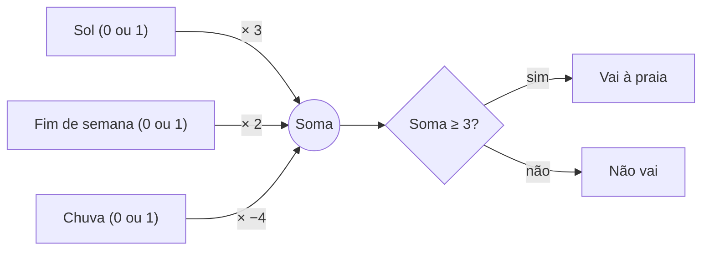

# 03 — Redes neurais e aprendizado profundo

> **Curso:** Introdução à IA  
> **Módulo:** 01 — O que é IA (sem mistério)  
> **Tempo estimado:** 1 h 30 min  

---

## Objetivos

Ao final desta aula, você será capaz de:

- Explicar o que faz um **neurônio artificial**: entradas, **pesos**, soma e decisão.
- **Calcular à mão** a decisão de um neurônio simples.
- Entender o que é **treinar** uma rede: ajustar os pesos quando ela erra.
- Explicar o que é **aprendizado profundo** e por que ele funciona tão bem com imagens, voz e texto.
- Reconhecer o problema da **caixa-preta**: quando nem quem fez o sistema consegue explicar uma decisão.

## Pré-requisitos

- [Aula 02](02_aprendizado_de_maquina.md): exemplos, rótulos, treino e teste.
- Somar e multiplicar números pequenos (inclusive negativos).

---

## O neurônio artificial: uma votação com pesos

O nome vem do cérebro, mas a ideia é simples. Pense em como você decide **ir ou não à praia**:

- Tem **sol**? Isso pesa **a favor**.
- É **fim de semana**? Também pesa a favor, um pouco menos.
- Está **chovendo**? Pesa **muito contra**.

Um **neurônio artificial** faz exatamente isso: cada **entrada** (1 = sim, 0 = não) é multiplicada pelo seu **peso**, os resultados são somados e, se a soma passar de um **limite**, a resposta é “sim”.

| Entrada | Peso |
|---|---|
| Sol | **+3** |
| Fim de semana | **+2** |
| Chuva | **−4** |
| **Limite** para ir | soma **≥ 3** |

**Exemplo:** sábado com sol e sem chuva ➔ 3 × 1 + 2 × 1 + (−4) × 0 = **5**. Como 5 ≥ 3, **vai**.

!!! info "Os pesos são o que a rede “sabe”"
    Ninguém escreve a regra “se tem sol e é sábado, vá”. A regra está **escondida nos pesos**. Mudou os pesos, mudou o comportamento. Treinar uma rede é encontrar bons pesos.

---

## Treinar: ajustar os pesos quando erra

Como encontrar os pesos? Com **exemplos** (aula 02): o neurônio dá a sua resposta, compara com a resposta certa e, quando erra, **ajusta** um pouco os pesos na direção certa.

Uma regra simples de ajuste (usada no **perceptron**, um dos primeiros neurônios artificiais, dos anos 1950):

- Se o neurônio disse **“não”** e a resposta certa era **“sim”**: **some 1** ao peso de cada entrada que estava ligada (= 1).
- Se disse **“sim”** e a certa era **“não”**: **subtraia 1** desses pesos.
- Repita com **todos os exemplos**, várias vezes, até os erros pararem (ou ficarem raros).

As redes modernas usam uma versão matemática bem mais refinada dessa ideia, com milhões ou bilhões de pesos ajustados ao mesmo tempo — mas o espírito é esse: **errou, ajusta um pouco; acertou, deixa como está.**

---

## Redes neurais e aprendizado profundo

Um neurônio sozinho só faz decisões simples. A força vem de **ligar muitos neurônios em camadas**: as saídas de uma camada são as entradas da próxima.

- Em uma rede que reconhece imagens, as primeiras camadas aprendem a detectar **bordas** e **manchas de cor**; as do meio combinam isso em **formas** (olho, roda, folha); as últimas reconhecem **objetos** (rosto, carro, planta doente).
- Ninguém programou “o que é um olho”: a rede descobriu sozinha, ajustando os pesos com milhões de fotos rotuladas.
- Quando a rede tem **muitas camadas**, chamamos de **aprendizado profundo** (*deep learning*).

| Área | O que o aprendizado profundo faz |
|---|---|
| **Visão** | Reconhecer rostos, ler placas, apontar alterações em exames de imagem |
| **Voz** | Transformar fala em texto (legendas, assistentes de voz) e texto em fala |
| **Texto** | Traduzir, resumir, responder perguntas — os assistentes de IA da próxima aula |
| **Jogos e ciência** | Jogar Go e xadrez; prever a forma de proteínas |

!!! tip "Por que só agora?"
    As redes neurais existem desde os anos 1950, mas precisam de **muitos exemplos** e de **muito cálculo**. A partir de 2010, a internet trouxe os exemplos e as placas de vídeo (feitas para games) trouxeram o cálculo. Foi isso que mudou.

---

## A caixa-preta

Uma rede grande tem milhões de pesos. Mesmo quem a construiu **não consegue ler** nos pesos o “porquê” de uma decisão. Isso cria problemas reais:

- Uma pessoa tem o crédito negado por um sistema e ninguém sabe dizer o motivo.
- Uma rede de imagens “aprende” a reconhecer cavalos pela marca d’água que aparecia nas fotos de cavalos, e não pelo animal — e ninguém percebe até ela errar.

Por isso existem pesquisas de **IA explicável** e leis que exigem que decisões automáticas importantes possam ser **revistas por uma pessoa**. No Brasil, a Lei Geral de Proteção de Dados (**LGPD**) dá a quem foi afetado por uma decisão automatizada o direito de pedir a **revisão** dessa decisão.

---

??? note "Para saber mais: experimente sem instalar nada"
    - **TensorFlow Playground** (gratuito, no navegador): uma rede neural pequena que você vê aprendendo em tempo real — dá para mudar o número de camadas e de neurônios e ver os pesos mudando de cor.
    - **Teachable Machine** (aula 02): treine uma rede de verdade com a câmera do computador e veja os erros com objetos parecidos.

---

## ⚠️ Erros comuns

- **Achar que a rede neural é um cérebro.** É uma conta: multiplicações, somas e ajustes. O nome é só inspiração.
- **Achar que alguém programou o que a rede sabe.** O conhecimento está nos **pesos**, encontrados no treino.
- **Achar que rede maior é sempre melhor.** Sem exemplos suficientes e variados, ela só **decora**.
- **Aceitar “o sistema decidiu” como explicação.** Decisões importantes precisam de uma pessoa responsável e de revisão.

---

## Exercícios

### Básico (fixação)

Use o **neurônio da praia** (sol +3, fim de semana +2, chuva −4, limite 3) e calcule a soma e a decisão:

1. Sábado, com sol, sem chuva.
2. Terça-feira, com sol e com chuva.
3. Domingo nublado (sem sol), sem chuva.
4. Quarta-feira, com sol, sem chuva.

<!-- gabarito -->
??? success "Gabarito — Básico"
    | Caso | Sol | Fim de semana | Chuva | Soma | Decisão |
    |---|---|---|---|---|---|
    | 1 | 1 | 1 | 0 | 3 + 2 + 0 = **5** | **Vai** |
    | 2 | 1 | 0 | 1 | 3 + 0 − 4 = **−1** | Não vai |
    | 3 | 0 | 1 | 0 | 0 + 2 + 0 = **2** | Não vai |
    | 4 | 1 | 0 | 0 | 3 + 0 + 0 = **3** | **Vai** (3 ≥ 3) |

    **Repare no caso 4:** a soma é **exatamente** o limite. A regra diz “≥ 3”, então vai. Com “> 3”, não iria — detalhes da regra mudam decisões.

### Intermediário (aplicação)

Um amigo **foi** à praia em um **sábado com sol e uma chuva rápida**. O neurônio errou esse caso.

1. Calcule o que o neurônio respondeu.
2. Aplique a regra de ajuste do perceptron e escreva os **pesos novos**.
3. Com os pesos novos, refaça a tabela das **8 combinações** possíveis (sol, fim de semana e chuva valendo 0 ou 1). Além do caso corrigido, **que outra decisão mudou?** Isso é bom ou ruim?

<!-- gabarito -->
??? success "Gabarito — Intermediário"
    1. Sol 1, fim de semana 1, chuva 1: 3 + 2 − 4 = **1** ➔ **não vai**. A resposta certa era “vai”: erro.
    2. O neurônio disse “não” e o certo era “sim” ➔ **some 1** aos pesos das entradas ligadas (as três): **sol +4**, **fim de semana +3**, **chuva −3**. O limite continua 3.
    3. Tabela com os pesos novos:

        | Sol | Fim de semana | Chuva | Soma | Decisão | Antes |
        |---|---|---|---|---|---|
        | 0 | 0 | 0 | 0 | Não vai | Não vai |
        | 0 | 0 | 1 | −3 | Não vai | Não vai |
        | 0 | 1 | 0 | **3** | **Vai** | Não vai |
        | 0 | 1 | 1 | 0 | Não vai | Não vai |
        | 1 | 0 | 0 | 4 | Vai | Vai |
        | 1 | 0 | 1 | 1 | Não vai | Não vai |
        | 1 | 1 | 0 | 7 | Vai | Vai |
        | 1 | 1 | 1 | **4** | **Vai** | Não vai |

        Além do caso corrigido, mudou o **fim de semana nublado e sem chuva**, que agora é “vai”. Pode ser bom ou ruim: depende do que o seu amigo faz nesses dias. **A lição:** corrigir um exemplo mexe nos outros. Por isso as redes são treinadas com **muitos** exemplos, várias vezes — para os ajustes valerem para todos, e não só para o último erro.

### Avançado (desafio)

1. Crie o seu próprio neurônio para decidir **“aceitar um convite para uma festa”**, com **três entradas** (escolha quais) e os **pesos** e o **limite**. Escreva **quatro situações** e mostre que o neurônio decide como você decidiria.
2. Explique, em um parágrafo, por que uma rede que reconhece rostos pode funcionar muito bem nos testes da empresa que a criou e mal em uma escola de outra região do país.

<!-- gabarito -->
??? success "Gabarito — Avançado"
    1. Um exemplo (o seu será diferente): **Amigos vão** +3, **Tenho prova no dia seguinte** −4, **Fica perto** +1, limite **3**.

        | Amigos vão | Prova amanhã | Perto | Soma | Decisão |
        |---|---|---|---|---|
        | 1 | 0 | 1 | 4 | Aceito |
        | 1 | 0 | 0 | 3 | Aceito |
        | 1 | 1 | 1 | 0 | Não aceito |
        | 0 | 0 | 1 | 1 | Não aceito |

        **Confira:** pesos **positivos** para o que pesa a favor, **negativos** para o que pesa contra, e o **tamanho** do peso mostra a importância. Se alguma situação saiu diferente do que você faria, ajuste um peso ou o limite — você acabou de **treinar** o seu neurônio.
    2. A rede aprende com os **exemplos de treino**. Se as fotos usadas pela empresa tinham pouca variedade de tons de pele, idades, iluminação ou câmeras, os testes (feitos com fotos parecidas) dão ótimos resultados, mas na escola, com outro público, outra luz e outras câmeras, os casos são **diferentes do que a rede viu** e os erros aumentam. É o **viés dos dados** da aula 02 aparecendo em uma rede neural.

---

## 💡 Resumo

- **Neurônio artificial:** entradas × **pesos** ➔ soma ➔ compara com o **limite** ➔ decisão.
- **Treinar** = ajustar os pesos quando erra, com muitos exemplos, várias vezes.
- **Rede neural:** muitos neurônios em camadas; **aprendizado profundo** = muitas camadas, que descobrem sozinhas bordas, formas e objetos.
- Funciona tão bem agora por causa de **muitos dados** e **muito cálculo**.
- **Caixa-preta:** decisões difíceis de explicar ➔ revisão humana (a LGPD garante pedir revisão de decisões automatizadas).

## ➡️ Próximo passo

**[04 — IA generativa e modelos de linguagem](04_ia_generativa.md)**: como funcionam os assistentes que escrevem textos e criam imagens — e por que às vezes inventam coisas.
