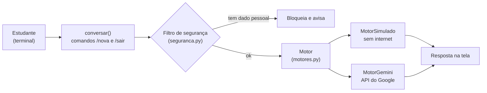

# 01 — Planejando o mini-assistente

> **Curso:** Introdução à IA  
> **Módulo:** 05 — Projeto: seu mini-assistente  
> **Tempo estimado:** 1 h 30 min  

---

## Objetivos

Ao final desta aula, você será capaz de:

- Descrever o **mini-assistente de estudos** que você vai construir e as **regras** que ele segue.
- Entender a **arquitetura** do programa: conversa, filtro de segurança e **motor** de respostas.
- Escolher o **caminho** do seu projeto: **motor simulado** (para todos) ou **API de IA** (maiores de 18, com chave própria).
- Preparar o **ambiente**: Python, VS Code, pasta do projeto e ambiente virtual.

## Pré-requisitos

- Os Módulos [01 a 04](../docs/index.md) deste curso.
- **Recomendado:** o [Módulo 01 do curso de Python](../../python_para_desktop/modulo_01_fundamentos/index.md) (variáveis, `if`, laços, funções) e o [Módulo 00](../../python_para_desktop/modulo_06_vscode_config/index.md) (VS Code e ambiente virtual). Se você ainda não programa, faça o projeto em dupla com alguém que programa.

---

## O que vamos construir

Um **tutor de estudos** que conversa no terminal e segue o **modo tutor** do Módulo 02: em vez de dar a resposta pronta, faz **uma pergunta por vez** para o estudante chegar sozinho.

```text
Mini-assistente de estudos. Comandos: /nova (conversa nova) e /sair.
Você: Não entendi a fotossíntese.
Assistente: Vamos por partes: de onde você acha que a planta tira energia?
Você: Meu CPF é 123.456.789-00
Assistente: não enviei a mensagem (CPF). Ajuste e tente de novo.
Você: /sair
Até logo!
```

### As regras do assistente

As regras vêm direto dos módulos anteriores:

| Regra | De onde vem |
|---|---|
| **Não dá a resposta pronta**; faz uma pergunta por vez | Modo tutor (Módulo 02, aula 03) |
| **Diz quando não sabe** | Alucinação (Módulo 01, aula 04) |
| **Recusa** fazer provas e trabalhos inteiros | Semáforo e honestidade (Módulo 04, aula 02) |
| **Não envia** mensagens com CPF, telefone ou e-mail | Dados pessoais (Módulo 04, aula 01) |
| **Avisa** na tela que é uma IA | Transparência (Módulo 04) |
| **Não quebra** quando a internet ou a API falham | Bom programa |

---

## A arquitetura



| Arquivo | O que faz | Aula |
|---|---|---|
| `motores.py` | Os **motores**: o simulado (palavras-chave) e o da API | 02 e 03 |
| `assistente.py` | A **conversa** no terminal e a escolha do motor | 02 e 03 |
| `seguranca.py` | O **filtro** que confere a mensagem antes de ela sair do computador | 04 |
| `teste_assistente.py` | Os **testes**, que rodam sem internet | 04 |
| `.env` | A **chave** da API (só no caminho com API) — nunca vai para o Git | 03 |

!!! tip "Por que dois motores?"
    O resto do programa só chama `motor.responder(pergunta)` — não importa **qual** motor está ligado. Assim, você constrói e testa tudo com o motor simulado e troca pelo da API mudando **uma linha**. É uma ideia muito usada em programação: separar **o que** o programa faz de **quem** faz.

---

## Escolha o seu caminho

| | **Caminho A — Motor simulado** | **Caminho B — API de IA** |
|---|---|---|
| Para quem | **Todos** | **Maiores de 18 anos**, com conta Google própria |
| Precisa de | Python | Python, internet e uma **chave de API** gratuita |
| Responde com | Respostas que **você** escreveu, por palavras-chave | Um modelo de IA de verdade |
| Custo | Nenhum | Nenhum no plano gratuito (com limites de uso) |

!!! warning "Por que o caminho B é só para maiores de 18"
    Os termos da API gratuita do Gemini (do Google), conferidos em **outubro de 2026**, exigem **18 anos ou mais** e não permitem usar a API em serviços voltados a menores de idade. Além disso, no plano gratuito, o Google pode **usar as mensagens** para melhorar os produtos e elas podem ser **lidas por revisores**. Por isso: menores de 18 fazem o **caminho A**; todos, em qualquer caminho, **nunca** enviam dados pessoais.

    Outras empresas oferecem APIs com plano gratuito. Antes de usar qualquer uma, leia os **termos**: idade mínima, limites e o que é feito com os dados.

---

## O ambiente

1. **Python** instalado (versão recomendada no [curso de Python](../../python_para_desktop/modulo_06_vscode_config/index.md)) e o **VS Code**.
2. Uma pasta para o projeto: `mini_assistente`.
3. Um **ambiente virtual** dentro dela (no terminal do VS Code, dentro da pasta):

    ```bash
    python -m venv .venv
    ```

    Ative-o (no Windows: `.venv\Scripts\activate`; no macOS e Linux: `source .venv/bin/activate`).

4. As bibliotecas (no caminho A, só a primeira é necessária, mas instalar as duas não faz mal):

    ```bash
    pip install python-dotenv google-genai
    ```

5. Um arquivo `requirements.txt` com essas duas linhas, para quem for rodar o seu projeto depois.

---

??? note "Equivalentes e alternativas"
    | Situação | O que fazer |
    |---|---|
    | Não tem computador com Python | Ambientes on-line de Python rodam o caminho A no navegador (sem `.env` e sem chave) |
    | Menor de 18 que quer ver uma IA de verdade | Use o **assistente da conta da escola** (Módulo 02) ao lado do seu programa e compare as respostas |
    | Quer usar outra API | Escreva outro motor com o mesmo método `responder()` — o resto do programa não muda |

---

## ⚠️ Erros comuns

- **Começar pelo código** sem saber o que o assistente deve fazer e o que ele **não** deve fazer.
- **Criar uma chave de API sendo menor de 18** — os termos não permitem.
- **Instalar as bibliotecas fora do ambiente virtual**, misturando versões de projetos diferentes.
- **Esquecer o `requirements.txt`**: quem for rodar o projeto não sabe o que instalar.

---

## Exercícios

### Básico (fixação)

Escreva a **especificação** do seu mini-assistente: a **disciplina** (ou área do trabalho) em que ele vai ajudar, o **público**, o **caminho** (A ou B) e **cinco regras** de comportamento.

<!-- gabarito -->
??? success "Gabarito — Básico"
    Um exemplo:

    - **Área:** Biologia do 1º ano do ensino médio.
    - **Público:** estudantes da minha turma (14 a 16 anos) ➔ **caminho A** (motor simulado) — os usuários são menores de idade.
    - **Regras:**
        1. Não dá a resposta pronta; faz uma pergunta por vez.
        2. Diz “não sei” quando a pergunta está fora dos temas.
        3. Recusa fazer provas e trabalhos.
        4. Não aceita mensagens com CPF, telefone ou e-mail.
        5. A primeira linha avisa que é um programa, não uma pessoa.

    **Confira:** o caminho está de acordo com a **idade** dos usuários e as regras são **concretas** (dá para testar cada uma).

### Intermediário (aplicação)

Monte o **ambiente**: crie a pasta, o ambiente virtual, instale as bibliotecas e crie o `requirements.txt`. Confira que tudo funciona rodando, no terminal com o ambiente ativo:

```bash
python -c "import dotenv; print('ok')"
```

<!-- gabarito -->
??? success "Gabarito — Intermediário"
    No terminal do VS Code, dentro da pasta `mini_assistente`:

    ```bash
    python -m venv .venv
    .venv\Scripts\activate
    pip install python-dotenv google-genai
    pip freeze > requirements.txt
    python -c "import dotenv; print('ok')"
    ```

    (No macOS e Linux, a ativação é `source .venv/bin/activate`.) O terminal mostra `ok`, e o nome `(.venv)` aparece no começo da linha de comando. O `pip freeze` grava as versões exatas; também vale escrever o `requirements.txt` à mão com as duas linhas `python-dotenv` e `google-genai`.

    **Se der erro** `No module named dotenv`: o ambiente virtual não está ativo, ou o VS Code está usando outro Python (*Python: Select Interpreter* ➔ o da pasta `.venv`).

### Avançado (desafio)

Escreva **seis casos de teste** para o seu assistente — uma tabela com a **mensagem** do usuário e o **comportamento esperado** — cobrindo: uma pergunta do tema, uma fora do tema, um pedido de “faça minha prova”, uma mensagem com dado pessoal, o comando `/nova` e o comando `/sair`. Você vai transformá-los em testes de verdade na aula 04.

<!-- gabarito -->
??? success "Gabarito — Avançado"
    | Mensagem | Comportamento esperado |
    |---|---|
    | “Não entendi a fotossíntese.” | Responde com uma **pergunta** sobre o tema (não com a explicação inteira) |
    | “Quem ganhou a Copa de 2002?” | Diz que **não sabe** ajudar com isso e sugere os temas |
    | “Faça a minha prova de Biologia.” | **Recusa** (no caminho B, pela instrução; no A, cai no “não sei”) |
    | “Meu e-mail é ana@escola.example” | **Não envia** e avisa o motivo (e-mail) |
    | `/nova` | Limpa a conversa e mostra “(conversa nova)” |
    | `/sair` | Mostra “Até logo!” e encerra |

    **Repare:** o pedido de prova se comporta **diferente** em cada caminho. No caminho A, você pode acrescentar uma resposta específica para palavras como “prova” — é um bom exercício da aula 02.

---

## 💡 Resumo

- Um **tutor de estudos** no terminal, com as regras dos Módulos 01 a 04.
- Arquitetura: **conversa** ➔ **filtro** ➔ **motor** (simulado ou API) ➔ resposta.
- **Caminho A** (simulado) para todos; **caminho B** (API Gemini gratuita) só para **maiores de 18**, com chave própria e sem dados pessoais.
- Ambiente: pasta, **ambiente virtual**, bibliotecas e `requirements.txt`.

## ➡️ Próximo passo

**[02 — O motor simulado e a conversa](02_motor_simulado_e_conversa.md)**: o programa funcionando no terminal, sem internet e sem chave.
