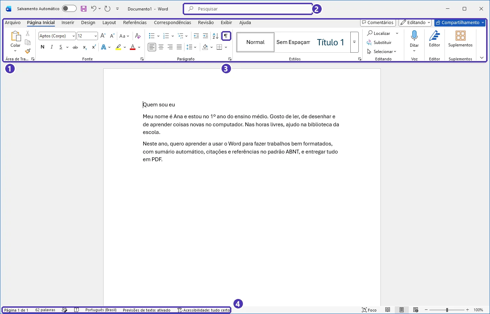
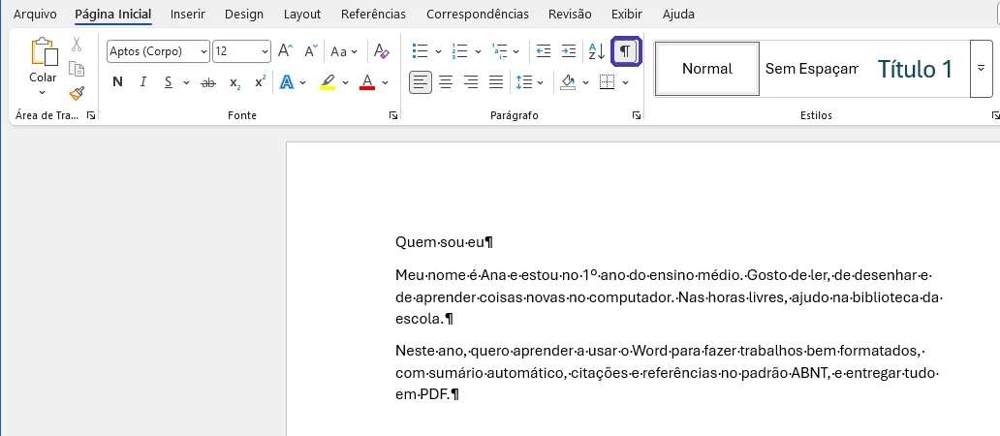
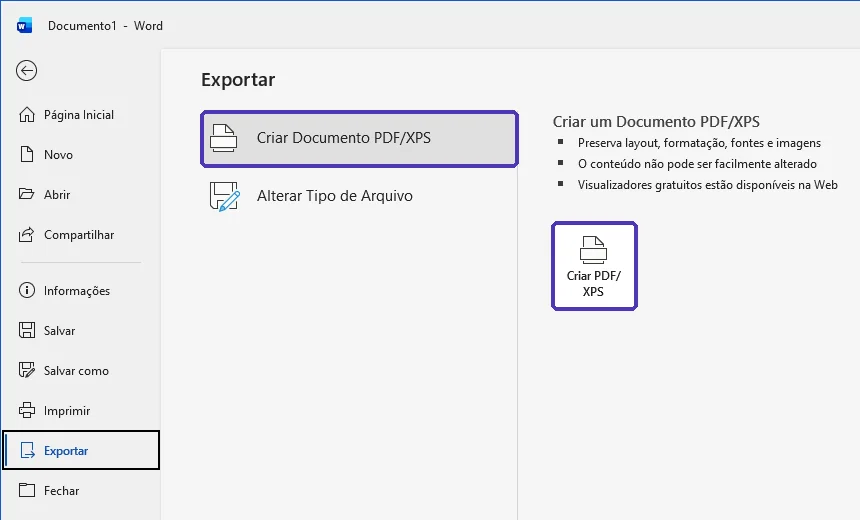
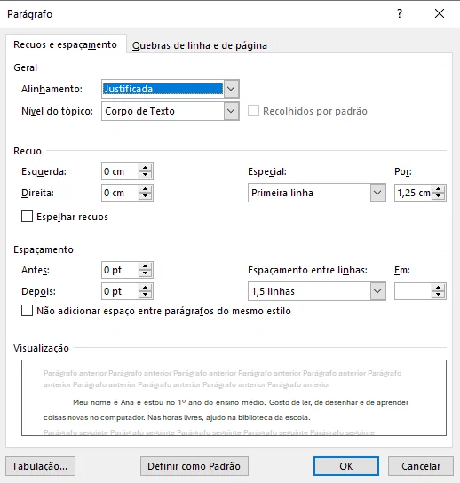
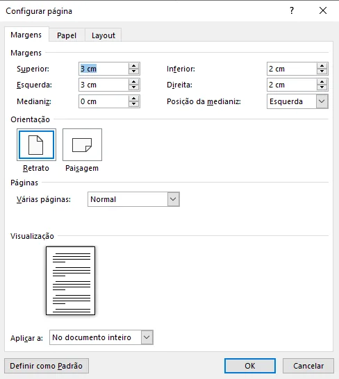

# 01 — Primeiros passos e formatação

> **Curso:** Pacote Office  
> **Módulo:** 01 — Word  
> **Tempo estimado:** 1 h 30 min  

---

## Objetivos

Ao final desta aula, você será capaz de:

- Reconhecer as partes da tela do Word e encontrar qualquer comando pela **faixa de opções** ou pela **pesquisa**.
- Salvar o documento em `.docx` e exportar uma cópia em **PDF**.
- Formatar **caracteres** (fonte, tamanho, negrito, cor) e **parágrafos** (alinhamento, espaçamento, recuo).
- Configurar a **página**: tamanho A4 e margens.
- Usar os atalhos de teclado do Word em português.

## Pré-requisitos

- Saber usar mouse e teclado e salvar arquivos em pastas.
- Ter acesso ao Word do Microsoft 365 (no computador ou em [office.com](https://www.office.com) com o e-mail da escola).

---

## A tela do Word

Ao abrir um **Documento em branco**, você vê:

| Parte | Para que serve |
|---|---|
| **Faixa de opções** | As abas no topo (*Página Inicial*, *Inserir*, *Layout*, *Referências*, *Correspondências*, *Revisão*, *Exibir*). Cada aba agrupa comandos parecidos. |
| **Caixa de pesquisa** | No alto da janela. Digite o que quer fazer (“margens”, “sumário”) e o Word mostra o comando. É o atalho para quando você não lembra onde fica algo. |
| **Régua** | Mostra margens e recuos. Se não aparecer: *Exibir ➔ Régua*. |
| **Barra de status** | Embaixo: número de páginas, de palavras e o zoom. |

<figure markdown="span">
  { loading=lazy }
  <figcaption>(1) Faixa de opções, com as abas e os grupos de comandos · (2) caixa de pesquisa · (3) botão ¶ (Mostrar Tudo) · (4) barra de status.</figcaption>
</figure>

!!! tip "Mostrar a formatação escondida"
    Na aba *Página Inicial*, o botão **¶** (Mostrar Tudo) exibe espaços, quebras de linha e de página como símbolos. Ele não aparece na impressão e é a melhor forma de descobrir por que algo "pulou" de lugar.

<figure markdown="span">
  { loading=lazy }
  <figcaption>Com o ¶ ligado, cada ponto é um espaço e cada ¶ é um <em>Enter</em>.</figcaption>
</figure>

---

## Salvar e exportar em PDF

- **Salvar:** *Arquivo ➔ Salvar como*. Escolha a pasta e dê um nome claro, como `trabalho_historia_ana.docx`.
- **Salvamento Automático:** se o arquivo estiver no **OneDrive** (conta da escola), a chave *Salvamento Automático* no canto superior esquerdo salva sozinha a cada alteração.
- **PDF:** *Arquivo ➔ Exportar ➔ Criar Documento PDF/XPS*. Envie sempre o PDF quando o professor pedir “a versão final”: ele abre igual em qualquer computador ou celular, sem desconfigurar.

<figure markdown="span">
  { loading=lazy }
  <figcaption><em>Arquivo ➔ Exportar ➔ Criar Documento PDF/XPS</em> e, à direita, o botão <strong>Criar PDF/XPS</strong>.</figcaption>
</figure>

!!! warning "Entregue o PDF, guarde o .docx"
    O `.docx` é o arquivo de trabalho — é nele que você corrige. O PDF é a “foto” do documento pronto. Mantenha os dois.

---

## Formatação de caracteres

Selecione o texto e use o grupo **Fonte** da *Página Inicial*: tipo de fonte, tamanho, **negrito**, *itálico*, sublinhado, cor e realce.

- Para trabalhos escolares, use fontes simples e legíveis: **Arial** ou **Times New Roman**, tamanho **12**.
- **Shift + F3** alterna o texto selecionado entre minúsculas, MAIÚSCULAS e Iniciais Maiúsculas.
- **Pincel de Formatação** (*Página Inicial*, ícone de pincel): copia a formatação de um trecho e “pinta” em outro. Clique duas vezes no pincel para aplicar em vários lugares; *Esc* para parar.

---

## Formatação de parágrafos

No Word, **parágrafo** é tudo o que vem antes de um *Enter*. Clique no parágrafo (não precisa selecionar) e ajuste no grupo **Parágrafo**, ou abra a janela completa pela setinha no canto do grupo.

| Ajuste | Onde | Valor comum em trabalhos |
|---|---|---|
| Alinhamento | Botões do grupo *Parágrafo* | **Justificado** |
| Espaçamento entre linhas | *Parágrafo ➔ Espaçamento entre linhas* | **1,5 linha** |
| Espaçamento antes e depois | *Parágrafo ➔ Antes / Depois* | **0 pt** |
| Recuo da primeira linha | *Parágrafo ➔ Especial: Primeira linha* | **1,25 cm** |

<figure markdown="span">
  { loading=lazy }
  <figcaption>A janela <strong>Parágrafo</strong> com os valores comuns em trabalhos — tudo no mesmo lugar.</figcaption>
</figure>

!!! warning "Não use Tab nem espaços para recuar"
    O recuo de primeira linha faz o trabalho sozinho em todos os parágrafos. Apertar *Tab* ou a barra de espaço para “empurrar” o texto deixa o documento torto e difícil de corrigir.

---

## Configuração da página

Aba **Layout**:

- **Tamanho ➔ A4** (é o papel padrão no Brasil).
- **Margens ➔ Margens Personalizadas**. No padrão ABNT: **Superior 3 cm**, **Esquerda 3 cm**, **Inferior 2 cm**, **Direita 2 cm**.
- **Orientação:** *Retrato* (em pé) é o normal; use *Paisagem* (deitada) só em páginas com tabelas largas.

<figure markdown="span">
  { loading=lazy }
  <figcaption>Em <em>Margens Personalizadas</em>, a janela <strong>Configurar página</strong> com as margens do padrão ABNT.</figcaption>
</figure>

---

## Atalhos do Word em português

Os atalhos acompanham o **idioma do Office**. No Word em português:

| Atalho | Ação | Atalho | Ação |
|---|---|---|---|
| `Ctrl + N` | **Negrito** | `Ctrl + B` | **Salvar** |
| `Ctrl + I` | Itálico | `Ctrl + O` | Novo documento |
| `Ctrl + S` | Sublinhado | `Ctrl + A` | Abrir |
| `Ctrl + E` | Centralizar | `Ctrl + T` | Selecionar tudo |
| `Ctrl + J` | Justificar | `Ctrl + L` | Localizar |
| `Ctrl + Z` | Desfazer | `Ctrl + U` | Substituir |
| `Ctrl + R` | Refazer | `Ctrl + Enter` | Quebra de página |

!!! info "Word em inglês?"
    Se o Office estiver em inglês, os atalhos mudam: `Ctrl + B` vira negrito (*bold*), `Ctrl + S` salva (*save*) e `Ctrl + F` localiza (*find*). Na dúvida, passe o mouse sobre o botão: a dica mostra o atalho.

---

??? note "Equivalentes gratuitos: LibreOffice Writer e Google Docs"
    | Tarefa | LibreOffice Writer | Google Docs |
    |---|---|---|
    | Parágrafo (recuo, espaçamento) | *Formatar ➔ Parágrafo* | *Formatar ➔ Alinhamento e recuo ➔ Opções de recuo* |
    | Margens e A4 | *Formatar ➔ Estilo de página ➔ Página* | *Arquivo ➔ Configuração da página* |
    | Exportar PDF | *Arquivo ➔ Exportar como ➔ Exportar como PDF* | *Arquivo ➔ Fazer download ➔ Documento PDF* |
    | Pincel de formatação | Ícone de pincel (*Clonar formatação*) | Ícone de rolo de pintura |

---

## ⚠️ Erros comuns

- **Apertar Enter várias vezes para pular de página.** Quando o texto anterior cresce, tudo desce junto. Use `Ctrl + Enter` (quebra de página).
- **Formatar parágrafo por parágrafo.** Configure o primeiro e use o pincel — ou, melhor ainda, use **estilos** (próxima aula).
- **Enviar só o .docx.** Em outro computador ele pode abrir com outra fonte e desconfigurar. Envie o PDF.

---

## Exercícios

### Básico (fixação)

1. Crie um documento novo e escreva um título (“Quem sou eu”) e dois parágrafos sobre você.
2. Deixe o título **centralizado**, em **negrito** e tamanho **14**; os parágrafos em fonte **12**, **justificados**, com espaçamento **1,5** e recuo de primeira linha de **1,25 cm**.
3. Salve como `quem_sou_eu.docx` e exporte uma cópia em PDF.

<!-- gabarito -->
??? success "Gabarito — Básico"
    1. *Arquivo ➔ Novo ➔ Documento em branco*. Digite o título, `Enter`, e os dois parágrafos (um `Enter` entre eles).
    2. Clique no título: `Ctrl + E` (centralizar), `Ctrl + N` (negrito) e tamanho **14** no grupo *Fonte*.
    3. Selecione os dois parágrafos e, na janela *Parágrafo*: **Justificado**, *Especial* **Primeira linha** **1,25 cm**, *Entre linhas* **1,5 linha**, *Antes* e *Depois* **0 pt**. Tamanho da fonte **12**.
    4. *Arquivo ➔ Salvar como* ➔ `quem_sou_eu.docx`. Depois *Arquivo ➔ Exportar ➔ Criar Documento PDF/XPS*.

    **Confira:** ligue o **¶** — não deve haver espaços nem *Tab* no começo dos parágrafos; o recuo vem da configuração.

### Intermediário (aplicação)

Configure um documento no padrão de página ABNT e deixe-o pronto para reaproveitar:

- Papel **A4**; margens **3 cm** (superior e esquerda) e **2 cm** (inferior e direita).
- Texto em **Arial 12**, **justificado**, espaçamento **1,5**, recuo de **1,25 cm** e **0 pt** antes e depois.
- Faça com que todo documento novo **já nasça assim**.

<!-- gabarito -->
??? success "Gabarito — Intermediário"
    1. *Layout ➔ Tamanho ➔ A4*.
    2. *Layout ➔ Margens ➔ Margens Personalizadas*: Superior **3**, Esquerda **3**, Inferior **2**, Direita **2** ➔ **Definir como Padrão** ➔ *Sim*.
    3. Na *Página Inicial*, clique com o botão direito no estilo **Normal** ➔ *Modificar*: fonte **Arial**, **12**, botão **Justificar**. Em *Formatar ➔ Parágrafo*: recuo *Primeira linha* **1,25 cm**, *Entre linhas* **1,5 linha**, *Antes/Depois* **0 pt**.
    4. Marque **Novos documentos baseados neste modelo** ➔ *OK*.

    **Por que funciona:** o estilo *Normal* é a base de todo o texto. Mudando o estilo — e não o texto —, todo parágrafo novo já sai formatado. É o assunto da próxima aula.

### Avançado (desafio)

Recebeu um texto “bagunçado”, com espaços duplos, “vc” no lugar de “você” e a palavra **Python** às vezes sem destaque. Usando só **Localizar e Substituir** (`Ctrl + U`):

1. Troque todos os espaços duplos por um espaço simples.
2. Troque “vc” por “você” — sem estragar palavras como “vcard”.
3. Deixe **todas** as ocorrências de “Python” em negrito de uma vez.

<!-- gabarito -->
??? success "Gabarito — Avançado"
    1. `Ctrl + U` ➔ *Localizar:* dois espaços ➔ *Substituir por:* um espaço ➔ **Substituir Tudo**. Repita até o Word informar **0 substituições** (sequências de três ou mais espaços precisam de mais de uma rodada).
    2. *Localizar:* `vc` ➔ *Substituir por:* `você` ➔ clique em **Mais >>** e marque **Palavras inteiras** ➔ *Substituir Tudo*. Assim “vcard” não é alterado.
    3. *Localizar:* `Python` ➔ *Substituir por:* `Python` ➔ com o cursor no campo *Substituir por*, clique em **Formatar ➔ Fonte ➔ Negrito** ➔ *Substituir Tudo*.

    **Dica:** antes de *Substituir Tudo*, use *Localizar Próxima* algumas vezes para ver o que será trocado.

---

## 💡 Resumo

- A **caixa de pesquisa** encontra qualquer comando; o **¶** revela a formatação escondida.
- Trabalhe no `.docx` e **entregue em PDF**.
- **Parágrafo** = tudo até o *Enter*: alinhamento, espaçamento e recuo moram nele.
- **Página**: A4 e margens 3/3/2/2 no padrão ABNT.
- Os atalhos seguem o idioma do Office: em português, `Ctrl + N` é negrito e `Ctrl + B` é salvar.

## ➡️ Próximo passo

**[02 — Estilos, seções e numeração de páginas](02_estilos_secoes_e_paginas.md)**: em vez de formatar trecho por trecho, você vai formatar o documento inteiro com estilos — e numerar as páginas como a ABNT pede.
