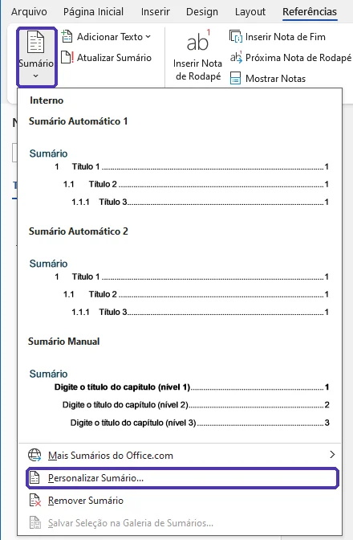
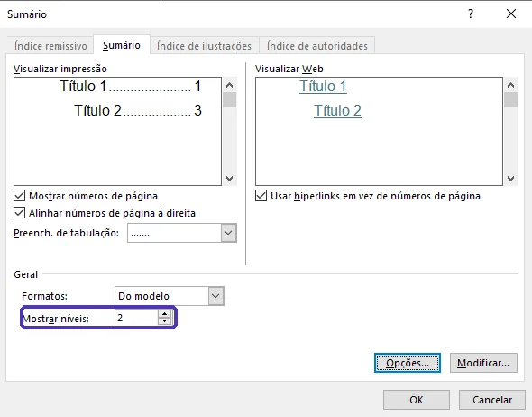
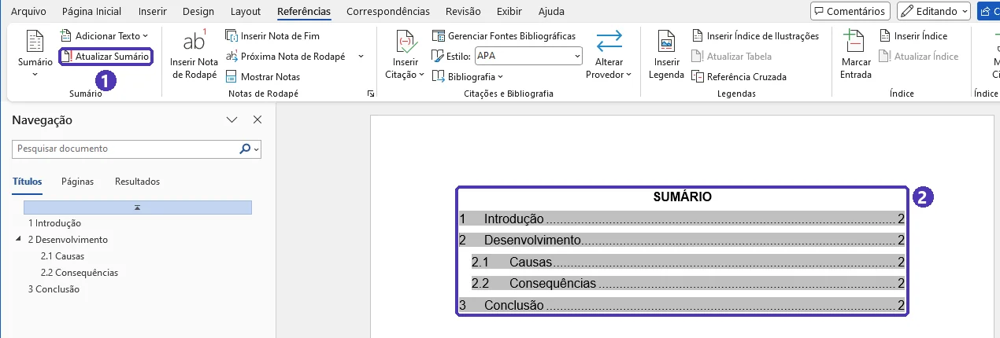
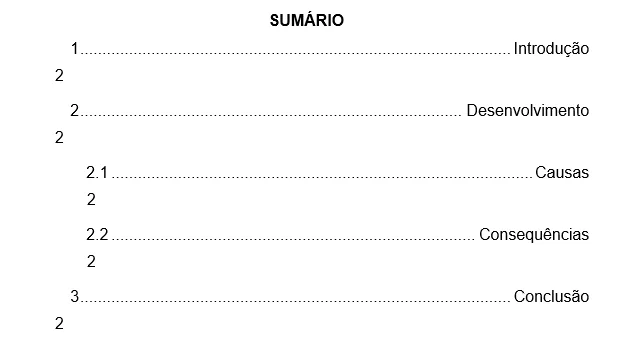
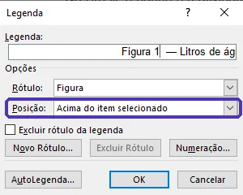
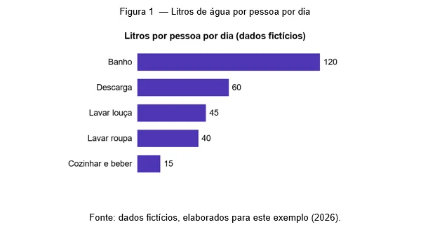
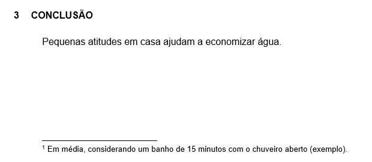

# 03 — Sumário, citações e referências (ABNT)

> **Curso:** Pacote Office  
> **Módulo:** 01 — Word  
> **Tempo estimado:** 2 h  

---

## Objetivos

Ao final desta aula, você será capaz de:

- Gerar um **sumário automático** e mantê-lo atualizado.
- Inserir **legendas** em figuras e tabelas no padrão ABNT e gerar a lista de ilustrações.
- Usar **notas de rodapé**.
- Escrever **citações** diretas e indiretas segundo a **NBR 10520:2023**.
- Montar a lista de **referências** segundo a **NBR 6023**.

## Pré-requisitos

- [Aula 02](02_estilos_secoes_e_paginas.md): títulos com os estilos *Título 1* e *Título 2*.

---

## Sumário automático

Com os títulos em *Título 1* e *Título 2*, o Word monta o sumário — com números de página — sozinho:

1. Na página do sumário, escreva **SUMÁRIO** (centralizado, negrito) e dê `Enter`.
2. *Referências ➔ Sumário* ➔ **Personalizar Sumário...** (o último bloco do menu). Em algumas versões do Word, o nome é *Sumário Personalizado*.
3. Na janela **Sumário**, deixe *Mostrar níveis*: **2** e clique em *OK*.

<figure markdown="span">
  { loading=lazy }
  <figcaption><em>Referências ➔ Sumário</em>: a opção <strong>Personalizar Sumário...</strong> fica no fim do menu.</figcaption>
</figure>

<figure markdown="span">
  { loading=lazy }
  <figcaption>Na janela <strong>Sumário</strong>, <em>Mostrar níveis</em>: <strong>2</strong> — a prévia passa a mostrar só Título 1 e Título 2.</figcaption>
</figure>

O sumário **não se atualiza sozinho**. Sempre que mudar o texto: *Referências* ➔ **Atualizar Sumário** (ou botão direito no sumário ➔ *Atualizar Campo*) ➔ **Atualizar o índice inteiro**. Faça isso por último, antes de exportar o PDF.

<figure markdown="span">
  { loading=lazy }
  <figcaption>(1) O botão <strong>Atualizar Sumário</strong> · (2) o sumário gerado a partir dos títulos, com pontilhado e páginas à direita.</figcaption>
</figure>

!!! tip "Por que “Personalizar” e não “Automático 1”?"
    O *Sumário Automático* insere um título “Sumário” formatado como *Título 1* — e aí o próprio sumário aparece dentro do sumário. Escrevendo o título à mão (em *Normal*) e usando o *Personalizar Sumário*, isso não acontece.

!!! warning "Sumário desalinhado, com o número da página na linha de baixo?"
    Se o estilo *Normal* tem texto **justificado** e **recuo de 1,25 cm** (como pede a aula 01), o sumário pode herdar isso e ficar assim:

    { loading=lazy }

    **Correção:** em *Página Inicial ➔ Estilos*, abra a lista completa (setinha no canto do grupo), clique com o botão direito em **Sumário 1** ➔ *Modificar* ➔ alinhamento **à esquerda** e, em *Formatar ➔ Parágrafo*, recuo especial **(nenhum)**. Faça o mesmo com **Sumário 2** e atualize o sumário.

---

## Legendas de figuras e tabelas

Na ABNT, a **identificação** vem **acima** da ilustração e a **fonte**, **abaixo**:

> **Figura 1** — Evolução do número de alunos  
> *(imagem)*  
> Fonte: elaborado pelo autor (2026).

No Word:

1. Clique na imagem (ou na tabela) ➔ *Referências* ➔ **Inserir Legenda**.
2. *Rótulo*: **Figura** ou **Tabela** (para “Quadro”, clique em **Novo Rótulo** e crie). *Posição*: **Acima do item selecionado**.
3. Depois do número, digite “ — ” e o título.
4. Abaixo da ilustração, escreva a linha **Fonte:** (fonte menor, ex.: 10).

<figure markdown="span">
  { loading=lazy }
  <figcaption>Na janela <strong>Legenda</strong>: rótulo <strong>Figura</strong> e posição <strong>Acima do item selecionado</strong>. Dá para digitar o “ — título” ali mesmo.</figcaption>
</figure>

<figure markdown="span">
  { loading=lazy }
  <figcaption>O resultado no padrão ABNT: identificação <strong>acima</strong>, fonte <strong>abaixo</strong> (os dados do gráfico são inventados).</figcaption>
</figure>

Com as legendas inseridas assim, *Referências* ➔ **Inserir Índice de Ilustrações** gera a lista de figuras automaticamente — igual ao sumário.

---

## Notas de rodapé

Clique onde a nota deve ser chamada ➔ *Referências* ➔ **Inserir Nota de Rodapé** (`Alt + Ctrl + F`). O Word numera e posiciona sozinho; se você apagar uma, as outras se renumeram. Use para explicações curtas que atrapalhariam o texto.

<figure markdown="span">
  { loading=lazy }
  <figcaption>No texto aparece o número pequeno (¹); no fim da mesma página, o traço e a nota.</figcaption>
</figure>

---

## Citações (NBR 10520:2023)

Toda ideia de outra pessoa precisa ser citada — senão é **plágio**. O sistema mais usado é o **autor-data**.

| Tipo | Quando | Como |
|---|---|---|
| **Direta curta** | Cópia literal de até 3 linhas | No texto, **entre aspas**, com página |
| **Direta longa** | Cópia literal de mais de 3 linhas | Parágrafo separado, **recuo de 4 cm**, fonte menor (10), espaço **simples**, **sem aspas** |
| **Indireta** | Você explica com suas palavras | Sem aspas; a página é opcional |

Exemplos:

- Direta curta, autor no fim: *“Estudar um pouco todo dia rende mais do que estudar muito de uma vez” (Silva, 2024, p. 15).*
- Direta curta, autor na frase: *Para Silva (2024, p. 15), “estudar um pouco todo dia rende mais”.*
- Indireta: *A prática distribuída ao longo da semana melhora a memória (Silva, 2024).*
- Dois ou três autores: *(Silva; Souza; Lima, 2025)*. Quatro ou mais: *(Silva et al., 2025)*.

!!! info "O que mudou em 2023"
    Na NBR 10520:2023, o sobrenome entre parênteses deixou de ser escrito em maiúsculas: agora é **(Silva, 2024)**, e não mais (SILVA, 2024). Siglas de instituições continuam em maiúsculas. Se o manual da sua escola ainda usa o formato antigo, siga o manual.

---

## Referências (NBR 6023)

A lista de **REFERÊNCIAS** fica no fim do trabalho e tem tudo o que foi citado:

- Em **ordem alfabética** pelo sobrenome.
- Alinhada **somente à esquerda** (não justifique), espaço **simples**, separadas por **uma linha em branco**.
- O **título da obra** (livro, revista ou site) em **negrito**.

| Tipo | Modelo |
|---|---|
| Livro | SOBRENOME, Nome. **Título**: subtítulo. Edição. Cidade: Editora, ano. |
| Artigo de revista | SOBRENOME, Nome. Título do artigo. **Nome da revista**, cidade, v. X, n. Y, p. inicial-final, ano. |
| Página da internet | SOBRENOME, Nome. Título da página. **Nome do site**, cidade, data. Disponível em: endereço. Acesso em: dia mês ano. |

Exemplos (obras fictícias):

> SILVA, Ana Paula. **Como estudar melhor**: técnicas para o ensino médio. 2. ed. São Paulo: Editora Exemplo, 2024.
>
> SOUZA, Carlos. Tecnologia na sala de aula. **Revista Exemplo de Educação**, Recife, v. 12, n. 3, p. 45-60, 2025.
>
> LIMA, Joana. Dicas para organizar a rotina de estudos. **Portal Exemplo**, [*s. l.*], 10 mar. 2025. Disponível em: https://www.exemplo.com.br/rotina. Acesso em: 15 out. 2026.

!!! warning "O Word não tem o estilo ABNT de fábrica"
    O botão *Referências ➔ Inserir Citação* usa estilos como APA e MLA, mas **não traz o ABNT**. Monte as referências à mão, como acima — ou use um gerenciador gratuito com estilo ABNT, como **Zotero** ou **Mendeley**. Qualquer que seja o caminho, **confira o resultado** linha por linha.

---

??? note "Equivalentes gratuitos: LibreOffice Writer e Google Docs"
    | Tarefa | LibreOffice Writer | Google Docs |
    |---|---|---|
    | Sumário | *Inserir ➔ Sumário e índice ➔ Sumário, índice ou bibliografia* | *Inserir ➔ Índice* |
    | Legenda | Botão direito na imagem ➔ *Inserir legenda* | Não tem legenda numerada — digite à mão |
    | Nota de rodapé | *Inserir ➔ Nota de rodapé e nota de fim* | *Inserir ➔ Nota de rodapé* (`Ctrl + Alt + F`) |

---

## ⚠️ Erros comuns

- **Entregar com o sumário desatualizado** (páginas trocadas). Atualize sempre por último.
- **Colar a citação sem aspas e sem autor.** Isso é plágio, mesmo que sem querer.
- **Referência citada que não está na lista** (ou o contrário). Cada citação do texto precisa estar nas referências.
- **Justificar as referências.** Elas ficam alinhadas só à esquerda.

---

## Exercícios

### Básico (fixação)

1. No documento da aula 02 (com Introdução, Desenvolvimento, subseções e Conclusão), gere um **sumário personalizado** com 2 níveis.
2. Acrescente uma subseção “2.3 Exemplos” e veja que o sumário **não** mudou.
3. Atualize o sumário.

<!-- gabarito -->
??? success "Gabarito — Básico"
    1. Na página do sumário, escreva **SUMÁRIO** em estilo *Normal* (centralizado, negrito) e dê `Enter`. *Referências ➔ Sumário ➔ Personalizar Sumário* ➔ *Mostrar níveis*: **2** ➔ *OK*. (Se os números das páginas caírem para a linha de baixo, ajuste os estilos *Sumário 1* e *Sumário 2* como no aviso da aula.)
    2. Crie o título “Exemplos” em *Título 2* depois de “Consequências”: a numeração vira **2.3**, mas o sumário continua igual.
    3. Clique no sumário ➔ *Atualizar Sumário* ➔ **Atualizar o índice inteiro**. A linha “2.3 EXEMPLOS” aparece com a página certa.

    **Confira:** clique com `Ctrl` pressionado numa linha do sumário — o Word pula até a seção.

### Intermediário (aplicação)

1. Insira uma imagem e uma tabela pequena (3 × 3) no desenvolvimento.
2. Dê a cada uma a legenda **acima** no padrão ABNT (*Figura 1 — ...* e *Tabela 1 — ...*) e a linha **Fonte:** abaixo.
3. Gere a **lista de ilustrações** depois do sumário.
4. Acrescente uma **nota de rodapé** explicando um termo do texto.

<!-- gabarito -->
??? success "Gabarito — Intermediário"
    1. *Inserir ➔ Imagens* e *Inserir ➔ Tabela* (3 × 3).
    2. Clique na imagem ➔ *Referências ➔ Inserir Legenda* ➔ Rótulo **Figura**, Posição **Acima do item selecionado** ➔ *OK* ➔ complete: “Figura 1 — Logotipo da escola”. Faça o mesmo na tabela com o rótulo **Tabela**. Abaixo de cada uma: “Fonte: elaborado pelo autor (2026).” em tamanho 10.
    3. Na página depois do sumário: escreva **LISTA DE ILUSTRAÇÕES**, `Enter`, *Referências ➔ Inserir Índice de Ilustrações* ➔ *Nome da legenda*: **Figura** ➔ *OK*. Repita com **Tabela** para a lista de tabelas.
    4. Clique depois do termo ➔ `Alt + Ctrl + F` ➔ escreva a explicação no rodapé.

### Avançado (desafio)

Com os dados abaixo (fictícios), escreva **três citações** no texto e a lista de **REFERÊNCIAS** completa:

- Livro: autora *Mariana Costa Ribeiro*, título *Leitura e escrita na escola*, subtítulo *guia prático*, 3ª edição, Belo Horizonte, Editora Exemplo, 2023. Trecho da página 42: “Quem lê com frequência escreve com mais clareza.”
- Artigo: autores *Pedro Alves* e *Luísa Martins*, “Celulares em sala de aula”, *Revista Exemplo de Ensino*, Natal, volume 8, número 2, páginas 10 a 25, 2024.
- Site: autor *Rafael Nunes*, página “Como fazer um resumo”, site *Portal Exemplo*, publicada em 5 de agosto de 2025, endereço https://www.exemplo.com.br/resumo, acessada hoje.

Faça uma citação **direta curta** do livro, uma **indireta** do artigo e uma **indireta** do site.

<!-- gabarito -->
??? success "Gabarito — Avançado"
    **No texto:**

    - Direta curta: *Segundo Ribeiro (2023, p. 42), “quem lê com frequência escreve com mais clareza”.* — ou: *“Quem lê com frequência escreve com mais clareza” (Ribeiro, 2023, p. 42).*
    - Indireta do artigo: *O uso do celular em sala pode ajudar ou atrapalhar, dependendo das regras combinadas com a turma (Alves; Martins, 2024).*
    - Indireta do site: *Um bom resumo começa pela leitura completa do texto (Nunes, 2025).*

    **REFERÊNCIAS** (ordem alfabética, alinhadas à esquerda, espaço simples, uma linha em branco entre elas):

    > ALVES, Pedro; MARTINS, Luísa. Celulares em sala de aula. **Revista Exemplo de Ensino**, Natal, v. 8, n. 2, p. 10-25, 2024.
    >
    > NUNES, Rafael. Como fazer um resumo. **Portal Exemplo**, [*s. l.*], 5 ago. 2025. Disponível em: https://www.exemplo.com.br/resumo. Acesso em: *(data de hoje, ex.: 24 out. 2026)*.
    >
    > RIBEIRO, Mariana Costa. **Leitura e escrita na escola**: guia prático. 3. ed. Belo Horizonte: Editora Exemplo, 2023.

    **Detalhes que costumam errar:** o sobrenome vem primeiro **em maiúsculas** na referência, mas com **só a inicial maiúscula** na citação entre parênteses; meses abreviados (*ago.*, *out.*); “3. ed.”, e não “3ª edição”; *[s. l.]* quando o site não informa a cidade.

---

## 💡 Resumo

- **Sumário** e **lista de ilustrações** saem dos estilos e das legendas — atualize antes de exportar.
- Legenda **acima**, **Fonte:** abaixo.
- Citação **direta curta**: aspas + página. **Longa**: recuo de 4 cm, fonte menor, espaço simples. **Indireta**: suas palavras + autor e ano.
- NBR 10520:2023: **(Silva, 2024)**, não mais (SILVA, 2024).
- **Referências**: ordem alfabética, alinhadas à esquerda, título da obra em negrito.

## ➡️ Próximo passo

**[04 — Mala direta](04_mala_direta.md)**: gere dezenas de certificados, convites ou etiquetas a partir de uma planilha — sem digitar nome por nome.
