# 04 — Mala direta: certificados e etiquetas em lote

> **Curso:** Pacote Office  
> **Módulo:** 01 — Word  
> **Tempo estimado:** 1 h 30 min  

---

## Objetivos

Ao final desta aula, você será capaz de:

- Explicar como a mala direta junta um **documento modelo** e uma **lista de dados**.
- Preparar a lista de dados no **Excel**.
- Gerar **certificados** e **etiquetas** em lote.
- Filtrar destinatários, usar **regras condicionais** e corrigir o formato de **datas e números**.

## Pré-requisitos

- [Aula 01](01_primeiros_passos_e_formatacao.md): formatação básica.
- Saber digitar dados numa planilha do Excel (o [Módulo 02 — Excel](../modulo_02_excel/index.md) aprofunda).

!!! warning "Precisa do Word instalado"
    A mala direta fica na aba **Correspondências**, que existe no Word **instalado** no computador. O Word na web (navegador) não tem essa aba. Se estiver no navegador, clique em **Editando ➔ Abrir no Aplicativo da Área de Trabalho**.

---

## Como funciona

A mala direta junta duas coisas:

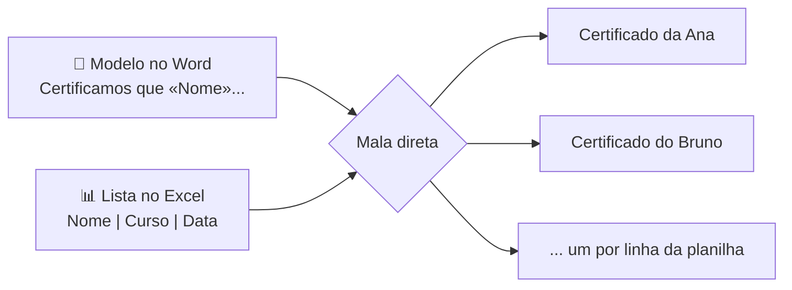

O modelo tem **campos** (como «Nome»). Para cada linha da planilha, o Word cria uma cópia do modelo com os dados daquela linha.

---

## 1) Preparar a lista no Excel

Regras para a planilha não dar problema:

- **Primeira linha = nomes das colunas**, curtos e sem espaços: `Nome`, `Curso`, `Carga`, `Data`.
- Uma pessoa por linha, **sem linhas em branco** no meio.
- Os dados começam na célula **A1**, na **primeira aba**.

Exemplo (salve como `participantes.xlsx`):

| Nome | Curso | Carga | Data |
|---|---|---|---|
| Ana Souza | Pacote Office | 40 | 24/10/2026 |
| Bruno Lima | Pacote Office | 40 | 24/10/2026 |
| Carla Dias | Introdução à IA | 20 | 24/10/2026 |

!!! tip "Feche o Excel antes de conectar"
    Se a planilha estiver aberta, o Word pode não conseguir lê-la. Salve e feche.

---

## 2) Montar o modelo e conectar

1. No Word, crie o modelo do certificado: *Layout ➔ Orientação ➔ Paisagem*, título “CERTIFICADO” e o texto com espaços para os dados.
2. *Correspondências ➔ Iniciar Mala Direta* ➔ **Cartas**.

<figure markdown="span">
  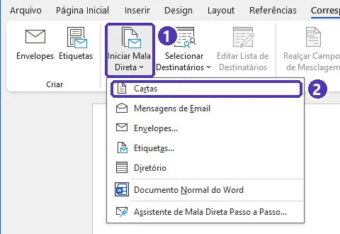{ loading=lazy }
  <figcaption>(1) <em>Iniciar Mala Direta</em> · (2) <strong>Cartas</strong>: serve para certificados, declarações e qualquer documento de uma página por pessoa.</figcaption>
</figure>

3. *Selecionar Destinatários* ➔ **Usar uma Lista Existente** ➔ escolha `participantes.xlsx` ➔ a aba (ex.: *Planilha1$*) ➔ deixe marcada a caixa **Primeira linha de dados contém cabeçalhos de coluna** ➔ *OK*.

<figure markdown="span">
  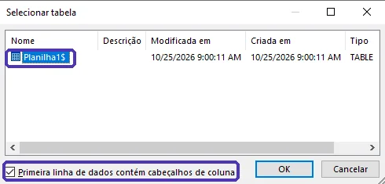{ loading=lazy }
  <figcaption>A aba da planilha aparece com um <strong>$</strong> no fim (<em>Planilha1$</em>). A caixa dos cabeçalhos faz o Word usar <em>Nome</em>, <em>Curso</em>... como nomes dos campos.</figcaption>
</figure>

4. Clique onde vai o nome ➔ *Inserir Campo de Mesclagem* ➔ **Nome**. Repita com **Curso**, **Carga** e **Data**.

O texto fica assim:

> Certificamos que **«Nome»** concluiu o curso **«Curso»**, com carga horária de «Carga» horas, em «Data».

<figure markdown="span">
  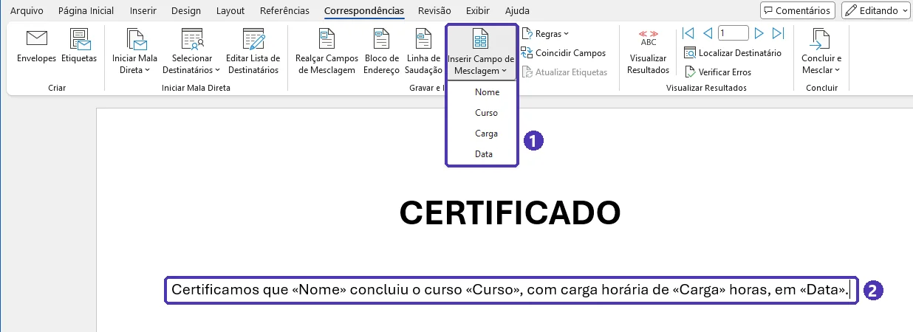{ loading=lazy }
  <figcaption>(1) O menu lista as colunas da planilha · (2) cada campo aparece entre « » no modelo.</figcaption>
</figure>

5. *Visualizar Resultados*: as setas mostram cada certificado com os dados reais.

<figure markdown="span">
  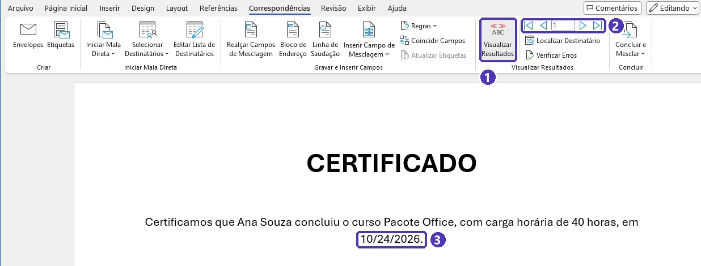{ loading=lazy }
  <figcaption>(1) <em>Visualizar Resultados</em> · (2) as setas passam de uma pessoa para outra · (3) repare na data: saiu <strong>10/24/2026</strong> (mês primeiro). A correção está em <a href="#filtros-regras-e-formatos">Filtros, regras e formatos</a>.</figcaption>
</figure>

---

## 3) Concluir

*Concluir e Mesclar*:

- **Editar Documentos Individuais** ➔ *Todos*: cria um documento novo com **todos** os certificados, um por página. Revise, salve e exporte em PDF.
- **Imprimir Documentos**: manda direto para a impressora.

<figure markdown="span">
  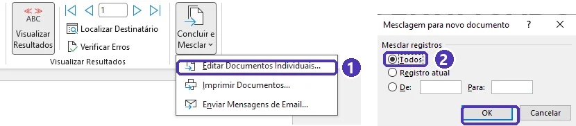{ loading=lazy }
  <figcaption>(1) <em>Editar Documentos Individuais...</em> · (2) na janela <strong>Mesclagem para novo documento</strong>, <strong>Todos</strong> ➔ <em>OK</em>.</figcaption>
</figure>

<figure markdown="span">
  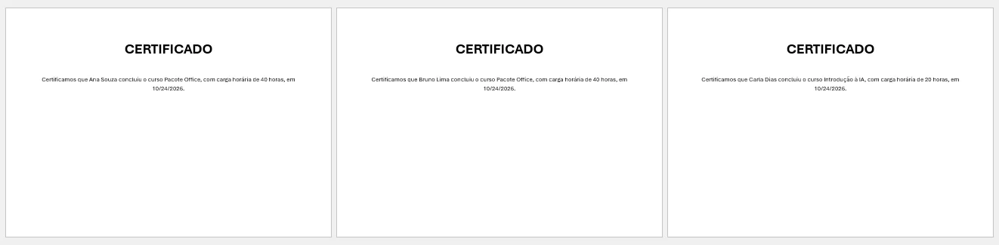{ loading=lazy }
  <figcaption>O resultado: uma página por linha da planilha (aqui, três pessoas).</figcaption>
</figure>

---

## Etiquetas

Mesmo processo, outro tipo: *Iniciar Mala Direta* ➔ **Etiquetas...** ➔ na janela **Opções de etiqueta**, escolha a marca em *Fornecedores de etiquetas* e o modelo em *Número do produto* (o código impresso na caixa da folha). Insira os campos na primeira etiqueta e clique em **Atualizar Etiquetas** para repetir nas demais.

<figure markdown="span">
  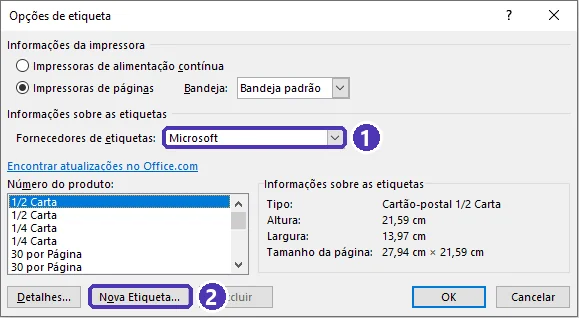{ loading=lazy }
  <figcaption>(1) <em>Fornecedores de etiquetas</em> · (2) <strong>Nova Etiqueta...</strong>, para quando a sua marca não está na lista.</figcaption>
</figure>

!!! tip "A marca da sua folha não está na lista?"
    Marcas comuns no Brasil, como a **Pimaco**, não aparecem na lista do Word (conferido no Microsoft 365 em outubro de 2026). Clique em **Nova Etiqueta...** e digite as medidas impressas na caixa (margens, altura, largura, etiquetas por linha e linhas por página), com *Tamanho da página* **A4**. Muitos fabricantes também oferecem modelos prontos para Word no site deles.

---

## Filtros, regras e formatos

- **Filtrar**: *Editar Lista de Destinatários* ➔ clique na seta de uma coluna (ex.: *Curso*) ➔ escolha um valor. Só esses entram na mesclagem.

    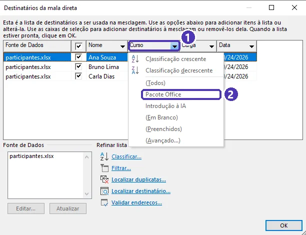{ loading=lazy }

- **Regras**: *Regras* ➔ **Se...Então...Senão...**. Ex.: se *Carga* for **Maior ou igual a** 40, escreva “com aproveitamento integral do curso”; senão, nada.

    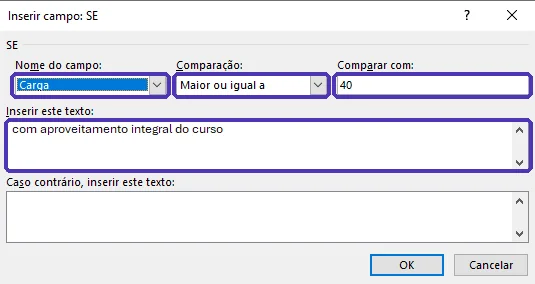{ loading=lazy }

- **Datas e números com formato errado** (ex.: a data aparece como `10/24/2026`): pressione `Alt + F9` para ver os códigos dos campos e acrescente o formato dentro das chaves:

    ```text
    { MERGEFIELD Data \@ "dd/MM/yyyy" }
    ```

    Depois `Alt + F9` de novo. Outra saída é deixar a coluna como **Texto** no Excel antes de conectar.

    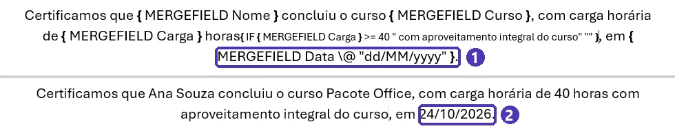{ loading=lazy }

---

??? note "Equivalentes gratuitos: LibreOffice Writer e Google Docs"
    | Tarefa | LibreOffice Writer | Google Docs |
    |---|---|---|
    | Mala direta | *Ferramentas ➔ Assistente de mala direta* (aceita `.xlsx`, `.ods` e `.csv`) | Não tem nativo — precisa de um complemento (*Extensões ➔ Complementos*) |
    | Etiquetas | *Arquivo ➔ Novo ➔ Etiquetas* | Complemento |

---

## ⚠️ Erros comuns

- **Linha em branco no meio da planilha**: a mesclagem para ali ou gera um certificado vazio.
- **Cabeçalho com espaços ou acentos estranhos** (`Nome do Aluno `): o campo fica difícil de achar. Prefira `Nome`.
- **Esquecer de visualizar** antes de concluir e imprimir 40 certificados com erro.
- **Editar o documento final em vez do modelo**: correções no modelo e mescle de novo.
- **Texto da regra com letra menor que o resto**: o texto do *Se...Então...Senão* pode entrar com a fonte padrão. Selecione o parágrafo inteiro no modelo e ajuste o tamanho da fonte.

---

## Exercícios

### Básico (fixação)

Crie a planilha `participantes.xlsx` da aula (com seus colegas no lugar dos nomes) e gere os **certificados** em paisagem com os campos *Nome*, *Curso*, *Carga* e *Data*. Visualize todos antes de concluir e exporte o resultado em PDF.

<!-- gabarito -->
??? success "Gabarito — Básico"
    1. No Excel: cabeçalhos em A1:D1 (`Nome`, `Curso`, `Carga`, `Data`), um participante por linha, sem linhas vazias. Salve e **feche**.
    2. No Word: *Layout ➔ Orientação ➔ Paisagem*. Escreva “CERTIFICADO” (centralizado, grande) e o texto da aula.
    3. *Correspondências ➔ Iniciar Mala Direta ➔ Cartas* ➔ *Selecionar Destinatários ➔ Usar uma Lista Existente* ➔ `participantes.xlsx` ➔ *Planilha1$* ➔ caixa dos cabeçalhos marcada.
    4. Insira os quatro campos com *Inserir Campo de Mesclagem*.
    5. *Visualizar Resultados* e passe pelas setas.
    6. *Concluir e Mesclar ➔ Editar Documentos Individuais ➔ Todos* ➔ no documento novo, *Arquivo ➔ Exportar ➔ Criar PDF*.

    **Confira:** o PDF tem uma página por linha da planilha.

### Intermediário (aplicação)

Com a mesma planilha:

1. Gere **etiquetas** com *Nome* e *Curso* para uma folha de etiquetas.
2. Gere certificados **só** de quem fez *Pacote Office*.

<!-- gabarito -->
??? success "Gabarito — Intermediário"
    1. Documento novo ➔ *Iniciar Mala Direta ➔ Etiquetas...* ➔ escolha o fornecedor e o número do produto da sua folha (se a marca não estiver na lista, use **Nova Etiqueta...** com as medidas da caixa) ➔ *Selecionar Destinatários ➔ Usar uma Lista Existente*. Na primeira etiqueta: **«Nome»** `Enter` «Curso». Clique em **Atualizar Etiquetas** ➔ *Visualizar* ➔ *Concluir e Mesclar*.
    2. No documento dos certificados: *Editar Lista de Destinatários* ➔ seta da coluna **Curso** ➔ **Pacote Office**. Visualize: os outros cursos sumiram. *Concluir e Mesclar*.

    **Para voltar a todos:** seta da coluna ➔ **(Todos)**.

### Avançado (desafio)

1. A data dos certificados está saindo como `10/24/2026`. Corrija para `24/10/2026` **sem mexer na planilha**.
2. Acrescente uma regra: se a carga horária for **40 ou mais**, o certificado ganha a frase “**com aproveitamento integral do curso**”; senão, nada.

<!-- gabarito -->
??? success "Gabarito — Avançado"
    1. `Alt + F9` mostra os códigos. O campo da data fica assim: `{ MERGEFIELD Data }`. Mude para:

        ```text
        { MERGEFIELD Data \@ "dd/MM/yyyy" }
        ```

        `Alt + F9` de novo ➔ *Visualizar Resultados*: aparece `24/10/2026`. (`MM` maiúsculo é mês; `mm` minúsculo seria minuto.)
    2. Posicione o cursor depois de «Carga» horas ➔ *Regras ➔ Se...Então...Senão* ➔ *Nome do campo*: **Carga**, *Comparação*: **Maior ou igual a**, *Comparar com*: **40**, *Inserir este texto*: “ com aproveitamento integral do curso”, *Caso contrário*: (vazio) ➔ *OK*.

    **Confira:** visualize uma pessoa com carga 40 (frase aparece) e uma com 20 (não aparece).

---

## 💡 Resumo

- Mala direta = **modelo** (com campos «...») + **lista** (planilha) ➔ um documento por linha.
- Planilha limpa: cabeçalhos na linha 1, sem linhas vazias, arquivo fechado.
- *Visualizar Resultados* **antes** de concluir.
- **Filtros** escolhem quem entra; **Regras** mudam o texto conforme os dados; `\@ "dd/MM/yyyy"` corrige datas.
- Só no Word **instalado**.

## ➡️ Próximo passo

**[05 — Projeto do módulo](05_projeto_trabalho_abnt.md)**: junte tudo num trabalho escolar completo no padrão ABNT.
