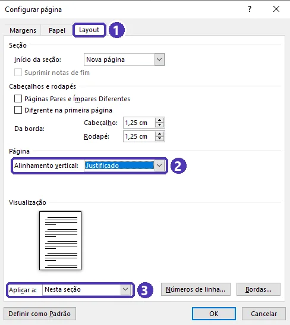
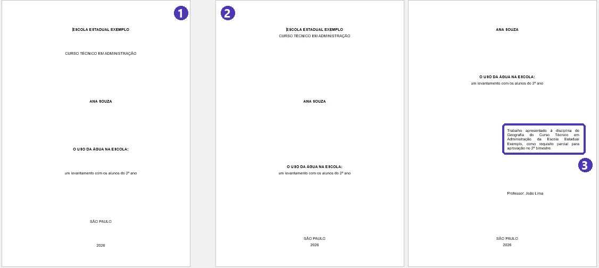
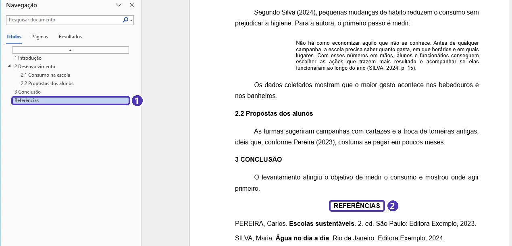
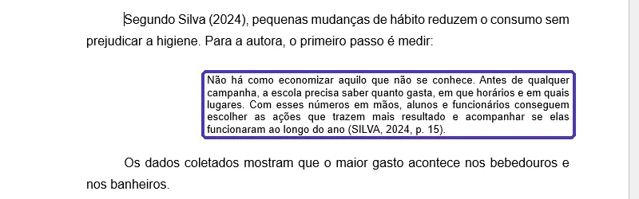
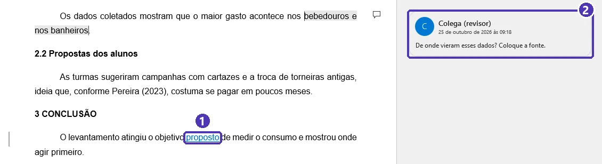
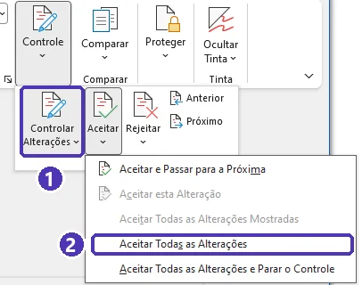

# 05 — Projeto do módulo: trabalho escolar no padrão ABNT

> **Curso:** Pacote Office  
> **Módulo:** 01 — Word  
> **Tempo estimado:** 2 h (mais o tempo de escrever o conteúdo)  

---

## Objetivos

Ao final deste projeto, você terá:

- Um trabalho escolar **completo** — capa, folha de rosto, sumário, introdução, desenvolvimento, conclusão e referências.
- Toda a formatação feita com **estilos**, **seções** e **campos automáticos** (nada “na mão”).
- Citações e referências no padrão **ABNT**.
- O trabalho revisado por um colega com **Controlar Alterações** e entregue em **PDF**.

## Pré-requisitos

- [Aulas 01 a 03](index.md) deste módulo. A [aula 04](04_mala_direta.md) não é necessária aqui.
- Um tema de trabalho — combine com o professor ou escolha um assunto de outra disciplina.

---

## A estrutura do trabalho

| Parte | Elemento | O que tem |
|---|---|---|
| **Pré-textual** | Capa | Instituição, seu nome, título, subtítulo (se houver), cidade e ano |
| | Folha de rosto | Seu nome, título, **natureza do trabalho** (“Trabalho apresentado à disciplina de ... do curso ...”), professor, cidade e ano |
| | Sumário | Gerado automaticamente |
| **Textual** | 1 Introdução | Tema, objetivo e como o trabalho está organizado |
| | 2 Desenvolvimento | Em subseções (2.1, 2.2...), com citações e pelo menos uma ilustração |
| | 3 Conclusão | O que você concluiu, retomando o objetivo |
| **Pós-textual** | Referências | Tudo o que foi citado, em ordem alfabética |

!!! info "Resumo, agradecimentos, lista de ilustrações..."
    TCCs e monografias têm mais elementos (resumo, abstract, listas). Para trabalhos de disciplina, a estrutura acima é a mais pedida. **Siga o que o professor ou o manual da escola definir.**

---

## Passo a passo

### 1. Prepare o documento (aula 01)

- A4, margens **3 cm** (superior e esquerda) e **2 cm** (inferior e direita).
- Estilo **Normal**: Arial ou Times 12, justificado, 1,5 linha, recuo 1,25 cm, 0 pt antes e depois.

### 2. Capa e folha de rosto

- Texto **centralizado**, sem recuo, em maiúsculas para instituição, nome e título.
- Na folha de rosto, a **natureza do trabalho** fica num parágrafo com **recuo à esquerda de 8 cm**, justificado e em espaço **simples** — o famoso “bloquinho à direita”.
- Separe capa, folha de rosto e sumário com *Layout* ➔ *Quebras* ➔ **Próxima Página**. Assim cada página vira uma **seção**, e o ajuste abaixo vale só nela.
- Cidade e ano na parte de baixo da página: em vez de apertar `Enter` até lá, use *Layout ➔ Configurar Página* (setinha no canto do grupo) ➔ guia **Layout** ➔ *Alinhamento vertical*: **Justificado**, com *Aplicar a*: **Nesta seção**. Faça na capa e na folha de rosto.

<figure markdown="span">
  { loading=lazy }
  <figcaption>(1) Guia <strong>Layout</strong> da janela · (2) <em>Alinhamento vertical</em>: <strong>Justificado</strong> · (3) <em>Aplicar a</em>: <strong>Nesta seção</strong> — por isso cada página precisa ser uma seção.</figcaption>
</figure>

!!! tip "O Justificado espalha todos os parágrafos por igual"
    Linhas que andam juntas — escola e curso, título e subtítulo, cidade e ano — precisam estar **no mesmo parágrafo**: termine a primeira com `Shift + Enter` (quebra de linha), não com `Enter`. E apague as linhas em branco: o Word já cuida do espaço.

    No bloco da natureza do trabalho, deixe o nome do professor num **parágrafo próprio**: num texto justificado, a linha antes de um `Shift + Enter` fica com as palavras esticadas.

<figure markdown="span">
  { loading=lazy }
  <figcaption>(1) Com <code>Enter</code> em todas as linhas, o curso se afasta da escola e o subtítulo, do título · (2) com <code>Shift + Enter</code>, cada grupo fica junto · (3) na folha de rosto, o bloco da natureza com recuo de 8 cm.</figcaption>
</figure>

### 3. Sumário e seções (aulas 02 e 03)

- Título **SUMÁRIO** (centralizado, negrito, estilo *Normal*) e *Personalizar Sumário* com 2 níveis.
- **Quebra de seção (Próxima Página)** no fim do sumário.

### 4. O texto

- Títulos com **Título 1** (1 INTRODUÇÃO, 2 ..., 3 CONCLUSÃO) e **Título 2** (2.1, 2.2), numerados pela **Lista de Vários Níveis**.
- **REFERÊNCIAS** é título sem número: aplique *Título 1* e, nesse parágrafo, desligue a numeração (botão *Numeração* da *Página Inicial*); centralize.

<figure markdown="span">
  { loading=lazy }
  <figcaption>(1) No <em>Painel de Navegação</em>, REFERÊNCIAS aparece como título, mas sem número · (2) no texto, centralizado. Autores, obras e dados são inventados para o exemplo.</figcaption>
</figure>

- Pelo menos **duas citações** (uma direta e uma indireta) e **uma figura ou tabela** com legenda e fonte.

<figure markdown="span">
  { loading=lazy }
  <figcaption>Citação direta longa: recuo de 4 cm, fonte 10, espaço simples, sem aspas e com (SOBRENOME, ano, p.) no fim. Antes dela, uma citação indireta: “Segundo Silva (2024)”.</figcaption>
</figure>

### 5. Numeração de páginas (aula 02)

- Na seção do texto: desligue **Vincular ao Anterior**, *Número Simples 3* no topo e **Iniciar em** = número de páginas da folha de rosto até a introdução.

### 6. Revisão por um colega

Troque o arquivo `.docx` com um colega:

- O colega liga *Revisão* ➔ **Controlar Alterações** e corrige o que achar errado — cada mudança fica marcada em cor.
- Para sugestões, *Revisão* ➔ **Novo Comentário**.
- De volta com você: *Revisão* ➔ **Aceitar** / **Rejeitar** cada alteração e responda ou resolva os comentários.

<figure markdown="span">
  { loading=lazy }
  <figcaption>(1) Palavra incluída pelo colega com <em>Controlar Alterações</em> ligado: aparece sublinhada e em cor · (2) o comentário, com o nome de quem escreveu.</figcaption>
</figure>

<figure markdown="span">
  { loading=lazy }
  <figcaption>Com a janela do Word mais estreita, os botões ficam dentro de <strong>Controle</strong>: (1) <em>Controlar Alterações</em> · (2) seta do <em>Aceitar</em> ➔ <strong>Aceitar Todas as Alterações</strong>.</figcaption>
</figure>

### 7. Finalização

1. *Revisão ➔ Ortografia e Gramática* (`F7`).
2. Atualize o **sumário** (índice inteiro).
3. Confira com o **¶** ligado: nenhum `Enter` em excesso, nenhum espaço no lugar de recuo.
4. *Arquivo* ➔ *Exportar* ➔ **Criar Documento PDF/XPS** e abra o PDF para conferir.

---

## ✅ Checklist de entrega

- [ ] Capa e folha de rosto **sem número de página** visível.
- [ ] Sumário automático, atualizado, com os números de página certos.
- [ ] Primeira página da introdução com o número correto, no **canto superior direito**.
- [ ] Todos os títulos com **Título 1/2** e numeração automática (exceto REFERÊNCIAS).
- [ ] Texto em 12, justificado, 1,5, recuo 1,25 cm; margens 3/3/2/2.
- [ ] Citações com autor e ano (e página, nas diretas); citação longa com recuo de 4 cm.
- [ ] Ilustração com legenda **acima** e **Fonte:** abaixo.
- [ ] Toda obra citada está nas REFERÊNCIAS, em ordem alfabética, alinhadas à esquerda.
- [ ] Nenhuma alteração controlada ou comentário pendente.
- [ ] Entregue em **PDF**.

---

## Exercícios

O projeto tem três entregas, uma por nível. Faça na ordem.

### Básico (fixação)

Monte o **esqueleto** do trabalho: capa, folha de rosto, sumário e as seções 1 a 3 e REFERÊNCIAS com um parágrafo provisório cada, já com os estilos certos e a página configurada.

<!-- gabarito -->
??? success "Gabarito — Básico"
    Confira o seu esqueleto contra esta lista:

    1. *Layout*: A4, margens 3/3/2/2. Estilo *Normal* ajustado (aula 01, exercício intermediário).
    2. Capa: centralizada, sem recuo, com instituição no topo e cidade/ano embaixo (*Alinhamento vertical: Justificado* e `Shift + Enter` entre as linhas que andam juntas). *Quebras ➔ Próxima Página*.
    3. Folha de rosto: nome e título centralizados; natureza do trabalho com **recuo à esquerda de 8 cm**, espaço simples; cidade/ano embaixo. *Quebras ➔ Próxima Página*.
    4. Página “SUMÁRIO” (estilo *Normal*, centralizado, negrito) + *Personalizar Sumário*. No fim: *Quebras ➔ Próxima Página*.
    5. “Introdução”, “Desenvolvimento” (com duas subseções), “Conclusão” em *Título 1/2* + *Lista de Vários Níveis*; “Referências” em *Título 1* sem numeração.

    **Teste rápido:** abra o *Painel de Navegação* — devem aparecer 1, 2 (2.1, 2.2), 3 e REFERÊNCIAS.

### Intermediário (aplicação)

Escreva o conteúdo (pelo menos duas páginas no desenvolvimento) e deixe a formatação final pronta: **numeração ABNT**, uma **figura ou tabela** com legenda e fonte, e o **sumário atualizado**.

<!-- gabarito -->
??? success "Gabarito — Intermediário"
    1. Numeração: cabeçalho da introdução ➔ desligar **Vincular ao Anterior** ➔ *Número Simples 3* ➔ *Formatar Números de Página ➔ Iniciar em* = páginas da folha de rosto até a introdução (no esqueleto do básico: **3**). Conferir que capa, folha de rosto e sumário estão sem número.
    2. Ilustração: *Referências ➔ Inserir Legenda* ➔ **Acima do item selecionado** ➔ “Figura 1 — ...”; abaixo, “Fonte: ...” em 10.
    3. Sumário: clique ➔ *Atualizar Sumário ➔ Atualizar o índice inteiro*.

    **Se o número da introdução estiver errado:** confira com o ¶ ligado se a quebra no fim do sumário é *Quebra de Seção (Próxima Página)* e não *Quebra de Página*.

### Avançado (desafio)

Complete com **citações** (pelo menos uma direta curta, uma direta longa e uma indireta) e as **REFERÊNCIAS** correspondentes; passe pela **revisão de um colega** com *Controlar Alterações* e entregue o **PDF** com todos os itens do checklist marcados.

<!-- gabarito -->
??? success "Gabarito — Avançado"
    - **Direta curta:** aspas + (Sobrenome, ano, p. X).
    - **Direta longa** (mais de 3 linhas): parágrafo próprio, **recuo à esquerda de 4 cm**, fonte **10**, espaço **simples**, **sem aspas**, com (Sobrenome, ano, p. X) no fim. Dica: crie um estilo “Citação longa” com essa formatação e reaproveite.
    - **Indireta:** suas palavras + (Sobrenome, ano).
    - **Referências:** uma para cada obra citada, no modelo da aula 03, ordem alfabética, alinhadas à esquerda, uma linha em branco entre elas.
    - **Revisão:** o colega trabalha com *Controlar Alterações* ligado; você aceita/rejeita tudo em *Revisão ➔ Aceitar ➔ Aceitar Todas as Alterações* (ou uma por uma) e exclui os comentários resolvidos. Confira em *Revisão ➔ Painel de Revisão* que não sobrou nada.
    - **PDF:** sumário atualizado por último ➔ *Exportar ➔ Criar PDF* ➔ abra e confira a numeração página por página.

    **Critérios que o professor costuma olhar:** estrutura completa; formatação por estilos (não manual); numeração correta; citações e referências batendo uma com a outra; texto revisado.

---

## 💡 Resumo do módulo

Você saiu do “documento em branco” para um trabalho que segue a norma, usando o Word como ferramenta — e não como máquina de escrever:

- **Estilos** em vez de formatação manual.
- **Seções** para controlar a numeração.
- **Campos automáticos**: sumário, legendas, notas e listas.
- **ABNT**: citações e referências que batem entre si.
- **Revisão** com controle de alterações e **entrega em PDF**.

## ➡️ Próximo passo

**[Módulo 02 — Excel](../modulo_02_excel/index.md)**: fórmulas, tabelas e gráficos — e a planilha que alimentou a sua mala direta.
